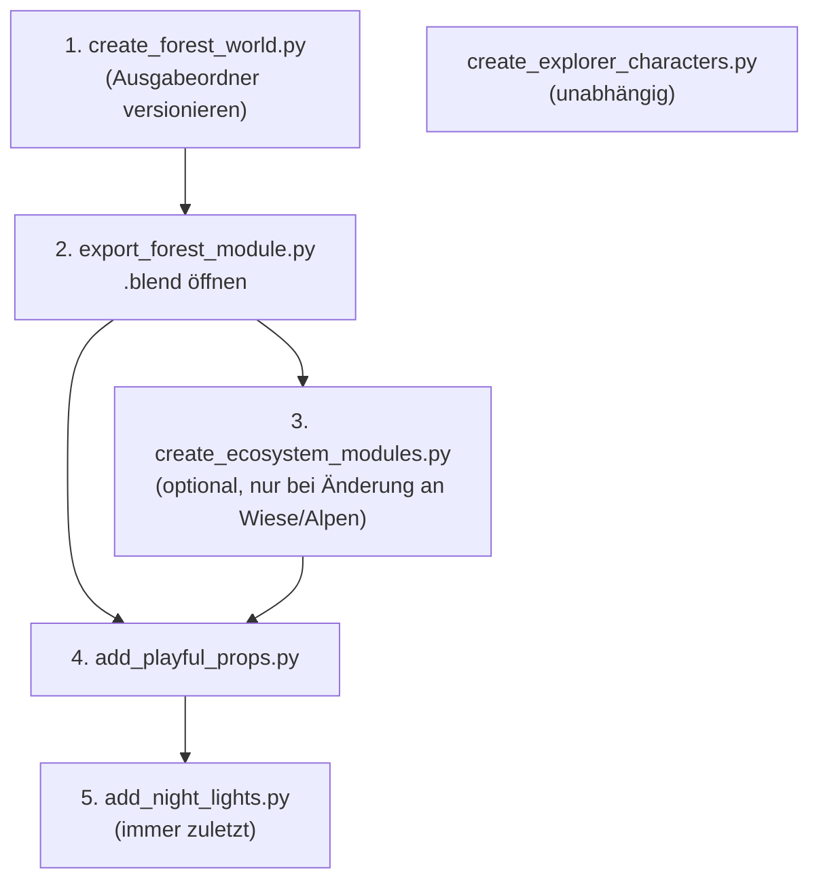

# Blender-Pipeline

Die Blender-Werkzeuge liegen in `tools/blender/` und erzeugen alle 3D-Daten, die die App mitbringt: die Waldszene, die
drei Ökosystem-Module mit ihren kleinen Szenen (Props), deren Abend- und Nachtlichter und die neun Entdecker:innen. Diese Seite sagt, was jedes
Skript tut, in welcher Reihenfolge sie laufen müssen und wie du ein neues Ökosystem-Modul anlegst.

!!! note "Geprüft am 05.10.2026"
    Alle fünf Skripte wurden mit Blender 5.2.2 LTS (`/usr/bin/blender`) auf **Kopien in einem Scratchpad-Verzeichnis**
    ausgeführt (bei zweien mit umgeschriebenem Ausgabepfad). Im Repo hat sich dabei nichts geändert. Ergebnisse stehen
    unten bei den jeweiligen Skripten. Eine Blender-Version ist im Repo nicht festgeschrieben.

## Überblick: sechs Skripte und eine Bibliothek

| Skript | Läuft mit | Liest | Schreibt | Überschreibt vorhandene Ausgabe? |
|---|---|---|---|---|
| `create_forest_world.py` | `blender -b -P …` (laut Docstring über Blender-MCP) | – | `artifacts/3d/forest-20260929-v1/plantini-forest.{blend,glb,png}` | **nein** – bricht ab, wenn die `.blend` existiert |
| `export_forest_module.py` | `blender -b <datei.blend> -P …` | die Szene `Plantini • Waldlichtung` | `apps/flutter/assets/worlds/forest_module.json` | **ja**, ohne Rückfrage |
| `create_ecosystem_modules.py` | `python3 …` (Blender optional) | `forest_module.json` | `meadow_module.json`, `alpine_module.json` | **ja**, baut beide von Grund auf neu |
| `add_playful_props.py` | `python3 …` | alle drei `*_module.json` | dieselben drei Dateien | **ja**, aber idempotent (Präfix `Prop `, feste Seeds) |
| `add_night_lights.py` | `python3 …` | alle drei `*_module.json` | dieselben drei Dateien | **ja**, aber idempotent |
| `create_explorer_characters.py` | `blender -b -P …` | – | `apps/flutter/assets/characters/explorers.json`, Vorschau in `artifacts/3d/explorers/` | **ja**, ohne Rückfrage |

Dazu kommt `world_kit.py`: die gemeinsame Bibliothek der Python-Skripte (Primitive, Sammler `Kit`, Freiflächen-Karte).
Sie wird importiert, nicht gestartet.

!!! warning "Stolperfalle: nur ein Skript schützt vor Überschreiben"
    Die Projektanweisungen (`CLAUDE.md` im Repo-Wurzelverzeichnis) sagen, die Blender-Generatoren in `tools/blender/`
    verweigerten das Überschreiben vorhandener Artefakte. Das Handover `knowledge/handovers/index-card-and-3d-world.md`
    sagt dasselbe, aber nur über `create_forest_world.py`. Im Code stimmt es **ausschließlich für dieses eine Skript**
    (`if (ROOT / 'plantini-forest.blend').exists(): raise RuntimeError(…)`). Die anderen vier
    schreiben ihre Ausgabe ohne Prüfung. Committe vorher oder arbeite in einem Branch, bevor du sie laufen lässt.

Zwei Skripte enthalten absolute Pfade des Entwicklerrechners (`create_forest_world.py` in `ROOT`,
`export_forest_module.py` im Zielpfad `out`). Die anderen drei leiten das Repo-Wurzelverzeichnis aus
`Path(__file__).resolve().parents[2]` ab. In den Beispielen unten steht `<repo>` für dein Checkout; passe die
beiden Pfade in den Skripten an, bevor du sie auf einem anderen Rechner laufen lässt.

## Reihenfolge



!!! warning "Stolperfalle: immer erst Props, dann `add_night_lights.py`"
    Der Docstring von `add_night_lights.py` nennt `create_ecosystem_modules.py` als Auslöser („rebuilds meadow and alpine
    from scratch and drops these additions“). Die Regel ist aber **breiter**: Auch `export_forest_module.py` schreibt
    `forest_module.json` neu und lässt Hütte, Laternen und `lights` weg. Geprüft am 05.10.2026: Der frische Export hat
    239 Meshes, das eingecheckte Waldmodul 264 – die Differenz sind genau die 25 Meshes mit Präfix `Hut ` und `Lantern `.
    Ohne `lights` bleiben Abend und Nacht in der App ohne Schein (und der Test `every ecosystem module carries its
    night lights` in `apps/flutter/test/features/catalog/world_lighting_test.dart` schlägt fehl).

Die Laternen und die Hütte halten Abstand zu den Props (`blockers()` kennt sie über das Feld `solid`) und das Skript
übernimmt die Lichter der Props (Feld `lamp`); die Props selbst reservieren den Platz der Hütte. Deshalb: **Props zuerst,
Nachtlichter zuletzt**.

Die Kette war am 05.10.2026 (vor den Props) reproduzierbar. Auf Kopien ausgeführt ergab sich damals:

- `create_forest_world.py` → `export_forest_module.py` ergibt dieselben 239 Meshes wie das eingecheckte
  `forest_module.json` (ohne Hütte und Laternen), `slots` identisch.
- `create_ecosystem_modules.py` → `add_night_lights.py` ergibt **byte-identische** Dateien zu den eingecheckten
  `forest_module.json`, `meadow_module.json`, `alpine_module.json` (`cmp` ohne Unterschied).
- `add_night_lights.py` zweimal hintereinander ändert nichts (idempotent).
- `create_explorer_characters.py` ergibt dieselben Vertices und Dreiecksanzahlen, aber bei 30 Meshes eine andere
  Reihenfolge der Dreiecksindizes (Triangulierung hängt von der Blender-Version ab). Die Datei ist also **nicht
  byte-reproduzierbar**; der Unterschied ist rein geometrisch folgenlos, erzeugt aber einen großen Diff.

## `create_forest_world.py` – die Waldszene

Baut in Blender eine **neue Szene** `Plantini • Waldlichtung` (die vorhandene Szene bleibt unberührt) mit einer kleinen
Spielzeuginsel: Helfer für Primitive (`ico`, `cube`, `cylinder`, `ribbon`, `key_loop`), einen gewundenen Bach (`stream_x(y)`), neun Bäume
mit wiederverwendeten Kronen, Brücke, Pfad, Blumen, Pilzen und einem Ranger. Ausgabe: `.blend`, `.glb` und ein
Cycles-Bild (32 Samples, 1600 × 1200). Die Zufallszahlen sind mit `random.seed(23)` fest.

```python title="tools/blender/create_forest_world.py"
ROOT = Path('<repo>/artifacts/3d/forest-20260929-v1')   # im Original ein absoluter Pfad
ROOT.mkdir(parents=True, exist_ok=True)
if (ROOT / 'plantini-forest.blend').exists():
    raise RuntimeError('Output already exists. Choose a new version directory.')
```

Wiederholen kannst du den Lauf nur, indem du das Verzeichnis im Skript hochzählst (`forest-20260929-v2`). Ein zweiter
Lauf im selben Ordner bricht mit genau dieser Meldung ab (am 05.10.2026 bestätigt).

```bash
blender -b -P tools/blender/create_forest_world.py     # ca. 14 s auf dem Testrechner
```

Der Docstring sagt, das Skript laufe in Blender über den lokalen MCP-Endpunkt `execute_code`. Das Handover nennt dafür
den Socket `127.0.0.1:9876`; diesen Port gibt es **im Code nicht**, er steht nur im Handover. Beim Testlauf war kein
Socket nötig: `blender -b -P …` funktioniert headless.

Animationen (Baumwiegen, Wasserglitzern) sind in der `.blend` als Keyframes (120 Frames, 24 fps) vorhanden. Die App
**benutzt sie nicht**: Sie liest nur Geometrie und `motion`-Marker und animiert selbst. Auch die `.glb` wird von der App
nirgends geladen.

## `export_forest_module.py` – von Blender zum JSON

Wandelt die Szene in das kompakte Format um (siehe [Überblick](index.md#dateiformat)). Aufruf mit geöffneter
Szene:

```bash
blender -b <repo>/artifacts/3d/forest-20260929-v1/plantini-forest.blend -P tools/blender/export_forest_module.py
```

Ohne `.blend` bricht das Skript mit `Open plantini-forest.blend before exporting` ab. Was passiert:

- Setzt Frame 1, liest jedes Mesh mit `calc_loop_triangles()`, wendet `matrix_world` an und rundet auf vier Nachkommastellen.
- `slots`: `[-2.4 + .55*sin(i*tau/5), -4 + i*1.6, .34]` für `i = 0..5` – hartkodiert im Skript.
- `earth`, `grass`, `station`, `station top`, `trail` und `connector` werden **im Skript mit der Hilfsfunktion `box()`
  erzeugt**, nicht aus Blender übernommen. Die entsprechenden Blender-Objekte (`Rounded earth`, `Moss island`,
  `Trail stepping`, `Level pedestal`, `Level inset`, `Backdrop`) stehen in der Liste `skip` und fehlen im Export.
- `motion`: `tree`, wenn der Elternknoten „sway“ im Namen hat (dann wird dessen Position als `pivot` exportiert);
  `water`, wenn der Name mit `Animated water` beginnt; `ranger`, wenn er mit `Ranger` beginnt; sonst `none`.
- Der Ranger wird um `(+2.95, +3.1)` verschoben, damit er um den Ursprung liegt – die App stellt ihn dann an
  `slot + (0.65, −0.2)`.
- Die Bachbänder werden an den Rändern korrigiert, damit der Bach bei `y = ±5` genau auf derselben x-Position endet
  und Module nahtlos aneinanderpassen:

```python title="tools/blender/export_forest_module.py"
if obj.name.startswith(('Sandy stream','Flowing woodland')):
    p.x -= .65*math.sin(p.y*.64)*(abs(p.y)/4.7)**8
    p.y *= 5/4.7
```

- Pfad-Anschlüsse: vier `connector`-Quader bei `x = -2.4`, `y = ±4.4` und `±4.8`.
- Schreibt `{"version": 1, "length": 10, …}` als kompaktes JSON (`separators=(',',':')`) und gibt Mesh- und Dreieckszahl aus.

!!! warning "Stolperfalle: das Skript ist ausschließlich für diese eine Szene gebaut"
    Die Namenslisten (`skip`, Präfixe für Ranger/Wasser/Bach) und die Platzierung des Rangers sind auf die Objektnamen von
    `create_forest_world.py` zugeschnitten. Nennst du in Blender ein Objekt um, ändert sich stillschweigend sein
    `motion` oder seine Zeichengruppe in der App.

## `create_ecosystem_modules.py` – Wiese und Alpen

Erzeugt Wiese und Alpen **rein in Python** aus Primitiven (`cone()`-Hilfsfunktion mit n-seitigen Kegelstümpfen und
`flower()`), mit `random.Random(2909)` für die Wiese und `random.Random(2910)` für die Alpen. Als Basis wird
`forest_module.json` gelesen: `earth`, `grass`, `station`, `station top`, `trail`, `connector` und alle Meshes mit
`motion == 'ranger'` werden übernommen (deshalb gleiche `slots` in allen drei Modulen), alles andere entsteht neu.

```python title="tools/blender/create_ecosystem_modules.py"
world = {k: copy.deepcopy(SOURCE[k]) for k in ('version', 'length', 'slots')}
world['meshes'] = [copy.deepcopy(m) for m in SOURCE['meshes']
                   if m['name'] in ('earth', 'grass', 'station', 'station top', 'trail', 'connector')
                   or m['motion'] == 'ranger']
```

```bash
python3 tools/blender/create_ecosystem_modules.py
# meadow 286 meshes 4077 triangles
# alpine 152 meshes 2278 triangles
```

(Ausgabe vom 06.10.2026, vor `add_playful_props.py` und `add_night_lights.py`.)

Läuft das Skript **in Blender** (`blender -b -P …`), gelingt `import bpy`, und `materialize()` legt zusätzlich je Modul
eine Szene `Plantini • Meadow Module` bzw. `Plantini • Alpine Module` im Arbeitsspeicher an. Das Skript speichert aber
keine `.blend`, der Zusatz hat also nur Wert, wenn du es interaktiv in Blender ausführst.

Wiese: ein Teich (`Sandy stream pond`, `Flowing woodland pond`), Schilf, Hügel, bis zu 44 Blumen und bis zu 35
Grasbüschel (Kandidaten auf dem Weg oder im Teich werden übersprungen). Alpen: ein Gipfel, ein Bach mit
`x = .5 + .30*sin((y+5)*tau/10)`, vier Kiefern, bis zu 32 Steine und Blumen; die übrigen Gipfel (ein Gebirgszug im
Hintergrund) stellt `add_playful_props.py` her. Die Alpenwiese ist seit dem 06.10.2026 grüner (`[.36, .56, .35]`).

## `add_playful_props.py` – die kleinen Szenen

Reines Python, **idempotent**: entfernt zuerst alle Meshes mit Präfix `Prop ` und baut sie aus festen Seeds neu auf
(`random.Random(3101 + 17 * variante)` für den Wald, 3102 für die Wiese, 3103 für die Alpen). Der Wald aus Blender
wird nie neu erzeugt, nur ergänzt.

```bash
python3 tools/blender/add_playful_props.py
# forest variant 0: 3xx prop meshes, 3702 triangles
# forest variant 1: …, 4182 triangles
# …
```

Jede Welt bekommt **zwei Varianten** mit verschiedenen Szenen. Die App zeichnet im Modul `m` die Variante `m % 2`.

| Welt | Variante 0 | Variante 1 | in beiden |
|---|---|---|---|
| Wald | Zeltlager mit Lagerfeuer (Licht!), Eichhörnchen auf dem Stumpf | Pilzhaus mit leuchtendem Fenster, Vogelhaus | Feenring mit leuchtenden Pilzen, Fliegenpilze, Stümpfe, Baumstämme, Farne, Beerensträucher, Blumenflecken, Wegweiser, Schmetterlinge, schwebende Blätter |
| Wiese | Windmühle (Flügel drehen sich), Bienenstöcke mit Bienen, Vogelscheuche, Zaun mit Heuballen und Schubkarre, Picknickdecke, Frosch | Brunnen, vier Gnome, Bienenstöcke, Vogelscheuche, Zaun | Seerosen, Enten, Sonnenblumen, Blumenflecken, Hase, Schmetterlinge |
| Alpen | Steinbock auf dem Felsen, Murmeltier, Adler | Kapelle mit Fenster, zwei Kühe, Adler | Gebirgszug, Felsblöcke mit Schnee, Steinmännchen, Wegweiser, Gebetsfahnen, Steg über den Bach, Edelweiß, Enzian, Alpenrosen, Schneeflecken, Bergsee |

Grundsätze des Skripts:

- **Freiflächen-Karte (`Kit`).** `world_kit.Kit` liest das Modul und merkt sich, was steht (Fußabdrücke von Stämmen, Felsen,
  Hütte …), wo Wasser ist (Dreiecke von `Flowing woodland*` und `Sandy stream*`) und wo der Weg verläuft. `Kit.spot(radius,
  region=…)` liefert einen freien Platz; Wasser, ein Streifen von etwa einer Einheit um den Weg und der Rand sind tabu.
- **Sichtbarer Streifen.** Auf einem Handy sind nur etwa `x = −3,7 … 3,7` zu sehen (Maßstab mindestens 52 px je Einheit,
  Bildbreite 390 px). Die Szenen stehen deshalb in der Mitte (`x = −1,3 … 3,7`) und hinter dem Weg, nicht am rechten Rand.
- **Dreieckebudget.** Die Props verdoppeln fast die Dreiecke der Alpen und erhöhen Wald und Wiese um etwa 60 bzw. 110 %
  (siehe Zählwerte im [Überblick](index.md#zahlwerte-aus-den-json-dateien-06102026)). Dass das nicht mehr kostet als vorher,
  liegt an der neuen Sortierung ([Performance](performance.md)). Halte trotzdem klein: eine Blume ist sieben Meshes, ein
  Fliegenpilz vier.
- **Animation:** `anim(kit, teile, 'hop' …)` gibt allen Teilen eines Tieres dieselben Parameter. Frequenzen sind ganze
  Zahlen je 6-Sekunden-Schleife (höchstens 3); `day: true` blendet das Mesh nachts aus.
- **Flache Dinge** (`layer: 'decal'` / `'decal2'`) liegen fast auf dem Boden (z = 0,08 + 0,012 …). Ohne Ebene würde der
  Painter-Algorithmus sie flackern lassen oder unter Blumen malen.
- **Schatten:** `shadow`-Kennungen fassen zusammengehörige Teile zu einem Schatten zusammen. Das Kit stellt jeder Kennung
  `v<variante>:` voran, damit sich die Varianten nicht treffen.

Ein neues Prop schreibst du als Funktion `def mein_prop(k, x, y): …`, die mit `k.add(name, form, '#farbe', …)` Meshes
anlegt (`form` ist ein Paar aus Vertices und Dreiecken aus `world_kit`: `frustum`, `dome`, `ball`, `box`, `beam`, `prism`,
`blade`, `disc`, `quad_up`). Dann rufst du sie in `forest()`, `meadow()` oder `alpine()` auf und lässt die drei Skripte
der Reihe nach laufen.

## `add_night_lights.py` – Hütten, Laternen, Glühwürmchen

Reines Python, **idempotent**: Es entfernt zuerst alle Meshes mit Präfix `Hut ` oder `Lantern ` sowie die Schlüssel
`lights` und `fireflies` und baut sie neu auf.

```bash
python3 tools/blender/add_night_lights.py
# forest: hut at (2.3, -4.4)
# forest: 25 meshes, 5 lights, 304 triangles
# meadow: 20 meshes, 5 lights, 250 triangles
# alpine: hut at (2.8, 3.6)
# alpine: 9 meshes, 1 lights, 104 triangles
```

Konfiguration ist das Dictionary `layout` in `main()`:

| Welt | Laternen | Hütte | Glühwürmchen |
|---|---|---|---|
| `forest` | ja | Kandidatenraster `x = 2.2…3.6`, `y = −4.2…−1.8`, Holzwände | – |
| `meadow` | ja | – | `{'count': 16, 'area': [-1.0, 3.7, -4.8, 4.8], 'z': [.3, 1.4]}` |
| `alpine` | nein | vier feste Kandidaten um `(3,0, −3,0)`, vor den Gipfeln, Steinwände mit Schneedach | – |

Die Alpenhütte steht an festen Plätzen vor dem Gebirge. Zuvor stand sie am ersten freien Platz des Rasters und lag am
05.10.2026 hinter einem Gipfel, sodass nur ihr Schein sichtbar war.

Wie Plätze gewählt werden:

- `blockers(module)` sammelt die x/y-Koordinaten aller Hindernisse (Stämme, Kronen, Berge, Brücke, Wasser, Blumenhügel …),
  die in Höhe 0,03…1,15 liegen. `free(points, x, y, radius)` prüft den Abstand zu diesen Punkten.
- Laternen: je Wegabschnitt zwischen zwei Stationen höchstens eine, seitlich versetzt um 0,62, ersatzweise 0,8,
  Mindestabstand 0,38. Im Wald fällt dadurch Abschnitt 1 aus (4 Laternen, `Lantern 1` fehlt), auf der Wiese gibt es 5.
- Hütte: die Kandidaten werden nach Nähe zur Bildmitte (`abs(x)`) sortiert; findet sich kein freier Platz
  (Radius `0.85 * HUT_SCALE`), bricht das Skript mit `SystemExit('<welt>: no free place for the hut')` ab.
- `solid()` richtet die Dreiecksumlaufrichtung jedes Körpers nach außen aus (Normale gegen den Schwerpunkt). Das ist
  nötig, weil die App keine Rückseitenerkennung hat, die Beleuchtung aber von der Normalen abhängt (siehe unten).
- `linear('#f1e3b0')` rechnet Hex-Farben mit `(c/255) ** 2.2` in lineare Werte um – dieselbe Konvention wie Blender.
- Meshes mit `motion: 'glow'` sind Fenster und Laternenglas. `lights` enthält `[x, y, z, radius]`; Meshes mit dem Feld
  `lamp` (Lagerfeuer, Mühlen- und Kapellenfenster, Pilzhaus) werden angehängt, mit der Variante als fünftem Eintrag.

## `create_explorer_characters.py` – die Entdecker:innen

Details auf der Seite [Charaktere](charaktere.md). Aufruf:

```bash
blender -b -P tools/blender/create_explorer_characters.py                 # mit Kontaktbogen artifacts/3d/explorers/explorers.png
blender -b -P tools/blender/create_explorer_characters.py -- --front      # Kontaktbogen von vorn: explorers-front.png
blender -b -P tools/blender/create_explorer_characters.py -- --no-render  # nur JSON, Lauf unter 1 s
```

Das Skript prüft `'--front' in sys.argv` und `'--no-render' not in sys.argv`; die Optionen müssen nach `--` stehen, damit
Blender sie nicht selbst auswertet. Der Kontaktbogen (Cycles, CPU, 24 Samples, 2400 × 560) braucht auf dem Testrechner
etwa 4 s. Der Kontaktbogen wird in `artifacts/3d/explorers/` geschrieben (relativ zum Repo-Wurzelverzeichnis).

## Ein neues Ökosystem-Modul anlegen

Als Beispiel ein viertes Modul `moor`. Es gibt keine Automatik; die Schritte betreffen Python, JSON und Dart.

### 1. Geometrie erzeugen

Am einfachsten erweiterst du `generate(kind)` in `create_ecosystem_modules.py` um einen dritten Zweig (die Hilfsfunktionen
`mesh()`, `cone()`, `flower()` sind lokale Funktionen darin) und trägst `'moor'` in die Schleife
`for kind in ('meadow', 'alpine')` am Dateiende ein. Beachte den Seed: `random.Random(2909 if kind == 'meadow' else 2910)`
müsste für `moor` angepasst werden, sonst benutzt es den Alpen-Seed.

Alternativ modellierst du in Blender und schreibst einen eigenen Export nach dem Muster von `export_forest_module.py`.
Das Zielformat ist in beiden Fällen das JSON aus dem [Überblick](index.md#dateiformat).

### 2. Maße und Anschlüsse einhalten

Das Gelände ist ein 11,5 × 10 großes Rechteck (`earth`/`grass`: x ±5,75, y ±5). Die App legt Module mit `m * 10` in y
aneinander. Damit Pfad und Wasser über die Modulgrenze weiterlaufen, muss an `y = ±5` alles auf gleicher x-Position
enden. Gemessen an den eingecheckten Dateien:

| Element | Wert an den Modulenden |
|---|---|
| Pfad (`connector`) | x −2,52…−2,28, y 4,25…4,55 und 4,65…4,95 (und gespiegelt), z 0,095…0,135 |
| Bach Wald (`Sandy stream banks`) | x −0,52 und 1,02 bei y = ±5 |
| Bach Alpen (`Sandy stream gravel`) | x −0,04 und 1,04 bei y = ±5 |
| Stationen (`slots`) | 6 Stück, Formel siehe oben, y von −4 bis 4, z 0,34 |

Der Bach im Wald und der in den Alpen laufen durch das Modul; die Wiese hat keinen durchgehenden Bach, sondern einen
Teich, der das Modul nicht verlässt. Ein Gewässer, das durchläuft, muss an beiden Rändern dieselben x-Werte haben (Alpen:
`sin((y+5)*tau/10)` ist bei y = −5 und y = +5 gleich 0).

Um die Anschlüsse eines eigenen Moduls zu prüfen, kannst du die Koordinaten messen:

```bash
python3 - <<'PY'
import json
d = json.load(open('apps/flutter/assets/worlds/forest_module.json'))
for m in d['meshes']:
    if m['name'] == 'connector':
        ys = [v[1] for v in m['vertices']]; xs = [v[0] for v in m['vertices']]
        print(m['name'], 'x', min(xs), max(xs), 'y', min(ys), max(ys))
PY
```

### 3. Stationen und Slots

Die App rechnet fest mit **sechs Stationen je Modul** (`levels[m * 6 + slot]`, `module.slots[currentIndex % 6]`). Übernimm
deshalb `SOURCE['slots']` und die Meshes `station`, `station top` und `trail` unverändert (so macht es
`create_ecosystem_modules.py`). Ein Mesh mit `slot = k` wird nur gezeichnet, wenn es für den Platz `k` ein Level gibt
(`m * 6 + k < levelCount`). Die Felder `length` und `version` im JSON liest die App nicht.

### 4. Bewegungsarten und Namen

| `motion` | Wofür | Beispiel im Skript |
|---|---|---|
| `tree` | Bäume und Kronen: wiegen, werfen Schatten | `Pine crown` |
| `plant` | Blumen, Gräser, Schilf: wiegen, werfen **keinen** Schatten | `Flower stem`, `Reed` |
| `water` | Glitzerpunkte: pendeln entlang y | `Animated water glint` |
| `ranger` | Spielfigur (wird durch die gewählte Entdecker:in ersetzt) | `Ranger …` aus dem Wald |
| `glow` | Fenster, Laternenglas | `Lantern 0 glass` |
| `none` | alles andere | `earth`, `Mountain granite` |

Namen mit den Präfixen `Sandy stream`, `Flowing woodland`, `Animated water`, sowie genau `earth` und `grass`, bestimmen die
Zeichenreihenfolge (siehe [Überblick](index.md#scenebuilderbuild)). Gewässer-Flächen müssen so heißen, sonst werden sie
von Blumen und Gras überdeckt.

### 5. Dart-Seite

1. `EcosystemWorld` in `apps/flutter/lib/features/catalog/presentation/widgets/modular_forest_view.dart`: neuer Eintrag
   `moor('moor', 'Moorpfad', Color(0x…))` (Dateiname-Stamm, Titel, Hintergrundfarbe). Der `switch` in `shortName` ist
   erschöpfend und zwingt dich zu einem Kurznamen.
2. `EcosystemWorld.forSlug`: eine Zeile für die Teilstrings des Ökosystem-Slugs ergänzen. Die Reihenfolge ist
   relevant, weil Alpen zuerst geprüft werden (`berg` gewinnt gegen `wald`).
3. Das Asset `assets/worlds/moor_module.json` liegt automatisch im Bundle, weil `pubspec.yaml` das ganze
   Verzeichnis `assets/worlds/` einträgt.
4. Das Ökosystem im Inhalt braucht einen passenden Slug (Seeds: `content/seeds/`; Demo-Slugs in
   `services/platform/src/api/platform/services/core/content/demo-journeys.js`).
5. `add_night_lights.py`: Eintrag in `layout`. Ohne Eintrag erhält das Modul keine Laternen, keine `lights` und kein
   Feld `fireflies`; die App läuft trotzdem (beide sind optional).
6. `apps/flutter/test/features/catalog/world_lighting_test.dart` iteriert über die fest eingetragene Liste
   `['forest', 'meadow', 'alpine']`; trage das neue Modul dort ein, sonst prüft kein Test seine Nachtlichter.

Prüfen:

```bash
cd <repo>/apps/flutter && flutter test test/features/catalog/world_lighting_test.dart
cd <repo>/apps/flutter && flutter run -d chrome -t lib/dev/forest_preview.dart
# im Browser: ...?world=moor&daytime=night&levels=31   (Query-Parameter werden über Uri.base gelesen)
```

`lib/dev/forest_preview.dart` ist eine Designvorschau, die nicht im Router hängt. Die Query-Parameter `world`,
`daytime` und `levels` funktionieren nur im Web, weil sie aus `Uri.base` kommen; ein Lauf der Vorschau wurde für diese
Seite nicht ausgeführt.

## Meshes budgetieren

Es gibt kein hartes Dreiecksbudget im Code, nur diese Grenzen:

| Grenze | Quelle |
|---|---|
| unter 2 000 Dreiecke je Entdecker:in | `apps/flutter/test/features/character/explorer_test.dart` |
| unter 2^20 Flächen je gezeichneter Szene | `_idxRange = 1048576` in `world_scene.dart` |
| Tiefe wird auf ±40 Einheiten begrenzt | `_depthRange = 40` |
| 6 Stationen und 10 Einheiten Länge je Modul | `modular_forest_view.dart` |

Die Praxis: Der Lernpfad zeichnet das aktuelle Modul **und beide Nachbarn**, also das Dreifache eines Moduls
(Wald ≈ 20 000 Dreiecke in einem `drawVertices`-Aufruf), und das für jede der 16 Animationsphasen einmal
(siehe [Performance](performance.md)). Wo die Dreiecke in den vorhandenen Modulen stecken:

| Modul | größte Posten (Dreiecke, Anteil) |
|---|---|
| Wald (6 816) | Baumkronen 2 160 (32 %), Blütenblätter 1 600 (23 %), Wasserglitzern 380 (6 %) |
| Wiese (6 267) | Blütenblätter 3 120 (50 %), Blütenmitten 912 (15 %), Blumenstiele 624 (10 %) |
| Alpen (2 434) | Blütenblätter 650 (27 %), Kiefernkronen 228 (9 %) |

Die Lehre: **Viele kleine Wiederholungen** sind teuer. Auf der Wiese sind 240 Blütenblätter mit je 13 Dreiecken die Hälfte
der Geometrie. Ein Quader kostet 12 Dreiecke, eine Ikosphäre der Unterteilung 2 hat 80.

## Koplanare Flächen und Painter-Sortierung

`SceneBuilder` sortiert Dreiecke nach der Tiefe ihres Mittelpunkts und malt von fern nach nah; es gibt keinen Z-Puffer
und keine Rückseitenerkennung. Daraus folgen zwei Regeln für Modelle:

1. **Keine deckungsgleichen Flächen.** Liegen zwei Flächen in derselben Ebene, haben sie dieselbe Tiefe, und der
    Sortierschlüssel entscheidet nach Einfügereihenfolge, was oben liegt. Beim Drehen oder durch Rundung wechselt
    das – die Fläche flackert. Belegt im Code: `vest()` in `create_explorer_characters.py`:

    ```python title="tools/blender/create_explorer_characters.py"
    # Stand clear of the vest front (y = -.1295): coplanar faces flicker
    # in the app's painter-sorted renderer.
    pk.box((sx * .09, -.15, .56), (.12, .03, .09))
    ```

    Auch `add_night_lights.py` setzt Tür, Türrahmen, Fenster und Fensterrahmen auf leicht verschiedene
    `offset`-Werte (`-.41`, `-.405`, …).
2. **Dreiecke müssen nach außen zeigen.** Ohne Rückseitenerkennung bewirkt eine falsche Umlaufrichtung nicht ein
    unsichtbares Dreieck, sondern eine falsch berechnete Normale und damit eine falsche Helligkeit (die Fläche wird von
    der verkehrten Seite „beleuchtet“). `solid()` in `add_night_lights.py` dreht die Dreiecke deshalb passend zum
    Schwerpunkt um.

Große Flächen (Boden, Wasser, Schatten) werden nicht über die Tiefe eingeordnet, sondern über die Zeichengruppen, siehe
[Überblick](index.md#scenebuilderbuild).

## Weiterführend

- [3D & Blender – Überblick](index.md) · [Tageszeit und Licht](tageszeit-licht.md) · [Charaktere](charaktere.md) ·
  [Performance](performance.md)
- Quellpfade: `tools/blender/`, `apps/flutter/assets/worlds/`, `apps/flutter/assets/characters/explorers.json`,
  `apps/flutter/lib/features/catalog/presentation/widgets/modular_forest_view.dart`,
  `knowledge/handovers/index-card-and-3d-world.md` (Hintergrund)
