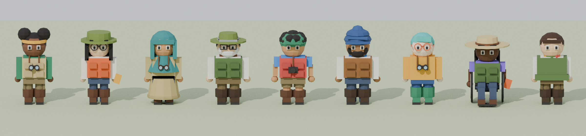
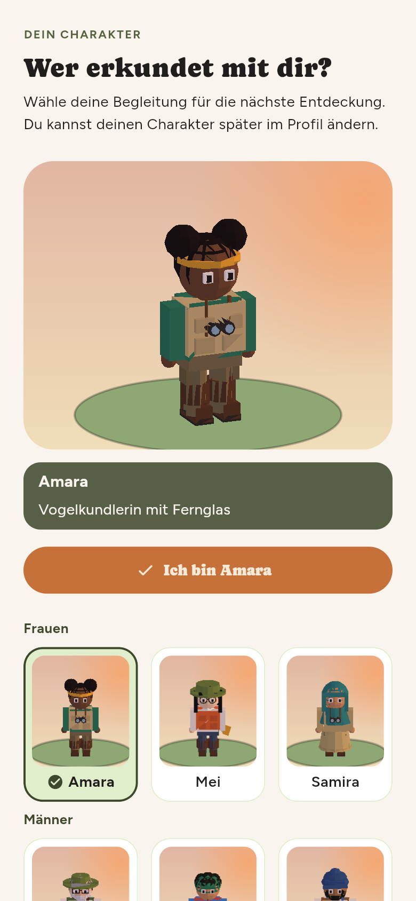
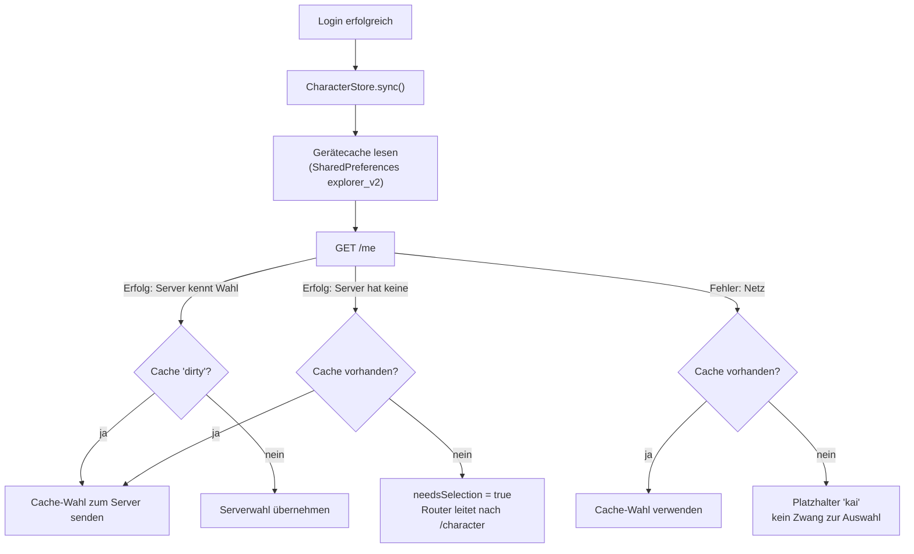

# Charaktere: die neun Entdecker:innen

Lernende wählen bei der ersten Anmeldung eine von **neun festen Entdecker:innen**. Die Figur steht danach auf dem
Lernpfad an der aktuellen Station und in den Vitrinen. Es gibt keinen Charakter-Editor: Ein früherer Designer mit frei
kombinierbaren Teilen wurde durch dieses feste Set ersetzt (Commit `854c2bf`, `DESIGN-13`).

{ loading=lazy }

*Die Entdecker:innen von Plantini (Bild zu `create_explorer_characters.py`).*

## Das Datenformat

Alle neun Figuren liegen in einer Datei, `apps/flutter/assets/characters/explorers.json` (282 119 Byte):

```json title="apps/flutter/assets/characters/explorers.json (Struktur, gekürzt)"
{
  "version": 2,
  "characters": [
    {
      "id": "amara",
      "name": "Amara",
      "group": "female",
      "blurb": "Vogelkundlerin mit Fernglas",
      "meshes": [
        { "name": "head", "color": [0.1573, 0.0582, 0.0254],
          "vertices": [[0.0, 0.0, 1.125], [0.0, 0.117, 1.074], …],
          "faces": [[…], …] },
        …
      ]
    }
  ]
}
```

| Feld | Bedeutung |
|---|---|
| `id` | stabile Kennung, steht auch in der API (`amara`, `mei`, `samira`, `heinrich`, `mateo`, `arjun`, `robin`, `nia`, `kai`) |
| `name`, `blurb` | Anzeigename und eine Zeile Beschreibung (auch Screenreader-Text) |
| `group` | `female`, `male` oder `diverse`; muss ein Wert von `ExplorerGroup` sein (`ExplorerGroup.values.byName`) |
| `meshes` | Teile mit `name`, `color` (linear), `vertices`, `faces`; **kein** `motion`, `pivot`, `slot` |

Der Blender-Export schreibt weder die Breite (`width`) noch den Absenkwert (`dz`) in die Datei – beides ist beim Export
in die Vertices eingerechnet.

| Figur | Gruppe | Kurzbeschreibung (`blurb`) | Meshes | Dreiecke |
|---|---|---|---:|---:|
| Amara | `female` | Vogelkundlerin mit Fernglas | 16 | 1 288 |
| Mei | `female` | Botanikerin mit Notizbuch | 17 | 1 248 |
| Samira | `female` | Geologin mit Rucksack | 16 | 1 136 |
| Heinrich | `male` | Förster im Ruhestand | 19 | 1 392 |
| Mateo | `male` | Insektenforscher mit Kamera | 17 | 1 712 |
| Arjun | `male` | Ökologe im Gelände | 16 | 1 276 |
| Robin | `diverse` | Pilzsucher*in im Regenmantel | 15 | 1 288 |
| Nia | `diverse` | Feldforscher*in mit Rollstuhl | 22 | 1 816 |
| Kai | `diverse` | Wanderer*in mit Bandana | 16 | 1 056 |

Dreiecke und Meshes stammen aus der Datei (05.10.2026). Eine Figur ist etwa 1,0 bis 1,2 Einheiten hoch (`z` von 0,095 bis höchstens 1,265 bei
Arjuns Turban) und steht, wie der Docstring des Skripts sagt, mit den Füßen auf `z = 0.10` und blickt Richtung −y – zur Kamera.

## Im Code: `ExplorerRoster` und `PlayerLook`

Datei: `apps/flutter/lib/features/character/presentation/widgets/explorer_roster.dart`.

`ExplorerRoster.load()` liest die Datei einmal (`rootBundle.loadString`) und hält das Ergebnis in `ExplorerRoster.loaded`.
`ExplorerRoster.parse` baut je Figur ein `Explorer` (`domain/explorer.dart`) und wandelt jedes Teil in ein `WorldMesh`:

```dart title="apps/flutter/lib/features/character/presentation/widgets/explorer_roster.dart"
WorldMesh({
  'name': 'Explorer ${(m as Map)['name']}',
  'vertices': m['vertices'],
  'faces': m['faces'],
  'color': m['color'],
  'motion': 'ranger',
  'slot': null,
}),
```

- **Alle Teile bekommen `motion: 'ranger'`.** Damit stellt jede 3D-Ansicht sie dorthin, wo sonst der Standard-Ranger steht.
- Der Name erhält das Präfix `Explorer `, das `version`-Feld der Datei wird nicht gelesen.

`PlayerLook` ist das globale Bindeglied:

| Mitglied | Aufgabe |
|---|---|
| `PlayerLook.id` | `ValueNotifier<String?>` mit der gewählten ID; alle 3D-Ansichten hören darauf |
| `PlayerLook.explorer` | die Figur zur ID (aus `ExplorerRoster.loaded`) |
| `PlayerLook.meshesFor(module)` | die Meshes des Moduls **ohne** den Ranger, plus die Meshes der Figur |
| `PlayerLook.cacheKey` | `id.value ?? '-'` – Teil jedes Bild-Cache-Schlüssels |
| `PlayerLook.shadow(lighting)` | ein einzelnes Schattenpolygon der Figur, je Phase und ID gecacht |

### Platzierung

- **Lernpfad** (`_ForestPainter._record` in `modular_forest_view.dart`): Die Figur steht in dem Modul, das das aktuelle
  Level enthält (erstes freigeschaltetes, nicht abgeschlossenes Level; `currentIndex ~/ 6 == m`), an
  `slots[currentIndex % 6] + (0.65, −0.2)`. Ist kein Level offen (`currentIndex < 0`), erscheint keine Figur.
- **Vitrine** (`_drawModel` in `ecosystem_vitrine.dart`): immer an `slots.first + (0.65, −0.2)`.
- **Profil** (`router.dart`): `ExplorerPortrait` in einer 96 × 120 großen Karte; solange keine Figur geladen ist, steht dort
  das Bild `assets/worlds/explorer.png` (`WorldArt.explorer`).
- **Schatten:** Im Pfad wirft die Figur einen Schatten als **ein** Polygon aller Teile (`PlayerLook.shadow`), in der Vitrine
  keinen. Details unter [Tageszeit und Licht](tageszeit-licht.md#schatten).

## Auswahlbildschirm und Porträts

`CharacterSelectorScreen` (`presentation/character_selector_screen.dart`) erscheint nach der ersten Anmeldung und über
„Charakter wechseln“ im Profil. Die Route `/character` hängt in `apps/flutter/lib/app/router.dart`; `?from=profile` bestimmt,
ob „Ich bin …“ nach `/profile` oder `/home` führt.

- Layout: ab 900 px Breite und Textskalierung ≤ 1,3 zwei Spalten (Vorschau : Raster = 4 : 6, Raster dreispaltig);
  sonst Vorschau oben, darunter das Raster mit `floor(Breite / (110 * Textskalierung)).clamp(1, 3)` Spalten.
- Das Raster gruppiert nach `ExplorerGroup.values`, die Gruppenüberschriften kommen aus `ExplorerGroup.label`
  („Frauen“, „Männer“, „Divers“).
- `ExplorerStage` (`widgets/explorer_views.dart`) zeigt die Figur groß auf einer kleinen Bühne: Ziehen dreht (`dx * 0.012`
  rad), außerdem wiegt sie sich zunächst selbst (`AnimationController` 5 s, `repeat(reverse: true, count: 4)`, Ausschlag
  `±0.45` rad). Bei `disableAnimations`, ohne Ticker oder `interactive: false` steht sie still.
- `ExplorerPortrait` ist ein ruhendes Porträt, das **einmal pro (Figur, Tageszeit, Größe, Pixeldichte) in eine Textur
  gebacken** wird (`toImageSync`, höchstens 30 Texturen). Neun Karten im Raster kosten damit neun Bildzeichnungen statt
  neun 1 000-Dreiecke-Szenen je Frame.

Die Porträts benutzen eine frontalere Projektion als der Lernpfad:

```dart title="apps/flutter/lib/features/character/presentation/widgets/explorer_views.dart"
// Frontal-ish view for portraits: less squash than the level path.
const _squash = .30, _lift = .96;
```

{ loading=lazy }

*Der Auswahlbildschirm für den Charakter in der App.*

## Speicherung: App, Gerät, Server



Die Bausteine:

| Teil | Datei | Aufgabe |
|---|---|---|
| `CharacterStore` | `apps/flutter/lib/features/character/application/character_store.dart` | Zustandsautomat (`idle`, `loading`, `ready`), Gerätecache, Offline-Wahl |
| `HttpCharacterRepository` | `apps/flutter/lib/features/character/infrastructure/http_character_repository.dart` | `GET`/`PATCH` auf `me` |
| `character-schema.js` | `services/platform/src/api/platform/services/core/profile/character-schema.js` | serverseitige Whitelist |
| `profile-service.js` | `services/platform/src/api/platform/services/core/profile/profile-service.js` | `validateProfilePatch`, `mapProfile` |

Details, die sich aus dem Code ergeben:

- **Gerätecache:** Schlüssel `explorer_v2`, Wert `{"id":"nia","dirty":true}`. `dirty` heißt „noch nicht an den Server
  gesendet“. Eine offline getroffene Wahl gewinnt beim nächsten `sync()` gegen die Serverwahl.
- **Router-Wächter:** Solange `character.status != ready`, hält der Router auf `/boot`; bei `needsSelection` auf `/character`.
  Ein Fehler beim Laden darf nie dort hängen lassen: Der `catch` in `_sync()` setzt notfalls `kai` und `finally` immer
  `ready` (Test `a failing load still ends ready`).
- **Logout:** `reset()` setzt alles zurück und löscht den Cache.
- **Unbekannte IDs zählen als „keine“:** `roster.byId(value)?.id` ist `null`, wenn der Server eine ID liefert, die diese App
  nicht kennt – die App zeigt dann die Auswahl.

### API

Die Figur ist Teil des Profils (`/me`). Der Vertrag in `contracts/api.yaml`:

```yaml title="contracts/api.yaml"
Character:
  type: object
  description: The player's chosen explorer, one of nine fixed characters shipped with the app. Visible to the owner only.
  additionalProperties: false
  required: [v, id]
  properties:
    v: {type: integer, enum: [2]}
    id: {type: string, enum: [amara, mei, samira, heinrich, mateo, arjun, robin, nia, kai]}
```

```http
PATCH /me
Content-Type: application/json

{"character": {"v": 2, "id": "nia"}}
```

Der Server (`validateCharacter`) akzeptiert nur ein Objekt mit genau den Schlüsseln `v` und `id`, `v` muss `2` sein, `id` muss
in `EXPLORERS` stehen. Alles andere liefert HTTP 400 mit Feldfehlern, zum Beispiel
`character.id: "Erlaubt: amara, mei, samira, heinrich, mateo, arjun, robin, nia, kai."` oder
`character.v: "Unterstützt wird nur Version 2."`. Gespeichert wird nur `{v, id}` im JSON-Feld `character` der
Strapi-Profiltabelle (`services/platform/src/api/profile/content-types/profile/schema.json`). `currentCharacter()` liefert
ältere Datensätze (`v: 1` vom früheren Designer) nicht mehr aus; die App behandelt das als „noch keine Wahl“.

Der Test `services/platform/test/character-schema.test.js` prüft zusätzlich, dass die Liste `EXPLORERS` exakt die IDs aus
`explorers.json` enthält (er wird übersprungen, wenn die App nicht ausgecheckt ist).

## Der Blender-Bauplan

`tools/blender/create_explorer_characters.py` baut alle Figuren aus Primitiven. Bausteine:

- `class Part`: ein Beutel aus Primitiven **in einer Farbe**, wird zu einem Mesh verschmolzen. Methoden `box`, `sphere`, `cyl`.
  Optionen: `shade` (Helligkeitsfaktor), `head=True` (behält seine Breite, wenn der Körper verbreitert wird), `upper=False`
  (bewegt sich beim Sitzen nicht nach unten).
- Bausteine als Funktionen: `head`, `hands`, `shirt`, `vest`, `long_coat`, `poncho`, `raincoat`, `trousers`, `shorts`, `boots`,
  Frisuren (`short_hair`, `afro_puffs`, `bob`, `locs`, `curly_hair`, `ponytail`, `undercut`, `hijab`, `turban`), Kopfbedeckungen
  (`safari_hat`, `bucket_hat`, `ranger_hat`, `cap`, `bandana`), `beard`, Brillen, `binoculars`, `notebook`, `camera`,
  `rucksack`, `wheelchair`, `seated_legs`.
- `build_all()` stellt die neun Figuren aus diesen Bausteinen zusammen; `add(id, name, group, blurb, width, parts, dz=0.0)`
  registriert eine.
- Farben als Hex (`'#6e4630'`); `linear()` wandelt in lineare Werte um (`(c/255) ** 2.2 * shade`). So kommt die Haut- und
  Kleiderfarbe in `color`.
- Der Export triangulierte (`bmesh.ops.triangulate`) und multipliziert die x-Koordinaten aller Teile ohne `head=True` mit
  `width` (Statur: 0,92 bei Mei bis 1,10 bei Arjun).

Aufruf siehe [Blender-Pipeline](blender-pipeline.md#create_explorer_characterspy-die-entdeckerinnen). Der Kontaktbogen
(`artifacts/3d/explorers/explorers.png`) ist zugleich der schnellste Weg, ein neues Modell anzusehen.

## Einen zehnten Charakter hinzufügen

Betroffen sind laut `grep` im Repo genau diese Stellen (`heinrich` kommt nur dort vor): `tools/blender/create_explorer_characters.py`,
`apps/flutter/assets/characters/explorers.json`, `services/platform/src/api/platform/services/core/profile/character-schema.js`,
`contracts/api.yaml` und der daraus erzeugte Client `packages/api/lib/src/model/character.dart` (plus `character.g.dart`).

1. **Modell definieren.** In `build_all()` eine weitere Zeile ergänzen. Der folgende Entwurf ist **erfunden** (nicht im Repo),
    benutzt aber ausschließlich vorhandene Bausteine; er wurde am 05.10.2026 auf einer Kopie des Skripts ausgeführt und ergab
    820 Dreiecke (Datei danach 300 810 Byte):

    ```python title="tools/blender/create_explorer_characters.py (Entwurf, in build_all())"
    skin = '#c58c5c'
    add('lena', 'Lena', 'female', 'Moosforscherin mit Lupe', .95, [
        head(skin), hands(skin), short_hair('#3b2414'),
        shirt('#e8e4d8'), vest('#4f6b3a'), trousers('#3d4860'), boots('#553522'),
    ])
    ```

2. **Skript ausführen:** `blender -b -P tools/blender/create_explorer_characters.py` (Option `-- --no-render` überspringt
    den Kontaktbogen). Das Skript überschreibt `explorers.json` ohne Rückfrage; weil die Triangulierung von der Blender-Version
    abhängt, ändern sich dabei meist auch die Dreiecksreihenfolgen der bestehenden Figuren (siehe Hinweis in der
    Pipeline-Seite).
3. **Server-Whitelist:** die ID in `EXPLORERS` in `character-schema.js` ergänzen. Ohne diesen Schritt antwortet die API mit 400.
4. **Vertrag:** `Character.properties.id.enum` in `contracts/api.yaml` erweitern und den Satz „one of nine fixed
    characters“ anpassen. Danach den Client neu erzeugen: `tools/scripts/generate-api-client.sh` (läuft in Docker mit dem
    festen Image `openapitools/openapi-generator-cli:v7.25.0`, überschreibt `packages/api` komplett – nicht von Hand
    editieren). Die Projektanweisungen führen zwei blockierende CI-Prüfungen für Vertragsänderungen auf:

    ```bash
    cd <repo> && node tools/scripts/validate-api-contract.mjs
    cd <repo> && npx --yes @redocly/cli@1.34.3 lint contracts/api.yaml
    ```

5. **Tests anpassen und ausführen:** `apps/flutter/test/features/character/explorer_test.dart` erwartet fest neun Figuren
    (`hasLength(9)`), je drei pro Gruppe und neun verschiedene IDs. Die Backend-Tests in
    `services/platform/test/character-schema.test.js` laufen über `EXPLORERS` und passen sich selbst an.

    ```bash
    cd <repo>/apps/flutter && flutter test test/features/character/explorer_test.dart
    cd <repo>/services/platform && npm test
    ```

    (Hinweis: Vier Backend-Tests sind Redis-gesteuert und werden ohne Redis übersprungen.)
6. **Neue Gruppe?** Dann zusätzlich `ExplorerGroup` in `domain/explorer.dart` erweitern; der Auswahlbildschirm iteriert über
    `ExplorerGroup.values` und zeigt die neue Gruppe automatisch. Der Test erwartet drei Figuren je Gruppe.

!!! warning "Stolperfalle: eine ältere App kann die neue Wahl still überschreiben"
    In `CharacterStore._load` ist `server = roster.byId(value)?.id`. Kennt eine App die vom Server gelieferte ID nicht, ist
    `server` `null`. Hat das Gerät dann **irgendeine** zwischengespeicherte Wahl (`explorer_v2`), greift der Zweig
    `else if (cached != null) await _push(cached.id)`: Die App schickt ihre alte Figur an den Server und überschreibt die
    neue, ohne dass jemand gefragt wird. Die Auswahl erscheint nur, wenn auch kein Cache da ist. Wer also auf zwei Geräten
    mit unterschiedlichen App-Ständen angemeldet ist, kann die neue Figur durch bloßes Öffnen der alten App verlieren.
    Rolle zuerst die Server-Whitelist aus, dann die App, und prüfe, ob alte App-Stände noch im Umlauf sind.

!!! warning "Stolperfalle: Budget und Flächen"
    `explorer_test.dart` verlangt unter 2 000 Dreiecke je Figur (Nia hat 1 816). Die Figuren werden beim Wechsel der Tageszeit
    und bei jedem Auswahlbild neu gezeichnet; halte neue Modelle deutlich darunter. Für Teile gilt zusätzlich die
    Regel „keine deckungsgleichen Flächen“ (siehe [Blender-Pipeline](blender-pipeline.md#koplanare-flachen-und-painter-sortierung)).

## Inklusion im Entwurf

Der Docstring des Skripts nennt die Absicht: „deliberately different in skin tone, age, hair, head covering, build and
mobility“. Was davon im Code steht:

| Aspekt | Umsetzung im Skript |
|---|---|
| Hautton | sieben verschiedene Hex-Werte, von `#f6d9c0` (Robin) bis `#5b3a26` (Nia); zwei Figuren (Samira, Mateo) teilen `#c58c5c`, zwei (Heinrich, Kai) `#e8b98f` |
| Alter | Heinrich: graues Haar und weißer Vollbart (`'#9a9a98'`, `'#d8d8d4'`), „Förster im Ruhestand“; andere Alter sind nicht eigens modelliert |
| Haare / Kopfbedeckung | Afro-Puffs mit Stirnband, Bob, Hijab, kurzes Haar, Locken mit Kappe, Turban, Undercut, Locs, Zopf; Hüte (Eimer-, Ranger-, Safarihut), Bandana |
| Statur | `width` zwischen 0,92 (Mei) und 1,10 (Arjun) |
| Mobilität | Nia sitzt im Rollstuhl (`wheelchair()`, `seated_legs()`, `dz=-.075`) |
| Berufe | alle in Forschungsrollen (Vogelkunde, Botanik, Geologie, Forst, Entomologie, Ökologie, Pilzkunde, Feldforschung, Wandern) |

Ehrliche Grenzen (nach dem Handover `knowledge/handovers/herbarium-map-character-daytime.md` und dem Code): Es gibt keine
Gehen-Animation, auch Nia steht an der Station wie die anderen; weitere Figuren oder frei kombinierbare Teile sind nicht
vorgesehen. Die Hautton-Vielfalt ist durch einzelne Hex-Werte pro Figur festgelegt – es gibt keine Anpassung durch die Spieler:innen.

Wenn du eine Figur ergänzt: Die folgenden Punkte sind **Empfehlungen aus der Praxis dieser Sammlung**, keine Regeln des Repos –
Rolle und Aussehen unabhängig halten (Berufe sind nicht an Hautton oder Geschlecht gebunden), Hilfsmittel und Kopfbedeckungen
als normale Ausstattung statt als Besonderheit modellieren, die `blurb` kurz und beschreibend halten, und gendergerechte
Formen (`Pilzsucher*in`) wie bei den bestehenden nicht-binären Figuren verwenden.

## Weiterführend

- [3D & Blender – Überblick](index.md) · [Blender-Pipeline](blender-pipeline.md) · [Tageszeit und Licht](tageszeit-licht.md) ·
  [Performance](performance.md) · [API-Vertrag](../backend/api-vertrag.md)
- Quellpfade: `apps/flutter/lib/features/character/`, `apps/flutter/assets/characters/explorers.json`,
  `apps/flutter/test/features/character/explorer_test.dart`, `services/platform/src/api/platform/services/core/profile/`,
  `services/platform/test/character-schema.test.js`, `tools/blender/create_explorer_characters.py`
