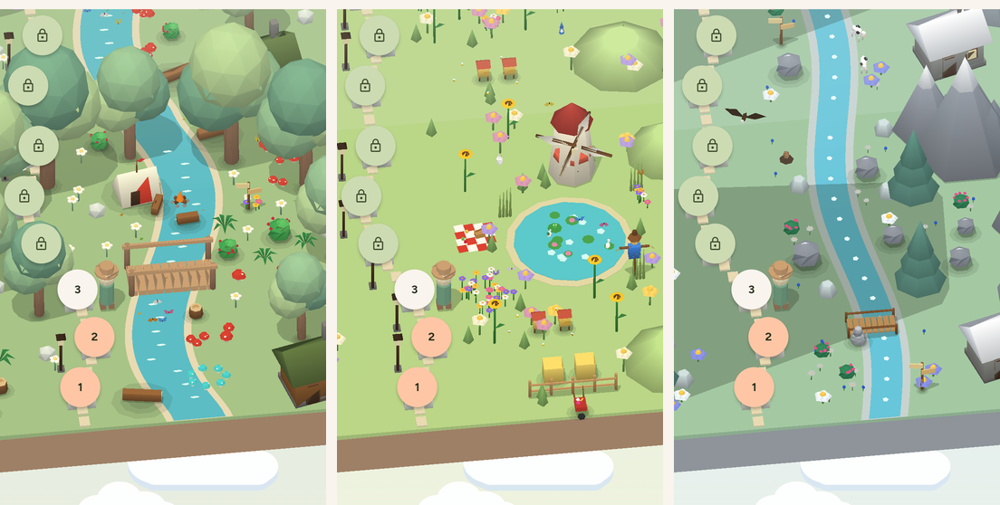
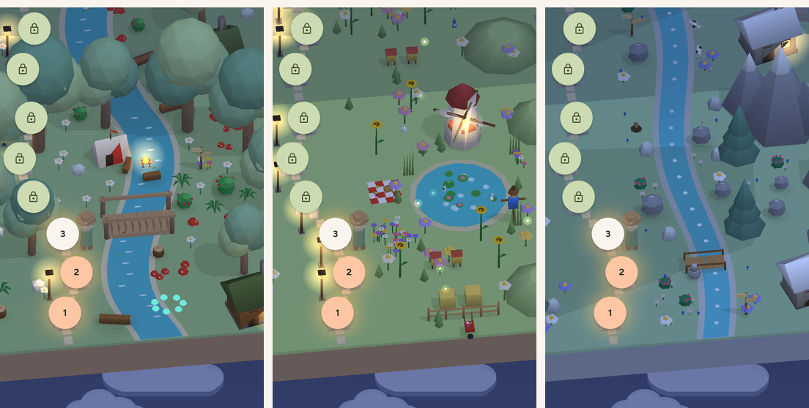
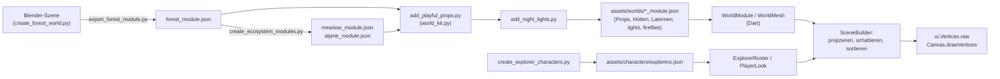
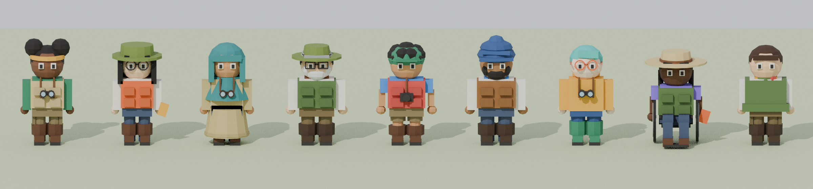

# 3D & Blender – Überblick

Die Lernpfade, Vitrinen und Entdecker:innen in Plantini sind Low-Poly-Welten, die in Blender entstehen, als kompaktes JSON
in der App landen und dort von einem **eigenen CPU-Projektions-Renderer** gezeichnet werden. Es gibt weder eine
3D-Engine noch einen GLB-Player: Die App liest Dreiecke, projiziert sie selbst und gibt sie als eine einzige
`ui.Vertices`-Liste an Flutters Canvas.

Diese Spur besteht aus fünf Seiten: diese Übersicht, [Blender-Pipeline](blender-pipeline.md),
[Tageszeit und Licht](tageszeit-licht.md), [Charaktere](charaktere.md) und [Performance](performance.md).

!!! note "Herkunft der Assets"
    Laut Kopfkommentaren der Skripte sind alle Modelle prozedural aus Primitiven erzeugt, ohne heruntergeladene Texturen
    oder externe Asset-Dienste (`tools/blender/create_ecosystem_modules.py`, `tools/blender/create_forest_world.py`).
    Zu den Rechten am Gesamtprojekt siehe [Projektstatus und Rechte](../start/status.md): Code unter AGPL-3.0-or-later, die 3D-Modelle als Lerninhalte unter CC BY-SA 4.0.

{ loading=lazy }

*Die drei Welten am Tag (Vorschau `lib/dev/forest_preview.dart`, 390 × 800 px, Stand 06.10.2026).*

{ loading=lazy }

*Nachts: Lagerfeuer, Mühlenfenster und Laternen leuchten, die Feenpilze glimmen türkis; was in Wirklichkeit vor einer
Lampe steht, verdeckt ihr Licht. Zum Vergleich der Abend: [Tageszeit und Licht](tageszeit-licht.md).*

## Die Idee

Ein Ökosystem besteht aus **Modulen**. Ein Modul ist ein Geländestück von 11,5 × 10 Einheiten (x × y) mit sechs
Stationsplätzen. Der Lernpfad reiht Module entlang der y-Achse aneinander: Modul `m` liegt um `m * 10` Einheiten
verschoben. Pro Modul gibt es also sechs Level; bei 30 Leveln liegen fünf Module hintereinander.

Der Weg von der Idee zum Pixel:



Warum nicht GLB und eine Engine? Die Quellen geben dafür keine ausdrückliche Begründung; was sich aus dem Code
ablesen lässt: Das Format ist platt (Listen von Zahlen), die App hat keine native Abhängigkeit für 3D
(Kommentar in `modular_forest_view.dart`: „No native GL plugin or remote CDN“), und derselbe Renderer läuft auf Web,
Linux, Android und iOS, weil er nur `Canvas` benutzt. Der Preis ist ein Painter-Algorithmus ohne Z-Puffer (siehe
[Stolperfallen](#stolperfallen)). Ein GLB der Originalszene wird von `create_forest_world.py` zwar erzeugt
(`plantini-forest.glb`), die App liest ihn aber nirgends (`grep -ri gltf apps/flutter/lib` findet nichts).

## Dateiformat

Die Module liegen in `apps/flutter/assets/worlds/{forest,meadow,alpine}_module.json`, die Entdecker:innen in
`apps/flutter/assets/characters/explorers.json`. Das Verzeichnis `assets/worlds/` ist in `apps/flutter/pubspec.yaml`
komplett als Asset eingetragen. Beachte: Dort liegen auch drei große Hintergrund-PNGs (`forest.png`, `meadow.png`,
`alpine.png`, je ca. 3 MB), die nur noch `apps/flutter/lib/design_system/world_art.dart` referenziert – mit dem
3D-Renderer haben sie nichts zu tun.

| Schlüssel | Typ | Bedeutung | Von der App gelesen? |
|---|---|---|---|
| `version` | int | Formatversion (immer `1`) | nein |
| `length` | int | Modullänge (immer `10`) | nein – die App rechnet fest mit `m * 10` |
| `slots` | `[[x,y,z] × 6]` | Stationsplätze eines Moduls | ja, **genau sechs** (`/ 6`, `% 6` in `modular_forest_view.dart`) |
| `meshes` | Liste | die Geometrie, siehe unten | ja |
| `lights` | `[[x,y,z,radius(,variant)]]` | Lichtquellen für Abend und Nacht; das fünfte Element (0 oder 1) bindet eine Quelle an die Props einer Variante, ohne es gehört sie allen Modulen | ja (optional) |
| `fireflies` | Objekt | Glühwürmchen-Feld (nur Wiese) | ja (optional) |

Ein Mesh (`WorldMesh` in `apps/flutter/lib/features/catalog/presentation/widgets/world_module.dart`):

| Feld | Bedeutung |
|---|---|
| `name` | Blender-Objektname. **Namenspräfixe steuern die Zeichenreihenfolge** (siehe unten). |
| `vertices` | `[[x,y,z], …]` in Weltkoordinaten des Moduls |
| `faces` | `[[a,b,c], …]` – **ausschließlich Dreiecke**, Indizes in `vertices` |
| `color` | `[r,g,b]` 0..1, **linear** (wie Blenders `diffuse_color`); die App macht daraus 8-Bit-Farbe und wendet Licht und Gamma selbst an |
| `motion` | `none`, `tree`, `plant`, `water`, `ranger`, `glow`, und die animierten Bewegungen `spin`, `flap`, `bob`, `hop`, `orbit` (siehe unten) |
| `pivot` | Baumposition aus Blender. Die App nutzt sie, um die Teile **eines** Baums zu einem gemeinsamen Schatten zusammenzufassen (Stamm und Kronen teilen den Pivot) und als Drehpunkt animierter Teile |
| `slot` | `null` oder Stationsnummer 0–5; Meshes mit `slot` verschwinden, wenn es für diesen Platz kein Level gibt |
| `variant` | nur Props: `0` oder `1`. Die App zeichnet im Modul `m` die Variante `m % 2`, damit sich dieselbe Windmühle nicht alle zehn Einheiten wiederholt. Ohne `variant` gehört das Mesh zu jedem Modul |
| `layer` | `decal` oder `decal2`: flache Dinge auf dem Boden (Seerosenblätter, Picknickdecke, Schneeflecken). Sie werden nach Gelände und Wasser, aber vor allem Aufrechten gemalt. Zwei Decals in derselben Höhe brauchen verschiedene Ebenen (kein Z-Puffer) |
| `shadow` | Textkennung: Teile mit derselben Kennung werfen **einen** gemeinsamen Schatten samt weichem Fußfleck |
| `anim` | Parameter der animierten Bewegungen: `pivot`, `axis`, `amp`, `freq` (ganze Zahl je 6-s-Durchlauf, höchstens 3), `phase`, `drift`, `radius`, `roll` |
| `glow` | `[r,g,b]` (0–255): Farbe, in der ein `glow`-Mesh leuchtet; ohne das warmes Fensterlicht |
| `lamp` | `[x,y,z,radius,variant]`: Lichtquelle, die `add_night_lights.py` in `lights` übernimmt (Lagerfeuer, Mühlenfenster) |
| `day` | `true`: nur am Tag da (Schmetterlinge, Bienen, Adler) |
| `solid` | `true`: Hütten und Laternen halten Abstand (nur für die Generatoren, die App liest es nicht) |

Kommentierter Ausschnitt (gekürzt; die Kommentare gibt es im echten JSON nicht, die Zahlen stammen aus der Datei):

```jsonc title="apps/flutter/assets/worlds/forest_module.json (gekürzt)"
{
  "version": 1,
  "length": 10,
  "slots": [[-2.4, -4.0, 0.34], [-1.8769189160376656, -2.4, 0.34], /* … */ [-2.4, 4.0, 0.34]],
  "meshes": [
    { "name": "earth",                         // Quader 11,5 x 10 x 0,9, Gruppe 4 (zuerst gemalt)
      "vertices": [[-5.75,-5.0,-0.9], [5.75,-5.0,-0.9], /* … 8 Punkte */],
      "faces": [[0,2,1], [0,3,2], [4,5,6], /* … 12 Dreiecke */],
      "color": [0.48, 0.29, 0.17], "motion": "none", "pivot": null, "slot": null },
    { "name": "station",                      // gehört zu Platz 0
      "color": [0.7, 0.72, 0.6], "motion": "none", "pivot": null, "slot": 0 /* … */ },
    { "name": "Tree trunk",
      "motion": "tree", "pivot": [-3.8, 2.1, 0.08] /* gerundet; im JSON: -3.799999952316284 … */ },
    { "name": "Lantern 0 glass",              // leuchtet ab 16 Uhr
      "color": [0.8832, 0.7742, 0.4423], "motion": "glow" /* … */ }
  ],
  "lights": [[-2.728, -3.007, 0.88, 1.0], /* … */ [2.76, -4.886, 0.47, 1.25]]
}
```

Das Feld `fireflies` gibt es nur in `meadow_module.json`:

```json title="apps/flutter/assets/worlds/meadow_module.json (Ausschnitt)"
"fireflies": {"count": 16, "area": [-1.2, 5.0, -4.8, 4.8], "z": [0.3, 1.4]}
```

`area` ist `[x0, x1, y0, y1]` (siehe `FireflyField.fromJson`), `z` ist `[z0, z1]`.

### Bewegungsarten (`motion`)

| Wert | Wirkung in `modular_forest_view.dart` | Wirkung in der Vitrine |
|---|---|---|
| `none` | statisch | statisch |
| `tree`, `plant` | Seitwärts-Scherung `x += sway * z` mit `sway = sin(phase + m) * 0.022` | keine Bewegung |
| `water` | Verschiebung entlang y um `sin(phase) * 0.17` | keine Bewegung |
| `spin` | dreht um `axis` durch `pivot` (`WorldMesh.coordsAt`): die Flügel der Windmühle | Ruhelage |
| `flap` | schwingt um `axis` um `±amp` und driftet auf einer kleinen Schleife `drift`: Schmetterlingsflügel, Flaggen, fliegende Blätter | Ruhelage |
| `bob` | hebt und senkt sich um `amp` (leichtes Wiegen um `roll`): Vogel, Murmeltier, Kuh | Ruhelage |
| `hop` | springt um `amp`: Hase, Eichhörnchen, Frosch | Ruhelage |
| `orbit` | fliegt einen Kreis mit `radius` und dreht sich mit: Enten auf dem Teich, Bienen, Adler | Ruhelage |
| `ranger` | die Spielfigur: wird an der aktuellen Station platziert und durch die gewählte Entdecker:in ersetzt | steht an Station 0 |
| `glow` | Fenster und Laternenglas: blass am Tag, warmes Licht ab Abend | wie links |

Das „Wiegen“ von Bäumen ist keine Rotation um den Stamm, sondern eine einfache Scherung proportional zur Höhe `z`. Die
animierten Teile (`spin`, `flap`, `bob`, `hop`, `orbit`) rechnet `WorldMesh.coordsAt(loop)` pro Phase neu und
merkt sich das Ergebnis; die Flächennormalen werden dabei **nicht** mitgedreht (die Teile sind klein, das Licht bleibt
also so, als stünden sie in Ruhelage). Alle Frequenzen sind ganze Zahlen, damit der 6-Sekunden-Durchlauf nahtlos schließt;
bei 30 Bildern je Sekunde wären auch schnellere Schwingungen darstellbar; die Frequenzen sind trotzdem auf höchstens 3 je Durchlauf gedeckelt, weil schnelleres Flattern bei 6 s Schleife hektisch wirkt.

### Zählwerte (aus den JSON-Dateien, 06.10.2026)

Je Modul wird die Basis plus **eine** Variante gezeichnet:

| Modul | Basis (Dreiecke) | Variante 0 | Variante 1 | je Modul gezeichnet | `lights` | Datei |
|---|---:|---:|---:|---:|---:|---:|
| `forest` | 6 816 | 3 702 | 4 182 | 10 518 / 10 998 | 7 | 581 KB |
| `meadow` | 4 327 | 4 910 | 4 676 | 9 237 / 9 003 | 6 | 683 KB |
| `alpine` | 2 382 | 2 331 | 2 595 | 4 713 / 4 977 | 1 | 350 KB |

Vor dem Umbau (05.10.2026) hatten die Module 6 816, 6 267 und 2 434 Dreiecke (201, 344 und 108 KB). Die Slot-Meshes
(27 je Modul) sind 6 × `station`, 6 × `station top` und 15 × `trail`.

## Koordinatensystem und Projektion

Szene: **x nach rechts, y in das Bild hinein, z nach oben** (Kommentar in `WorldLighting`; Konvention im Kopf von
`create_explorer_characters.py`: „z is up“). Die Spielfigur schaut Richtung −y, also zur Kamera des Lernpfads.

`SceneProjection` in `apps/flutter/lib/features/catalog/presentation/widgets/world_scene.dart` bildet einen Punkt so ab:

```dart title="apps/flutter/lib/features/catalog/presentation/widgets/world_scene.dart"
ui.Offset project(double x, double y, double z) {
  final yy = y - focus;
  final along = x * sinYaw + yy * cosYaw;
  return ui.Offset(
    ox + (x * cosYaw - yy * sinYaw) * scale,
    oy - (along * squash + z * lift) * scale,
  );
}
```

Parameter: `yaw` (Drehung um die Hochachse), `focus` (y-Versatz, am Lernpfad `position * 10`), `scale` (Pixel pro
Einheit), `squash = 0.7` (Tiefenstauchung), `lift = 0.85` (Pixel pro Höheneinheit). Rechenbeispiel mit `yaw = 0`,
`focus = 0`, `scale = 100`, Ursprung `(0, 0)`:

| Punkt (x, y, z) | Bildschirm (x, y) | Erklärung |
|---|---|---|
| (1, 0, 0) | (100, 0) | eine Einheit nach rechts |
| (0, 1, 0) | (0, −70) | eine Einheit tiefer ins Bild: 0,7 × 100 nach oben |
| (0, 0, 1) | (0, −85) | eine Einheit Höhe: 0,85 × 100 nach oben |

Der Lernpfad wählt `scale = max(52, min(width / 12.5, height / 8.5))` (`_Projection.scale`). Die Untergrenze von 52 px
hält die 48-px-Tippziele benachbarter Stationen getrennt.

!!! warning "Stolperfalle: die Projektion existiert dreimal"
    `SceneProjection.project` (Rendering), `_Projection.project` in `modular_forest_view.dart` (Stationsknöpfe,
    Lichtschein, Glühwürmchen) und `_Fit._raw` in `ecosystem_vitrine.dart` (Einpassen der Vitrine) enthalten jeweils
    dieselbe Formel mit den Konstanten `0.7` und `0.85`. Wer `squash` oder `lift` ändert, muss alle drei anfassen, sonst
    sitzen die Stationsknöpfe neben ihren Sockeln. `SceneProjection` hat die Werte als Parameter, die beiden anderen
    nicht.

## Der Render-Pfad

| Datei (unter `apps/flutter/lib/features/catalog/presentation/widgets/`) | Aufgabe |
|---|---|
| `world_module.dart` | `WorldModule` (Laden und Cachen per `WorldModule.load`), `WorldMesh` (vorberechnete Normalen/Farben, Schatten, Zeichengruppe), `FireflyField` |
| `world_scene.dart` | `SceneProjection`, `SceneInstance`, `SceneBuilder.build`, `PictureCache` |
| `world_lighting.dart` | Tageszeit, Beleuchtung, Himmel, Lichtschein – siehe [Tageszeit und Licht](tageszeit-licht.md) |
| `modular_forest_view.dart` | `ModularForestView`: der Lernpfad (Module, Stationsknöpfe, Animation, Glühwürmchen-Ebene) |
| `ecosystem_vitrine.dart` | `EcosystemVitrine`: das schwebende Modell als gebackene Textur |

### `SceneBuilder.build` und `SceneBuilder.paintScene`

Beide teilen sich `_assemble(...)`. Die Funktion macht in einem Durchlauf:

0. **Ganze Meshes überspringen**, deren Bounding-Box (`WorldMesh.bounds`, projiziert) außerhalb des Bildes liegt
   (`_outside`); Flächen außerhalb werden zusätzlich einzeln verworfen (`cullHeight`, `cullWidth`).
1. **Projizieren** jedes Vertex (`px`, `py`) plus einen Tiefenwert `pd = along * lift - z * squash`. Animierte Teile
   bringen ihre Koordinaten der Phase mit (`SceneInstance.coords`).
2. **Farbe je Fläche**: im Modus `SceneShading.path` aus dem vorberechneten `mesh.pathColorsFor(lighting)` (Sonne und
   Lampenlicht); im Modus `SceneShading.viewer` (Vitrine) wird je Fläche neu schattiert, weil das Modell unter einem
   mitgedrehten Licht steht. Danach **Dunst** (ferne Flächen werden zum Himmel hin heller, `haze`) und **Rundung**:
   Aufrechte Dinge bekommen je Eckpunkt eine Helligkeit zwischen 0,78 am Fuß und 1,12 an der Spitze
   (`WorldMesh.vertexShade`). Deshalb gibt es **drei Farben je Dreieck**: die Facetten bleiben sichtbar, laufen aber
   weich ineinander.
3. **Tiefenschlüssel je Fläche** als `Int32`: `gruppe * 65536 + tiefe_quantisiert`. Die Tiefe wird über ±40 Einheiten auf
   16 Bit abgebildet (`_depthRange = 40`); die Gruppe (`groundGroup`) liegt darüber.
4. **Sortieren mit zwei Zählpässen** (`_sortKeys`: LSD-Radix, 2 × 10 Bit). Das ist stabil: Flächen mit gleichem Schlüssel
   behalten die Reihenfolge, in der sie hinzugefügt wurden. Gemalt wird von „fern“ nach „nah“, bei Gleichstand die
   zuletzt hinzugefügte zuerst (so wie zuvor mit dem Fließkomma-Schlüssel). Warum kein `Float64List.sort` mehr: siehe
   [Performance](performance.md#5-sortieren-ohne-vergleiche).
5. `build` gibt ein einziges `ui.Vertices.raw(VertexMode.triangles, positions, colors: …)` zurück (eine Farbe je Ecke).
   `paintScene` malt **mehrere** Abschnitte und setzt dazwischen die `SceneMarker`.

**`SceneMarker`** sind Dinge, die nicht über, sondern *zwischen* den Dreiecken gemalt werden: das Leuchten einer Laterne
ist ein Marker an der Tiefe der Lampe (alles, was näher an der Kamera steht, verdeckt ihn), die Lichtpfütze am Boden ein
Marker, der nach allem Flachen und vor allem Aufrechten kommt. `paintScene` findet die Stelle mit einer Binärsuche
über den sortierten Schlüsseln (`_upperBound`) und zerlegt den Dreieckspuffer dort.

Die Zeichengruppe (`WorldMesh.groundGroup`) legt fest, was vor dem Tiefenvergleich gemalt wird. **Höhere Gruppen werden
früher gemalt**:

| Gruppe | Meshes |
|---|---|
| 7 | `earth`, `grass` |
| 6 | Name beginnt mit `Sandy stream` |
| 5 | Name beginnt mit `Flowing woodland` |
| 4 | alle Schatten und Fußflecken (`motion == 'shadow'`) |
| 3 | Name beginnt mit `Animated water` |
| 2 | `layer == 'decal'` |
| 1 | `layer == 'decal2'` |
| 0 | alles Aufrechte (Tiefensortierung untereinander) |

Die Trennung zwischen Gruppe 1 und 0 ist wichtig: Eine Lichtpfütze am Boden (`SceneMarker.ground`) wird nach allem
Flachen und vor allem Aufrechten gemalt, damit Stämme und Dächer sie überdecken (siehe
[Tageszeit und Licht](tageszeit-licht.md#laternen-hutten-gluhwurmchen)).

Diese Präfixe sind ein **stiller Vertrag zwischen Blender-Namen und Dart-Code**. Die Teiche der Wiese heißen deshalb
`Sandy stream pond` und `Flowing woodland pond`, die alpinen Bäche `Sandy stream gravel` und
`Flowing woodland alpine` (`create_ecosystem_modules.py`) – nicht, weil es Bäche wären, sondern damit sie hinter den
Wiesenblumen gemalt werden.

### Der Lernpfad: `ModularForestView`

- Nur das aktuelle Modul und seine beiden Nachbarn werden gezeichnet (`center - 1 … center + 1`); jedes Modul `m` zeigt
  die Basis und die **Variante `m % 2`** der Props (Windmühle und Bienenstöcke in den geraden, Brunnen und Gnome in den
  ungeraden Wiesenmodulen, usw.). Schatten, Lichter und Lampenlicht auf den Flächen richten sich nach derselben Variante.
- Die Animation ist eine 6-Sekunden-Schleife mit **30 Bildern je Sekunde** (`_framesPerLoop = 180`). Der
  `AnimationController` tickt mit der Bildwiederholrate des Geräts, das Widget zeichnet aber nur beim Wechsel des
  30stel-Bildes neu (`_frames.value++`). Jedes Bild wird **beim Zeigen aufgenommen** und nach dem nächsten verworfen
  (`PictureCache.retireAfterNext`); nur ein stehendes Bild (Pause, reduzierte Bewegung, Ansicht ändert sich nicht) wird
  zwischengespeichert und wiederholt. Früher waren es 16 aufgenommene Phasen (etwa 2,7 Bilder je Sekunde): 180 Bilder je
  Welt im Speicher zu halten wäre viel zu teuer, eine Aufnahme kostet dank Radix-Sortierung nur 2–3 ms.
- Ziehen verschiebt `position` (Einheit: Module) und `yaw` (auf ±0,35 begrenzt); das Mausrad bewegt `position`.
- Die Stationsknöpfe (Level 1–6 je Modul) sind normale Flutter-Widgets, die per `_Projection.project` über die
  Szene gelegt werden – nicht Teil des 3D-Bildes. Außerhalb des Sichtfensters werden sie ganz weggelassen (auch
  Semantik und Treffer), nicht nur abgeschnitten.
- `MediaQuery.disableAnimationsOf` und `TickerMode` stoppen die Animation; der Pausenknopf in der Kopfzeile ebenfalls.
- Welche Welt zu welchem Ökosystem gehört, entscheidet `EcosystemWorld.forSlug(slug)` über Teilstrings im Slug
  (`alpen`/`alpin`/`berg`/`mountain` → Alpen, `wiese`/`meadow` → Wiese, `wald`/`forest` → Wald). Die Reihenfolge ist
  relevant: ein Slug wie „bergwald“ würde als Alpen erkannt. Ohne Treffer fällt `ResearcherPathView` auf eine
  2D-Darstellung (`WorldLandscapePainter`) zurück.
  Die Demo-Slugs stehen in `services/platform/src/api/platform/services/core/content/demo-journeys.js`
  (`mitteleuropaeischer-laubwald`, `alpenraum`, `artenreiche-wiese`).

!!! note "Eigener Modul-Cache"
    `ModularForestView` lädt das Modul über einen eigenen statischen Cache (`_modules`), nicht über
    `WorldModule.load`. Vitrinen benutzen `WorldModule.load`. Dieselbe Datei wird also beim ersten Aufruf beider Wege
    zweimal geparst. Das ist Duplikat, kein Fehler; ein Nutzer:innen-sichtbarer Effekt wurde nicht untersucht.

### Die Vitrine: `EcosystemVitrine`

Seit dem 08.10.2026 ohne Glas, Wand und Sockel: Dasselbe Modul schwebt schräg von vorn vor dem Hintergrund, mit einem
weichen Schatten darunter und einem Namensschild als Pille, wie die drei Modelle auf der Projekt-Homepage (Startseite,
Lernliste, Herbarium, Anmeldung – Aufrufer: `home_screen.dart`, `ecosystem_list_screen.dart`,
`herbarium_bottle_collection.dart` und der Anmeldebildschirm in `router.dart`). Der Name `EcosystemVitrine` blieb, damit
Aufrufer und Tests unverändert bleiben. Eigenheiten:

- Eigene Einpassung (`_Fit`): Das Modul wird in den freien Bereich über Schatten und Namensschild skaliert; Meshes mit
  `slot != null` (Stationen, Pfadstücke) fehlen, die Spielfigur steht an Station 0.
- Die Vitrine zeigt die Basis und die Variante 0 (`mesh.inVariant(0)`); Tagwesen wie Schmetterlinge fehlen nachts.
  Animierte Teile stehen in Ruhelage.
- Das Modell wird **zu einer Textur** gebacken (`toImageSync`, transparenter Hintergrund) und als ein Bild gezeichnet; der
  Schatten ist ein einziger Radialverlauf. Warum das nötig war, steht in [Performance](performance.md).
- Bei `animate: true` schwingt das Modell ±0,15 rad in zwei Durchläufen über 32 s und schwebt dabei zweimal sanft auf und
  ab (die Textur wird nur verschoben, der Schatten schrumpft beim Steigen); danach steht es still.

{ loading=lazy }

*Die Entdecker:innen (Bild zu `create_explorer_characters.py`). Dieselben Modelle stehen im Lernpfad und in den Vitrinen.*

## Stolperfallen

!!! warning "Stolperfalle: Painter-Algorithmus statt Z-Puffer"
    `SceneBuilder` sortiert Dreiecke nach dem Mittelpunkt ihrer Tiefe. Zwei **deckungsgleiche** Flächen haben denselben
    Schlüssel und flackern, je nachdem, welche zuerst gemalt wird. Die Blender-Skripte halten deshalb Abstand (die Taschen
    der Weste stehen etwa 0,005 Einheiten vor ihr: Kommentar in `vest()` in `create_explorer_characters.py`). Details in der
    [Blender-Pipeline](blender-pipeline.md#koplanare-flachen-und-painter-sortierung).

!!! warning "Stolperfalle: Farben sind linear, die Vitrine nutzt kein Gamma"
    Im Pfad wird nach der Beleuchtung `pow(v, 1/2.2)` angewendet (`gamma: true`), in der Vitrine nicht
    (`gamma: false`, dafür `_viewerGain = 1.22`). Dieselbe JSON-Farbe sieht deshalb in beiden Ansichten nicht
    identisch aus – gewollt, siehe Kommentar an `_viewerGain` in `world_scene.dart`.

!!! warning "Stolperfalle: `SceneBuilder.build` ist nicht wiedereintrittsfähig"
    Die Arbeitspuffer (`_px`, `_py`, `_pd`, `_keys`, `_order`, `_swap`, `_bucket`, `_pos`, `_col`) sind `static`. Der Aufruf ist synchron und auf dem
    UI-Isolate sicher; ein zweiter Aufruf aus einem anderen Isolate oder während eines ersten wäre es nicht.

!!! warning "Stolperfalle: Der Cache-Schlüssel ist der Vertrag"
    `_ForestPainter.paint` nimmt ein aufgenommenes Bild nur wieder, wenn der Schlüssel `(module, size, focus, yaw,
    levelCount, currentIndex, background, lighting.phase, PlayerLook.cacheKey)` gleich bleibt. Jede neue Eingabe, die das
    Bild verändert, **muss** in diesen Schlüssel – sonst zeigt die App ein veraltetes Bild ohne jede Fehlermeldung.

## Weiterführend

- [Blender-Pipeline](blender-pipeline.md): Skripte, Aufrufe, neues Modul anlegen
- [Tageszeit und Licht](tageszeit-licht.md): `world_lighting.dart`, Schatten, Laternen
- [Charaktere](charaktere.md): die neun Entdecker:innen
- [Performance](performance.md): Messung und Regeln
- [App-Überblick](../app/index.md)
- Quellpfade: `apps/flutter/lib/features/catalog/presentation/widgets/`, `apps/flutter/assets/worlds/`,
  `tools/blender/`, `apps/flutter/test/features/catalog/world_lighting_test.dart`
