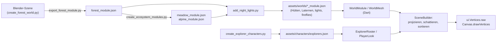

# 3D & Blender – Überblick

Die Lernpfade, Vitrinen und Entdecker:innen in Plantini sind Low-Poly-Welten, die in Blender entstehen, als kompaktes JSON
in der App landen und dort von einem **eigenen CPU-Projektions-Renderer** gezeichnet werden. Es gibt weder eine
3D-Engine noch einen GLB-Player: Die App liest Dreiecke, projiziert sie selbst und gibt sie als eine einzige
`ui.Vertices`-Liste an Flutters Canvas.

Diese Spur besteht aus fünf Seiten: diese Übersicht, [Blender-Pipeline](blender-pipeline.md),
[Tageszeit und Licht](tageszeit-licht.md), [Charaktere](charaktere.md) und [Performance](performance.md).

!!! note "Herkunft der Assets"
    Laut Kopfkommentaren der Skripte sind alle Modelle prozedural aus Primitiven erzeugt, ohne heruntergeladene Texturen
    oder externe Asset-Dienste (`tools/blender/create_ecosystem_modules.py`, `tools/blender/create_forest_world.py`).
    Zu den Rechten am Gesamtprojekt siehe [Projektstatus und Rechte](../start/status.md): Plantini ist kein Open-Source-Projekt.

## Die Idee

Ein Ökosystem besteht aus **Modulen**. Ein Modul ist ein Geländestück von 11,5 × 10 Einheiten (x × y) mit sechs
Stationsplätzen. Der Lernpfad reiht Module entlang der y-Achse aneinander: Modul `m` liegt um `m * 10` Einheiten
verschoben. Pro Modul gibt es also sechs Level; bei 30 Leveln liegen fünf Module hintereinander.

Der Weg von der Idee zum Pixel:



Warum nicht GLB und eine Engine? Die Quellen geben dafür keine ausdrückliche Begründung; was sich aus dem Code
ablesen lässt: Das Format ist platt (Listen von Zahlen), die App hat keine native Abhängigkeit für 3D
(Kommentar in `modular_forest_view.dart`: „No native GL plugin or remote CDN“), und derselbe Renderer läuft auf Web,
Linux, Android und iOS, weil er nur `Canvas` benutzt. Der Preis ist ein Painter-Algorithmus ohne Z-Puffer (siehe
[Stolperfallen](#stolperfallen)). Ein GLB der Originalszene wird von `create_forest_world.py` zwar erzeugt
(`plantini-forest.glb`), die App liest ihn aber nirgends (`grep -ri gltf apps/flutter/lib` findet nichts).

## Dateiformat

Die Module liegen in `apps/flutter/assets/worlds/{forest,meadow,alpine}_module.json`, die Entdecker:innen in
`apps/flutter/assets/characters/explorers.json`. Das Verzeichnis `assets/worlds/` ist in `apps/flutter/pubspec.yaml`
komplett als Asset eingetragen. Beachte: Dort liegen auch drei große Hintergrund-PNGs (`forest.png`, `meadow.png`,
`alpine.png`, je ca. 3 MB), die nur noch `apps/flutter/lib/design_system/world_art.dart` referenziert – mit dem
3D-Renderer haben sie nichts zu tun.

| Schlüssel | Typ | Bedeutung | Von der App gelesen? |
|---|---|---|---|
| `version` | int | Formatversion (immer `1`) | nein |
| `length` | int | Modullänge (immer `10`) | nein – die App rechnet fest mit `m * 10` |
| `slots` | `[[x,y,z] × 6]` | Stationsplätze eines Moduls | ja, **genau sechs** (`/ 6`, `% 6` in `modular_forest_view.dart`) |
| `meshes` | Liste | die Geometrie, siehe unten | ja |
| `lights` | `[[x,y,z,radius]]` | Lichtquellen für Abend und Nacht | ja (optional) |
| `fireflies` | Objekt | Glühwürmchen-Feld (nur Wiese) | ja (optional) |

Ein Mesh (`WorldMesh` in `apps/flutter/lib/features/catalog/presentation/widgets/world_module.dart`):

| Feld | Bedeutung |
|---|---|
| `name` | Blender-Objektname. **Namenspräfixe steuern die Zeichenreihenfolge** (siehe unten). |
| `vertices` | `[[x,y,z], …]` in Weltkoordinaten des Moduls |
| `faces` | `[[a,b,c], …]` – **ausschließlich Dreiecke**, Indizes in `vertices` |
| `color` | `[r,g,b]` 0..1, **linear** (wie Blenders `diffuse_color`); die App macht daraus 8-Bit-Farbe und wendet Licht und Gamma selbst an |
| `motion` | `none`, `tree`, `plant`, `water`, `ranger`, `glow` |
| `pivot` | Baumposition aus Blender, **wird von der App nicht gelesen** (`grep pivot apps/flutter/lib` ohne Treffer) |
| `slot` | `null` oder Stationsnummer 0–5; Meshes mit `slot` verschwinden, wenn es für diesen Platz kein Level gibt |

Kommentierter Ausschnitt (gekürzt; die Kommentare gibt es im echten JSON nicht, die Zahlen stammen aus der Datei):

```jsonc title="apps/flutter/assets/worlds/forest_module.json (gekürzt)"
{
  "version": 1,
  "length": 10,
  "slots": [[-2.4, -4.0, 0.34], [-1.8769189160376656, -2.4, 0.34], /* … */ [-2.4, 4.0, 0.34]],
  "meshes": [
    { "name": "earth",                         // Quader 11,5 x 10 x 0,9, Gruppe 4 (zuerst gemalt)
      "vertices": [[-5.75,-5.0,-0.9], [5.75,-5.0,-0.9], /* … 8 Punkte */],
      "faces": [[0,2,1], [0,3,2], [4,5,6], /* … 12 Dreiecke */],
      "color": [0.48, 0.29, 0.17], "motion": "none", "pivot": null, "slot": null },
    { "name": "station",                      // gehört zu Platz 0
      "color": [0.7, 0.72, 0.6], "motion": "none", "pivot": null, "slot": 0 /* … */ },
    { "name": "Tree trunk",
      "motion": "tree", "pivot": [-3.8, 2.1, 0.08] /* gerundet; im JSON: -3.799999952316284 … */ },
    { "name": "Lantern 0 glass",              // leuchtet ab 16 Uhr
      "color": [0.8832, 0.7742, 0.4423], "motion": "glow" /* … */ }
  ],
  "lights": [[-2.728, -3.007, 0.88, 1.0], /* … */ [2.76, -4.886, 0.47, 1.25]]
}
```

Das Feld `fireflies` gibt es nur in `meadow_module.json`:

```json title="apps/flutter/assets/worlds/meadow_module.json (Ausschnitt)"
"fireflies": {"count": 16, "area": [-1.2, 5.0, -4.8, 4.8], "z": [0.3, 1.4]}
```

`area` ist `[x0, x1, y0, y1]` (siehe `FireflyField.fromJson`), `z` ist `[z0, z1]`.

### Bewegungsarten (`motion`)

| Wert | Wirkung in `modular_forest_view.dart` | Wirkung in der Vitrine |
|---|---|---|
| `none` | statisch | statisch |
| `tree`, `plant` | Seitwärts-Scherung `x += sway * z` mit `sway = sin(phase + m) * 0.022`; `tree` wirft einen Schatten | keine Bewegung |
| `water` | Verschiebung entlang y um `sin(phase) * 0.17` | keine Bewegung |
| `ranger` | die Spielfigur: wird an der aktuellen Station platziert und durch die gewählte Entdecker:in ersetzt | steht an Station 0 |
| `glow` | Fenster und Laternenglas: blass am Tag, warmes Licht ab Abend | wie links |

`pivot` ist also nur Blender-Metadaten: Das „Wiegen“ ist keine Rotation um den Stamm, sondern eine einfache Scherung
proportional zur Höhe `z`.

### Zählwerte (aus den JSON-Dateien, 05.10.2026)

| Modul | Meshes | Dreiecke | Vertices | davon `slot != null` | `lights` | Datei |
|---|---:|---:|---:|---:|---:|---:|
| `forest` | 264 | 6 816 | 4 032 | 27 | 5 | 200 889 B |
| `meadow` | 446 | 6 267 | 4 669 | 27 | 5 | 343 714 B |
| `alpine` | 165 | 2 434 | 1 784 | 27 | 1 | 107 556 B |

Die 27 Slot-Meshes sind 6 × `station`, 6 × `station top` und 15 × `trail`.

## Koordinatensystem und Projektion

Szene: **x nach rechts, y in das Bild hinein, z nach oben** (Kommentar in `WorldLighting`; Konvention im Kopf von
`create_explorer_characters.py`: „z is up“). Die Spielfigur schaut Richtung −y, also zur Kamera des Lernpfads.

`SceneProjection` in `apps/flutter/lib/features/catalog/presentation/widgets/world_scene.dart` bildet einen Punkt so ab:

```dart title="apps/flutter/lib/features/catalog/presentation/widgets/world_scene.dart"
ui.Offset project(double x, double y, double z) {
  final yy = y - focus;
  final along = x * sinYaw + yy * cosYaw;
  return ui.Offset(
    ox + (x * cosYaw - yy * sinYaw) * scale,
    oy - (along * squash + z * lift) * scale,
  );
}
```

Parameter: `yaw` (Drehung um die Hochachse), `focus` (y-Versatz, am Lernpfad `position * 10`), `scale` (Pixel pro
Einheit), `squash = 0.7` (Tiefenstauchung), `lift = 0.85` (Pixel pro Höheneinheit). Rechenbeispiel mit `yaw = 0`,
`focus = 0`, `scale = 100`, Ursprung `(0, 0)`:

| Punkt (x, y, z) | Bildschirm (x, y) | Erklärung |
|---|---|---|
| (1, 0, 0) | (100, 0) | eine Einheit nach rechts |
| (0, 1, 0) | (0, −70) | eine Einheit tiefer ins Bild: 0,7 × 100 nach oben |
| (0, 0, 1) | (0, −85) | eine Einheit Höhe: 0,85 × 100 nach oben |

Der Lernpfad wählt `scale = max(52, min(width / 12.5, height / 8.5))` (`_Projection.scale`). Die Untergrenze von 52 px
hält die 48-px-Tippziele benachbarter Stationen getrennt.

!!! warning "Stolperfalle: die Projektion existiert dreimal"
    `SceneProjection.project` (Rendering), `_Projection.project` in `modular_forest_view.dart` (Stationsknöpfe,
    Lichtschein, Glühwürmchen) und `_Fit._raw` in `ecosystem_vitrine.dart` (Einpassen der Vitrine) enthalten jeweils
    dieselbe Formel mit den Konstanten `0.7` und `0.85`. Wer `squash` oder `lift` ändert, muss alle drei anfassen, sonst
    sitzen die Stationsknöpfe neben ihren Sockeln. `SceneProjection` hat die Werte als Parameter, die beiden anderen
    nicht.

## Der Render-Pfad

| Datei (unter `apps/flutter/lib/features/catalog/presentation/widgets/`) | Aufgabe |
|---|---|
| `world_module.dart` | `WorldModule` (Laden und Cachen per `WorldModule.load`), `WorldMesh` (vorberechnete Normalen/Farben, Schatten, Zeichengruppe), `FireflyField` |
| `world_scene.dart` | `SceneProjection`, `SceneInstance`, `SceneBuilder.build`, `PictureCache` |
| `world_lighting.dart` | Tageszeit, Beleuchtung, Himmel, Lichtschein – siehe [Tageszeit und Licht](tageszeit-licht.md) |
| `modular_forest_view.dart` | `ModularForestView`: der Lernpfad (Module, Stationsknöpfe, Animation, Glühwürmchen-Ebene) |
| `ecosystem_vitrine.dart` | `EcosystemVitrine`: die Glasvitrine als gebackene Textur |

### `SceneBuilder.build`

`SceneBuilder.build(instances, projection, …)` macht in einem Durchlauf:

1. **Projizieren** jedes Vertex (`px`, `py`) plus einen Tiefenwert `pd = along * lift - z * squash`.
2. **Farbe je Fläche**: im Modus `SceneShading.path` aus dem vorberechneten `mesh.pathColorsFor(lighting)`; im Modus
   `SceneShading.viewer` (Vitrine) wird je Fläche neu schattiert, weil das Modell unter einem mitgedrehten Licht steht.
3. **Tiefenschlüssel je Fläche** als `Float64`: `(gruppe + tiefe_quantisiert) * 2^20 + laufende_nummer`. Die Tiefe wird über
   ±40 Einheiten auf 16 Bit abgebildet (`_depthRange = 40`), die Gruppe (`groundGroup * 65536`) liegt darüber, der
   Index ganz unten. Float64 ist nötig, damit der Index im Schlüssel erhalten bleibt (`_idxRange = 1048576`, also
   weniger als 2^20 Flächen pro Szene).
4. **Native Sortierung** (`Float64List.sort`), dann von „fern“ nach „nah“ in zwei Float32-/Int32-Puffer schreiben.
5. `ui.Vertices.raw(VertexMode.triangles, positions, colors: …)` – eine Farbe pro Dreieck (flat shading).

Die Zeichengruppe (`WorldMesh.groundGroup`) legt fest, was vor dem Tiefenvergleich gemalt wird. **Höhere Gruppen werden
früher gemalt**:

| Gruppe | Meshes |
|---|---|
| 4 | `earth`, `grass` |
| 3 | Name beginnt mit `Sandy stream` |
| 2 | Name beginnt mit `Flowing woodland`; alle Schatten (`motion == 'shadow'`) |
| 1 | Name beginnt mit `Animated water` |
| 0 | alles andere (Tiefensortierung untereinander) |

Diese Präfixe sind ein **stiller Vertrag zwischen Blender-Namen und Dart-Code**. Die Teiche der Wiese heißen deshalb
`Sandy stream pond` und `Flowing woodland pond`, die alpinen Bäche `Sandy stream gravel` und
`Flowing woodland alpine` (`create_ecosystem_modules.py`) – nicht, weil es Bäche wären, sondern damit sie hinter den
Wiesenblumen gemalt werden.

### Der Lernpfad: `ModularForestView`

- Nur das aktuelle Modul und seine beiden Nachbarn werden gezeichnet (`center - 1 … center + 1`).
- Die Animation hat **16 Phasen** je 6-Sekunden-Zyklus (`const _phases = 16`). Der `AnimationController` tickt zwar
  durchgehend, das Widget repaintet aber nur, wenn die Phase wechselt (`_frames.value++`). Jede Phase wird einmal als
  `ui.Picture` aufgenommen und danach nur noch abgespielt (`PictureCache`).
- Ziehen verschiebt `position` (Einheit: Module) und `yaw` (auf ±0,35 begrenzt); das Mausrad bewegt `position`.
- Die Stationsknöpfe (Level 1–6 je Modul) sind normale Flutter-Widgets, die per `_Projection.project` über die
  Szene gelegt werden – nicht Teil des 3D-Bildes. Außerhalb des Sichtfensters werden sie ganz weggelassen (auch
  Semantik und Treffer), nicht nur abgeschnitten.
- `MediaQuery.disableAnimationsOf` und `TickerMode` stoppen die Animation; der Pausenknopf in der Kopfzeile ebenfalls.
- Welche Welt zu welchem Ökosystem gehört, entscheidet `EcosystemWorld.forSlug(slug)` über Teilstrings im Slug
  (`alpen`/`alpin`/`berg`/`mountain` → Alpen, `wiese`/`meadow` → Wiese, `wald`/`forest` → Wald). Die Reihenfolge ist
  relevant: ein Slug wie „bergwald“ würde als Alpen erkannt. Ohne Treffer fällt `ResearcherPathView` auf eine
  2D-Darstellung (`WorldLandscapePainter`) zurück.
  Die Demo-Slugs stehen in `services/platform/src/api/platform/services/core/content/demo-journeys.js`
  (`mitteleuropaeischer-laubwald`, `alpenraum`, `artenreiche-wiese`).

!!! note "Eigener Modul-Cache"
    `ModularForestView` lädt das Modul über einen eigenen statischen Cache (`_modules`), nicht über
    `WorldModule.load`. Vitrinen benutzen `WorldModule.load`. Dieselbe Datei wird also beim ersten Aufruf beider Wege
    zweimal geparst. Das ist Duplikat, kein Fehler; ein Nutzer:innen-sichtbarer Effekt wurde nicht untersucht.

### Die Vitrine: `EcosystemVitrine`

Eine Glasvitrine mit Sockel und Messingschild, in der dasselbe Modul schräg von vorn steht (Startseite, Lernliste,
Herbarium, Anmeldung – Aufrufer: `home_screen.dart`, `ecosystem_list_screen.dart`,
`herbarium_bottle_collection.dart` und der Anmeldebildschirm in `router.dart`). Eigenheiten:

- Eigene Einpassung (`_Fit`): Das Modul wird in den freien Bereich zwischen Glasrand und Sockel skaliert; Meshes mit
  `slot != null` (Stationen, Pfadstücke) fehlen, die Spielfigur steht an Station 0.
- Wand, Sockel, Modell und Glas werden **zu einer Textur** gebacken (`toImageSync`) und als ein Bild gezeichnet. Warum
  das nötig war, steht in [Performance](performance.md).
- Bei `animate: true` schwingt das Modell ±0,15 rad in zwei Durchläufen über 32 s und steht dann still.

{ loading=lazy }

*Die Entdecker:innen (Bild zu `create_explorer_characters.py`). Dieselben Modelle stehen im Lernpfad und in den Vitrinen.*

## Stolperfallen

!!! warning "Stolperfalle: Painter-Algorithmus statt Z-Puffer"
    `SceneBuilder` sortiert Dreiecke nach dem Mittelpunkt ihrer Tiefe. Zwei **deckungsgleiche** Flächen haben denselben
    Schlüssel und flackern, je nachdem, welche zuerst gemalt wird. Die Blender-Skripte halten deshalb Abstand (die Taschen
    der Weste stehen etwa 0,005 Einheiten vor ihr: Kommentar in `vest()` in `create_explorer_characters.py`). Details in der
    [Blender-Pipeline](blender-pipeline.md#koplanare-flachen-und-painter-sortierung).

!!! warning "Stolperfalle: Farben sind linear, die Vitrine nutzt kein Gamma"
    Im Pfad wird nach der Beleuchtung `pow(v, 1/2.2)` angewendet (`gamma: true`), in der Vitrine nicht
    (`gamma: false`, dafür `_viewerGain = 1.22`). Dieselbe JSON-Farbe sieht deshalb in beiden Ansichten nicht
    identisch aus – gewollt, siehe Kommentar an `_viewerGain` in `world_scene.dart`.

!!! warning "Stolperfalle: `SceneBuilder.build` ist nicht wiedereintrittsfähig"
    Die Arbeitspuffer (`_px`, `_py`, `_pd`, `_keys`, `_pos`, `_col`) sind `static`. Der Aufruf ist synchron und auf dem
    UI-Isolate sicher; ein zweiter Aufruf aus einem anderen Isolate oder während eines ersten wäre es nicht.

!!! warning "Stolperfalle: Der Cache-Schlüssel ist der Vertrag"
    `_ForestPainter.paint` nimmt ein aufgenommenes Bild nur wieder, wenn der Schlüssel `(module, size, focus, yaw,
    levelCount, currentIndex, background, lighting.phase, PlayerLook.cacheKey)` gleich bleibt. Jede neue Eingabe, die das
    Bild verändert, **muss** in diesen Schlüssel – sonst zeigt die App ein veraltetes Bild ohne jede Fehlermeldung.

## Weiterführend

- [Blender-Pipeline](blender-pipeline.md): Skripte, Aufrufe, neues Modul anlegen
- [Tageszeit und Licht](tageszeit-licht.md): `world_lighting.dart`, Schatten, Laternen
- [Charaktere](charaktere.md): die neun Entdecker:innen
- [Performance](performance.md): Messung und Regeln
- [App-Überblick](../app/index.md)
- Quellpfade: `apps/flutter/lib/features/catalog/presentation/widgets/`, `apps/flutter/assets/worlds/`,
  `tools/blender/`, `apps/flutter/test/features/catalog/world_lighting_test.dart`
