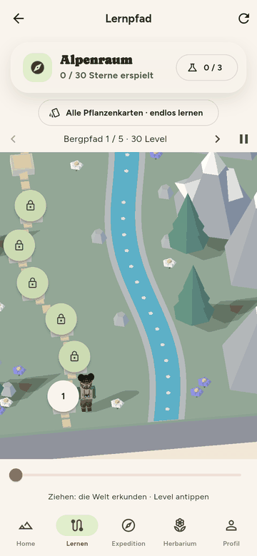
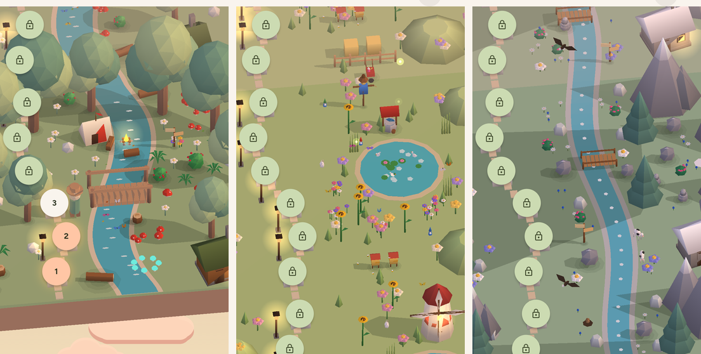
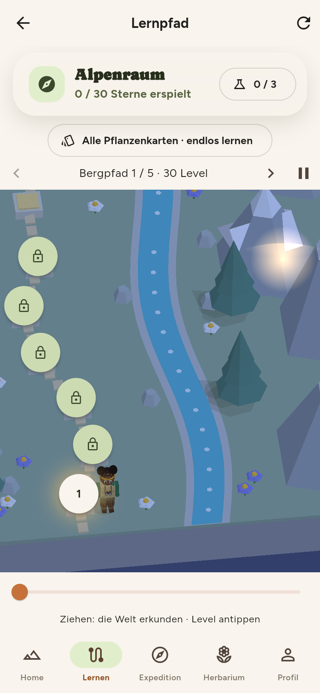

# Tageszeit und Licht

Die Ökosysteme der App sehen morgens, mittags, abends und nachts verschieden aus: andere Sonnenrichtung, andere Farben,
andere Himmel, leuchtende Fenster und Laternen. Alles dafür steckt in
`apps/flutter/lib/features/catalog/presentation/widgets/world_lighting.dart` (328 Zeilen) und in einigen Zeilen
`world_module.dart` und `world_scene.dart`.

{ loading=lazy }

*Der Lernpfad im Tagesverlauf.*

{ loading=lazy }

*Der Abend in den drei Welten (Wiese und Alpen jeweils in einem Modul mit der zweiten Prop-Variante).*

## Vier Phasen

`DayPhase` ist ein Enum mit Anzeigename (`label`) und der Zuordnung von Uhrzeit zu Phase:

| Phase | `label` | Uhrzeit (lokale Zeit) | `lamps` | `stars` |
|---|---|---|---|---|
| `morning` | Morgen | 05:00 bis 09:59 | nein | nein |
| `noon` | Mittag | 10:00 bis 15:59 | nein | nein |
| `evening` | Abend | 16:00 bis 20:59 | **ja** | nein |
| `night` | Nacht | 21:00 bis 04:59 | **ja** | **ja** |

```dart title="apps/flutter/lib/features/catalog/presentation/widgets/world_lighting.dart"
static DayPhase at(DateTime time) {
  final h = time.hour;
  if (h >= 5 && h < 10) return morning;
  if (h >= 10 && h < 16) return noon;
  if (h >= 16 && h < 21) return evening;
  return night;
}
```

`WorldLighting.of(phase)` liefert für jede Phase ein unveränderliches Objekt mit diesen Werten:

| Phase | `toSun` (Zeile unnormalisiert) | `sun` (RGB) | `ambient` (RGB) | `skyTop` / `skyBottom` | `glow` |
|---|---|---|---|---|---|
| Morgen | (−0,80, −0,30, 0,45) | .62 .47 .30 | .56 .60 .72 | `BFD7EC` / `FCE5C9` | `FFD79A` links oben |
| Mittag | (−0,18, −0,30, 0,94) | .50 .48 .42 | .58 .61 .66 | `CFE6F5` / `F1F5E4` | `FFF6D0` oben |
| Abend | (0,82, −0,22, 0,38) | .72 .42 .20 | .50 .44 .58 | `E0A58F` / `F7D7A6` | `FF9B54` rechts oben |
| Nacht | (0,35, −0,35, 0,80) | .16 .21 .36 | .22 .27 .44 | `17203F` / `34406C` | `DCE6FF` rechts oben (Mond) |

`toSun` wird mit `_unit()` normalisiert und zeigt **von der Fläche zur Sonne**. Die Szene hat x nach rechts, y ins Bild
hinein und z nach oben; ein negatives y bedeutet also „Sonne steht auf der Seite der Kamera“. Der Abend hat die Sonne
rechts, der Morgen links.

## `DayClock`: Uhr, Pin, Aktualisierung

`DayClock` ist ein statisches Objekt mit einem `ValueNotifier<DayPhase> phase`. Alle 3D-Ansichten hören darauf:
`ModularForestView` (`DayClock.phase.addListener`), `EcosystemVitrine` (`ListenableBuilder`), `ExplorerStage` und
`ExplorerPortrait`.

| Aufruf | Wirkung |
|---|---|
| `DayClock.pin(DayPhase? value)` | merkt sich die Phase (oder `null` für „folgt der Uhr“) und ruft `refresh()` |
| `DayClock.refresh([DateTime? now])` | setzt `phase.value = _pinned ?? DayPhase.at(now ?? DateTime.now())` |
| `DayClock.pinned` | die gepinnte Phase oder `null` |

**Es gibt keinen Timer.** Der Kommentar in der Datei sagt es ausdrücklich: Die App ruft `refresh()` beim Start und beim
Zurückkehren in den Vordergrund (`didChangeAppLifecycleState` mit `AppLifecycleState.resumed` in
`apps/flutter/lib/app/plantini_app.dart`). Läuft die App im Vordergrund über 16:00 oder 21:00, ändert sich die Szene erst
beim nächsten Aufruf von `refresh()`.

Start-Reihenfolge in `apps/flutter/lib/main.dart` (`_initialize()`): `SharedPreferences` laden, dann
`_restoreDayPin(preferences)`, danach erst Anmeldung und API. Dort gilt:

```dart title="apps/flutter/lib/main.dart"
const defined = String.fromEnvironment('PLANTINI_DAYTIME');
final name = defined.isNotEmpty
    ? defined
    : preferences.getString('daytime_pin');
for (final phase in DayPhase.values) {
  if (phase.name == name) DayClock.pin(phase);
}
```

- Der Build-Parameter `--dart-define=PLANTINI_DAYTIME=night` (`morning`, `noon`, `evening`, `night`) **hat Vorrang** vor der
  gespeicherten Wahl. Ein unbekannter Wert wird stillschweigend ignoriert.
- Ohne den Parameter gilt die im Profil gespeicherte Wahl (`SharedPreferences`-Schlüssel `daytime_pin`).

### Umschalter im Profil

`_DayTimeCard` in `apps/flutter/lib/app/router.dart` zeigt unter „Tageszeit der Ökosysteme“ fünf `ChoiceChip`s mit den
Test-Keys `daytime-auto`, `daytime-morning`, `daytime-noon`, `daytime-evening` und `daytime-night`. `_choose(phase)` ruft
`DayClock.pin(phase)` und speichert den Namen unter `daytime_pin` (bei „Automatisch“ wird der Schlüssel entfernt). Schlägt das
Speichern fehl, ist nur die Erinnerung verloren, die Ansicht hat sich schon geändert.

!!! note "Wer gewinnt: Profilwahl oder Build-Parameter?"
    Zur Laufzeit gewinnt die letzte Wahl im Profil. Beim nächsten Start gewinnt wieder `PLANTINI_DAYTIME`, falls gesetzt –
    ein im Build gepinnter Test-Zeitpunkt überschreibt also die gespeicherte Wahl, nicht umgekehrt.

Die Designvorschau `apps/flutter/lib/dev/forest_preview.dart` liest stattdessen den Query-Parameter `?daytime=night` (nur Web).

## Beleuchtung: `WorldLighting.shade()`

Eine Fläche mit Einheitsnormale `n` und Grundfarbe `base` (linear, 0..1) bekommt je Farbkanal `c`:

```text
ndl     = clamp(n · toSun, 0, 1)
v       = clamp(base_c * (ambient_c + sun_c * ndl), 0, 1)
ausgabe = round(255 * (gamma ? v^(1/2.2) : v))
```

Das ist reines Lambert-Licht ohne Spiegelung: `ambient` ist die Himmelsfarbe, die auch die abgewandten Seiten erreicht,
`sun` kommt nur auf der Sonnenseite dazu. Weil `sun` je Phase eine Farbe ist, werden Morgen und Abend warm (viel Rot),
die Nacht blau.

Der Pfad (`SceneShading.path`) rechnet mit `gamma: true`. Die Vitrine (`SceneShading.viewer`) rechnet mit `gamma: false`,
multipliziert die Grundfarbe mit `_viewerGain = 1.22` und dreht die Normale um den Betrachter statt die Sonne zu fixieren,
siehe `SceneBuilder.build` in `world_scene.dart`.

### Rechenbeispiel

Grasfläche aus dem Wald: `color = [0.38, 0.53, 0.23]` im JSON. Die App rundet auf 8 Bit
(`Color.fromRGBO(round(c * 255), …)`), rechnet also mit `[0.3804, 0.5294, 0.2314]`. Obere Fläche, `n = (0, 0, 1)`, Mittag:

```text
ndl   = 1 * 0.937 = 0.937            (toSun.z nach der Normierung)
R     = 0.3804 * (0.58 + 0.50 * 0.937) = 0.3804 * 1.0486 = 0.3989
Rout  = 255 * 0.3989^(1/2.2)          ≈ 168
```

Für alle Kanäle und Phasen ergibt das (Pfad-Ansicht, 8-Bit-Grundfarbe, auf ganze Zahlen gerundet):

| Fläche | Phase | `n · toSun` | RGB | Hex |
|---|---|---:|---|---|
| oben `(0,0,1)` | Morgen | 0,466 | 153, 174, 122 | `#99AE7A` |
| oben | Mittag | 0,937 | 168, 196, 134 | `#A8C486` |
| oben | Abend | 0,409 | 148, 153, 109 | `#94996D` |
| oben | Nacht | 0,850 | 103, 133, 115 | `#678573` |
| Ost `(1,0,0)` | Mittag | 0 (Schatten) | 128, 153, 109 | `#80996D` |
| Ost `(1,0,0)` | Abend | 0,882 (Sonnenseite) | 174, 174, 115 | `#AEAE73` |

Die Werte stammen aus einer Nachrechnung der Formel mit den Konstanten aus `world_lighting.dart` (Python, 05.10.2026),
nicht aus einem Screenshot der App.

Zwei Dinge, die man daran sieht: Die Schattenseite behält durch das hohe Ambient (0,58–0,66) am Mittag noch rund drei
Viertel der Helligkeit der Oberseite (Rotkanal 128 gegen 168). Am Abend wird die Ostfläche **heller als die Oberseite**
(174 gegen 148), weil die Sonne dann von rechts und niedrig kommt.

Der Test `apps/flutter/test/features/catalog/world_lighting_test.dart` sichert nur Beziehungen, keine Zahlen: eine zur Sonne
gedrehte Fläche ist heller als eine abgewandte, die Nacht ist dunkler als der Mittag, der Abend wärmer als der Mittag.

## Himmel und Hintergrund

`paintSkyBackdrop(canvas, size, lighting, world)` zeichnet:

1. einen **vertikalen Verlauf** `lighting.backdrop(world)`: Mittag mischt die Welt-Farbe zu 55 % in den Himmel
   (`Color.lerp(skyTop, world, .55)`), Morgen und Abend zu 25 % oben und 35 % unten, die Nacht nimmt den reinen Himmel
   (`world` ist die Hintergrundfarbe aus `EcosystemWorld`, z. B. `0xFFE2E9DC` für den Wald);
2. eine **radiale Scheibe** `glow` an `glowAt` (Radius `0.6 * shortestSide`, nachts `0.28`; Deckkraft 0,62 bzw. 0,55);
3. nachts eine kleine **Mondscheibe** (`shortestSide * 0.035`) und
4. **Sterne** (`paintStars`, 38 Stück im Pfad, 16 in der Vitrine): eine feste Pseudozufallsfolge (linearer
   Kongruenzgenerator, Startwert 7919), im oberen 55 %-Bereich – jedes Bild zeigt denselben Himmel.

Die Vitrine hat seit dem 08.10.2026 keine Rückwand mehr: Das Modell schwebt auf transparentem Grund vor dem Hintergrund der jeweiligen Seite, Himmel, Sterne und Glow entfallen dort.

{ loading=lazy }

*Der Lernpfad bei Nacht.*

## Himmel: Dunst und Wolken

Zwei Dinge machen aus dem Hintergrund mehr als einen Verlauf:

- **Dunst** (aerial perspective): Im Pfad werden ferne Flächen zur Oberkante des Bildes hin zur Himmelsfarbe gemischt
  (`SceneBuilder._assemble`, Parameter `haze` und `hazeStrength`; Mischfaktor `smoothstep((tiefe − 0,5) / 5,5)`). Die
  Stärke steht in `WorldLighting.hazeStrength` (Mittag 0,14, Morgen und Abend 0,26, Nacht 0,24). Leuchtende Meshes
  (`glow`) nimmt der Dunst aus.
- **Wolken** (`paintClouds`): sechs weiche Wolken unter und neben der kleinen Welt, sodass die Insel im Himmel schwebt.
  Sie schwingen mit `loop` ein paar Pixel hin und her (nahtlose Schleife) und haben je Phase eigene Farben (Morgen
  cremig, Mittag weiß, Abend rosa, Nacht blau). Nur der Lernpfad schaltet sie ein (`clouds: true`).

## Schatten

Es gibt keine Schattenberechnung im Sinne von Shadow-Maps. Stattdessen entsteht pro **Gruppe** ein flaches,
halbtransparentes Polygon: die konvexe Hülle aller Punkte der Gruppe, entlang des Lichts auf den Boden projiziert
(`WorldMesh.shadowOf`, mit Andrews Monotone-Chain-Algorithmus in `_convexHull`).

```dart title="apps/flutter/lib/features/catalog/presentation/widgets/world_module.dart"
// Very low sun would throw endless shadows; cap the stretch.
final lz = math.max(lighting.toSun[2], .7);
final dx = lighting.toSun[0] / lz, dy = lighting.toSun[1] / lz;
// ...
pts.add([c[v * 3] - z * dx, c[v * 3 + 1] - z * dy]);
```

Rechenbeispiel für die Spitze eines Baums bei `z = 2`, Fuß bei `(0, 0)`:

| Phase | `lz` | Verschiebung `(−z·dx, −z·dy)` | ohne Kappung bei `lz` |
|---|---:|---|---|
| Mittag | 0,937 | (+0,38, +0,64) | – |
| Abend | **0,7** (statt 0,409) | (−2,52, +0,68) | (−4,32, +1,16) |
| Morgen | **0,7** (statt 0,466) | (+2,37, +0,89) | (+3,55, +1,33) |

Die Kappung `max(toSun.z, 0.7)` ist also bei Morgen und Abend aktiv und verkürzt dort die Schatten um ein Drittel bis zwei Fünftel.

Was zu einem Schatten gehört, bestimmt `WorldMesh.shadowKey`: die JSON-Kennung `shadow` (Props) oder, bei `motion ==
'tree'` ohne Kennung, der **Pivot** (Stamm und Kronen eines Baums haben denselben). `WorldModule.shadowPieces(lighting,
variant)` fasst die Meshes je Kennung zusammen und liefert pro Gruppe

- das **Schattenpolygon** (Farbe `0x1C2618`, Deckkraft je Phase: Nacht `0x22`, Mittag `0x40`, sonst `0x3A`) und
- einen weichen **Fußfleck** (`WorldMesh.contactOf`): drei übereinanderliegende, durchscheinende Ringe um den Fuß der
  Gruppe (alle Punkte mit `z < 0,45`), die zusammen einen Verlauf ergeben. Gruppen, die länger als 1,1 Einheiten sind
  (Zaun, Brücke), bekommen keinen Fleck, sonst würde er die Wiese nur abdunkeln.

Weitere Eigenschaften:

- Zeichengruppe 4 (siehe [Überblick](index.md#scenebuilderbuild-und-scenebuilderpaintscene)): Schatten werden nach Boden
  und Bach, aber vor Wasserflächen-Glanz, Decals und allem Aufrechten gemalt.
- Es werfen Schatten: Bäume, alle Props mit `shadow` (Zelt, Mühle, Hütte, Heuballen, Felsen, Gipfel …) und die
  **Spielfigur als Ganzes** (`PlayerLook.shadow(lighting)` bzw. beim Standard-Ranger `WorldMesh.shadowOf([…ranger…], …)`).
- **Kein Schatten:** `plant`-Meshes (Blumen, Gräser), Tiere, Laternen und alles in der Vitrine.
- Die Hüllen werden je Phase **und Variante** gecacht (`_shadowPieces`, Schlüssel `(phase, variant)`).

!!! note "Früher: ein Schatten je Mesh"
    Bis zum 06.10.2026 warf jedes Baum-Mesh einzeln einen Schatten; wo sich Stamm und Kronenkugeln überlagerten, entstand
    ein dunklerer Kern. Seitdem teilt sich ein Baum **einen** Schatten (Pivot), wie es bei Figuren schon vorher war.

## Laternen, Hütten, Glühwürmchen

Die Lichtquellen entstehen in Blender-/Python-Werkzeugen, nicht in Dart: `tools/blender/add_night_lights.py` ergänzt die
Module um Meshes und Daten (siehe [Blender-Pipeline](blender-pipeline.md#add_night_lightspy-hutten-laternen-gluhwurmchen)).

### `glow`-Meshes

Meshes mit `motion == 'glow'` (Hüttenfenster, Laternenglas) werden in `WorldMesh.pathColorsFor` besonders behandelt:

```dart title="apps/flutter/lib/features/catalog/presentation/widgets/world_module.dart"
if (motion == 'glow' && lighting.lamps) {
  final argb = lighting.phase == DayPhase.night ? 0xFFFFE08A : 0xFFFFC878;
  return Int32List(faces.length)..fillRange(0, faces.length, argb);
}
```

Tagsüber (`lamps == false`) werden sie wie jedes andere Mesh beleuchtet und wirken blass (Grundfarbe
`#f1e3b0`). Abends `0xFFFFC878`, nachts `0xFFFFE08A`. In der Vitrine gilt dieselbe Regel in `SceneBuilder.build`.

Ein `glow`-Mesh kann seine eigene Leuchtfarbe mitbringen (JSON-Feld `glow: [r, g, b]`, `WorldMesh.glowArgb`): die
Feenpilze im Wald leuchten türkis, das Lagerfeuer orange, nur die Fenster warm.

### `lights`: Licht, das hinter Bäumen bleibt

`module.lights` ist eine Liste `[x, y, z, radius]`, optional mit einer Variante als fünftem Eintrag (siehe
[Überblick](index.md#dateiformat)). Jede Quelle erzeugt zwei **`SceneMarker`** (`lightMarkers` in `world_scene.dart`):

1. eine **Lichtpfütze am Boden** (`paintLightPool`): ein Oval (Breite `radius * 2,4`, Höhe `radius * 1,1`) mit radialem
   Verlauf in `0xFFFFB552`, Deckkraft `0,42 * strength`, additiv (`BlendMode.plus`). Sie wird **nach allem Flachen und vor
   allem Aufrechten** gemalt: Stämme, Dächer und Felsen, die in der Pfütze stehen, überdecken sie.
2. ein **Schein um die Lampe** (`paintLightOrb`): Kreis mit Radius `radius * 0,56`, Deckkraft `0,7 * strength`, additiv, an
   der **Tiefe der Lampe**. Alles, was näher an der Kamera steht (eine Baumkrone, ein Berg), wird danach gemalt und
   verdeckt ihn.

`strength` ist nachts `1,0`, abends `0,55`. Im Pfad entstehen die Marker für jedes sichtbare Modul mit `dy: m * 10.0` und
gehören zum aufgenommenen Bild (`_record` in `modular_forest_view.dart`); die Vitrine setzt sie genauso
(`_drawModel`, Variante 0).

!!! success "Gelöst am 06.10.2026: der Schein lag nicht mehr über allem"
    Früher lief `paintLightHalos` **nach** `drawVertices`; ein Schein hinter einer Baumkrone oder einem Berg strahlte
    darüber (auf den Screenshots vom 06.10.2026: ein Lichtfleck mitten auf einer Krone im Wald, die Alpenhütte
    leuchtete durch den Berg). Mit `SceneBuilder.paintScene` und den Markern ist das behoben. Der Schein am Rand
    einer verdeckenden Fläche bleibt sichtbar (Streulicht um die Silhouette); eine Lampe, die vollständig hinter einer
    großen Fläche steht, sieht man nicht mehr.

### Lampenlicht auf den Flächen

Nachts und abends **beleuchten die Lampen die Dinge in ihrer Nähe**: Steine, Blumen, Hüttenwände, Zeltstoff und
Baumstämme neben einer Laterne oder dem Lagerfeuer werden warm (`WorldMesh._lampLight`, eingerechnet in
`WorldLighting.shade(..., lamp:)`). Je Fläche gilt: nur Flächen, die der Lampe zugewandt sind
(`n · richtung > 0`), innerhalb von 2,4 Radien, mit quadratisch abfallender Stärke; zusammen höchstens 1,0 (nachts
mal 1,15, abends mal 0,6). Große Flächen (Gelände, Berghänge: Fläche über 0,9) bleiben ausgenommen, sonst würde die
ganze Ebene einfarbig. Zur Sicherheit gegen „Licht durch Bäume“: Eine Fläche, die der Lampe den Rücken zukehrt, bleibt
dunkel. Verdeckung durch andere Körper wird dabei **nicht** geprüft (Lampe, Fläche und Hindernis müssten dafür
geschnitten werden); bei den kleinen Lampen reichte die Zuwendung, im Screenshot fiel nichts auf.

Ein Mesh bekommt die Lampen seines Moduls bei `WorldMesh.attach`: Basis-Meshes die Laternen und Hütten, Props zusätzlich
die Lampen ihrer eigenen Variante (`WorldModule.lightsOf`). Die Spielfigur wird nicht angestrahlt (ihre Meshes
wechseln den Platz, der Farb-Cache nicht).

### Glühwürmchen

`FireflyField` (in `world_module.dart`) beschreibt ein Rechteck und liefert mit `at(i, phase, {salt})` Position und
Helligkeit des i-ten Tiers. Alles ist eine **reine Funktion von `phase`** (0..1 entspricht einem 6-s-Durchlauf), ohne
Zustand und ohne `Random`: Eine Hash-Funktion aus `i`, `k` und `salt` erzeugt die Streuwerte.

- Die Schwingungen haben ganzzahlige Frequenzen (x und y 1 oder 2, z 2, Blinken 2 oder 3), deshalb schließt sich die
  Schleife nahtlos. Der Test `a firefly flies a seamless loop and blinks within 0..1` prüft `at(i, 0) == at(i, 1)`.
- Helligkeit `b = sin(…)² ` nur im positiven Teil der Welle, sonst 0: Tiere mit `b <= 0.02` werden nicht gezeichnet. Im
  Schnitt ist also etwa die Hälfte der Tiere gerade unsichtbar.
- `salt` ist die Modulnummer, damit nebeneinanderliegende Module nicht dasselbe Muster zeigen.
- Gemalt wird in `paintFireflies`: ein weicher Kreis (`scale * 0.12`, Deckkraft `0.28 * b`) und ein heller Kern
  (`scale * 0.028 + 0.6`, Deckkraft `0.95 * b`), beide additiv.
- Anteil `share`: im Pfad nachts alle 16, abends 40 % (`1` bzw. `.4` in `modular_forest_view.dart`), in der Vitrine als
  Standbild bei `phase = .35` mit 75 % bzw. 30 %.

Im Lernpfad liegen die Glühwürmchen auf einer **eigenen Ebene** (`_FireflyPainter`, `repaint: clock`), die bei jedem
Animations-Tick neu gezeichnet wird – sie sind viel billiger als die aufgenommene Welt. Sie erscheinen nur, wenn das Modul
`fireflies` hat (Wiese) und `lamps` gilt.

## Cache-Schlüssel je Phase

Ein Phasenwechsel muss alles Aufgenommene verwerfen. Die Schlüssel enthalten deshalb `lighting.phase`:

| Wo | Schlüssel (Ausschnitt) | Wirkung |
|---|---|---|
| Lernpfad, `PictureCache` in `_ForestPainter.paint` | `(module, view.size, view.focus, view.yaw, levelCount, currentIndex, background, lighting.phase, PlayerLook.cacheKey)` | neuer Schlüssel: alle 16 aufgenommenen Phasenbilder werden verworfen und nach und nach neu aufgenommen |
| Vitrine, `_FloatingModelPainter` | Zeichenkette aus Welt, Phase, `PlayerLook.cacheKey`, Winkel (3 Nachkommastellen), Größe und `pixelRatio`, mit senkrechtem Strich verbunden | bis zu 12 Texturen, die am längsten ungenutzte zuerst entfernt |
| Entdecker:innen-Porträt, `_PortraitPainter` | Zeichenkette aus `explorer.id`, Phase, Größe und `pixelRatio` | bis zu 30 Texturen |
| Flächenfarben, `WorldMesh._pathColors` | `DayPhase` | je Mesh vier `Int32List`s (Sonne und Lampenlicht) |
| Schattenhüllen, `WorldModule._shadowPieces` | `(DayPhase, Variante)` | Polygone und Fußflecken je Gruppe |
| Animierte Koordinaten, `WorldMesh._frames` | Schleifenposition (64 Stufen) | je animiertem Mesh ein `Float32List` je Stufe |

Der Pfad hat darüber hinaus keinen eigenen Zeitgeber: Wechselt `DayClock.phase`, ruft `_dayChanged()` ein `setState` auf,
der `_ForestPainter` bekommt ein neues `WorldLighting`, und `shouldRepaint` meldet die Änderung.

## Offene Punkte

- **Glühwürmchen auf dem Web (nicht geprüft).** Die Hash-Funktion in `FireflyField.at` multipliziert
  `(h ^ (h >> 13)) * 1274126177` mit `h` bis 2^31; das Produkt kann 2^53 überschreiten. Eine Python-Simulation mit
  JavaScript-Doppelzahlen (Produkt als `double` runden, danach auf 32 Bit maskieren) ergab für 782 von 800 getesteten
  Hashwerten (16 Tiere, 10 Streuwerte, 5 Salts) andere Zahlen als die exakte Ganzzahlrechnung. Ob ein Browser-Build
  (dart2js) tatsächlich so rechnet oder der Compiler die Multiplikation anders übersetzt, ist **nicht geprüft**; dart2wasm
  hat 64-Bit-Ganzzahlen. Selbst im ungünstigen Fall bleibt die Schleife nahtlos, weil sie nur von `phase` abhängt – es
  könnten nur die Positionen auf Web und nativ verschieden streuen.
- **Lampenlicht ohne Verdeckung** (siehe [Lampenlicht auf den Flächen](#lampenlicht-auf-den-flachen)): Das Licht kennt
  nur die Zuwendung der Fläche, keinen Schatten durch Körper dazwischen.
- **Glühwürmchen bleiben eine Ebene über dem Bild.** Sie sind als einzige Lichter nicht in die Tiefenordnung eingebaut
  (sie müssten jedes Frame neu eingeordnet werden); sie stehen nur auf der Wiese, wo keine Bäume sind. Ein Test
  (`world_lighting_test.dart`) verlangt, dass nur die Wiese `fireflies` hat.

## Tests und Nachweise

`apps/flutter/test/features/catalog/world_lighting_test.dart` prüft: Uhrzeitgrenzen (4, 5, 9, 10, 15, 16, 20, 21, 0 Uhr),
Pin gegen Uhr, Helligkeitsbeziehungen, die Schattenrichtung („die Spitze landet links vom Stamm“ am Abend), die Glow-Farben
`0xFFFFE08A` und `0xFFFFC878`, die Existenz von `lights` und `glow`-Meshes in allen drei Modulen (`fireflies` nur bei der
Wiese) und die nahtlose Glühwürmchen-Schleife.

Nicht automatisch geprüft: das Aussehen. Ein Review der Tageszeiten geht über `PLANTINI_DAYTIME` bzw. den Umschalter im Profil.

## Stolperfallen

!!! warning "Stolperfalle: gepinnt ist nicht automatisch"
    Wer zum Testen `PLANTINI_DAYTIME=night` setzt, sieht auch nach einer anderen Wahl im Profil beim nächsten Start wieder
    die Nacht. Fehlt der Parameter im Produktions-Build, gilt die gespeicherte oder die Uhr-Phase.

!!! warning "Stolperfalle: ein Phasenwechsel braucht `refresh()`"
    Bleibt die App geöffnet, während die Uhr 16:00 oder 21:00 überschreitet, bleibt die alte Phase stehen, bis `refresh()`
    läuft (Rückkehr in den Vordergrund, Wahl im Profil). Für Tests übergibst du die Zeit explizit:
    `DayClock.refresh(DateTime(2026, 1, 1, 12))`, wie im Test `a pinned phase wins over the clock until it is released`.

## Weiterführend

- [3D & Blender – Überblick](index.md) · [Blender-Pipeline](blender-pipeline.md) · [Charaktere](charaktere.md) ·
  [Performance](performance.md)
- Quellpfade: `apps/flutter/lib/features/catalog/presentation/widgets/world_lighting.dart`,
  `apps/flutter/lib/features/catalog/presentation/widgets/world_module.dart`,
  `apps/flutter/lib/features/catalog/presentation/widgets/world_scene.dart`, `apps/flutter/lib/main.dart`,
  `apps/flutter/lib/app/router.dart`, `apps/flutter/lib/app/plantini_app.dart`, `tools/blender/add_night_lights.py`
