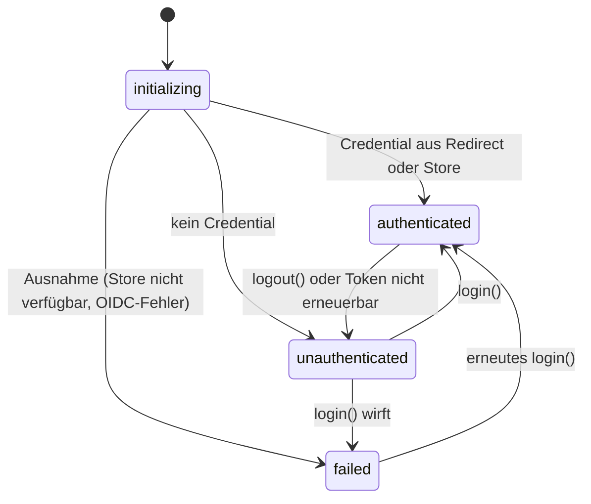
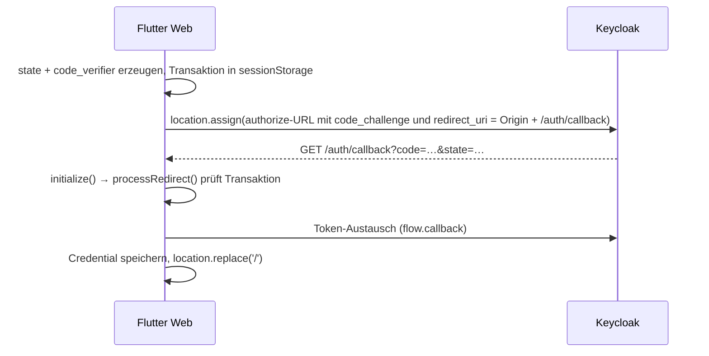
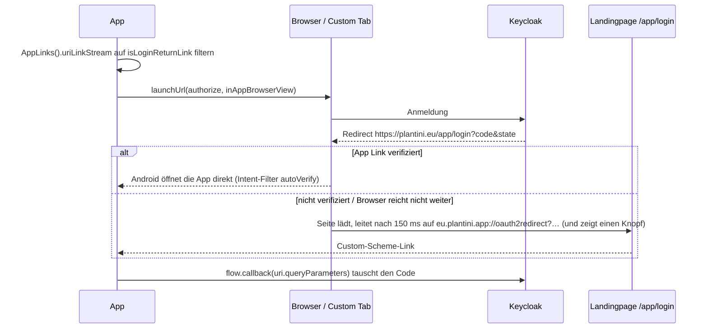

# Authentifizierung in der App

Die App meldet sich per OpenID Connect (Authorization Code mit PKCE) an Keycloak an und schickt das Access-Token als Bearer an die Fach-API. Diese Seite beschreibt `apps/flutter/lib/auth/`, die drei Rückkehrwege (Web, Desktop, Telefon), Token-Erneuerung, Abmelden und die zugehörigen Tests.

!!! note "Geltungsbereich"
    Hier geht es um den Client. Wie Keycloak, Realm-Import und Token-Prüfung im Backend aufgesetzt sind, steht in [Identity und Keycloak](../betrieb/identity-keycloak.md) und [Sicherheit und Datenschutz](../architektur/sicherheit-datenschutz.md). Keycloak-Clients werden hier nur allgemein beschrieben.

## Dateien

| Datei | Rolle |
|---|---|
| `lib/auth/auth_service.dart` | `AuthService` (`ChangeNotifier`), `AuthState`; Anmelden, Token holen, Abmelden |
| `lib/auth/credential_store.dart` | `CredentialStore`, `SecureCredentialStore`, `CredentialStoreUnavailable` |
| `lib/auth/auth_platform_interface.dart` | `AuthPlatformHelper`: `login`, `processRedirect`, `completeRedirect`, `logout` |
| `lib/auth/auth_platform_io.dart` | Desktop und Telefon (Loopback, App Link, `app_links`) |
| `lib/auth/auth_platform_web.dart` | Browser: Redirect-Flow mit eigener PKCE-Transaktion |
| `test/auth_platform_io_test.dart` | Tests für Redirect-URIs, PKCE und Rückkehr-Link |

`auth_service.dart` wählt die Plattform-Implementierung zur Compile-Zeit:

```dart title="apps/flutter/lib/auth/auth_service.dart"
import 'auth_platform_interface.dart' hide getAuthPlatformHelper;
import 'auth_platform_io.dart' if (dart.library.html) 'auth_platform_web.dart';
```

Beide Dateien exportieren die Funktion `getAuthPlatformHelper()`; die Variante aus `auth_platform_interface.dart` wirft nur `UnsupportedError`.

## Zustände und Ablauf im `AuthService`

`AuthState` kennt `initializing`, `unauthenticated`, `authenticated` und `failed`. Der Router (siehe [Überblick](index.md#router-und-redirect-logik)) schickt `initializing` auf `/boot` und alles Nicht-Angemeldete (also auch `failed`) auf `/login`; die Fehlermeldung `auth.failure` zeigt der `LoginScreen`.

Angefragt werden immer die Scopes `openid`, `profile`, `email`.

**`initialize()`** (einmal beim Start in `main.dart`): fragt den Plattform-Helfer `processRedirect(...)`. Liefert er ein Credential (nur im Web nach der Rückkehr), wird es gespeichert und `completeRedirect()` aufgerufen. Sonst wird ein gespeichertes Credential aus dem `CredentialStore` gelesen. Ergebnis: `authenticated` oder `unauthenticated`. Jede Ausnahme setzt `failed`; ist es eine `CredentialStoreUnavailable`, lautet die Meldung (als `StorageFailure`) „Der System-Schlüsselbund ist nicht verfügbar. Installiere libsecret und starte einen Secret Service, bevor du dich anmeldest.“, sonst eine `ConfigurationFailure` über die OIDC-Konfiguration.

**`login()`**: ruft `_helper.login(...)`. Native Plattformen bekommen ein `Credential` zurück, speichern es und wechseln auf `authenticated`. Im Web gibt `login` `null` zurück, weil die Seite zu Keycloak navigiert; die Rückkehr verarbeitet erst das nächste `initialize()`. Das ist im Code ausdrücklich kommentiert („Do not mark that transition as a failure“).

**`getAccessToken()`**: siehe [Token-Erneuerung](#token-erneuerung).

**`logout()`**: siehe [Abmelden](#abmelden-und-charakter-reset).



## Gespeicherte Anmeldedaten

`SecureCredentialStore` speichert das serialisierte `Credential` (`jsonEncode(credential.toJson())`) unter dem Schlüssel `plantini.oidc.credential.v1` im `FlutterSecureStorage`. Die Klasse dokumentiert die Absicht: UI-Code sieht nie einen Refresh-Token und schreibt ihn „to normal preferences, logs, or the offline content cache“. Wichtige Verhalten:

- Lesefehler des Schlüsselbunds werden zu `CredentialStoreUnavailable` (anderer Fehler als „falsche OIDC-Konfiguration“).
- Ein nicht lesbares JSON wird gelöscht und als „nicht angemeldet“ behandelt (`debugPrint('… corrupted credential in storage, clearing …')`).
- `clear()` schluckt Fehler, damit Abmelden nie an einem defekten Schlüsselbund scheitert.

!!! warning "Stolperfalle: Linux braucht `libsecret` und einen Secret Service"
    Ohne laufenden Secret Service scheitert schon das Speichern nach dem Login. `apps/flutter/README.md` nennt `libgtk-3-0` und `libsecret-1-0` als Laufzeitabhängigkeiten. Wie `flutter_secure_storage` im Browser speichert, habe ich nicht geprüft.

## Web: Redirect mit eigener PKCE-Transaktion

`WebAuthPlatformHelper` (`auth_platform_web.dart`) implementiert den Code-Flow selbst. Der Kommentar im Code nennt den Grund: `openid_client_browser.Authenticator` „only implements the implicit flow; that flow is disabled in the realm“.



Einzelheiten:

- **Redirect-URI** ist `<origin>/auth/callback` (`_callbackUri()`); ein Hash-Fragment der Flutter-Route wird bewusst nicht übernommen, „Keycloak validates redirect URIs exactly“.
- **Transaktion**: `login` schreibt `issuerUrl`, `clientId`, `scopes`, `state`, `verifier`, `redirectUri` als JSON in `sessionStorage` unter `plantini.oidc.pkce.transaction.v1`. `state` hat 48, der `code_verifier` 96 Zeichen aus `Random.secure()`.
- **Rückkehr**: `processRedirect` liest `code` aus `Uri.base`. Passt die gespeicherte Transaktion nicht zu Issuer, Client, Scopes und Redirect-URI, wirft sie `StateError('OIDC callback does not match the pending PKCE transaction.')`. Ein `error`-Parameter ohne `code` wirft ebenfalls.
- **Aufräumen**: `completeRedirect` ersetzt die Adresse per `location.replace('/')` und wartet auf das Entladen der Seite, damit der Router nicht auf der Callback-URL startet.
- **Abmelden**: `logout` navigiert zu `credential.generateLogoutUrl(redirectUri: <origin>/auth/logout-callback)`.

!!! warning "Stolperfalle: Der Webserver muss `/auth/callback` ausliefern"
    Beide Pfade sind keine echten Dateien. Die Konfiguration fällt deshalb auf `index.html` zurück: `try_files $uri $uri/ /index.html;` in `infra/nginx/e2e.conf` und `try_files {path} /index.html` in `infra/production/Caddyfile`. Ohne diese Regel liefert die Rückkehr von Keycloak ein 404.

## Desktop: Loopback-Redirect

Auf Linux (und jeder Nicht-Telefon-Plattform) startet `IoAuthPlatformHelper.login` den klassischen Loopback-Flow nach RFC 8252:

```dart title="apps/flutter/lib/auth/auth_platform_io.dart"
final Uri desktopLoopbackRedirectUri = Uri.parse('http://127.0.0.1:4000/');

openid.Flow createDesktopPkceFlow(
  openid.Client client,
  Iterable<String> scopes,
) {
  final flow = openid.Flow.authorizationCodeWithPKCE(client);
  flow.scopes.addAll(scopes);
  flow.redirectUri = desktopLoopbackRedirectUri;
  return flow;
}
```

Ablauf: `Issuer.discover(issuerUrl)` → `openid.Client` → Flow → `canLaunchUrl` (sonst `StateError('Kein Browser kann die Anmeldung öffnen.')`) → `Authenticator.fromFlow(...)`, der die Autorisierungsseite per `url_launcher` im externen Browser öffnet und `authorize()` auf den Code wartet.

Die Adresse ist ein IPv4-Literal, weil „the local Keycloak clients only allow this exact loopback URI and IPv6 is not routable in the supported Plantini development and E2E environments“ (Kommentar). Port 4000 ist fest verdrahtet und muss in der Redirect-Liste des Keycloak-Clients stehen.

!!! note "Beobachtung zur Bibliothek"
    `openid_client` startet den Empfänger in `openid_client_io.dart` mit `HttpServer.bind(InternetAddress.anyIPv4, port)`, also auf allen IPv4-Schnittstellen und nicht nur auf `127.0.0.1`. PKCE und `state` schützen den Ablauf trotzdem; enger zu binden wäre eine Änderung an der Bibliothek oder eine eigene Implementierung.

## Telefon: verifizierter App Link mit Schema-Rückfall

Auf Android und iOS (`Platform.isAndroid || Platform.isIOS`) benutzt `login` statt des Loopbacks `createMobilePkceFlow` mit Redirect `https://plantini.eu/app/login`. Der Kommentar im Code begründet es: Ein Loopback-Server überlebt es nicht, wenn die App hinter dem Browser pausiert wird, und ein reines Custom-Scheme blockt der Browser; eine normale https-Weiterleitung nie.



### Bausteine

**App-Seite** (`auth_platform_io.dart`):

- `mobileDeepLinkRedirectUri = https://plantini.eu/app/login`, `mobileSchemeLink = eu.plantini.app://oauth2redirect`.
- `isLoginReturnLink(Uri)` akzeptiert nur genau diese beiden Formen (https mit Host `plantini.eu` und Pfad-Präfix `/app/login`, oder das Schema mit Host `oauth2redirect`). Alles andere (andere Hosts, andere Pfade) erreicht den Login-Flow nie.
- `_loginWithDeepLink`: abonniert `AppLinks().uriLinkStream.firstWhere(isLoginReturnLink)` **vor** dem Öffnen des Browsers, öffnet die Seite zuerst als `LaunchMode.inAppBrowserView` (Custom Tab) und fällt auf `externalApplication` zurück, wartet höchstens 15 Minuten (`timeout(const Duration(minutes: 15))`). Enthält der Link `error`, wird `StateError('Die Anmeldung wurde abgebrochen: …')` geworfen; sonst `flow.callback(uri.queryParameters)`.

**Android-Manifest** (`apps/flutter/android/app/src/main/AndroidManifest.xml`): drei Besonderheiten.

```xml title="apps/flutter/android/app/src/main/AndroidManifest.xml"
<!-- The login return link is handled by app_links, not by the router. -->
<meta-data android:name="flutter_deeplinking_enabled" android:value="false"/>
<intent-filter android:autoVerify="true">
    <action android:name="android.intent.action.VIEW"/>
    <category android:name="android.intent.category.DEFAULT"/>
    <category android:name="android.intent.category.BROWSABLE"/>
    <data android:scheme="https" android:host="plantini.eu" android:pathPrefix="/app/login"/>
</intent-filter>
<intent-filter>
    <action android:name="android.intent.action.VIEW"/>
    <category android:name="android.intent.category.DEFAULT"/>
    <category android:name="android.intent.category.BROWSABLE"/>
    <data android:scheme="eu.plantini.app" android:host="oauth2redirect"/>
</intent-filter>
```

`flutter_deeplinking_enabled=false` verhindert, dass Flutters eigener Router den Link verarbeitet. Außerdem steht im `<queries>`-Block eine https-VIEW-Abfrage; ohne sie meldet `canLaunchUrl` ab Android 11, es gebe keinen Browser (Kommentar im Manifest). Die Activity läuft mit `launchMode="singleTask"`.

**Website-Seite** (`apps/homepage/`):

- `public/.well-known/assetlinks.json` enthält eine `delegate_permission/common.handle_all_urls`-Beziehung für das Android-Paket `eu.plantini.app` und den SHA-256-Fingerabdruck des Signaturzertifikats. Der Fingerabdruck muss zum Schlüssel passen, mit dem die APK signiert wird (siehe [Bauen und Release](bauen-release.md)); eine mit dem Debug-Schlüssel signierte APK wird nicht verifiziert.
- `app/login/index.html` (Vite-Eingang `applogin` in `vite.config.js`) lädt `src/applink.js`.
- `src/applink.js` baut aus `window.location.search` das Ziel `eu.plantini.app://oauth2redirect${query}`, setzt es auf den Knopf `#open` und springt bei vorhandenem `code` nach 150 ms selbst dorthin. Mit `error` zeigt die Seite „Anmeldung abgebrochen“; ohne `code` einen Hinweis und blendet den Knopf aus.
- `nginx.conf` liefert `location = /app/login` ohne Verzeichnis-Redirect aus (`try_files /app/login/index.html =404;`, `Cache-Control: no-store`), damit „the query (code, state) reaches the page and Android's App Link sees the exact URL“.

Mehr zur Homepage in [Homepage](../betrieb/homepage.md).

### iOS

Für iOS ist im Repository nur das Custom-Scheme vorbereitet: `apps/flutter/ios/Runner/Info.plist` enthält `CFBundleURLSchemes` mit `eu.plantini.app`. Es gibt **keine** `.entitlements`-Datei (also keine Associated Domains), unter `apps/homepage/public/.well-known/` liegt nur `assetlinks.json` (keine `apple-app-site-association`), und die Bundle-ID in `project.pbxproj` ist noch `com.example.plantiniApp`. Da `_isPhone` auch iOS einschließt, würde iOS den https-Redirect verwenden und könnte nur über den Knopf der Landingpage zur App zurückkehren. Das ist **nicht getestet**; ein iOS-Login ist hier nicht belegt.

## Keycloak-Clients (allgemein)

Pro Umgebung und Plattform gibt es einen öffentlichen Client (`publicClient`), nach Muster `plantini-web-<env>` (Browser) und `plantini-mobile-<env>` (Desktop und Telefon), mit `<env>` aus `dev`, `staging`, `production`. Im Realm-Export `services/identity/realm/plantini-realm.json` gilt für diese Clients: Standard-Flow an, Implicit-Flow und Direct-Access-Grants aus, PKCE-Methode `S256`. Die erlaubten Redirect-URIs sind exakt aufgezählt:

| Client (Dev-Export) | erlaubte Redirect-URIs |
|---|---|
| `plantini-web-dev` | `http://127.0.0.1:3000/`, `…/auth/callback`, `…/auth/logout-callback` |
| `plantini-mobile-dev` | `http://127.0.0.1:4000/`, `https://plantini.eu/app/login`, `eu.plantini.app://oauth2redirect` |

Die Produktions-Clients sind im versionierten Export leer; `tools/scripts/build-production-realm.mjs` setzt ihre URIs beim Erzeugen des Produktions-Realms (für den mobilen Client dieselben drei Einträge wie oben, für den Web-Client die Pfade unter der App-Origin). Die Client-ID wählst du beim Bauen über `PLANTINI_OIDC_CLIENT_ID` (siehe [Überblick](index.md#konfiguration-per-dart-define)).

!!! warning "Stolperfalle: Die URIs stehen an drei Stellen"
    Eine neue Rückkehradresse musst du im Client-Code (`auth_platform_io.dart` / `auth_platform_web.dart`), im Realm (`plantini-realm.json` und `build-production-realm.mjs`) und, für Telefone, im Manifest und auf der Website pflegen. Der Realm-Validator `services/identity/scripts/validate-realm-security.mjs` prüft die Sicherheitsvorgaben der Clients.

!!! note "Widerspruch in `knowledge/operations/android-release.md`"
    Der Abschnitt „Anmeldung und Keycloak“ dort beschreibt, die Android-App nutze den Loopback-Redirect `http://127.0.0.1:4000/`. Das ist überholt: Nach `auth_platform_io.dart` verwenden Telefone den App Link (`_isPhone`), der Loopback gilt nur für Desktop. Der Code gilt.

## Token-Erneuerung

`PlatformApiClient` fragt vor jeder Anfrage `AuthService.getAccessToken()`. Die Methode ruft `credential.getTokenResponse()` der Bibliothek `openid_client` auf. Laut deren Quelltext (`getTokenResponse([bool forceRefresh = false])`) liefert sie das vorhandene Token, solange `expiresAt` in der Zukunft liegt, und holt sonst per `refresh_token`-Grant ein neues. Parallele Aufrufe teilen sich einen laufenden Request. Hat sich das Token geändert, schreibt der Service das Credential neu in den Store.

```dart title="apps/flutter/lib/auth/auth_service.dart"
final oldToken = credential.response?['access_token'] as String?;
final tokenResponse = await credential.getTokenResponse();
final token = tokenResponse.accessToken;
if (token != null && token.isNotEmpty) {
  if (oldToken != token) {
    await _credentialStore.write(credential);
  }
  return token;
}
```

Scheitert die Erneuerung (Ausnahme), ist die Sitzung beendet: Credential verwerfen, Store leeren, `unauthenticated`, Meldung „Deine Sitzung ist abgelaufen. Bitte melde dich erneut an.“; der Router bringt die Person dann auf `/login`.

!!! warning "Stolperfalle: Jeder Fehler beim Erneuern beendet die Sitzung, auch ein Netzfehler"
    Der `catch` in `getAccessToken` unterscheidet nicht zwischen „Refresh-Token von Keycloak abgelehnt“ und „kein Netz“. Ist das Access-Token abgelaufen (im versionierten Realm `accessTokenLifespan: 300`, also fünf Minuten) und das Gerät gerade offline, löscht die erste Anfrage das Credential samt Refresh-Token, auch eine öffentliche wie `GET ecosystems`, weil `PlatformApiClient._requestJson` den Token-Provider immer aufruft. Das ist aus dem Code abgeleitet, nicht auf einem Gerät ausprobiert. Es begrenzt den Offline-Betrieb ([Offline-Fähigkeit](offline.md)); eine Korrektur (nur bei abgelehntem Refresh abmelden, bei Netzfehlern das alte Credential behalten) ist nicht umgesetzt.

!!! warning "Stolperfalle: Die 401-Wiederholung erzwingt keine Erneuerung"
    `PlatformApiClient` wiederholt eine Anfrage nach 401 einmal und fragt dazu den Token-Provider erneut. Der ruft `getTokenResponse()` ohne `forceRefresh` auf; ist das Token laut Uhr noch gültig, kommt dasselbe Token zurück. Die Wiederholung hilft also nur, wenn das Token zwischen Abfrage und Anfrage abgelaufen ist. Ein serverseitig widerrufenes, laut `expiresAt` noch gültiges Token führt zu `UnauthorizedFailure` (siehe [Überblick](index.md#platformapiclient)).

## Abmelden und Charakter-Reset

Der Profil-Reiter hat den Knopf „Auf allen Geräten abmelden“ (`ValueKey('auth-logout')`, ruft `auth.logout`). `AuthService.logout()` macht der Reihe nach:

1. `credential.revoke()` (Fehler werden nur geloggt),
2. `_helper.logout(credential)` (Fehler werden nur geloggt),
3. `_credential = null`, `_credentialStore.clear()`, `AuthState.unauthenticated`.

!!! warning "Stolperfalle: Nur im Web gibt es eine Sitzungsbeendigung bei Keycloak"
    `IoAuthPlatformHelper.logout` ist eine leere Methode. Auf Desktop und Telefon bedeutet „Abmelden“ daher: Token widerrufen und lokal löschen. Die Browser-Sitzung bei Keycloak bleibt bestehen; ein erneutes Anmelden kann ohne Passworteingabe gelingen. Nur `WebAuthPlatformHelper.logout` leitet zur End-Session-URL weiter. Die Beschriftung „auf allen Geräten“ ist damit durch den Client-Code nicht gedeckt; ob `revoke()` serverseitig weitere Sitzungen beendet, habe ich nicht geprüft.

Der Wechsel auf `unauthenticated` löst in `PlantiniApp._checkAuthAndSync` den **Charakter-Reset** aus: `character?.reset()` setzt `CharacterStore` auf `idle`, leert `PlayerLook.id` und entfernt den SharedPreferences-Schlüssel `explorer_v2`; außerdem wird `_hasSynced` zurückgesetzt, damit der Content-Sync nach dem nächsten Login wieder läuft. Der Kommentar nennt den Zweck: „Another person may sign in on this device next.“ Andere lokale Daten (Lernstände, Herbarium-Cache, Isar-Inhalte) werden dabei **nicht** gelöscht; siehe [Offline-Fähigkeit](offline.md).

## Tests

`test/auth_platform_io_test.dart` hat drei Tests:

1. **Desktop-Loopback:** `createDesktopPkceFlow(...)` verwendet Host `127.0.0.1`, `redirect_uri=http://127.0.0.1:4000/` und `code_challenge_method=S256`.
2. **Nur der Login-Rückweg zählt:** `isLoginReturnLink` ist wahr für `https://plantini.eu/app/login?code=1&state=2` und `eu.plantini.app://oauth2redirect?code=1`, aber falsch für `https://plantini.eu/`, `https://evil.example/app/login` und `eu.plantini.app://other`.
3. **Telefon-Flow:** `createMobilePkceFlow(...)` erzeugt `redirect_uri=https://plantini.eu/app/login`, `S256` und einen nicht leeren `state`.

```sh
cd apps/flutter && flutter test test/auth_platform_io_test.dart
```

Nicht getestet sind der Web-Helfer (`auth_platform_web.dart`), `AuthService` selbst und der echte Rückweg über `app_links` auf einem Gerät. Der Test zur Konfigurationsprüfung liegt in `test/app_config_test.dart`.

## Weiterführend

- [Überblick der App](index.md): Router-Redirects, `PlatformApiClient`, Konfiguration
- [Offline-Fähigkeit](offline.md): was nach Abmelden lokal bleibt
- [Identity und Keycloak](../betrieb/identity-keycloak.md), [Homepage](../betrieb/homepage.md)
- [Bauen und Release](bauen-release.md): Signierung und die Bindung an `assetlinks.json`
- Quellpfade: `apps/flutter/lib/auth/`, `apps/flutter/android/app/src/main/AndroidManifest.xml`, `apps/homepage/src/applink.js`, `apps/homepage/public/.well-known/assetlinks.json`, `services/identity/realm/plantini-realm.json`, `tools/scripts/build-production-realm.mjs`
