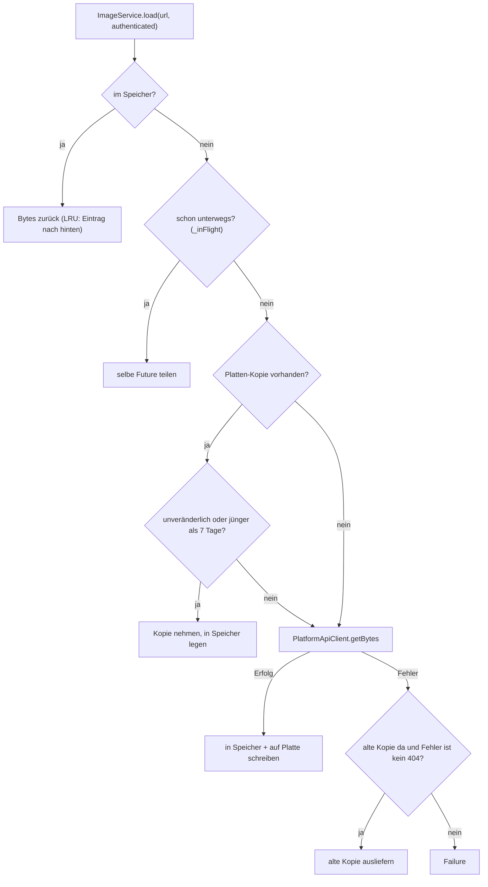
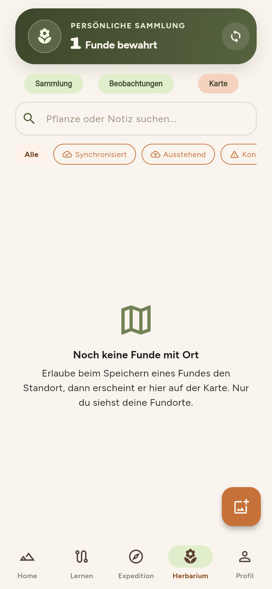
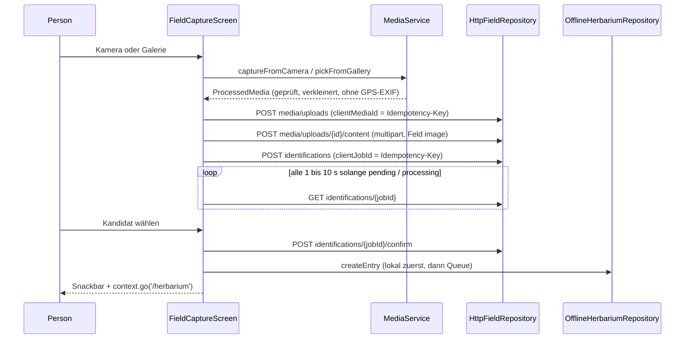

# Bilder, Cache und Karte

Alle Bilder der App laufen durch einen gemeinsamen `ImageService` (Speicher, dann Platte, dann Netz), Fotos der Nutzer:innen werden authentifiziert geladen, und die Herbarium-Karte bezieht ihre Kacheln vom Server statt direkt von OpenStreetMap. Diese Seite beschreibt das Zusammenspiel samt Artkarten, Sammelquoten und dem Feldablauf von Foto bis Fund.

## Der `ImageService`

`lib/core/images/image_service.dart` lädt „every picture at most once per lifetime of the image“. Die Reihenfolge ist Speicher, Platte, Netz:



Wichtige Regeln im Code:

| Regel | Umsetzung |
|---|---|
| **Unveränderlichkeit** | `ImageService.isImmutable(url)` ist wahr, wenn der Pfad `/media/` enthält oder die Query `photoId` hat. Solche Bilder werden nie neu geladen: die ID steckt in der URL, die Bytes dahinter ändern sich nicht. |
| **Frische** | Andere URLs gelten 7 Tage (`static const refreshAfter = Duration(days: 7)`), passend zur wöchentlichen Auffrischung im Backend (Kommentar). Danach wird neu geladen; scheitert das, liefert der Dienst die alte Kopie. |
| **Kein 404-Rückfall** | Bei `NotFoundFailure` wird die alte Kopie **nicht** ausgeliefert. |
| **Speicher-Budget** | `memoryBudgetBytes = 48 * 1024 * 1024`; ältester Eintrag fliegt zuerst (`_remember`). Ein einzelnes Bild bleibt auch über Budget. |
| **Gleichzeitige Anfragen** | `_inFlight[url]` teilt eine Future; sie wird nach Abschluss entfernt (der Kommentar warnt vor dem Rückgabe-Trick, der die Future auf sich selbst warten ließe). |
| **Singleton** | `ImageService.shared` wird in `main.dart` gesetzt; Widgets ohne Service fallen auf `Image.network` zurück. |

!!! warning "Stolperfalle: Der Schlüssel ist die URL, nicht der Inhalt"
    Der Cache-Schlüssel ist der Rohstring `url`. Eine Änderung eines Bildes unter derselben URL erreicht Geräte erst nach 7 Tagen, außer die URL enthält `/media/` oder `photoId`. Wer also neue Bild-Endpunkte baut, die Bytes ändern können, sollte die Version in die URL legen und aufpassen, ob `isImmutable` sie fälschlich als unveränderlich einstuft. Siehe auch `test/core/image_service_test.dart` (einmaliges Laden, Plattenkopie nach App-Neustart, veraltete Kopie bei Netzfehler).

### Platten-Store: nativ und Web

`image_disk_store.dart` wählt per bedingtem Export:

```dart title="apps/flutter/lib/core/images/image_disk_store.dart"
export 'image_disk_store_native.dart'
    if (dart.library.js_interop) 'image_disk_store_web.dart';
```

- **Nativ** (`image_disk_store_native.dart`): eine Datei je Bild unter `<ApplicationSupport>/images/<sha256(key)>.img`, also „not purged like the temporary cache“. Geschrieben wird atomar über eine `.tmp`-Datei und `rename`. Das Änderungsdatum der Datei dient als `storedAt`.
- **Web** (`image_disk_store_web.dart`): `_NoDiskStore`, tut nichts. Der Browser hält die unveränderlichen Antworten selbst im HTTP-Cache. Folge: Im Web greift die 7-Tage-Logik nicht, jede Speicher-Lücke führt zu einer Netzanfrage (der Browser-Cache entscheidet).

## `PlantiniImage`

`PlantiniImage(url, authenticated: …, decodeWidth: …)` (`lib/core/images/plantini_image.dart`) ist das Widget dazu. Es holt die Bytes über `ImageService.shared.load` und zeigt sie mit `Image.memory(…, gaplessPlayback: true)`.

- `decodeWidth` begrenzt die Dekodiergröße: `cacheWidth = decodeWidth * devicePixelRatio`.
- `peek(url)` liefert Bytes synchron, wenn sie schon im Speicher liegen; dadurch flackert ein bereits geladenes Bild beim Neuaufbau nicht.
- Fehler gehen an `errorBuilder(context, failure)`; ohne Builder wird nichts gezeichnet (`SizedBox.shrink`).
- `authenticated: true` ist **nur** für die privaten Medien der angemeldeten Person gedacht (Kommentar: „a plain `Image.network` cannot send“ das Bearer-Token).

```dart title="apps/flutter/lib/features/herbarium/presentation/widgets/herbarium_map_view.dart"
: PlantiniImage(
    photo,
    authenticated: true,
    decodeWidth: 46,
    errorBuilder: (_, _) =>
        const Icon(Icons.local_florist_rounded, size: 22),
  ),
```

### Wo das Token mitgeht

`PlatformApiClient.getBytes` löst die URL gegen die API-Basis auf (`resolveContentUrl`) und sendet `Authorization: Bearer …` nur, wenn `authenticated` gesetzt ist **und** `target.origin == baseUrl.origin`:

```dart title="apps/flutter/lib/adapters/http/platform_api_client.dart"
final sameOrigin =
    target.origin == Uri.parse(_dio.options.baseUrl).origin;
final token = authenticated && sameOrigin
    ? await _accessTokenProvider()
    : null;
```

Eine absolute Fremd-URL bekommt also nie das Token. Fehlt bei `authenticated: true` das Token, ergibt das `UnauthorizedFailure('Deine Sitzung ist abgelaufen …')`. Wie bei JSON gibt es bei 401 genau eine Wiederholung ([Überblick](index.md#platformapiclient)).

## Authentifizierte Fotos: `/media/{id}/content?width=`

Die Fotos der Funde sind privat. Der Vertrag (`contracts/api.yaml`, Operation `getPrivateMediaContent`) beschreibt `GET /media/{mediaId}/content`: nur für den Besitzer („another account's media id is indistinguishable from a missing one“), die Bytes hinter einer ID ändern sich nie, der optionale Parameter `width` darf `320`, `720` oder `1280` sein und liefert ein verkleinertes JPEG.

Im Client baut `HerbariumEntry.photoUrl({int? width})` (`lib/features/herbarium/domain/herbarium_models.dart`) die URL aus dem vom Server gelieferten `mediaUrl`:

```dart title="apps/flutter/lib/features/herbarium/domain/herbarium_models.dart"
String? photoUrl({int? width}) {
  final url = mediaUrl;
  if (url == null || url.isEmpty) return null;
  return width == null ? url : '$url?width=$width';
}
```

Die Karte nutzt `photoUrl(width: 320)` für den Marker und `photoUrl(width: 720)` für das Detailblatt. Lokale Funde ohne Serverfoto haben noch kein `mediaUrl` und zeigen ein Blumen-Icon. Weil der Pfad `/media/` enthält, behandelt `ImageService.isImmutable` diese Fotos als dauerhaft: einmal geladen, nie wieder.

## Herbarium-Karte

<figure markdown="span">
  
  <figcaption>Der Reiter „Karte“ im Herbarium (<code>HerbariumMapView</code>): Marker mit Fundfoto, Tippen öffnet ein Detailblatt.</figcaption>
</figure>

`HerbariumMapView` (`lib/features/herbarium/presentation/widgets/herbarium_map_view.dart`) nutzt das Paket `flutter_map` (Version laut `pubspec.yaml`: `^8.3.2`) mit `latlong2`.

- **Welche Funde?** Nur Einträge mit `latitude` und `longitude` und `syncStatus != deleted`. Ohne solche (oder ohne `ImageService.shared`) erscheint „Noch keine Funde mit Ort“. Die Texte im leeren Zustand versprechen „Nur du siehst deine Fundorte“; zur Genauigkeit der Marker siehe den Abschnitt „Standort“ weiter unten.
- **Kamera:** bei mindestens zwei Funden `CameraFit.coordinates(...)` mit `maxZoom: 15`; sonst Mitte beim ersten Fund, Zoom 13. `minZoom: 3`, `maxZoom: 17`, Drehen ist abgeschaltet (`InteractiveFlag.all & ~InteractiveFlag.rotate`).
- **Kacheln:** `TileLayer(urlTemplate: 'tiles/{z}/{x}/{y}', tileProvider: PlantiniTileProvider(images), userAgentPackageName: 'eu.plantini.app', maxNativeZoom: 17)`.
- **Marker:** `_FindPin` mit rundem Fundfoto (`PlantiniImage`, authentifiziert), Tippen öffnet ein Bottom-Sheet (`_FindSheet`) mit Titel, Datum, `FindInsights` und „Fund öffnen“.
- **Attribution:** `SimpleAttributionWidget(source: Text('© OpenStreetMap-Mitwirkende'))`.

### `PlantiniTileProvider` und der Kachel-Proxy

Der `TileProvider` (`map_tile_provider.dart`) bildet jede Kachel auf den relativen Pfad `tiles/<z>/<x>/<y>` ab und lädt sie über `images.load(path, authenticated: true)`. Der Pfad löst sich gegen die API-Basis auf, es entsteht ein Aufruf `GET /api/v1/tiles/{z}/{x}/{y}` mit Bearer-Token. Das Gerät kontaktiert den Kachelanbieter nie. Der Grund steht im Server-Code:

```js title="services/platform/src/api/platform/services/core/content/tile-proxy.js"
/**
 * Map tiles for the herbarium map, fetched and cached by the server so the
 * app never contacts the tile provider (the provider would see every user's
 * IP address and the places they look at).
 */
```

Der Server-Proxy lädt `https://tile.openstreetmap.org/{z}/{x}/{y}.png` (kein Redirect, höchstens 256 KiB je Kachel, 6 s Timeout, maximal 6 parallele Abrufe) und hält sie auf der Platte vor; neu geholt wird nach 14 Tagen (`REFRESH_MS`, die OSM-Tile-Policy verlangt laut Kommentar mindestens eine Woche Caching). Laut Vertrag ist der Endpunkt „not an open proxy“ (Anmeldung nötig), Zoom 0 bis 18. Die App fragt maximal Zoom 17 (`maxZoom`/`maxNativeZoom`). Details zum Proxy gehören zur [Backend-Dokumentation](../backend/services.md).

Weil Kacheln als `ImageService`-Einträge laufen, bekommen sie dieselbe Behandlung wie Bilder: Der Pfad `tiles/…` enthält weder `/media/` noch `photoId`, gilt also **nicht** als unveränderlich und wird nach 7 Tagen neu geladen (nativ; im Web entscheidet der Browser-Cache).

!!! note "Offline-Karte"
    Bereits angesehene Kacheln liegen nativ auf der Platte und sind ohne Netz wieder da. Neue Ausschnitte brauchen Netz. Eine vorab herunterladbare Offline-Karte gibt es nicht.

## Artkarten und Sammelquoten

Beide Informationen kommen aus `HttpInsightRepository` (`lib/features/herbarium/infrastructure/http_insight_repository.dart`) und erscheinen im Karten-Detailblatt (`FindInsights`) und auf dem Pflanzensteckbrief (`CollectionShareNote`).

| Angebot | Endpunkt | Cache im Client | Hinweis |
|---|---|---|---|
| Sammelquote | `GET stats/collection` | 10 Minuten im Arbeitsspeicher (`statsTtl`) | Liefert `available: false`, solange zu wenige Konten existieren; der Client zeigt dann nichts. Server formatiert Prozent bzw. Promille (`label`). |
| Artkarte | `GET species/{speciesKey}` | dauerhaft im Arbeitsspeicher je Schlüssel | nur für Arten, die nicht im Katalog stehen (`HerbariumEntry.speciesKey`); Foto über `PlantiniImage(authenticated: true)` |

`CollectionStats.sentenceFor` (`domain/collection_insights.dart`) liefert den Satz: Fehlt die Pflanze in der Veröffentlichung, heißt es „Noch niemand sonst hat diese Art gesammelt.“, sonst „{label} der Nutzer*innen haben diese Art gesammelt.“ Ist `available` falsch, gibt es `null` und die Karte bleibt leer, damit niemand durch kleine Zahlen identifizierbar wird (Kommentar: „too few accounts exist for a share to be published without singling anyone out“).

Die Artkarte (`SpeciesCard`) enthält Name, Kurztext, Quelle und Foto mit Urheber und Lizenz; der Client zeigt ausdrücklich „Artkarte aus öffentlichen Quellen, nicht redaktionell geprüft. Sie gehört zu keinem Ökosystem.“ und für den Text „Quelle: … (CC BY-SA 4.0)“. Aufbau und Lizenzprüfung der Karten auf dem Server: [Inhalte und Releases](../backend/inhalte-releases.md) und [Datenmodell](../architektur/datenmodell.md).

## Feldablauf: von der Kamera zum Fund

`FieldCaptureScreen` (`lib/features/field/presentation/field_capture_screen.dart`, Route `/field`) ist ein Zustandsautomat über `_media`, `_job` und `_isWorking`. Query-Parameter `expectedPlantId` und `expectedPlantName` übergeben dem Bestimmungsauftrag eine erwartete Pflanze (`expectedPlantId` im `POST identifications`), etwa wenn der Fund aus einem Steckbrief gestartet wird.



### Foto vorbereiten (`MediaService`)

`lib/features/field/infrastructure/media_service.dart`: Standardgrenzen `defaultMaxBytes = 10 MB`, `defaultMaxDimension = 2048`, `defaultJpegQuality = 85`.

1. Rohdaten über `2 × maxBytes` werden sofort abgelehnt.
2. Das Format wird an den **Magic Bytes** erkannt (`detectMimeType`: JPEG `FF D8 FF`, PNG-Signatur); alles andere ist `ValidationFailure('Ungültiges Dateiformat. Bitte wähle ein JPEG- oder PNG-Foto.')`.
3. Dekodieren mit dem Paket `image`; bei JPEG mit GPS-Block wird `hadLocationMetadata` gesetzt und der Block entfernt, wenn `keepLocation` falsch ist.
4. Längste Kante auf höchstens 2048 px verkleinern, neu kodieren (PNG bleibt PNG, sonst JPEG Qualität 85).
5. Ist das Ergebnis noch größer als 10 MB: `ValidationFailure('Das Bild überschreitet nach der Kompression die Maximalgröße.')`.

Im UI steuert der Schalter „Foto-Standort entfernen“ (Standard an, `_removePhotoLocation = true`, Schlüssel `field-remove-photo-location`) den GPS-Block im Bild. Getrennt davon steuert „Fundort privat speichern“ (`field-location-consent`) den Standort des **Fundes**.

### Standort

`LocationService` (`location_service.dart`) fragt Berechtigung und Dienst ab (`LocationState`) und liefert Koordinaten nur, wenn die Genauigkeit höchstens `maxUsefulAccuracyMeters = 100` ist. Der Screen holt sie bei „Speichern“ nur, wenn `_includeLocation` gesetzt ist. Der Server bekommt eine vergröberte Position (zwei Nachkommastellen, `accuracyMeters: 1000`). Der lokale Datensatz hält die genauen Koordinaten nur, bis der nächste Listenabgleich den Serverstand darüberschreibt; danach zeigt die Karte voraussichtlich das vergröberte Raster (Herleitung und Vorbehalt in [Offline](offline.md#herbarium-offline)). `AndroidManifest.xml` deklariert `CAMERA`, `ACCESS_FINE_LOCATION`, `ACCESS_COARSE_LOCATION` und `READ_MEDIA_IMAGES`; Kamera und Standort sind per `uses-feature … android:required="false"` optional.

### Idempotenz im Ablauf

Jede schreibende Stufe erzeugt ihre ID per `SecureClientIdGenerator` (UUID v4) und nutzt sie als `Idempotency-Key`: `clientMediaId` für die Reservierung, `clientJobId` für die Bestimmung. Fund-ID und -Schlüssel (`_observationClientId`, `_observationIdempotencyKey`) werden erst beim Speichern vergeben und bei jedem Wiederholen wiederverwendet; sie werden nur zurückgesetzt, wenn ein neues Foto gewählt wird. Serverseitige Auswertung: [Idempotenz und Fehler](../backend/idempotenz-fehler.md).

### Warten: Ladeanimation

Solange das Foto hochgeladen oder bestimmt wird, ersetzt `AnalysisProgress` (`lib/features/field/presentation/widgets/analysis_progress.dart`) den Screen. Die Stufen sind „each value is a real state of the workflow“:

| `AnalysisStage` | Auslöser | Titel |
|---|---|---|
| `uploading` | Foto gewählt, noch kein Job | „Dein Foto wird hochgeladen“ |
| `queued` | Job `pending` (oder Wiederholung geplant) | „Gleich geht es los“ |
| `analysing` | Job `processing` | „Die Pflanze wird bestimmt“ |

Das Widget zeichnet das Foto mit Scan-Strahl, drehendem Ring und Schritteliste und wechselt alle 6 Sekunden einen Tipp. Die Animation läuft endlich (`repeat(count: 60)`, rund 2,5 Minuten), „so widget tests can settle“. Das Abfragen übernimmt `_scheduleIdentificationPoll`: Standard 1 Sekunde, bei `retryAfter` bis höchstens 10 Sekunden Wartezeit.

### Fehler-Popups

Jeder fehlgeschlagene Schritt zeigt einen Dialog (`showFieldProblemDialog`, Schlüssel `field-problem-dialog`) und zusätzlich einen Hinweis im Screen. Der Dialog wird in `lib/features/field/presentation/field_problem.dart` zusammengesetzt; `FieldStep` benennt die Stufe (`reserve`, `upload`, `submit`, `poll`, `confirm`, `save`) und bestimmt den Einleitungssatz („Dein Foto konnte nicht zur Bestimmung geschickt werden.“ usw.).

`FieldProblem.fromFailure(AppFailure, FieldStep)` übersetzt:

| `AppFailure` | Titel | wiederholbar |
|---|---|---|
| `NetworkFailure` | „Keine Verbindung“ | ja |
| `TimeoutFailure` | „Das dauert zu lange“ | ja |
| `RateLimitedFailure` | „Gerade zu viel los“ (nennt Wartezeit aus `retryAfter`) | ja |
| `UnauthorizedFailure` | „Bitte neu anmelden“ | nein, Knopf „Anmelden“ (`needsLogin`) |
| `PermissionFailure` | „Nicht erlaubt“ | nein |
| `ValidationFailure` | „Das Foto passt nicht“ | nein |
| `ConflictFailure` | „Schon erledigt“ | nein |
| `ServerFailure` | „Unser Server hakt“ (mit `Fehlernummer: <traceId>`) | ja |

`FieldProblem.fromJob(IdentificationJob)` übersetzt die Fehlercodes eines fertigen Jobs:

| `failureCode` | Titel | wiederholbar |
|---|---|---|
| `PROVIDER_RATE_LIMITED`, `PROVIDER_QUOTA_RESERVED` | „Die Bestimmung ist ausgelastet“ | ja |
| `PROVIDER_TIMEOUT`, `PROVIDER_UNAVAILABLE`, `PROVIDER_CIRCUIT_OPEN`, `PROVIDER_RETRY_EXHAUSTED` | „Bestimmung nicht erreichbar“ | ja |
| `PROVIDER_REJECTED` | „Foto nicht erkannt“ | nein |
| `PROVIDER_CREDENTIALS_INVALID` | „Bestimmung ist gerade abgeschaltet“ | nein |
| `MEDIA_UPLOAD_EXPIRED`, `MEDIA_UNAVAILABLE`, `MEDIA_UPLOAD_NOT_FOUND` | „Foto nicht mehr da“ | nein |
| `PROVIDER_INVALID_RESPONSE` | „Unklare Antwort“ | ja |
| sonst | „Bestimmung fehlgeschlagen“ | ja |

„Erneut versuchen“ führt genau den Schritt aus, der gescheitert ist (der Screen übergibt `_startIdentification`, `_refreshIdentification`, `_retryIdentification` oder `_saveObservation` als `retry`). Ein endgültig gescheiterter Job wird nur einmal erklärt (`_explainedJob = '<id>/<attempts>'`). Neue Codes, die der Server einführt, müssen hier ergänzt werden, sonst erscheint der allgemeine Text. Die Codes selbst definiert der Server (siehe [Services](../backend/services.md)).

!!! tip "Dialog ohne Backend ansehen"
    `lib/dev/analysis_preview.dart` ist laut Dateikopf eine „Design workbench: the analysis wait and the problem pop-up, no backend“. Starten kannst du sie wie die anderen Werkbänke mit `flutter run -t lib/dev/analysis_preview.dart` (Aufrufmuster aus `forest_preview.dart`, hier nicht ausgeführt).

### Weitere Schutzmechanismen im Screen

- Ein Abgleich mit der erwarteten Pflanze (`expectedPlantId`) fordert bei Abweichung eine ausdrückliche Zustimmung (`_acceptMismatch`, `acceptMismatch: true` im Confirm-Aufruf; Widget `expected_plant_mismatch_consent.dart`, Test `test/expected_plant_mismatch_consent_test.dart`).
- Gespeichert werden kann nur, wenn der Job `identified` ist und ein Kandidat gewählt wurde (`canSave`).
- Ist `fieldRepository` oder `herbariumRepository` nicht verdrahtet, zeigt der Screen „Der Feldablauf ist nicht konfiguriert.“

## Weiterführend

- [Überblick der App](index.md), [Offline-Fähigkeit](offline.md), [Authentifizierung](auth.md)
- [Services](../backend/services.md) und [Idempotenz und Fehler](../backend/idempotenz-fehler.md) für Kachel-Proxy, Medien und Bestimmung auf dem Server
- [Nutzung: Herbarium](../nutzung/herbarium.md) aus Sicht der Lernenden
- Quellpfade: `apps/flutter/lib/core/images/`, `apps/flutter/lib/features/herbarium/presentation/widgets/herbarium_map_view.dart`, `apps/flutter/lib/features/herbarium/presentation/widgets/map_tile_provider.dart`, `apps/flutter/lib/features/herbarium/presentation/widgets/find_insights.dart`, `apps/flutter/lib/features/herbarium/presentation/widgets/collection_share_note.dart`, `apps/flutter/lib/features/herbarium/infrastructure/http_insight_repository.dart`, `apps/flutter/lib/features/field/presentation/field_capture_screen.dart`, `apps/flutter/lib/features/field/presentation/field_problem.dart`, `apps/flutter/lib/features/field/presentation/widgets/analysis_progress.dart`, `contracts/api.yaml`
