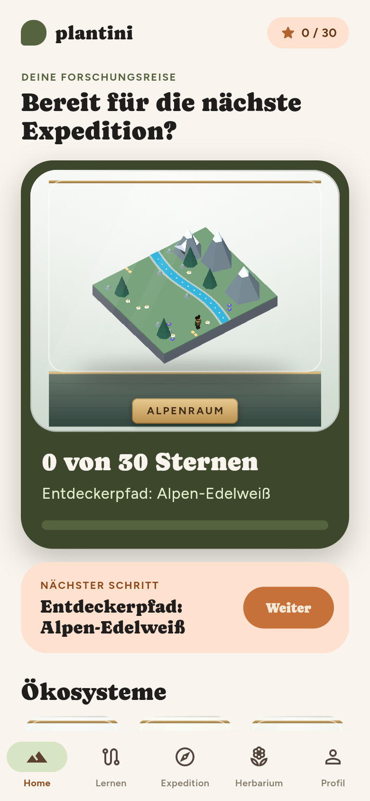
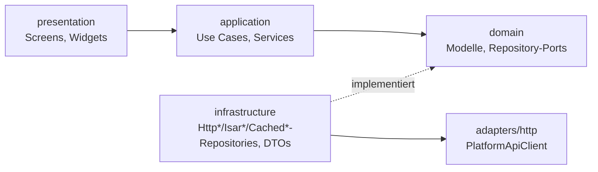
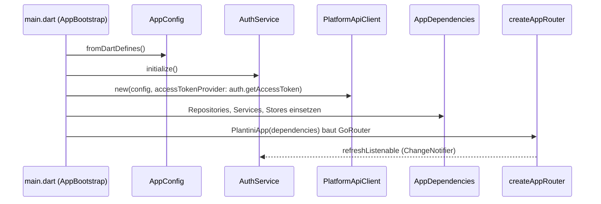
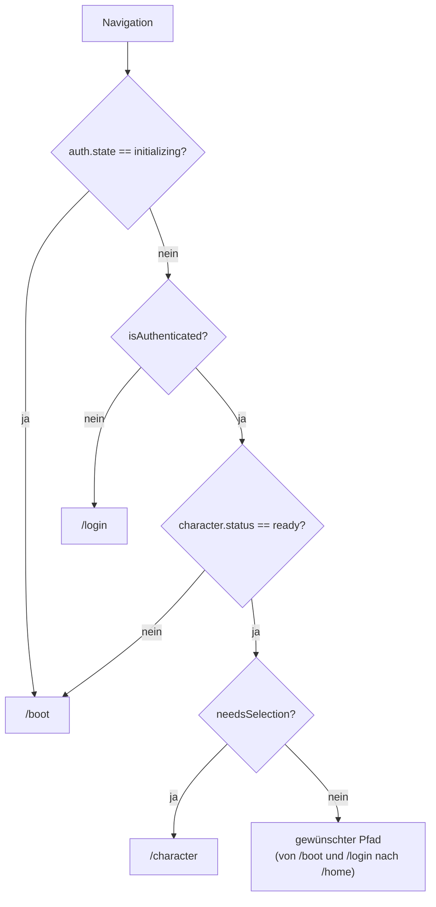
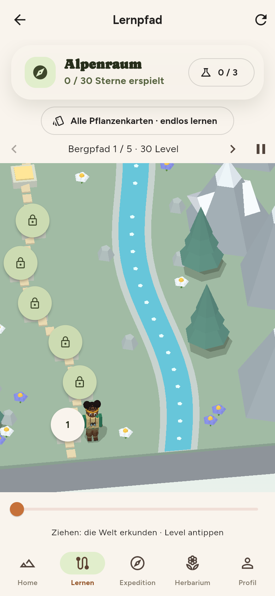

# Die Flutter-App im Überblick

Die Plantini-App liegt unter `apps/flutter/` und läuft als Web-App, Linux-Desktop-Programm und Android-App (iOS ist im Repository vorbereitet, aber nicht belegt, siehe [Bauen und Release](bauen-release.md)). Diese Seite erklärt, wie `lib/` aufgebaut ist, wie die Teile beim Start zusammengesteckt werden und welche Konventionen du beim Mitarbeiten brauchst.

!!! note "Projektstatus"
    Plantini ist Open Source (Code: AGPL-3.0-or-later, Inhalte: CC BY-SA 4.0; siehe `LICENSE` und `NOTICE`) und ein früher, unvollständiger Stand. Beiträge: siehe `CONTRIBUTING.md`. Die App-Version steht in `apps/flutter/pubspec.yaml` (`version: 0.7.1+11` zum Zeitpunkt dieser Seite).

<figure markdown="span">
  
  <figcaption>Die Startseite (<code>/home</code>, <code>HomeScreen</code>): nächste freigeschaltete Station, Fortschrittschip und die Ökosysteme.</figcaption>
</figure>

## Verzeichnisstruktur von `lib/`

```text
apps/flutter/lib/
├── main.dart                # AppBootstrap: baut alle Abhängigkeiten, zeigt Startfehler
├── app/                     # app_config, app_dependencies, app_version, plantini_app, router
├── auth/                    # AuthService, CredentialStore, Plattform-Helfer (io / web)
├── adapters/http/           # PlatformApiClient (einziger HTTP-Einstieg für Features)
├── core/                    # result, errors, ids, images, storage, theme, time, widgets, diagnostics
├── design_system/           # AsyncStateView, PlantSpecimenBottle, WorldArt
├── features/
│   ├── catalog/             # Ökosysteme, Level, Pflanzen, Content-Sync, 3D-Welt-Widgets
│   ├── learning/            # Quiz-Sitzungen, Übungsmodus, Fortschritt
│   ├── field/               # Foto, Standort, Bestimmung, Sync-Queue
│   ├── herbarium/           # privates Herbarium, Karte, Artkarten
│   ├── character/           # neun Entdecker:innen, Auswahl, Cache
│   └── home/                # Startseite
├── dev/                     # eigenständige Vorschauen (eigene main), nicht im Router
├── ui/                      # leere Unterverzeichnisse, keine Dateien
└── storage/                 # leeres Verzeichnis
```

!!! warning "Stolperfalle: `lib/ui/*` und `lib/storage` sind leer"
    `CLAUDE.md` im Repository beschreibt `lib/ui/*` noch als „ältere Screens“. Im Arbeitsbaum enthalten `lib/ui/{ecosystem,level,plant,learning,quiz,expedition,herbarium,components,game}` und `lib/storage` **keine Dateien** (`find lib/ui lib/storage -type f` liefert nichts, `git ls-files lib/ui lib/storage` ebenso). Alle Screens liegen unter `lib/features/*/presentation`. Der Code gilt; lege neue Dateien nicht in die leeren Ordner.

Die Dateien in `lib/dev/` (`analysis_preview.dart`, `card_preview.dart`, `forest_preview.dart`, `world_bench.dart`) sind Design-Werkbänke mit je eigener `main()`. Du startest sie mit `flutter run -t lib/dev/forest_preview.dart` (Kommentar am Dateikopf). `world_bench.dart` ist ein Benchmark für die 3D-Ansichten, siehe [Bauen und Release](bauen-release.md#perf-messlauf).

## Schichten am Beispiel eines Features

Jedes Feature unter `lib/features/<name>/` trennt vier Schichten. Die Abhängigkeit zeigt immer nach innen: Presentation kennt Application, Application kennt Domain, nur Infrastructure kennt HTTP und Speicher.



Am Katalog sieht man das vollständig:

| Schicht | Datei | Rolle |
|---|---|---|
| domain | `features/catalog/domain/catalog_repository.dart` | Port `CatalogRepository` (vier Methoden, alle `Future<Result<…>>`) |
| domain | `features/catalog/domain/catalog_models.dart` | `Ecosystem`, `Level`, `LevelStatus`; laut Kommentar „deliberately contain no transport or persistence annotations“ |
| application | `features/catalog/application/catalog_use_cases.dart` | `LoadPublishedEcosystems`, `LoadPublishedLevels`, `LoadPublishedLevel`, `LoadPublishedPlant` |
| infrastructure | `features/catalog/infrastructure/http_catalog_repository.dart` | ruft `PlatformApiClient` auf |
| infrastructure | `features/catalog/infrastructure/catalog_dto.dart` | `CatalogDto`: JSON zu Domain-Modell, fehlende Felder werden `ContractFailure` |
| infrastructure | `…/cached_catalog_repository.dart`, `…/isar_catalog_repository.dart` | Dekoratoren für Offline-Fälle, siehe [Offline](offline.md) |
| presentation | `features/catalog/presentation/ecosystem_list_screen.dart` u. a. | Screens, bekommen `AppDependencies` |

Ein Use Case ist bewusst klein, `call()` delegiert nur:

```dart title="apps/flutter/lib/features/catalog/application/catalog_use_cases.dart"
final class LoadPublishedEcosystems {
  const LoadPublishedEcosystems(this._repository);

  final CatalogRepository _repository;

  Future<Result<List<Ecosystem>>> call() =>
      _repository.listPublishedEcosystems();
}
```

Und ein Repository im Infrastructure-Ordner übersetzt nur Transport in Domain, hier das Lesen des Charakters aus dem Profil:

```dart title="apps/flutter/lib/features/character/infrastructure/http_character_repository.dart"
@override
Future<Result<String?>> load() async {
  final response = await _client.getJson('me', requiresAuthentication: true);
  return response.when(
    // A record from the old character designer (v1) counts as "none": the
    // player picks one of the new explorers.
    success: (value) => Result.success(_idOf(value.body['character'])),
    failure: Result.failure,
  );
}
```

!!! note "Der generierte API-Client wird (noch) nicht benutzt"
    `apps/flutter/pubspec.yaml` hängt `packages/api` als Pfad-Abhängigkeit `openapi` ein, aber `grep -rn openapi lib test integration_test` findet **keinen Import**. Die App spricht ausschließlich über den handgeschriebenen `PlatformApiClient` mit eigenen DTO-Mappern. `PlatformApiClient` sagt das selbst: Er „deliberately exposes JSON and multipart primitives rather than generated API models“. Den Vertrag `contracts/api.yaml` pflegst du trotzdem mit, siehe [API-Vertrag](../backend/api-vertrag.md).

## Start und Abhängigkeits-Verdrahtung

`main()` ist minimal: Binding initialisieren, `FrameStats.install()`, `runApp(const AppBootstrap())`. Die eigentliche Arbeit macht `_AppBootstrapState._initialize()` in `lib/main.dart`, in dieser Reihenfolge:

1. `AppConfig.fromDartDefines()` liest und validiert die Build-Konfiguration.
2. `SharedPreferences.getInstance()`, danach `_restoreDayPin` (gemerkte Tageszeit).
3. `AuthService(config: config)` und `await auth.initialize()` (verarbeitet den Web-Redirect oder liest gespeicherte Anmeldedaten, siehe [Authentifizierung](auth.md)).
4. `PlatformApiClient(config: config, accessTokenProvider: auth.getAccessToken)`.
5. `ImageService.shared = ImageService(api: api)` (ein statischer Singleton, die einzige Ausnahme vom expliziten Reichen der Abhängigkeiten; siehe [Bilder und Karte](bilder-karte.md)).
6. Katalog: `HttpCatalogRepository` → `CachedCatalogRepository` (SharedPreferences) → `IsarCatalogRepository` (Isar als letzter Rückfall).
7. `createLocalDatabase()`, `createContentSyncService(...)`, `createSyncQueueStore(...)`, `OfflineHerbariumRepository(...)..startConnectivityMonitoring()`.
8. Alles landet in einem `AppDependencies`-Objekt.

`AppDependencies` (`lib/app/app_dependencies.dart`) ist ein reines Bündel `final class` mit Use Cases und Ports. Der Kommentar legt die Regel fest: „Feature widgets get use cases and ports, never raw Dio, Strapi, or storage objects.“ Optionale Felder (`herbariumRepository`, `fieldRepository`, `character`, …) sind nullable, damit Widget-Tests nur das verdrahten müssen, was sie brauchen.

Schlägt ein Schritt fehl, zeigt `AppBootstrap` eine wiederholbare Fehlerseite („Erneut versuchen“). Die Ursache geht zusätzlich mit `debugPrint('Plantini bootstrap failed: …')` ins Log. Ein `AppFailure` (z. B. `ConfigurationFailure` oder `StorageFailure`) zeigt seinen Text direkt, alles andere „Plantini konnte nicht sicher gestartet werden …“.



### Router und Redirect-Logik

`lib/app/router.dart` baut mit `createAppRouter(AppDependencies)` einen `GoRouter` (Paket `go_router`). Er hört per `refreshListenable: Listenable.merge([dependencies.auth, ?dependencies.character])` auf Änderungen der Anmeldung und des Charakters und wertet bei jeder Änderung `redirect` neu aus:

```dart title="apps/flutter/lib/app/router.dart"
redirect: (context, state) {
  final path = state.matchedLocation;
  if (dependencies.auth.state == AuthState.initializing) {
    return path == '/boot' ? null : '/boot';
  }
  if (!dependencies.auth.isAuthenticated) {
    return path == '/login' ? null : '/login';
  }
  final character = dependencies.character;
  if (character != null) {
    // The character is loaded right after login; the first login has none
    // yet and starts in the creator.
    if (character.status != CharacterStatus.ready) {
      return path == '/boot' ? null : '/boot';
    }
    if (character.needsSelection) {
      return path == '/character' ? null : '/character';
    }
  }
  if (path == '/boot' || path == '/login') return '/home';
  return null;
},
```



Routen (`initialLocation: '/home'`):

| Pfad | Screen | Bemerkung |
|---|---|---|
| `/boot`, `/login`, `/character` | `BootScreen`, `LoginScreen`, `CharacterSelectorScreen` | außerhalb der Shell; `/character?from=profile` kehrt nach `/profile` zurück |
| `/home` | `HomeScreen` | Reiter „Home“ |
| `/`, `/ecosystems` | `EcosystemListScreen` | Reiter „Lernen“ |
| `/ecosystems/:ecosystemId` | `EcosystemLevelsScreen` | Lernpfad eines Ökosystems |
| `/ecosystems/:ecosystemId/practice` | `PracticeScreen` | freies Üben, ändert keinen Fortschritt |
| `/levels/:levelId` | `LevelOverviewScreen` | Stationsvorschau |
| `/levels/:levelId/quiz` | `LearningScreen` | `contentVersion` aus der Query, Standard `latest` |
| `/quiz/:levelId` | `LearningScreen` | **verlangt** `?contentVersion=`, sonst `InvalidRouteScreen` |
| `/plants/:plantId` | `PlantDetailScreen` | nimmt die `Plant` aus `state.extra`, sonst einen Platzhalter |
| `/field` | `FieldCaptureScreen` | Reiter „Expedition“; Query `expectedPlantId`, `expectedPlantName` |
| `/herbarium` | `HerbariumScreen` | Reiter „Herbarium“ |
| `/profile` | `ProfileScreen` | Reiter „Profil“, Tageszeit-Auswahl, Abmelden |

Die fünf Reiter der `NavigationBar` stehen in `AppShell`: Home, Lernen, Expedition, Herbarium, Profil (`ShellRoute`). Fällt ein Pfad in keinen der Präfixe `/home`, `/field`, `/herbarium`, `/profile`, wird der Reiter „Lernen“ markiert.

Zusätzlich hängt `PlantiniApp` (`lib/app/plantini_app.dart`) einen Listener an `auth`: Sobald angemeldet, ruft er `character?.sync()` und genau einmal `contentSync.syncRelease()` auf; bei `AuthState.unauthenticated` ruft er `character?.reset()`, „Another person may sign in on this device next“. Beim Zurückkehren aus dem Hintergrund (`AppLifecycleState.resumed`) aktualisiert er `DayClock` und synchronisiert den Charakter.

!!! warning "Stolperfalle: Update-Pflicht bleibt unsichtbar"
    `contentSync.syncRelease()` wird in `plantini_app.dart` ohne `await` und ohne Auswertung des `Result` aufgerufen. Ein `AppUpdateRequiredFailure` (Inhalte brauchen eine neuere App-Version) landet deshalb nirgends in der Oberfläche; `grep -rn AppUpdateRequiredFailure lib` zeigt nur die Definition und die Stelle in `content_sync_service.dart`. Bestehende Inhalte bleiben erhalten, der Nutzer erfährt aber nichts davon.

## Konfiguration per `--dart-define`

Alle Werte kommen zur Build-Zeit. `AppConfig` (`lib/app/app_config.dart`) rät nie einen Endpunkt: fehlende oder falsche Werte werfen eine `ConfigurationFailure`, die der Bootstrap anzeigt.

| Define | Gelesen in | Pflicht | Regel |
|---|---|---|---|
| `PLANTINI_ENV` | `app_config.dart` | nein, Standard `development` | `development`, `staging` oder `production` |
| `PLANTINI_API_BASE_URL` | `app_config.dart` | ja | absolute http(s)-URL, Pfad muss genau `/api/v1` sein (Schrägstrich am Ende wird normalisiert) |
| `PLANTINI_OIDC_ISSUER_URL` | `app_config.dart` | ja | absolute http(s)-URL des Keycloak-Realms |
| `PLANTINI_OIDC_CLIENT_ID` | `app_config.dart` | ja | nicht leer |
| `PLANTINI_DAYTIME` | `main.dart` (`_restoreDayPin`) | nein | `morning`, `noon`, `evening`, `night`: erzwingt die Tageszeit der 3D-Welten |
| `PLANTINI_PERF_LOG` | `core/diagnostics/frame_stats.dart` | nein | `true` schreibt jede Sekunde eine `PERF …`-Zeile |
| `PLANTINI_APP_VERSION` | `app/app_version.dart` | nur bei `--build-name`-Überschreibung | muss dann mit dem Build-Namen übereinstimmen |

Zusätzliche Prüfungen in `AppConfig.fromValues`: keine IPv6-Literale (`uri.host.contains(':')`) in API- und Issuer-URL und bei `production` zwingend HTTPS. Beispiel für eine lokale Entwicklungsumgebung (so auch in `tools/e2e/scripts/run-e2e-stack.sh` und `.gitlab-ci.yml`):

```sh
cd apps/flutter
flutter build web --release \
  --dart-define=PLANTINI_ENV=development \
  --dart-define=PLANTINI_API_BASE_URL=http://127.0.0.1:1338/api/v1 \
  --dart-define=PLANTINI_OIDC_ISSUER_URL=http://127.0.0.1:8082/realms/plantini \
  --dart-define=PLANTINI_OIDC_CLIENT_ID=plantini-web-dev
```

!!! tip "Warum `127.0.0.1` und nie `localhost`"
    Der Code verbietet IPv6-Literale und der Desktop-Login nutzt eine IPv4-Loopback-Adresse (siehe [Authentifizierung](auth.md)). Das Skript `apps/flutter/tool/build-linux.sh` bricht mit Exit-Code 64 ab, wenn eine der vier Pflicht-Variablen fehlt oder eine URL `[`/`]` enthält.

## Design-System

Das visuelle System heißt im Code „Organic“ und ist aus `ds/organic.css` übernommen (Kommentar in `core/theme/app_colors.dart`; die Vorlage liegt unter `knowledge/references/design/plantini-mobile-app-design/project/ds/organic.css`).

| Datei | Inhalt |
|---|---|
| `core/theme/app_colors.dart` | `AppColors`: Grundfarben `bg` (`0xFFF5EAD8`), `terracotta` (`0xFFC67139`), `sage` (`0xFF7A8A5E`), `ink`; Skalen `neutral100…900`, `accent100…900`, `sage100…900`; dazu Kompatibilitätsnamen (`forest`, `moss`, `cream`, …) |
| `core/theme/app_typography.dart` | `AppTypography.textTheme`: Überschriften `Caprasimo`, Fließtext `Figtree` |
| `core/theme/app_theme.dart` | `AppTheme.lightTheme` (Material 3, Seed `terracotta`); `darkTheme` ist ein Alias auf `lightTheme` |
| `core/theme/design_tokens.dart`, `organic_tokens.dart` | Abstände (`AppSpacing`), Radien, Dauern; `OrganicTokens` (Seitenrand `22/10`, Radius 8/16/28) |
| `design_system/async_state_view.dart` | `AsyncStateView` mit `AsyncViewKind` (loading, empty, offline, stale, permissionDenied, recoverableError, fatalError) |
| `design_system/plant_specimen_bottle.dart`, `world_art.dart` | Herbariums-Flasche, lokale Welt-Illustrationen (`assets/worlds/*.png`) |

Die Schriften liegen als Dateien in `assets/fonts/` und sind in `pubspec.yaml` deklariert (beide SIL OFL 1.1; die Lizenztexte sind als Assets mitgeliefert). Das hat einen belegten Grund, den die Kommentare nennen: Ohne Fallback-Schrift lädt der Web-Build fehlende Zeichen („·“, „→“) von einem Drittanbieter-CDN; deshalb setzt `AppTypography.headingFallback` Figtree als Fallback. Caprasimo gibt es nur in einem Schnitt, `pubspec.yaml` ordnet ihn allen Gewichten zu, „stops Flutter from synthesising a smeared faux-bold“.

`PlantiniApp` setzt `darkTheme: AppTheme.darkTheme` und `themeMode: ThemeMode.light`. Da `darkTheme` in `app_theme.dart` nur `=> lightTheme` zurückgibt (`static ThemeData get darkTheme => lightTheme;`), gibt es in der App derzeit keinen dunklen Modus.

!!! note "Zwei Sätze Zustandswidgets"
    Es gibt `design_system/async_state_view.dart` (`AsyncStateView`, im Router und auf der Startseite benutzt) **und** `core/widgets/state_widgets.dart` (`LoadingState`, `EmptyState`, `OfflineState`, `ErrorState`, `PermissionDeniedState`). Für neue Screens ist `AsyncStateView` das Muster im Router; ob `state_widgets.dart` noch an anderer Stelle gebraucht wird, habe ich nicht geprüft.

## `Result` und `AppFailure`

Fehler laufen in der App nicht als Exceptions durch die Schichten, sondern als Wert. `lib/core/result.dart` definiert ein `sealed class Result<T>` mit `Success<T>` und `Failure<T>` sowie `when`, `valueOrNull`, `failureOrNull`. Dart-3-Mustervergleich funktioniert direkt:

```dart title="apps/flutter/lib/features/catalog/application/content_sync_service.dart"
final manifestResponse = await apiClient.getJson('content/manifest');
if (manifestResponse case Failure<ApiJsonResponse>(:final failure)) {
  return Result.failure(failure);
}
```

`AppFailure` (`lib/core/errors/app_failure.dart`) ist ebenfalls `sealed`; rohe Dio- und Plattform-Ausnahmen dürfen „inside infrastructure adapters“ bleiben. `isRetryable` ist für `NetworkFailure`, `ServerFailure` und `TimeoutFailure` wahr, `RateLimitedFailure` überschreibt es auf `true`.

| Typ | `code` | typische Ursache |
|---|---|---|
| `ConfigurationFailure` | `configuration_invalid` | falsche Dart-Defines, Pfad beginnt mit `/` |
| `AppUpdateRequiredFailure` | `app_update_required` | `minimumAppVersion` des Manifests größer als die App |
| `NetworkFailure` | `network_unavailable` | kein Netz |
| `TimeoutFailure` | `request_timeout` | Connect-, Receive- oder Send-Timeout |
| `RateLimitedFailure` | `rate_limited` | HTTP 429, `retryAfter` aus Header |
| `ServerFailure` | `server_error` | 5xx, trägt `statusCode` und `traceId` |
| `UnauthorizedFailure` | `unauthorized` | 401 oder kein Token |
| `PermissionFailure` | `permission_denied` | 403 |
| `ValidationFailure` | `validation_failed` | übrige 4xx, `fieldErrors` |
| `ContractFailure` | `contract_violation` | Antwort entspricht nicht dem Vertrag, `missingFields` |
| `NotFoundFailure` | `not_found` | 404 |
| `ConflictFailure` | `conflict` | 409 |
| `StorageFailure` | `storage_failed` | Isar, SharedPreferences, Schlüsselbund |

## `PlatformApiClient`

`lib/adapters/http/platform_api_client.dart` ist „the only HTTP entry point for feature adapters“. Er kapselt `Dio` mit Basis-URL aus `AppConfig`, `connectTimeout` 12 s, `receiveTimeout` 20 s, `sendTimeout` 30 s und Header `Accept: application/json`.

| Methode | HTTP | Besonderheit |
|---|---|---|
| `getJson(path, queryParameters, requiresAuthentication=false)` | GET | Token wird mitgeschickt, wenn vorhanden |
| `postJson(path, body, idempotencyKey, requiresAuthentication=true)` | POST | Header `Idempotency-Key` |
| `patchJson(…, ifMatchVersion)` | PATCH | Header `If-Match` |
| `deleteJson(…, ifMatchVersion)` | DELETE | Header `If-Match` |
| `postMultipart(path, fields, bytes, mediaType, filename)` | POST | Dateifeld heißt `image`; `FormData` wird pro Versuch geklont |
| `getBytes(url, authenticated, accept)` | GET | Binärdaten; Token nur bei gleicher Origin wie die API |

Regeln, die du beim Erweitern beachten musst:

- **Pfade sind relativ.** `_relativePath` wirft `ConfigurationFailure('API-Pfade müssen relativ zu /api/v1 angegeben werden.')`, wenn ein Pfad mit `/` beginnt. Schreibe `getJson('ecosystems')`, nicht `getJson('/ecosystems')`.
- **Eine Wiederholung bei 401.** Die Schleife in `_requestJson` läuft höchstens zweimal (`while (attempt < 2)`); bei `DioException` mit Status 401 im ersten Versuch fragt sie den `accessTokenProvider` erneut und sendet noch einmal. Die Erneuerung des Tokens selbst passiert im Provider (`AuthService.getAccessToken`), nicht im Client. Gleiches gilt für `getBytes`.
- **Antwortform.** Erwartet wird ein JSON-Objekt (`Map<String, dynamic>`); `202`/`204` mit leerem Rumpf ergibt `ApiJsonResponse(body: {})`. Alles andere wird `ContractFailure('Die API lieferte kein im Vertrag vorgesehenes JSON-Objekt.')`.
- **Fehlerabbildung** (`_mapDioFailure`): 401 → `UnauthorizedFailure`, 403 → `PermissionFailure`, 404 → `NotFoundFailure`, 429 → `RateLimitedFailure` (Header `retry-after` in Sekunden), 409 → `ConflictFailure`, übrige 4xx → `ValidationFailure` mit `fieldErrors` aus dem Problem-Objekt, Timeouts → `TimeoutFailure`, andere Statuscodes → `ServerFailure`, sonst `NetworkFailure`. Die Meldung kommt aus `detail` oder `title` des Problem-Rumpfes; die `traceId` aus `x-correlation-id` oder `x-request-id`. Wie das Backend diese Probleme erzeugt, steht in [Idempotenz und Fehler](../backend/idempotenz-fehler.md).

```dart title="apps/flutter/lib/adapters/http/platform_api_client.dart"
} on DioException catch (error) {
  if (error.response?.statusCode == 401 && attempt == 1) {
    continue;
  }
  debugPrint('PlatformApiClient: DioException on $path: $error');
  return Result.failure(_mapDioFailure(error));
}
```

## Feature-Tour

<figure markdown="span">
  
  <figcaption>Der Lernpfad (<code>/ecosystems/:ecosystemId</code>): Stationen pro Level (zehn pro Kapitel laut Kommentar in <code>ResearcherPathView</code>), der Fortschritt kommt vom Server.</figcaption>
</figure>

**Katalog** (`features/catalog`). `EcosystemListScreen` zeigt die veröffentlichten Ökosysteme, `EcosystemLevelsScreen` den Pfad mit Stationen (`ResearcherPathView`, `ModularForestView` für die 3D-Welt, `LevelGateCard` für gesperrte Level), `LevelOverviewScreen` die Vorschau einer Station und `PlantDetailScreen` den Steckbrief. Die Daten kommen aus `/ecosystems`, `/levels/{id}`, `/plants/{id}` und dem Paket-Sync (`content/manifest`, siehe [Offline](offline.md)). Die 3D-Widgets (`world_*.dart`) werden in [3D und Blender](../3d/index.md) beschrieben.

**Lernen** (`features/learning`). `LearningScreen` führt durch Lektion und Quiz. `LearningSessionService` hält den lokalen Wiederaufnahme-Stand, der Server bleibt maßgeblich (`startLevelAttempt`, `submitEvents`, `completeLevelAttempt` über `level-attempts`, `learning-events/batch`). `PracticeScreen` ist der freie Übungsmodus: „Recall is optional self-assessment and never modifies level progress.“

**Feld und Fund** (`features/field`). `FieldCaptureScreen` führt Foto aufnehmen oder wählen (`MediaService`), optional Standort (`LocationService`), Upload reservieren und senden, Bestimmung abfragen, Kandidat bestätigen und Fund speichern. Fehler erscheinen als Pop-up (`FieldProblem`). Details in [Bilder und Karte](bilder-karte.md).

**Herbarium** (`features/herbarium`). `HerbariumScreen` hat drei Ansichten: „Sammlung“ (Flaschen, `HerbariumBottleCollection`), „Beobachtungen“ (Liste) und „Karte“. `HerbariumDetailScreen` zeigt einen Fund mit Sync-Banner. Offline-Verhalten in [Offline](offline.md).

**Charakter** (`features/character`). Neun feste Entdecker:innen (`assets/characters/explorers.json`, in Blender modelliert, siehe [Charaktere](../3d/charaktere.md)). `CharacterStore` lädt die Wahl aus `GET /me`, speichert sie per `PATCH /me` (`{'character': {'v': 2, 'id': …}}`) und cached sie in SharedPreferences. Beim ersten Login ohne Wahl leitet der Router nach `/character`.

**Home** (`features/home`). `HomeScreen` lädt die Ökosysteme, sucht im ersten Ökosystem das erste freigeschaltete, nicht abgeschlossene Level und zeigt Fortschritt als Sternchip.

## Tests

Die Tests liegen in `apps/flutter/test/` (Konfiguration, Router, Auth, Content-Sync, Sync-Queue, Herbarium, Feld, Lernen). `test/app_flow_widget_test.dart` exportiert `createWidgetFlowDependencies`, ein vollständiges `AppDependencies`-Bündel aus Fakes; `integration_test/perf_walk_test.dart` benutzt es ebenfalls. Gates laut `.gitlab-ci.yml`:

```sh
cd apps/flutter
flutter pub get
dart format --output=none --set-exit-if-changed lib test
flutter analyze
flutter test
```

Allgemeine Regeln zu Tests und CI findest du in [Tests und CI](../mitmachen/tests-ci.md).

## Weiterführend

- [Authentifizierung](auth.md): PKCE, Redirects je Plattform, Token-Erneuerung
- [Offline-Fähigkeit](offline.md): Isar, Content-Sync, Sync-Queue, Herbarium
- [Bilder und Karte](bilder-karte.md): Bild-Cache, Kachel-Proxy, Feldablauf
- [Bauen und Release](bauen-release.md): Web, Linux, Android, Perf-Messlauf
- [API-Vertrag](../backend/api-vertrag.md) und [Services](../backend/services.md) auf der Backend-Seite
- Quellpfade: `apps/flutter/lib/main.dart`, `apps/flutter/lib/app/`, `apps/flutter/lib/adapters/http/platform_api_client.dart`, `apps/flutter/lib/core/`
