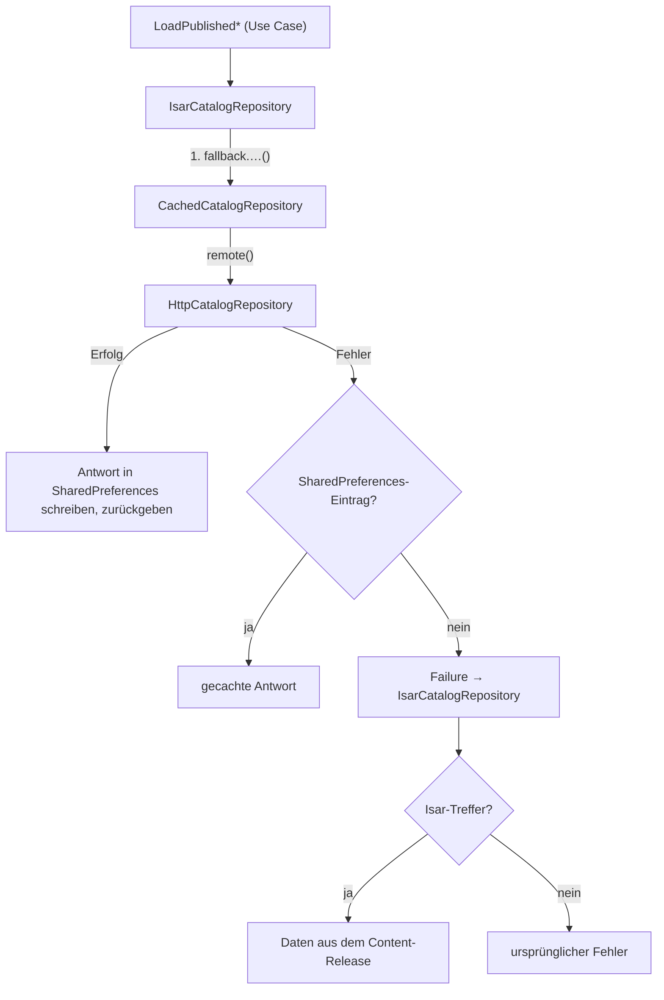
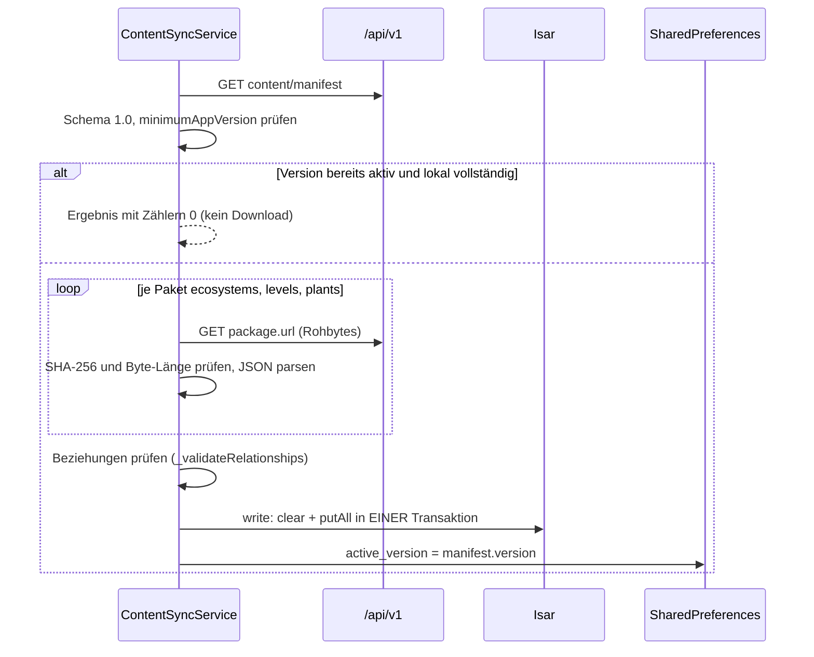

# Offline-Fähigkeit

Die App speichert veröffentlichte Lerninhalte, laufende Quizsitzungen, Funde und die Charakterwahl lokal und überträgt Schreibvorgänge mit stabilen Client-IDs später. Diese Seite zeigt, welcher Speicher was hält, wie der Content-Sync und die Sync-Queue arbeiten und wo die Grenzen liegen.

!!! warning "Stolperfalle: Lesen ist netzwerk-zuerst, nicht offline-zuerst"
    Der Katalog fragt zuerst immer den Server. Isar kommt nur zum Zug, wenn Netzwerk **und** der SharedPreferences-Cache keinen Treffer liefern. Offline-zuerst ist nur das Schreiben von Herbarium-Funden. Die Reihenfolge steht in [Katalog lesen](#katalog-lesen-netz-dann-cache-dann-isar).

## Speicher im Überblick

| Speicher | Technik | Was liegt dort | Datei |
|---|---|---|---|
| Isar (`plantini_local_db`) | `isar_plus`, nativ Isar-Engine, Web SQLite/WASM | Ökosysteme, Level, Pflanzen des aktiven Content-Releases; Sync-Jobs | `lib/core/storage/local_database.dart` |
| SharedPreferences | `shared_preferences` (Web: Browser-Speicher) | aktive Content-Version, Katalog-Cache, Herbarium-Funde, Lernsitzungen, Charakter, Tageszeit | siehe Tabelle unten |
| Sicherer Speicher | `flutter_secure_storage` | OIDC-Credential | `lib/auth/credential_store.dart` |
| Datei-Cache (nur nativ) | Dateien unter dem Application-Support-Verzeichnis | heruntergeladene Bilder und Kacheln | `lib/core/images/` ([Bilder und Karte](bilder-karte.md)) |

SharedPreferences-Schlüssel, soweit im Code belegt:

| Schlüssel | Besitzer | Inhalt |
|---|---|---|
| `plantini.content.active_version` | `ContentSyncService` | Version des zuletzt vollständig übernommenen Releases |
| `plantini.catalog.ecosystems.v1`, `plantini.catalog.level.<id>.v1`, `plantini.catalog.plant.<id>.v1`, `plantini.catalog.ecosystem.<id>.levels.v1` | `CachedCatalogRepository` | letzte erfolgreiche Server-Antwort |
| `herbarium.cache.v1` | `SharedPreferencesHerbariumStore` | Liste aller lokalen Fund-Datensätze (ein JSON-Array) |
| `plantini.learning.session.v1.<levelId>` | `SharedPreferencesLearningSessionStore` | laufende Quizsitzung je Level |
| `explorer_v2` | `CharacterStore` | `{"id": …, "dirty": bool}` |
| `daytime_pin` | `_DayTimeCardState` / `_restoreDayPin` | gemerkte Tageszeit |

### Isar öffnen

`LocalDatabase.open()` initialisiert Isar und öffnet die Schemas `IsarEcosystemSchema`, `IsarLevelSchema`, `IsarPlantSchema`, `IsarSyncJobSchema`. Im Web lädt es die Engine aus der eigenen Origin und nicht von einem CDN, damit der Start „not depend on public DNS and an external service“:

```dart title="apps/flutter/lib/core/storage/local_database.dart"
await Isar.initialize(kIsWeb ? '/isar_plus.wasm' : null);
final dbDir =
    directory ??
    (kIsWeb ? '.' : (await getApplicationSupportDirectory()).path);
final isarInstance = Isar.open(
  schemas: schemas,
  directory: dbDir,
  name: name,
  engine: kIsWeb ? IsarEngine.sqlite : IsarEngine.isar,
  inspector: inspector,
);
```

`/isar_plus.wasm` und `isar_plus.js` liegen in `apps/flutter/web/`; der Pfad ist absolut, die Web-App muss also an der Wurzel der Origin liegen. Die Modelle (`lib/features/catalog/infrastructure/models/isar_*.dart`) tragen eindeutige Indizes auf `publicId`; `IsarPlant` hat eingebettete `IsarPlantMedia` und `IsarPlantProfileCard`. Die `*.g.dart`-Dateien sind generiert (aus der Analyse ausgeschlossen, `analysis_options.yaml`).

!!! note "Wenn Isar nicht öffnet"
    `createLocalDatabase()` gibt bei Fehlern `null` zurück. Die beiden Fabriken `createContentSyncService` und `createSyncQueueStore` öffnen die Datenbank dann erneut und werfen bei einem zweiten Fehler die `StorageFailure`. Der Bootstrap zeigt dann den Startfehler-Bildschirm („Erneut versuchen“).

## Katalog lesen: Netz, dann Cache, dann Isar

In `lib/main.dart` ist der Katalog dreifach geschachtelt:



`IsarCatalogRepository` ruft bei jeder Methode zuerst `fallback` (also `CachedCatalogRepository`) auf und liest Isar nur, wenn das ein `Failure` liefert. Die Kommentare im Code begründen es: „Progress changes after each quiz. Published Isar content is a fallback, never the authority for fresh unlocks.“ und „Published profiles can gain new field-note cards. Prefer the remote source so an older Isar snapshot cannot hide that additive content.“

!!! warning "Stolperfalle: Der Isar-Rückfall kennt keinen Fortschritt"
    `ContentSyncService._parseIsarLevel` schreibt jedes Level mit `status = IsarLevelStatus.available`; Fortschritt und Sperren sind kein Teil der Content-Pakete. Greift der Isar-Rückfall, erscheinen daher alle Level freigeschaltet, ohne Fortschrittswert. Der SharedPreferences-Cache dagegen enthält die letzte Server-Antwort samt Status.

## Content-Sync

`ContentSyncService` (`lib/features/catalog/application/content_sync_service.dart`) lädt ein komplettes, unveränderliches Release. Angestoßen wird `syncRelease()` von `PlantiniApp` einmal pro Anmeldung, ohne Rückmeldung an die Oberfläche (siehe [Überblick](index.md#router-und-redirect-logik)).



Schritt für Schritt:

1. **Manifest** `GET content/manifest` (öffentlich, ohne Authentifizierung). `ContentReleaseManifest.fromJson` verlangt `version`, ein parsbares `releasedAt`, `schemaVersion == '1.0'` und `minimumAppVersion` im Format `x.y.z`. Jedes Paket (`ContentPackageDescriptor`) braucht `id`, eine **relative** `url` (ohne Schema, Authority, Fragment und ohne `..`), einen 64-stelligen Hex-`sha256` und `bytes > 0`. Verstöße werden `ContractFailure('Das Inhalts-Manifest entspricht nicht dem API-Vertrag.')`.
2. **Mindestversion.** Vor jedem Download vergleicht die Schleife `AppVersion.components(currentVersion)` mit `minimumAppVersion`. Ist die App älter, gibt es `AppUpdateRequiredFailure` und der bisherige Stand bleibt erhalten, auch bei `force: true`.
3. **Überspringen.** Ist `activeLocalVersion == manifest.version` **und** hat `_hasCompleteLocalRelease` in Isar jeweils mindestens einen Datensatz je Sammlung, passiert nichts weiter.
4. **Pakete laden und prüfen.** Je Paket `apiClient.getBytes(url, accept: 'application/json')`. Gehasht werden die Roh-Bytes („Re-encoding a parsed JSON response changes whitespace and key ordering, making a valid immutable package fail SHA-256“). Falsche Prüfsumme oder Länge ergeben `ValidationFailure('Integritätsfehler für Paket "…"')` mit `fieldErrors` `expected`/`actual`. Der Nutzlast-Parser erwartet eine Liste oder `{ "items": [...] }`.
5. **Vollständigkeit.** Genau die drei Pakete `ecosystems`, `levels`, `plants` müssen vorhanden und nicht leer sein; sonst `ContractFailure`.
6. **Beziehungen** (`_validateRelationships`): keine doppelten IDs; Pflanzen mit Identität und passender `releaseVersion`; jedes Ökosystem verweist auf existierende Level desselben Ökosystems; pro Ökosystem eindeutige `sequence`, `minimumScore` in 0 bis 1, `requiredLevelIds` nur mit kleinerer `sequence`, alle `plantIds` existieren.
7. **Atomarer Wechsel.** Erst jetzt öffnet `localDb.isar.write(...)` eine Transaktion, leert die drei Sammlungen und schreibt alles neu. Bricht etwas vorher ab, ändert sich nichts. Zuletzt setzt der Service `plantini.content.active_version`.

```dart title="apps/flutter/lib/features/catalog/application/content_sync_service.dart"
localDb.isar.write((_) {
  localDb.ecosystems.clear();
  localDb.levels.clear();
  localDb.plants.clear();
  // … autoIncrement-IDs vergeben, dann putAll(...)
});
```

!!! note "`signature` wird (noch) nicht geprüft"
    Das Manifest-Feld `signature` wird geparst und im Modell abgelegt (`ContentReleaseManifest.signature`), aber nirgends ausgewertet (`grep -rn signature lib` findet keine Prüfung). Die Integrität stützt sich auf die SHA-256-Summen im Manifest selbst, das über TLS vom selben Server kommt.

Tests: `test/content_sync_test.dart` deckt den erfolgreichen Sync, das Überspringen bei vollständigem lokalem Release, den Abbruch bei falscher Prüfsumme und bei Netzfehler ab. Wie die Server-Seite Releases baut, steht in [Inhalte und Releases](../backend/inhalte-releases.md).

## Sync-Queue

Die Queue (`lib/features/field/application/sync_queue_service.dart`) macht Schreibvorgänge wiederholbar. Heute nutzt sie nur das Herbarium.

**Datenmodell** `SyncJob` / `IsarSyncJob` (`lib/core/storage/models/isar_sync_queue.dart`): `clientId` (eindeutiger Index), `payload` (String), `status` (`pending`, `running`, `failed`, `completed`), `attemptCount`, `nextRetryAt`, `errorReason`, `createdAt`, `updatedAt`.

**Verarbeitung** (`SyncQueueService.processQueue`):

- Geholt werden Jobs, die `pending` oder `failed` und fällig (`nextRetryAt <= now`) sind, oder `running` und älter als `runningJobTimeout` (5 Minuten, Absturzschutz), jeweils mit `attemptCount < maxAttempts` (5), sortiert nach `createdAt`.
- Pro Job: `running`, `attemptCount += 1`, Processor aufrufen. Erfolg setzt `completed`. Fehler setzt `failed` und `nextRetryAt = now + calculateBackoff(attemptCount)`.
- Backoff: `min(maxBackoffSeconds, baseBackoffSeconds * 2^(attemptCount - 1))` mit 2 s Basis und 300 s Obergrenze, also 2, 4, 8, 16 s bei den ersten Versuchen.
- `retryFailedJobs()` (Herbarium-Knopf „Synchronisieren“) setzt alle `failed`-Jobs auf `pending`, `attemptCount = 0`, ohne die `clientId` zu ändern: „so the remote idempotency contract still applies“.
- `onNetworkRestored` ruft nur `processQueue`. Ausgelöst wird es von `OfflineHerbariumRepository.startConnectivityMonitoring()`, sobald `connectivity_plus` ein Ergebnis ungleich `ConnectivityResult.none` meldet.

!!! warning "Offene Punkte der Queue"
    - **Erledigte Jobs bleiben stehen.** Der Service ruft `store.deleteJob` nirgends auf; `completed`-Jobs werden nur aus der Abfrage ausgefiltert und nie gelöscht.
    - **Erneutes Einreihen derselben `clientId`.** Das Herbarium nutzt pro Fund die feste `clientId` `observation:<clientObservationId>` und reiht bei jeder Änderung (Notiz, Löschen) neu ein. `InMemorySyncQueueStore.enqueue` überschreibt den vorhandenen Job. `IsarSyncQueueStore.enqueue` vergibt für eine neue Entität eine neue ID (`autoIncrement`) und schreibt per `put`, obwohl `clientId` einen eindeutigen Index hat. Laut Doc-Kommentar der Annotation `Index.unique` in `isar_plus-1.3.9` (`lib/src/annotations/index.dart`) wird dann „the existing object … overwritten“, der alte Job also ersetzt und wieder `pending/attemptCount 0`. Das ist aus der Bibliotheksdokumentation gelesen; `test/sync_queue_test.dart` testet nur den In-Memory-Store, ein Test gegen echtes Isar fehlt. Falls `put` doch scheitern würde, bliebe das unbemerkt: `OfflineHerbariumRepository._enqueue` verwirft das `Result` von `enqueueJob`, Änderungen und Löschungen nach dem ersten Sync würden dann still nicht eingereiht.
    - Die Queue wird nur vom Herbarium benutzt; Lernereignisse haben ihren eigenen Pfad (unten).

## Herbarium offline

`OfflineHerbariumRepository` (`lib/features/herbarium/infrastructure/offline_herbarium_repository.dart`) umhüllt `HttpHerbariumRepository`. Die Klassenbeschreibung: „Local state is committed before a durable queue item is processed, so app termination never turns a failed request into a lost field observation.“

| Operation | Lokal (sofort) | Remote (Queue) |
|---|---|---|
| `createEntry` | Datensatz mit `id = clientObservationId`, `version = 'local-<id>'`, `syncStatus = pending` in `herbarium.cache.v1`; Job `observation:<id>` einreihen | `POST observations` mit `Idempotency-Key = clientObservationId` |
| `updateEntry` | Notiz und `pending` lokal, Job einreihen | `PATCH observations/<remoteId>` mit `If-Match = remoteVersion` |
| `deleteEntry` | lokal `syncStatus = deleted`, Job einreihen | `DELETE observations/<remoteId>` mit `If-Match`; hat der Fund noch keine `remoteId`, wird er nur lokal entfernt |
| `listEntries` | zuerst `queue.processQueue`, dann `remote.listEntries`, Ergebnis in den lokalen Store mischen, lokale Liste (ohne `deleted`) nach `observedAt` absteigend | – |
| `syncEntries` | `queue.retryFailedJobs()`, dann `listEntries(pageSize: 100)` | – |

Idempotenz-IDs: Der Feldablauf erzeugt `clientObservationId` und `idempotencyKey` aus `SecureClientIdGenerator` (UUID v4, `lib/core/ids/client_id_generator.dart`) und behält sie pro Foto (`_observationClientId ??= _ids.next()`), damit ein Wiederholen denselben Fund meint. Wie der Server Idempotenz-Schlüssel auswertet, steht in [Idempotenz und Fehler](../backend/idempotenz-fehler.md).

**Zusammenführen.** In `listEntries` überschreibt ein Serverstand nur Datensätze, die lokal `synced` sind; lokale `pending`/`conflict`-Einträge gewinnen (`if (current != null && current.entry.syncStatus != SyncStatus.synced) continue;`). Nach erfolgreichem `createEntry` übernimmt der Code die Serverfelder, behält aber lokale Anzeigefelder (`mediaUrl`, `plantName`, `scientificName`, `identificationResult`, `latitude`, `longitude`, `accuracyMeters`) per `copyWith`.

**Standort.** Beim Senden wird die Position vergröbert:

```dart title="apps/flutter/lib/features/field/domain/location_privacy.dart"
static ObservationLocation coarsen(ObservationLocation location) {
  final lat = (location.latitude * 100).round() / 100;
  final lng = (location.longitude * 100).round() / 100;

  return ObservationLocation(
    latitude: lat,
    longitude: lng,
    accuracyMeters: 1000.0,
  );
}
```

`_processQueuePayload` ruft `LocationPrivacy.coarsen` vor `remote.createEntry` auf (zwei Nachkommastellen, `accuracyMeters: 1000`). Der Server kennt also nur die vergröberte Position. Direkt nach dem Senden behält der lokale Datensatz noch die **genauen** Koordinaten (`value.copyWith(latitude: record.entry.latitude, …)`), aber nur kurz:

- `HttpHerbariumRepository._observation` übernimmt `syncStatus` und `location` aus der Serverantwort. Der zusammengeführte Datensatz ist danach `synced`.
- Beim nächsten `listEntries` (bei jedem Öffnen des Herbariums) überspringt der Merge nur Datensätze, die **nicht** `synced` sind, und schreibt für `synced` den Serverstand komplett darüber, inklusive der vergröberten `latitude`/`longitude`.
- Folge (aus dem Code abgeleitet, nicht auf einem Gerät ausprobiert): Die Karte zeigt den genauen Ort nur bis zur nächsten Aktualisierung der Liste; danach springt der Marker auf das 2-Nachkommastellen-Raster (Größenordnung 1 km). Liefert der Server für einen Fund keine `location`, würde dieser Fund nach dem Überschreiben ohne Koordinaten dastehen und von der Karte verschwinden (die Karte filtert auf `latitude != null`). Ob der Server die vergröberte Position tatsächlich zurückgibt, steht im Vertrag (`ObservationLocation`) und im Backend, siehe [Sicherheit und Datenschutz](../architektur/sicherheit-datenschutz.md); ich habe es hier nicht gegengeprüft.

**Konflikte.** Schlägt ein Job mit `ConflictFailure` (HTTP 409) fehl, setzt der Code `SyncStatus.conflict` und `syncError` am Datensatz; sonst bleibt der Status `pending` mit Fehlertext. Die Detailansicht zeigt dazu ein Sync-Banner (`_SyncStatusBanner`). Es gibt keine automatische Auflösung; der Nutzer kann über „Synchronisieren“ erneut versuchen. `test/offline_herbarium_repository_test.dart` enthält den Test „remote version conflict remains visible and retryable“.

!!! note "Nur der Fund lebt in SharedPreferences, die Queue in Isar"
    Der Datensatz (`herbarium.cache.v1`) und der Job (`IsarSyncJob`) liegen in verschiedenen Speichern. Sie sind über `clientObservationId` verknüpft. Bei einem Absturz zwischen `local.write` und `_enqueue` entsteht ein `pending`-Datensatz ohne Job. Im Code sucht nichts nach solchen verwaisten Datensätzen; sie werden erst wieder eingereiht, wenn für denselben Fund `updateEntry` oder `deleteEntry` aufgerufen wird.

## Lernsitzungen

`LearningSessionService` (`lib/features/learning/application/learning_session_service.dart`) behält je Level eine `LearningSession` im `SharedPreferencesLearningSessionStore` (Schlüssel `plantini.learning.session.v1.<levelId>`):

- `beginOrResume` nimmt eine vorhandene Sitzung wieder auf, wenn die `contentVersion` übereinstimmt, und fragt sonst Quizfragen und einen neuen Versuch beim Server an (`quiz-items`, `level-attempts`). Ein **neuer** Versuch braucht also Netz.
- `recordAnswer` erzeugt pro bestätigter Antwort ein `LearningEvent` (`quiz_answered`) mit `clientEventId` und speichert es in `pendingEvents`. Ersetzt der Nutzer eine Antwort, wird das alte Ereignis derselben Frage verworfen: „Only the confirmed selection is sent, not discarded draft choices.“
- Der lokale Speicher enthält nur `id` und `label` der Antwortmöglichkeiten, **keine** richtigen Lösungen; bewertet wird serverseitig.
- `submitPendingEvents` sendet gesammelt an `learning-events/batch` mit eigenem `Idempotency-Key`, entfernt akzeptierte Ereignisse und meldet abgelehnte als `ValidationFailure`.
- `complete` sendet erst ausstehende Ereignisse, dann `level-attempts/<id>/complete` mit `idempotencyKey = 'complete-<clientAttemptId>'` („A lost response must replay the same completion“). Bei einem wiederholbaren Fehler (`isRetryable`) markiert der Service die Sitzung als `completionPending`, damit sie beim nächsten Öffnen erneut abgeschickt werden kann. Erst nach Erfolg wird die lokale Sitzung gelöscht.

Der Abschluss und die Freischaltung bleiben dadurch serverseitig; offline kannst du antworten, aber nicht abschließen oder neue Level freischalten.

!!! note "`ProgressSyncService` ist nicht verdrahtet"
    `lib/features/learning/application/progress_sync_service.dart` (Zusammenführen von Server- und lokalem Fortschritt, „Server state always wins when conflicts occur on the same level“) wird in `lib/` nirgends erzeugt, nur in `test/progress_sync_test.dart`. Der Fortschritt im Pfad kommt in der Praxis direkt aus `levels/<id>` bzw. dem SharedPreferences-Cache.

## Charakter-Cache

`CharacterStore` (`lib/features/character/application/character_store.dart`) lädt die Wahl nach dem Login (`GET me`) und cached sie unter `explorer_v2` zusammen mit einem `dirty`-Flag:

- `choose(id)` zeigt die Wahl sofort, markiert sie `dirty: true` und sendet `PATCH me`. Erst nach Bestätigung wird `dirty: false` gespeichert.
- Beim nächsten `sync()` gewinnt eine ungesendete lokale Änderung: `if (cached != null && cached.dirty) { await _push(cached.id); }` („an offline change wins“). Ohne `dirty` gewinnt der Serverwert; hat der Server keinen, aber der Cache einen, wird der Cache hochgeladen.
- Fällt der Server aus und es gibt keinen Cache, nutzt der Store den Platzhalter `kai` (`fallbackId`) und setzt `_placeholder`, damit niemand „by a dead connection“ in die Auswahl gezwungen wird. Der Router hält die Person bis `CharacterStatus.ready` auf `/boot`.
- `reset()` (Abmelden) löscht Cache und Anzeige.

## Konfliktstrategie im Überblick

| Daten | Bei Konflikt gewinnt | Mechanismus |
|---|---|---|
| Lerninhalte (Katalog) | Server | Release ersetzt Isar komplett; Online-Antwort schlägt Cache |
| Level-Fortschritt, Freischaltung | Server | wird nie lokal berechnet |
| Quizantworten | Server bewertet | Ereignisse mit `clientEventId`, Abschluss mit festem Idempotenz-Schlüssel |
| Herbarium-Fund (lokal ungesendet) | lokal | `pending`/`conflict` wird beim Zusammenführen nicht überschrieben |
| Herbarium-Fund (Versionskonflikt) | niemand automatisch | 409 → `SyncStatus.conflict`, sichtbar, manuell erneut versuchen |
| Charakter | lokal, falls `dirty`, sonst Server | siehe oben |

## Was offline nicht geht

- **Neue Anmeldung:** `Issuer.discover(...)` und der Token-Austausch brauchen Keycloak. Eine bestehende Sitzung startet ohne Netz (Credential aus dem Store), **aber nur solange das Access-Token gültig ist**: siehe die Warnung zum abgelaufenen Token direkt unter dieser Liste.
- **Neuen Quizversuch starten, Level abschließen, Freischaltungen sehen** (siehe Lernsitzungen).
- **Bestimmung und Bestätigung:** Upload, Warteschlange und PlantNet-Abgleich laufen über den Server; der Feldablauf zeigt bei fehlendem Netz „Keine Verbindung“ ([Bilder und Karte](bilder-karte.md#fehler-popups)). Auch `FieldRepository.confirmIdentification` ist ein Serveraufruf und läuft in `_saveObservation` **vor** `HerbariumRepository.createEntry`. Offline-fähig ist deshalb nur der Teil danach (Fund lokal anlegen und später senden, etwa wenn die Verbindung genau dort abbricht oder der Sync scheitert); einen komplett offline aufgenommenen Fund kann der Feldablauf nicht abschließen.
- **Artkarten und Sammelquoten** (`species/<key>`, `stats/collection`): Nur der Arbeitsspeicher hält sie kurz (10 Minuten für die Quoten); nichts davon wird auf die Platte geschrieben.
- **Kartenkacheln, die noch nie geladen wurden**, und im Web grundsätzlich alle Bilder ohne Browser-Cache: Der Web-Build hat keinen Platten-Cache der App (`image_disk_store_web.dart`).
- **Abmelden löscht keine Lokaldaten** außer Credential und Charakter-Cache; Lernsitzungen, Herbarium-Cache und Isar bleiben auf dem Gerät liegen (Folgerung aus `AuthService.logout` und `PlantiniApp._checkAuthAndSync`).

!!! warning "Stolperfalle: Ein abgelaufenes Token macht offline zum Abmelden (aus dem Code abgeleitet, nicht ausprobiert)"
    1. `PlatformApiClient._requestJson` ruft bei **jeder** Anfrage `accessTokenProvider()` auf, auch bei öffentlichen Endpunkten wie `GET ecosystems`.
    2. Ist `expiresAt` des Access-Tokens überschritten, versucht `credential.getTokenResponse()` (Bibliothek `openid_client`) einen Refresh-POST an Keycloak. Ohne Netz wirft das eine Ausnahme.
    3. `AuthService.getAccessToken` fängt jede Ausnahme, löscht das gespeicherte Credential und setzt `unauthenticated`. Der Router geht auf `/login`, `PlantiniApp` ruft `character.reset()`.
    4. Die Lebensdauer des Access-Tokens beträgt im versionierten Realm `accessTokenLifespan: 300` (5 Minuten, `services/identity/realm/plantini-realm.json`). Nach rund fünf Minuten ohne Netz meldet also schon die erste Anfrage, auch ein bloßes Aufrufen des Katalogs, die Person ab; der Refresh-Token ist damit weg und der Login braucht Netz.

    Bereits gespeicherte Funde bleiben lokal erhalten; ihre Jobs laufen nach dem erneuten Login weiter. Dasselbe gilt für einen kurzen Netzaussetzer bei abgelaufenem Token. Der echte Offline-Betrieb ist damit heute auf die Lebensdauer des Access-Tokens begrenzt; der Refresh-Token selbst ist an die SSO-Sitzung gebunden (`ssoSessionIdleTimeout` 1800 s, `ssoSessionMaxLifespan` 28800 s im selben Export). Eine Änderung wäre ein Fix in `AuthService.getAccessToken` (Netzfehler von abgelehntem Refresh unterscheiden); sie ist nicht umgesetzt.

## Weiterführend

- [Überblick der App](index.md), [Authentifizierung](auth.md), [Bilder und Karte](bilder-karte.md)
- [Idempotenz und Fehler](../backend/idempotenz-fehler.md), [Inhalte und Releases](../backend/inhalte-releases.md), [API-Vertrag](../backend/api-vertrag.md)
- [Sicherheit und Datenschutz](../architektur/sicherheit-datenschutz.md) zu privaten Fundorten
- Quellpfade: `apps/flutter/lib/core/storage/`, `apps/flutter/lib/features/catalog/application/content_sync_service.dart`, `apps/flutter/lib/features/field/application/sync_queue_service.dart`, `apps/flutter/lib/features/herbarium/infrastructure/offline_herbarium_repository.dart`, `apps/flutter/lib/features/learning/application/learning_session_service.dart`, `apps/flutter/lib/features/character/application/character_store.dart`
