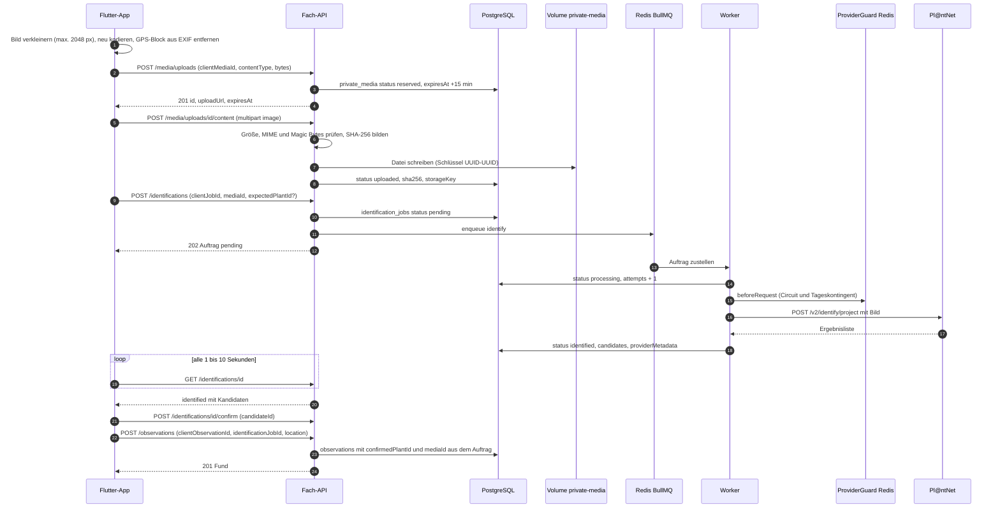
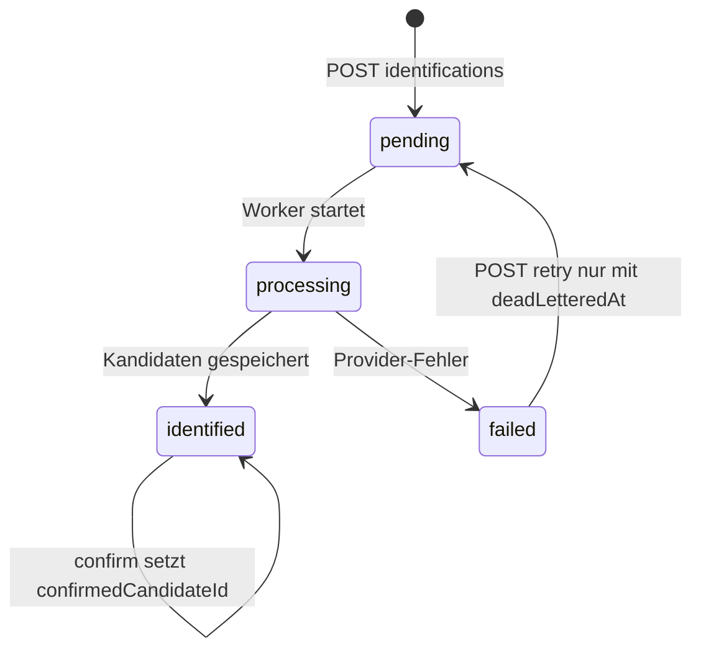
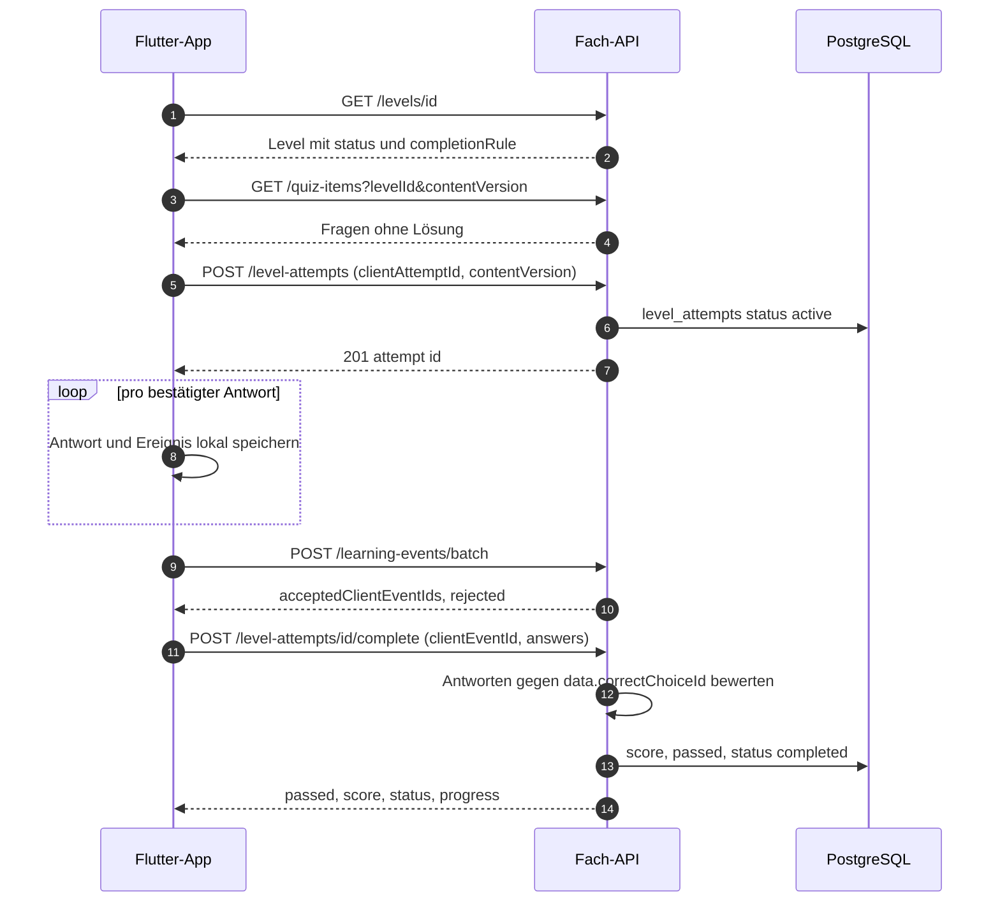
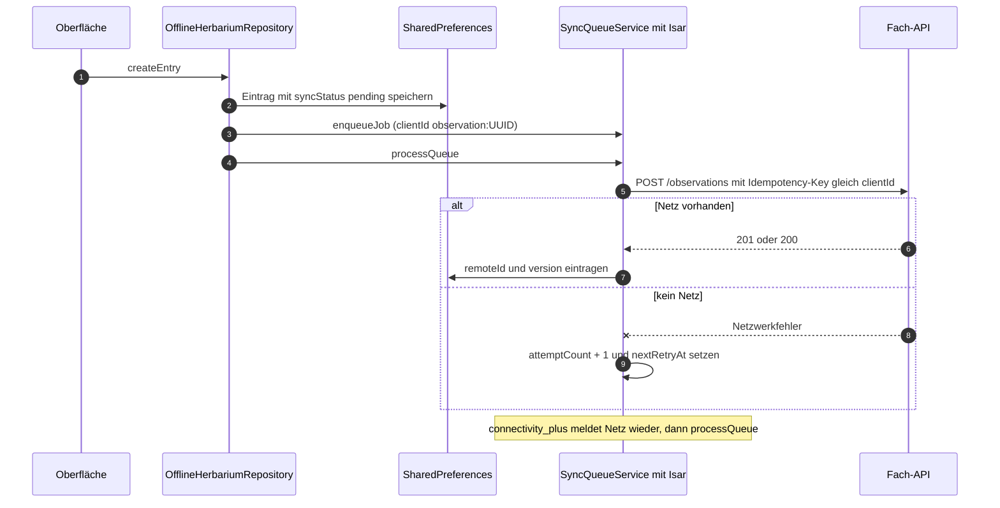
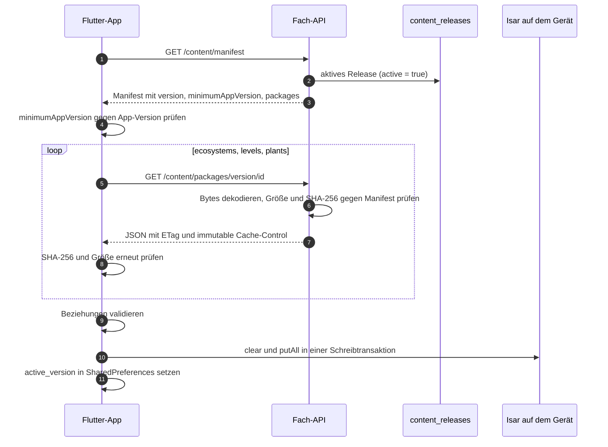
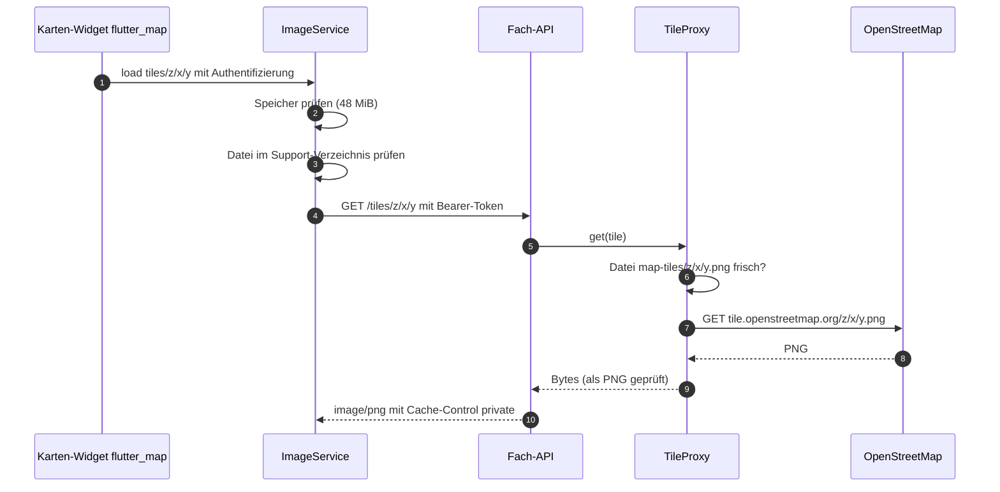

# Datenflüsse

Diese Seite zeigt die sechs wichtigen Abläufe von Plantini als Sequenzdiagramme und erklärt sie anhand des Codes: Anmeldung, Foto bis Herbarium, Level und Quiz, Offline-Schreiben, Inhalts-Releases sowie Kacheln und Bilder. Jeder Abschnitt nennt die Dateien, in denen du den Ablauf nachlesen oder ändern kannst.

!!! note "Lesehinweis"
    Statuscodes, Feldnamen und Fehlercodes stammen aus dem Code (`services/platform/src/api/platform/**`) und aus
    `contracts/api.yaml`. Beispielwerte (UUIDs, Zeitstempel) sind synthetisch. Was nur aus dem Code gelesen und nicht auf einem
    laufenden Stack geprüft wurde, ist als solches gekennzeichnet.

## 1. Anmeldung: OIDC mit PKCE

Die App meldet sich bei Keycloak mit dem Authorization-Code-Flow und PKCE (`S256`) an. Implizite Flows und Direct Access
Grants sind im Realm abgeschaltet und werden von `services/identity/scripts/validate-realm-security.mjs` als Fehler gewertet.
Es gibt drei Rückkehrwege, je nach Plattform. Umgesetzt ist das hinter einer Schnittstelle
(`apps/flutter/lib/auth/auth_platform_interface.dart`), die per bedingtem Import gewählt wird
(`auth_service.dart`: `auth_platform_io.dart` bzw. `auth_platform_web.dart`).

=== "Web"

    ```mermaid
    sequenceDiagram
        autonumber
        actor U as Person
        participant A as Flutter-Web-App
        participant K as Keycloak
        participant P as Fach-API
        U->>A: Anmelden
        A->>A: state (48 Zeichen) und code_verifier (96 Zeichen) erzeugen
        A->>A: Transaktion in sessionStorage ablegen
        A->>K: Weiterleitung zum Login mit code_challenge S256 und redirect_uri /auth/callback
        K->>U: Anmeldeformular
        U->>K: Zugangsdaten
        K->>A: Weiterleitung nach /auth/callback mit code und state
        A->>A: Transaktion gegen Issuer, Client, Scopes und redirect_uri prüfen
        A->>K: POST token mit code und code_verifier
        K-->>A: access_token, refresh_token, id_token
        A->>A: Credential in flutter_secure_storage ablegen, URL auf / zurücksetzen
        A->>P: GET /api/v1/me mit Bearer-Token
        P->>K: JWKS holen (intern, 5 Minuten Cache)
        P-->>A: Profil und Rollen
    ```

    Die Web-Variante ist selbst geschrieben, weil `openid_client_browser` nur den impliziten Flow beherrscht
    (Kommentar in `auth_platform_web.dart`). Die PKCE-Transaktion liegt unter dem Schlüssel
    `plantini.oidc.pkce.transaction.v1` in `sessionStorage`; die `redirect_uri` ist immer `<origin>/auth/callback`,
    ohne Fragment, weil Keycloak Redirects exakt vergleicht. `completeRedirect()` ersetzt danach die URL durch `/`, damit
    der Router nicht in der Callback-URL startet.

    Das Credential (inklusive Refresh-Token) legt `SecureCredentialStore` unter `plantini.oidc.credential.v1` in `flutter_secure_storage` ab.
    Im Browser bedeutet das laut Quelltext von `flutter_secure_storage_web` 2.1.1 (Version aus `apps/flutter/pubspec.lock`): Der Wert liegt AES-GCM-verschlüsselt in
    `localStorage`, der zufällige AES-Schlüssel steht Base64-kodiert im selben Speicher, solange kein Wrap-Key konfiguriert ist (die App ruft
    `const FlutterSecureStorage()` ohne Optionen auf). Skripte derselben Origin können das Refresh-Token also lesen; siehe die Threat-Model-Zeile dazu in
    [Sicherheit und Datenschutz](sicherheit-datenschutz.md).

=== "Android"

    ```mermaid
    sequenceDiagram
        autonumber
        participant A as Flutter-App Android
        participant B as Browser oder Custom Tab
        participant K as Keycloak
        participant H as Homepage nginx
        participant OS as Android
        A->>A: createMobilePkceFlow
        A->>B: launchUrl mit Authentifizierungs-URL
        B->>K: Anmeldung
        K->>B: Redirect nach https://plantini.eu/app/login mit code und state
        alt App Link ist verifiziert
            OS->>A: App Link öffnet die App direkt
        else Browser übergibt nicht
            B->>H: GET /app/login
            H-->>B: Landingseite mit applink.js
            B->>A: eu.plantini.app://oauth2redirect mit code und state
        end
        A->>A: isLoginReturnLink prüft die URL
        A->>K: flow.callback tauscht code gegen Token
    ```

    Der Rückweg ist ein verifizierter Android App Link (`android:autoVerify="true"` in
    `apps/flutter/android/app/src/main/AndroidManifest.xml`, Gegenstück `apps/homepage/public/.well-known/assetlinks.json`).
    Die Landingseite `apps/homepage/app/login/index.html` mit `apps/homepage/src/applink.js` ist der Fallback:

    ```js title="apps/homepage/src/applink.js"
    const query = window.location.search;
    const params = new URLSearchParams(query);
    const target = `eu.plantini.app://oauth2redirect${query}`;
    ```

    ```js title="apps/homepage/src/applink.js"
      // Works where the browser allows it; otherwise the button above does.
      window.setTimeout(() => { window.location.href = target; }, 150);
    ```

    Die App wartet höchstens 15 Minuten auf die Rückkehr (`returned.timeout(const Duration(minutes: 15))` in
    `_loginWithDeepLink`).

=== "Desktop (Linux)"

    Desktop-Builds erhalten den Code auf einer Loopback-Adresse (RFC 8252). Die Adresse ist bewusst ein IPv4-Literal und
    der Port fest:

    ```dart title="apps/flutter/lib/auth/auth_platform_io.dart"
    final Uri desktopLoopbackRedirectUri = Uri.parse('http://127.0.0.1:4000/');
    ```

    `createDesktopPkceFlow()` setzt diese `redirectUri`; der Browser wird über `url_launcher` geöffnet
    (`openid.Authenticator.fromFlow`). Die Keycloak-Clients `plantini-mobile-dev` und `plantini-mobile-production`
    erlauben genau `http://127.0.0.1:4000/`, `https://plantini.eu/app/login` und `eu.plantini.app://oauth2redirect`
    (`tools/scripts/build-production-realm.mjs`). Das Credential wird auf Linux über libsecret im System-Schlüsselbund abgelegt;
    fehlt er, zeigt die App eine eigene Fehlermeldung (`CredentialStoreUnavailable` in `credential_store.dart`).

### Was die Fach-API mit dem Token macht

Jeder geschützte Aufruf läuft durch `resolveActor()` (`services/platform/src/api/platform/services/core/platform-runtime.js`):

1. Header muss `Authorization: Bearer <token>` sein, sonst `401 AUTH_TOKEN_MISSING`.
2. `KeycloakJwtValidator.validate()`: höchstens 16 384 Zeichen, genau drei Segmente, Algorithmus `RS256` mit `kid`,
   Signaturprüfung gegen das JWKS (`PLATFORM_OIDC_JWKS_URI`, intern `http://keycloak:8080/…/certs`). Bei unbekanntem `kid` wird
   das JWKS genau einmal neu geladen, sonst gilt ein Cache von 5 Minuten.
3. Claims: `iss` muss exakt `PLATFORM_OIDC_ISSUER` sein, `aud` muss `PLATFORM_OIDC_AUDIENCE` (`plantini-api`) enthalten,
   `exp` und `nbf` mit 30 Sekunden Toleranz, `sub` nichtleer.
4. `ActorService.resolve()` findet oder erzeugt das Profil zum `sub` (Race-sicher über den Unique-Index auf `keycloakSubject`).
5. Gesperrte Konten (`status: suspended`) bekommen `403 ACCOUNT_SUSPENDED`; Tokens, die vor `tokensValidAfter` ausgestellt wurden,
   `401 AUTH_SESSION_REVOKED`.

```js title="services/platform/src/api/platform/services/core/auth/jwt-validator.js"
    if (claims.iss !== this.issuer) {
      throw authenticationError('AUTH_TOKEN_INVALID', 'Der Zugriffstoken wurde für einen anderen Aussteller ausgestellt.');
    }
    const audiences = Array.isArray(claims.aud) ? claims.aud : [claims.aud];
    if (!audiences.includes(this.audience)) {
      throw authenticationError('AUTH_TOKEN_INVALID', 'Der Zugriffstoken ist nicht für diese API bestimmt.');
    }
```

Die Audience `plantini-api` kommt nicht von allein: Der Client-Scope `plantini-api-audience` (Mapper `oidc-audience-mapper`)
hängt sie an alle App-Clients. Die Lebensdauern stehen im Realm (`services/identity/realm/plantini-realm.json`):
Access-Token 300 Sekunden, SSO-Leerlauf 1800 Sekunden, Sitzungsmaximum 28 800 Sekunden, Refresh-Token-Rotation
(`revokeRefreshToken: true`, `refreshTokenMaxReuse: 0`). Daraus folgt, dass eine Person nach rund 30 Minuten Inaktivität neu
anmelden muss; praktisch gemessen wurde das nicht.

Auf der Client-Seite kümmert sich `AuthService.getAccessToken()` um die Erneuerung (`credential.getTokenResponse()`), und der
HTTP-Client wiederholt eine Anfrage nach `401` genau einmal (`PlatformApiClient._requestJson`). Scheitert die Erneuerung,
löscht die App das Credential und zeigt „Deine Sitzung ist abgelaufen“.

## 2. Foto → Bestimmung → Fund im Herbarium

Der längste Ablauf. Er ist asynchron, weil die externe Bestimmung länger dauern oder scheitern kann: Die API legt einen
persistenten Auftrag an, ein Worker über eine Redis-Queue ruft Pl@ntNet auf, die App fragt den Status ab.



### Schritt für Schritt

**Bildaufbereitung (App).** `MediaService.processImageBytes()` (`apps/flutter/lib/features/field/infrastructure/media_service.dart`) prüft Magic
Bytes (JPEG oder PNG), skaliert auf höchstens 2048 px je Kante und kodiert neu (JPEG mit Qualität 85, PNG bleibt PNG). Bei JPEG
entfernt es das GPS-Verzeichnis aus den EXIF-Daten, wenn `keepLocation` nicht gesetzt ist; der Schalter
„Ortsdaten aus dem Foto entfernen“ ist standardmäßig an (`_removePhotoLocation = true`). Das Limit nach der Kompression liegt bei 10 MB.

**Upload-Reservierung.** `FieldService.reserveUpload()` akzeptiert nur `image/jpeg` und `image/png`, höchstens 20 MiB, und legt
einen `private_media`-Datensatz mit Status `reserved` an. Die Reservierung läuft nach 15 Minuten ab
(`RESERVATION_TTL_MS`). Wiederholte Aufrufe mit gleichem Schlüssel liefern `200` mit derselben `id`; dieselbe `clientMediaId` mit anderen
Metadaten ergibt `409 CLIENT_MEDIA_CONFLICT`.

```json title="Beispiel: Antwort von POST /api/v1/media/uploads (synthetische Werte)"
{
  "id": "6f1d0c52-0f3a-4b6e-9d65-3a2c9e0b7a14",
  "uploadUrl": "https://api.<domain>/api/v1/media/uploads/6f1d0c52-0f3a-4b6e-9d65-3a2c9e0b7a14/content",
  "expiresAt": "2026-10-05T10:15:00.000Z",
  "status": "reserved"
}
```

Die App wertet `uploadUrl` nicht aus: `HttpFieldRepository.uploadMediaContent` baut den Pfad `media/uploads/<id>/content` selbst. Der Server
erzeugt die URL aus `ctx.origin`; `services/platform/config/server.js` setzt keine `proxy`-Option, hinter TLS-Terminierung könnte der Schema-Teil daher
`http` statt `https` sein (nicht geprüft).

**Upload.** `uploadPrivateMediaContent` im Controller liest die Datei aus dem Multipart-Feld `image` (oder `file`), schreibt sie über
`PrivateMediaStore.write()` in das Verzeichnis `PRIVATE_UPLOAD_DIR` (`/var/lib/plantini/private-media`, Dateimodus `0600`,
Verzeichnis `0700`) und ruft dann `FieldService.attachUpload()`. Dort wird geprüft: tatsächliche Größe gleich reservierter
Größe, MIME gleich reserviertem Typ, Magic Bytes passen (`hasExpectedMagicBytes`). Schlägt etwas fehl, entfernt der Controller
die geschriebene Datei wieder. Ein zweiter Upload auf eine bereits abgeschlossene Reservierung ist ein No-Op.

**Auftrag anlegen.** `createIdentification` prüft, dass `mediaId` dem Konto gehört und hochgeladen ist, und optional dass die
`expectedPlantId` eine veröffentlichte Pflanze der aktiven Release ist. Das Ergebnis: `202` für einen neuen Auftrag, `200`
für eine Wiederholung. Die Queue ist ein Zusatz, keine Voraussetzung: `enqueuePersistedJob()` verschluckt Fehler, und der
Wiederaufnahme-Timer aus `services/platform/src/index.js` stellt `pending`-Aufträge alle 30 Sekunden erneut ein
(`recoverPendingJobs`, Test: `services/platform/test/field-identification-queue.test.js`).

**Worker.** `createIdentificationWorker()` (`services/platform/src/api/platform/services/core/field/identification-queue.js`) hat `concurrency: 2`. Pro Auftrag:

- `FieldService.processIdentification()` setzt `processing`, erhöht `attempts`, liest die Bytes aus dem Volume und ruft
  `PlantNetProvider.identify()`.
- `PlantNetProvider` unterscheidet `PLANTNET_MODE=real` (Multipart an `/v2/identify/<project>` mit `images`, `organs=auto`,
  Query `api-key`, `lang`, `nb-results`, `include-related-images=false`) und `mock` (Rohbytes an `/v1/identify` des Mocks in
  `infra/plantnet-mock/`). Timeout 12 Sekunden; im Modus `real` wird `dns.setDefaultResultOrder('ipv4first')` gesetzt.
- Die Antwort wird normalisiert (`normaliseProviderResponse`) und anhand des wissenschaftlichen Namens mit dem veröffentlichten
  Katalog abgeglichen (`enrichCandidateSafety`): Gibt es die Art im Katalog, erhält der Kandidat `plantId` und – falls
  vorhanden – den Sicherheitshinweis `safetyNotice` aus `plant.warning`.
- Gab es eine `expectedPlantId`, setzt `matchExpectedPlant()` `expectedMatch` auf `matched` oder `mismatch` samt `expectedCandidateId`.

```json title="Beispiel: GET /api/v1/identifications/{jobId} nach erfolgreicher Bestimmung (synthetisch)"
{
  "id": "0b8c1f7e-6a43-4f2e-8d6c-5a1d1f2e9c33",
  "status": "identified",
  "createdAt": "2026-10-05T10:02:11.000Z",
  "attempts": 1,
  "candidates": [
    {
      "candidateId": "plantnet:taxon:33e34bafcdc0239e168b744b",
      "scientificName": "Fagus sylvatica",
      "commonName": "Rotbuche",
      "plantId": "e86229bc-320e-41ff-8741-033e3a118cd4",
      "score": 0.87,
      "provider": "plantnet",
      "modelVersion": "unknown",
      "safetyNotice": "Früchte und andere Pflanzenteile nicht verzehren; Beobachtung zur Bestimmung genügt."
    }
  ],
  "providerMetadata": { "provider": "plantnet", "modelVersion": "unknown", "floraVersion": "unknown" },
  "expectedPlantId": "e86229bc-320e-41ff-8741-033e3a118cd4",
  "expectedMatch": "matched",
  "expectedCandidateId": "plantnet:taxon:33e34bafcdc0239e168b744b"
}
```

Die Kandidaten-ID bildet `candidateIdFor()`: eine vom Provider gelieferte `candidateId`, sonst `plantini:<plantId>` (wenn der
Adapter die Katalog-ID schon kennt, wie der Mock), sonst `plantnet:gbif:<id>` oder `plantnet:taxon:<24 Hex-Zeichen des SHA-256
über den kleingeschriebenen Namen>`. Im Beispiel ist `33e34bafcdc0239e168b744b` genau dieser Hash für „fagus sylvatica“. Die
Katalog-`plantId` kommt im Modus `real` erst nachträglich über `enrichCandidateSafety` dazu. Die UUID im Beispiel ist die stabile
Seed-ID der Rotbuche (`stableContentId('plant', 'rotbuche')` in `services/platform/src/api/platform/services/core/content/demo-content.js`).

### Schutz der Provider-Quote: `RedisProviderGuard`

Vor jedem Aufruf prüft `beforeRequest()` per Lua-Skript atomar zwei Dinge: ob der Circuit-Breaker offen ist und ob das
Tageskontingent (abzüglich Reserve) noch Platz hat.

```lua title="services/platform/src/api/platform/services/core/field/provider-guard.js (BEFORE_REQUEST_SCRIPT)"
local circuitTtl = redis.call('PTTL', KEYS[1])
if circuitTtl > 0 then return {0, 'circuit', circuitTtl} end
local used = tonumber(redis.call('GET', KEYS[2]) or '0')
local available = tonumber(ARGV[1]) - tonumber(ARGV[2])
if used >= available then
  local quotaTtl = redis.call('PTTL', KEYS[2])
  return {0, 'quota', quotaTtl}
end
```

Konfiguriert wird das über `PLANTNET_DAILY_REQUEST_LIMIT`, `PLANTNET_QUOTA_RESERVE` (muss kleiner sein), 
`PLANTNET_CIRCUIT_FAILURE_THRESHOLD` (Standard 5) und `PLANTNET_CIRCUIT_COOLDOWN_MS` (Standard 60 000). Die Tageszähler leben
unter `plantini:plantnet:quota:<YYYY-MM-DD>` (UTC) in Redis. Nur transiente Fehler (`PROVIDER_RATE_LIMITED`, `PROVIDER_TIMEOUT`,
`PROVIDER_UNAVAILABLE`) zählen für den Breaker.

### Zustände eines Auftrags



Nach jedem Fehlschlag berechnet `retryAfterFor()` eine Wartezeit aus Provider-Hinweis, exponentiellem Backoff (höchstens 60 s) und
deterministischem Jitter, gedeckelt auf 24 Stunden. Nach `MAX_IDENTIFICATION_ATTEMPTS = 5` – und sofort bei nicht wiederholbaren
Fehlern – wird der Auftrag mit `failureCode: PROVIDER_RETRY_EXHAUSTED` und `deadLetteredAt` stillgelegt. Nur dann erlaubt
`retryIdentification` einen manuellen Neustart (`attempts` wird auf 0 gesetzt).

!!! warning "Beobachtung: automatischer Wiederholungsversuch greift vermutlich nicht"
    Bei einem wiederholbaren Fehler (zum Beispiel Pl@ntNet-`429`) bleibt der Auftrag mit `status: failed` und gesetztem
    `retryAfter`, aber ohne `deadLetteredAt`. Der Worker stellt daraufhin einen verzögerten Queue-Eintrag ein
    (`identification-queue.js`). Wenn dieser ausgeführt wird, ruft er `processIdentification()` auf – und die Funktion kehrt sofort zurück,
    weil sie nur Aufträge mit `status === 'pending'` bearbeitet. `recoverPendingJobs()` sucht ebenfalls nur `pending`. Ein manueller
    Retry liefert `409 IDENTIFICATION_NOT_RETRYABLE`, solange `deadLetteredAt` fehlt. Das Verhalten ist mit einer minimalen
    In-Memory-Attrappe des Repositorys nachgestellt (erster Lauf: `failed`/`PROVIDER_RATE_LIMITED`, zweiter Lauf: übersprungen,
    Retry: `IDENTIFICATION_NOT_RETRYABLE`), gegen einen echten Stack mit Redis aber **nicht geprüft**. Die App fragt einen solchen Auftrag
    trotzdem weiter ab (`_scheduleIdentificationPoll` in `field_capture_screen.dart` behandelt `failed` mit `retryAfter` als „Retry geplant“).
    Dasselbe gilt für Aufträge, die nach einem Worker-Absturz in `processing` hängen: Sie werden nirgends wieder eingestellt.
    Siehe auch die Threat-Model-Tabelle in [Sicherheit und Datenschutz](sicherheit-datenschutz.md).

### Bestätigen und im Herbarium speichern

`confirmIdentification` verlangt genau eines von `candidateId` oder `confirmedPlantId`. Weicht die Wahl von der erwarteten
Levelart ab (`expectedMatch: mismatch`), muss der Client `acceptMismatch: true` senden, sonst `409
IDENTIFICATION_MISMATCH_NOT_ACCEPTED`. Beim Bestätigen einer externen Art wird `confirmedPlantId` bewusst auf `null` gesetzt.

`HerbariumService.create()` (`services/platform/src/api/platform/services/core/herbarium/herbarium-service.js`) legt den Fund an. Verweist er auf einen
`identificationJobId`, muss der Auftrag `identified` und bestätigt sein (`requireConfirmedIdentification`); das Foto
(`mediaId`) übernimmt der Server aus dem Auftrag. Für bestätigte Arten außerhalb des Katalogs stößt er
`SpeciesService.ensureFromCandidate()` an: eine gemeinsame Artkarte aus Wikipedia/Wikimedia, einmal gebaut und höchstens
wöchentlich neu geprüft (best effort, blockiert nie das Speichern). Der Ort kommt aus der App bereits auf etwa einen Kilometer
vergröbert (siehe [Sicherheit und Datenschutz](sicherheit-datenschutz.md)).

```json title="Beispiel: POST /api/v1/observations (synthetisch)"
{
  "clientObservationId": "c3f2a9f0-2d1e-4a5b-9a41-7d0f6c1e8b22",
  "observedAt": "2026-10-05T09:58:40.000Z",
  "note": "Am Waldrand, Rinde glatt",
  "identificationJobId": "0b8c1f7e-6a43-4f2e-8d6c-5a1d1f2e9c33",
  "location": { "latitude": 49.41, "longitude": 8.69, "accuracyMeters": 1000 }
}
```

## 3. Level, Quiz und Abschluss

Der Server bewertet Levelversuche selbst. Die App kennt keine Lösungen; sie bekommt pro Frage nur `id`, `type`, `prompt` und
Auswahl-`id`/`label` (`mapQuizItem`). Die richtige Antwort liegt in `quiz.data.correctChoiceId` und wird nie ausgeliefert.



- **Versionsbindung.** `POST /level-attempts` verlangt `contentVersion`; weicht sie von `level.releaseVersion` ab, antwortet der
  Server `409 CONTENT_VERSION_CONFLICT`. Ein Abschluss gegen eine inzwischen abgelöste Release scheitert mit
  `409 CONTENT_VERSION_UNAVAILABLE`.
- **Freischaltung.** `requireLevelAccess` prüft die `requiredLevelIds` der `completionRule` gegen die bestandenen Versuche des
  Kontos; sonst `409 LEVEL_LOCKED`. Bereits bestandene Level bleiben wiederholbar.
- **Bewertung.** `scoreAnswers` verlangt für jede Pflichtfrage (`requiredQuizIds`) genau eine Antwort. `passed = score >= minimumScore`;
  das Demo-Material verwendet `2/3` (`demo-journeys.js`), ohne Angabe gilt `1`. Ein Versuch lässt sich nur einmal abschließen:
  Wiederholung mit demselben `Idempotency-Key` und gleicher Nutzlast liefert das gespeicherte Ergebnis, mit anderem Schlüssel
  `409 ATTEMPT_ALREADY_COMPLETED`. Ein nicht bestandener Versuch ist also beendet, für einen neuen Versuch legt die App einen neuen an
  (`LearningSessionService.restartCompleted`).
- **Sammelregel.** Mit `collectionScope: 'level'` muss das Herbarium vor dem Bestehen die Zielpflanzen enthalten
  (`LEVEL_COLLECTION_INCOMPLETE`). Das Demo-Material nutzt `'ecosystem'`: Die letzten Level jedes Ökosystems verlangen drei
  Sammelziele, geprüft in `getEcosystemProgress` (Status `collection_pending`, bis alle gefunden sind).
- **Ereignisse.** `POST /learning-events/batch` speichert jedes Ereignis append-only in `learning_events`; die Antwort listet
  angenommene `clientEventId`s und abgelehnte Ereignisse als Problem-Objekte. Ein Ereignis mit bereits bekannter ID und gleicher
  Nutzlast zählt als angenommen, mit anderer Nutzlast als `IDEMPOTENCY_CONFLICT`.

```json title="Beispiel: POST /api/v1/level-attempts/{attemptId}/complete (synthetisch)"
{
  "clientEventId": "5d8e7a10-91c2-4b7a-8c31-0e5a4a1f7d09",
  "answers": [
    { "quizItemId": "a1b2c3d4-0000-4000-8000-000000000001", "choiceId": "choice-1" },
    { "quizItemId": "a1b2c3d4-0000-4000-8000-000000000002", "choiceId": "choice-3" },
    { "quizItemId": "a1b2c3d4-0000-4000-8000-000000000003", "choiceId": "choice-2" }
  ]
}
```

Dazu gehört der Header `Idempotency-Key: complete-<clientAttemptId>`; die App erzeugt ihn in
`LearningSessionService.complete()`. Fragen und Antworten liegen bis dahin lokal
(`shared_preferences_learning_session_store.dart`). Ein Abbruch oder Netzfehler markiert die Sitzung mit
`completionPending`, bei einem späteren Versuch wird dieselbe Nutzlast erneut gesendet.

## 4. Offline-Schreiben und Sync-Queue

Alle schreibenden Aufrufe tragen eine stabile, auf dem Gerät erzeugte UUID (`SecureClientIdGenerator`, UUID v4) und einen
`Idempotency-Key`. Die Server-Logik ist in `ids.js` zentral:

```js title="services/platform/src/api/platform/services/core/ids.js"
function scopedIdempotencyKey(ownerId, operation, externalKey) {
  return createHash('sha256')
    .update(`${ownerId}\u0000${operation}\u0000${externalKey}`)
    .digest('hex');
}
```

Der externe Schlüssel wird nie direkt als Datenbankschlüssel verwendet; er wird mit Besitzer und Operation zu einem SHA-256 gemischt.
Zusätzlich speichert jeder Datensatz `requestDigest` (SHA-256 der kanonisch sortierten Nutzlast, `payloadDigest`). Derselbe Schlüssel
mit anderer Nutzlast ergibt `409 IDEMPOTENCY_CONFLICT`. Daneben gibt es eine zweite Eindeutigkeit über die Client-ID
(`ownerClientObservationKey` usw. = `ownerClientKey(ownerId, clientId)`). Details und Tabelle: [Datenmodell](datenmodell.md) und
[Idempotenz und Fehler](../backend/idempotenz-fehler.md).

Welcher Wert zählt, wenn mehrere angegeben sind, steht in jedem Service gleich (hier `HerbariumService.create`):

```js title="services/platform/src/api/platform/services/core/herbarium/herbarium-service.js"
const externalKey = requireIdempotencyKey(input.idempotencyKey || input.clientMutationId || idempotencyHeader || input.clientObservationId);
```

### Die Queue in der App



Quelle: `apps/flutter/lib/features/herbarium/infrastructure/offline_herbarium_repository.dart` und
`apps/flutter/lib/features/field/application/sync_queue_service.dart`. Regeln:

| Eigenschaft | Wert (Code) |
|---|---|
| Wartezeit | `min(300 s, 2 s · 2^(Versuche−1))` (`calculateBackoff`) |
| Höchstzahl Versuche | 5 (`maxAttempts`), danach nur über „erneut versuchen“ (`retryFailedJobs`) |
| Hängende `running`-Jobs | werden nach 5 Minuten wieder aufgenommen (`runningJobTimeout`) |
| Auslöser | nach jedem Anlegen/Ändern/Löschen, in `listEntries`, bei Netzwechsel (`connectivity_plus`) |
| Speicher der Warteschlange | Isar-Sammlung `IsarSyncJob`, eindeutiger Index auf `clientId` |
| Konflikt | `409` wird zu `SyncStatus.conflict`; Änderungen und Löschungen senden `If-Match` mit der letzten `version` |

Ändern und Löschen verwenden optimistische Sperren: Jede Beobachtung trägt `version` (neue UUID bei jeder Änderung); der Server
vergleicht sie mit `If-Match` und antwortet bei Abweichung `409 OBSERVATION_VERSION_CONFLICT`. Löschen ist ein „weiches“ Löschen
(`syncStatus: deleted`, `deletedAt`) und antwortet `202`.

!!! warning "Grenzen des Offline-Modus (aus dem Code gelesen)"
    - Die Isar-Queue transportiert **nur Herbarium-Beobachtungen**. Die Beobachtungen selbst liegen als JSON in
      `SharedPreferences` unter `herbarium.cache.v1`, nicht in Isar.
    - Foto-Upload und Bestimmung sind **online-only**: `_startIdentification` in `field_capture_screen.dart` ruft Reservierung,
      Upload und Auftrag nacheinander direkt auf. Eine Offline-Warteschlange für Fotos, wie sie `knowledge/architecture/offline-sync.md`
      beschreibt, existiert nicht.
    - Ein Levelversuch muss online begonnen werden (`startLevelAttempt`). Antworten werden lokal gesammelt und beim
      Abschluss gesendet; eine allgemeine Queue dafür gibt es nicht.
    - Der Endpunkt `POST /v1/sync` ist implementiert, wird aber von der App nicht aufgerufen (`grep` über `apps/flutter/lib`).
    - Das Gerät räumt beim Abmelden nur das Credential und den Charakter auf. Herbarium-Cache, Lernsitzungen und Bild-Cache
      bleiben liegen; die Auswirkung steht unter „Gemeinsam genutztes Gerät“ in [Sicherheit und Datenschutz](sicherheit-datenschutz.md).

## 5. Inhalte und Release-Sync

Veröffentlichte Lerninhalte reisen als unveränderliche, versionierte Pakete: drei JSON-Dateien (`ecosystems`, `levels`, `plants`),
beschrieben durch ein Manifest mit Größe und SHA-256.



### Wie ein Release aufgebaut ist

`buildReleasePackages()` in `services/platform/src/api/platform/services/core/content/release-packages.js` serialisiert je
Paket `{ "items": [...] }`, bildet SHA-256 und Länge und legt die Bytes **Base64-kodiert** in der JSON-Spalte
`content_releases.package_blobs` ab:

```js title="services/platform/src/api/platform/services/core/content/release-packages.js"
    // Base64 is intentional: Strapi's JSONB storage may reorder object keys,
    // but package bytes must stay identical to the signed manifest checksum.
    blobs[id] = bytes.toString('base64');
```

`readReleasePackage()` dekodiert bei jeder Anfrage, prüft Größe und Hash gegen das Manifest und wirft sonst
`503 CONTENT_INTEGRITY_FAILED`. Die Antwort trägt `ETag: "<sha256>"` und `Cache-Control: public, max-age=31536000, immutable`; auch ältere,
inaktive Versionen bleiben abrufbar. Das Manifest hat den ETag `"<version>"` und antwortet mit `304` auf passendes `If-None-Match`.

```json title="Beispiel: Manifest (Form aus demo-seed.js; releasedAt, sha256 und bytes sind synthetisch)"
{
  "version": "2026.10.02-de.2",
  "releasedAt": "2026-10-02T12:00:00.000Z",
  "schemaVersion": "1.0",
  "minimumAppVersion": "0.6.3",
  "packages": [
    { "id": "ecosystems", "url": "/api/v1/content/packages/2026.10.02-de.2/ecosystems", "sha256": "9b1f…c2", "bytes": 4210 },
    { "id": "levels",     "url": "/api/v1/content/packages/2026.10.02-de.2/levels",     "sha256": "41ae…07", "bytes": 61890 },
    { "id": "plants",     "url": "/api/v1/content/packages/2026.10.02-de.2/plants",     "sha256": "e07d…5b", "bytes": 38112 }
  ]
}
```

### Was davon tatsächlich vorhanden ist

!!! warning "Es gibt noch keinen echten Veröffentlichungsweg"
    `buildReleasePackages` wird **ausschließlich** vom Demo-Seed aufgerufen (`services/platform/src/api/platform/services/core/content/demo-seed.js`, Funktion `seedDemoContent`,
    aktiv nur mit `PLATFORM_SEED_DEMO_CONTENT=true`; Version `DEMO_RELEASE_VERSION = '2026.10.02-de.2'`). Es gibt keinen Code, der aus
    redaktionell freigegebenen Änderungen ein Release baut oder aktiviert:

    - `EditorService.approve()` setzt nur `status: approved`; der Kommentar im Code sagt es selbst: „Approval is an editorial decision only;
      applying it requires a separately validated, atomic content release.“ Das Feld `editor_changes.applied_at` wird nirgends gesetzt.
    - In `contracts/api.yaml` sind `/admin/content-releases` und `/admin/imports` als `x-plantini-implementation-status: planned` markiert.
    - Der Seed schreibt die Inhalte vor dem Release-Datensatz und deaktiviert alte Releases erst danach, **nicht in einer Datenbanktransaktion**
      (`retirePreviousReleases`); bei einem Abbruch holt ein erneuter Start den Rest nach (`existingRelease[0].active`).
    - Das Manifest-Feld `signature` liest die App (`ContentReleaseManifest.fromJson`), prüft es aber nicht; der Server schreibt keines.
      Der Kommentar „signed manifest checksum“ in `release-packages.js` meint also nur den SHA-256 im Manifest.

    Das passt zum Hinweis in [Projektstatus und Rechte](../start/status.md): Das Studio erlaubt Entwürfe und Freigabe, aber keine Veröffentlichung.
    Fachliche Einordnung: [Inhalte und Releases](../backend/inhalte-releases.md).

### Was die App mit einem Release macht

`ContentSyncService.syncRelease()` (`apps/flutter/lib/features/catalog/application/content_sync_service.dart`) läuft einmal nach der Anmeldung
(`_checkAuthAndSync` in `plantini_app.dart`):

1. Manifest holen. Die App sendet **kein** `If-None-Match`; sie vergleicht die Version selbst mit `plantini.content.active_version`.
2. `minimumAppVersion` gegen die App-Version prüfen (`AppVersion`, Quelle `pubspec.yaml`, aktuell `0.6.5+9`); zu alt ergibt
   `AppUpdateRequiredFailure` und der alte Stand bleibt.
3. Alle drei Pakete herunterladen, jeweils SHA-256 und Größe prüfen, parsen, dann `_validateRelationships` (eindeutige IDs, Level gehören
   zu genau einem Ökosystem, Sequenzen eindeutig, `requiredLevelIds` verweisen nur auf frühere Level …).
4. In **einer** Isar-Schreibtransaktion `ecosystems`, `levels`, `plants` leeren und neu füllen. Es gibt keinen Delta-Sync:
   `GET /content/changes` ist serverseitig vorhanden (`findChangesSince`), wird aber von der App nicht benutzt.

!!! note "Isar ist nur die Rückfallebene"
    `IsarCatalogRepository` fragt **zuerst** das Netz (über `CachedCatalogRepository`, das erfolgreiche Antworten in
    `SharedPreferences` spiegelt) und fällt erst bei einem Fehler auf Isar zurück. Das gilt für Ökosysteme, Level und Pflanzen.
    Die Kommentare im Code begründen es: Fortschritt und neue Steckbrief-Karten sollen nicht von einem älteren Snapshot verdeckt werden.
    Das Release aus Isar ist also die Offline-Basis, nicht die Hauptquelle.

Auch die Online-Lesepfade filtern auf die aktive Release: `createContentRepository` verwendet `visibleVersion()` (= Version des Datensatzes
mit `active: true`) in jeder Abfrage. Weil `publicId` und `slug` in Strapi global eindeutig sind, können zwei Versionen derselben
Entität nicht nebeneinander als Zeilen existieren; der Seed aktualisiert bekannte IDs deshalb **in place**
(`createUpsertingEntityService`). Das beschreibt `knowledge/architecture/backend-cms.md` als offenen Entwurfspunkt.

## 6. Kartenkacheln, Pflanzenfotos und der Bild-Cache

Die App lädt nie von einem Drittanbieter. Alle Bilder und Kacheln laufen über die Fach-API und einen zweistufigen Cache.



**Kacheln.** `GET /v1/tiles/{z}/{x}/{y}` verlangt Anmeldung (`withActor`). `TileProxy.parse()` akzeptiert Zoomstufen 0 bis 18 und
Koordinaten innerhalb des Rasters. Die Datei liegt unter `<PRIVATE_UPLOAD_DIR>/map-tiles/<z>/<x>/<y>.png`; sie gilt 14 Tage als frisch
(`REFRESH_MS`), danach wird neu geladen, und bei Fehlern liefert der Proxy die veraltete Kachel („a week-old tile beats a grey hole in
the map“). Es laufen höchstens 6 Downloads parallel (`Limiter`), weitere warten (Warteschlange bis 256); überzählige Anfragen
und Fehler ergeben `502 MAP_TILE_UNAVAILABLE`. Der Download folgt keinen Weiterleitungen, begrenzt auf 256 KiB, prüft die PNG-Signatur und sendet den
User-Agent `PlantiniBot/…`. Die Antwort trägt `Cache-Control: private, max-age=604800`.

```dart title="apps/flutter/lib/features/herbarium/presentation/widgets/map_tile_provider.dart"
  ImageProvider getImage(TileCoordinates coordinates, TileLayer options) =>
      _TileImage(
        images,
        'tiles/${coordinates.z}/${coordinates.x}/${coordinates.y}',
      );
```

**Pflanzenfotos.** Redaktionelle Medien aus Strapi (`media.file.url`) und – falls aktiviert – automatisch gefundene Fotos
(`PLATFORM_EXTERNAL_PLANT_PHOTOS`, im Produktions-Compose standardmäßig `disabled`) werden als
`/api/v1/plants/{id}/photo?photoId=…` angeboten. `PublicPhotoCache` erlaubt nur `https` und genau die Hosts `upload.wikimedia.org`,
`thumb.wikimedia.org`, `inaturalist-open-data.s3.amazonaws.com` und `static.inaturalist.org`, begrenzt auf 2 MiB je Bild, 4 parallele
Downloads, Neuladen wöchentlich und 60 Sekunden Sperre nach einem Fehler. Artkarten haben ein eigenes Foto-Routing
(`GET /v1/species/{key}/photo`, angemeldet). Private Fotos der Person kommen aus `GET /v1/media/{mediaId}/content?width=320|720|1280`
(verkleinert per `sharp`, wenn verfügbar) mit `Cache-Control: private, max-age=31536000, immutable` und ETag.

**Bild-Cache der App.** `ImageService` (`apps/flutter/lib/core/images/image_service.dart`): Speicher (48 MiB), dann Datei im
Anwendungsverzeichnis (`<support>/images/<sha256>.img`), dann Netz. Bilder, deren URL ihre Identität enthält (`/media/` im Pfad oder
`photoId` in der Query), gelten für immer; alles andere – auch Kacheln – nach 7 Tagen als veraltet, wird aber bei Netzfehlern weiter
angezeigt. Das Bearer-Token geht nur an die API-Origin.

## Weiterführend

- [Architektur im Überblick](index.md) · [Datenmodell](datenmodell.md) · [Sicherheit und Datenschutz](sicherheit-datenschutz.md) · [Entscheidungen](entscheidungen.md)
- [Anmeldung in der App](../app/auth.md), [Offline und Sync](../app/offline.md), [Bilder und Karte](../app/bilder-karte.md)
- [Services der Plattform](../backend/services.md), [Idempotenz und Fehler](../backend/idempotenz-fehler.md), [Inhalte und Releases](../backend/inhalte-releases.md), [API-Vertrag](../backend/api-vertrag.md)
- Quellen: `apps/flutter/lib/auth/`, `apps/homepage/src/applink.js`, `services/platform/src/api/platform/services/core/field/field-service.js`, `services/platform/src/api/platform/services/core/field/identification-queue.js`, `services/platform/src/api/platform/services/core/field/plantnet-provider.js`, `services/platform/src/api/platform/services/core/field/provider-guard.js`,
  `services/platform/src/api/platform/services/core/herbarium/herbarium-service.js`, `services/platform/src/api/platform/services/core/learning/learning-service.js`, `services/platform/src/api/platform/services/core/content/release-packages.js`, `services/platform/src/api/platform/services/core/content/content-service.js`, `services/platform/src/api/platform/services/core/content/demo-seed.js`,
  `services/platform/src/api/platform/services/core/content/tile-proxy.js`, `services/platform/src/api/platform/services/core/content/public-photo-cache.js`, `apps/flutter/lib/features/field/`, `apps/flutter/lib/features/herbarium/`, `apps/flutter/lib/features/catalog/`,
  `apps/flutter/lib/features/learning/`, `apps/flutter/lib/core/images/`
