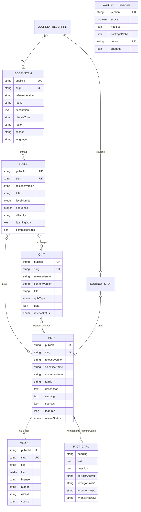
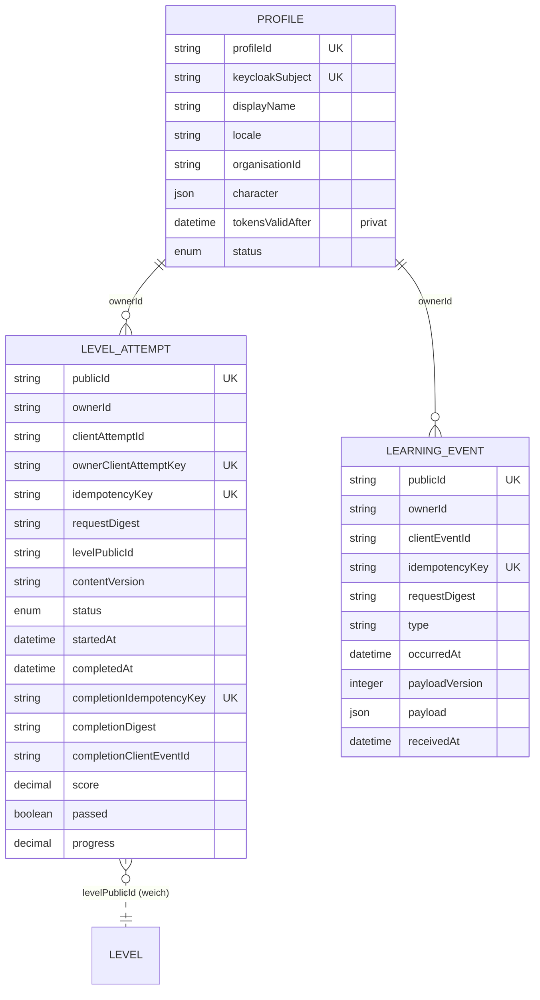
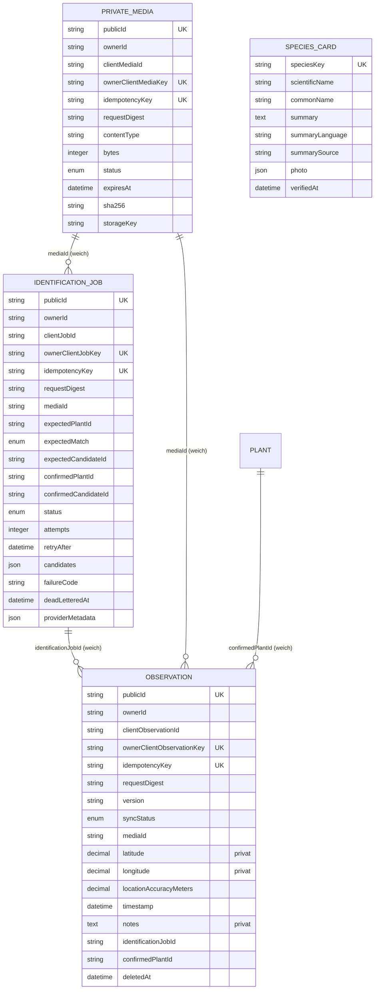
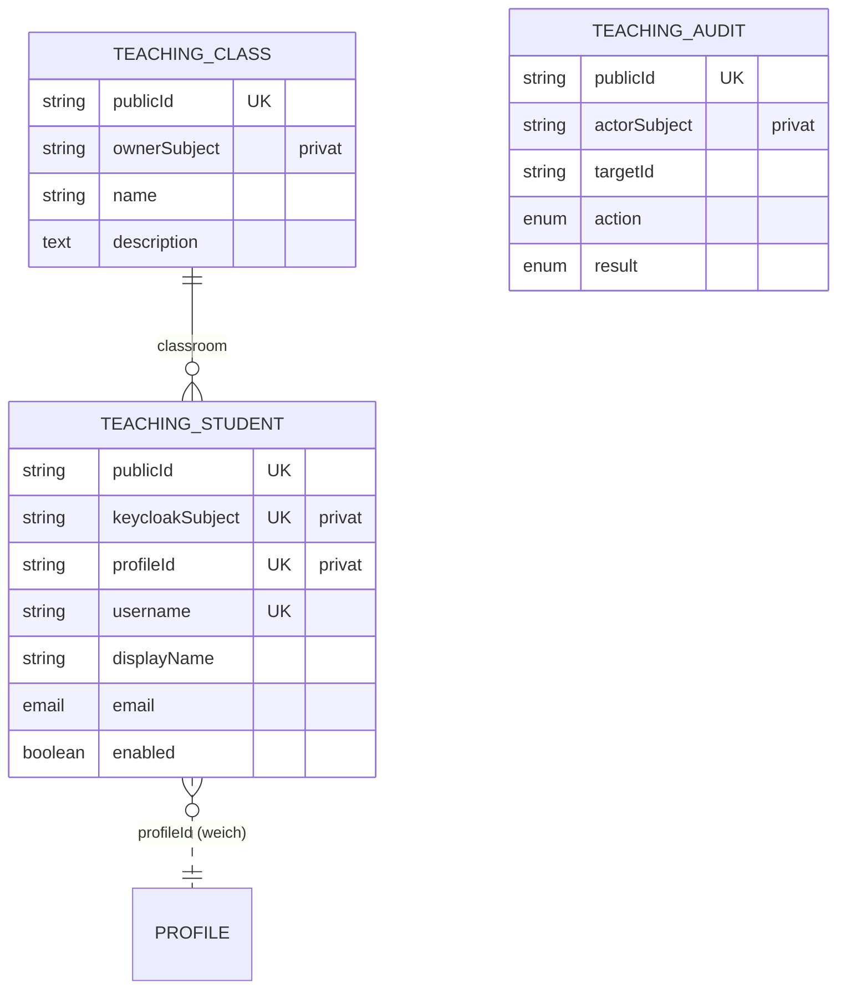
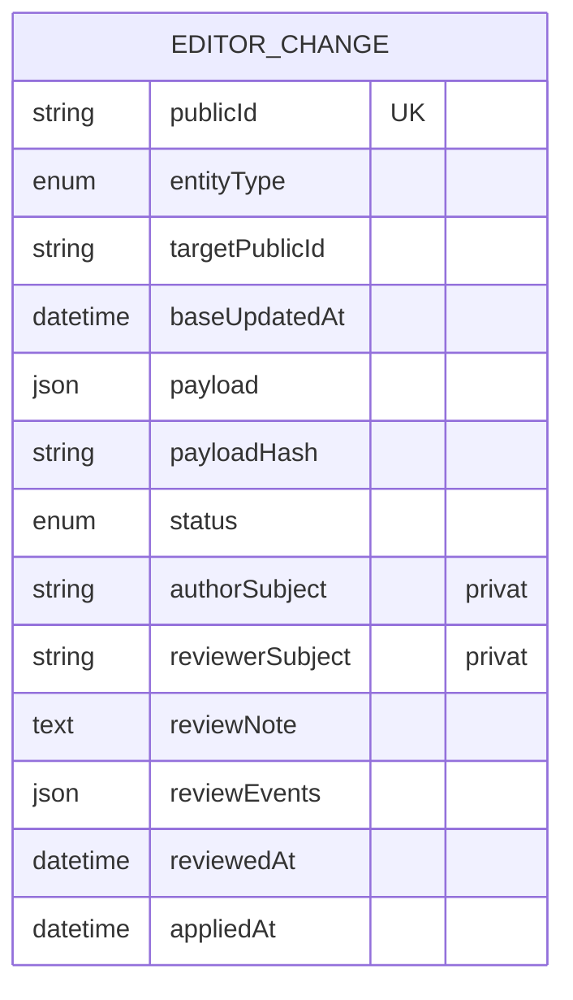

# Datenmodell

Die Plattform kennt 18 Strapi-Inhaltstypen und 2 Komponenten. Diese Seite listet alle mit ihren Feldern und Beziehungen, gruppiert in Inhalt, Lernen, Feld und Herbarium, Konten und Lehre sowie Redaktion, und zeigt, welche Spalten privat sind und über welche Schlüssel Wiederholungen erkannt werden.

!!! note "Quelle"
    Alle Angaben stammen aus `services/platform/src/api/*/content-types/*/schema.json` und `services/platform/src/components/learning/*.json`.
    Strapi legt die Tabellen daraus an; handgeschriebene Migrationen gibt es nicht (`services/platform/database/migrations/` ist leer).
    Zusätzliche Indizes legt `TeachingService.ensureIndexes()` beim Start an. Die Beispieldatensätze unten sind aus den Seeds
    (`services/platform/src/api/platform/services/core/content/demo-content.de.json`) und den Service-Funktionen abgeleitet; Konten- und Nutzdaten sind synthetisch.

## Überblick über die Gruppen

| Gruppe | Typen | Besitzer | Wer liest |
|---|---|---|---|
| Inhalt | `ecosystem`, `level`, `plant`, `quiz`, `media`, `content-release`, `journey-blueprint` (+ Komponenten `fact-card`, `journey-stop`) | Redaktion | alle (veröffentlichter Teil, ohne Lösungen) |
| Lernen | `profile`, `level-attempt`, `learning-event` | je Konto | nur das Konto; Lehrende sehen Versuchs-Ergebnisse ihrer Klassen |
| Feld und Herbarium | `private-media`, `identification-job`, `observation`, `species-card` | je Konto (`species-card`: gemeinsam) | nur das Konto; Artkarten alle Angemeldeten |
| Konten und Lehre | `teaching-class`, `teaching-student`, `teaching-audit` | Lehrperson | nur die besitzende Lehrperson |
| Redaktion | `editor-change` | Autor:in | Autor:in; Review sieht alle |

Die Beziehungen zwischen Konten-bezogenen Typen laufen **nicht** über Strapi-Relationen, sondern über Textfelder mit stabilen UUIDs
(`ownerId` = `profile.profileId`, `levelPublicId`, `mediaId`, `identificationJobId` …). Das hält die Plattform-Services unabhängig von
Strapis numerischen IDs (siehe [Architektur im Überblick](index.md)).

## Inhalt



Die Typen `ecosystem`, `level`, `plant`, `quiz` und `media` haben `publicId` (UUID) und `slug`, beide **global eindeutig**, und ein Feld `releaseVersion`.
`ecosystem`, `level`, `plant`, `quiz`, `media` und `content-release` verwenden Draft & Publish (`publishedAt` = veröffentlicht).

Weitere Felder und Besonderheiten:

- `plant` hat zusätzlich `kingdom`, `order`, `genus`, `species` (Taxonomie, vom Code nicht ausgewertet). `learningCards` ist als `private` markiert und
  erscheint daher nicht in Strapis eigener REST-Ausgabe. `features` und `sources` sind JSON-Listen.
- `quiz.data` enthält die Frage **und die Lösung**: `type`, `prompt`, `choices[{id,label}]`, `correctChoiceId`. Nur `prompt` und `choices`
  verlassen den Server (`mapQuizItem`).
- `level.completionRule` ist JSON mit `minimumScore` (0 bis 1), `requiredQuizIds`, `requiredPlantIds`, `requiredLevelIds` und `collectionScope`
  (`level` oder `ecosystem`). `normaliseCompletionRule` in `content-service.js` normalisiert und prüft es.
- `level` und `quiz` haben die privaten Felder `generatedFromBlueprint` und `generationFingerprint`: Sie markieren Entwürfe, die der
  Generator erzeugt hat.
- `journey-blueprint` (nur im Strapi-Admin bearbeitbar, „no public CRUD router“) beschreibt genau 10 Pflanzenstationen mit genau 3 Sammelzielen und
  erzeugt per Schalter `generateDrafts` 30 Level und 90 Fragen als Entwürfe (`journey-authoring.js`). Zustand in `generationState`
  (`idle`, `generating`, `ready`, `failed`).
- `media` hat nichts mit den privaten Fotos zu tun; es sind redaktionelle Bilder mit Pflichtfeldern `license`, `author`, `altText` (Lifecycle `services/platform/src/api/media/content-types/media/lifecycles.js`
  verweigert leere Werte).

### Veröffentlichungsregeln als Lifecycle-Hooks

| Typ | Regel | Datei |
|---|---|---|
| `plant`, `quiz` | Veröffentlichen nur mit `reviewStatus: approved` | `services/platform/src/api/plant/content-types/plant/lifecycles.js`, `services/platform/src/api/quiz/content-types/quiz/lifecycles.js` |
| `level` (aus Blueprint) | nur wenn Ökosystem und alle Pflanzen in derselben `releaseVersion` veröffentlicht, Pflanzen/Fragen `approved`, genau drei verschiedene Pflichtfragen | `services/platform/src/api/level/content-types/level/lifecycles.js` |
| `media` | `author` und `license` nicht leer | `services/platform/src/api/media/content-types/media/lifecycles.js` |

!!! warning "Stolperfalle: Veröffentlichen in Strapi macht Inhalt nicht sichtbar"
    Die öffentlichen Lesepfade filtern auf `releaseVersion` der **aktiven** `content-release` (`visibleVersion()` in `strapi-repositories.js`). Ein im
    Strapi-Admin veröffentlichter Datensatz mit anderer `releaseVersion` ist für die App unsichtbar, solange kein Release mit dieser Version aktiv ist –
    und einen Code, der ein solches Release erzeugt, gibt es nur im Demo-Seed ([Datenflüsse](datenfluesse.md)).

### Beispiel: Ökosystem, Level, Frage (Demo-Seed)

Die IDs sind deterministisch: `stableContentId(kind, slug)` bildet aus SHA-256 von `plantini:<kind>:<slug>` eine UUID v4 (`services/platform/src/api/platform/services/core/content/demo-content.js`).

```json title="Ökosystem (Seed-Form: Felder aus demo-content.de.json, dazu ID und Release-Version wie von demo-seed.js ergänzt)"
{
  "publicId": "cf258570-a979-4d4b-8c12-d7f16c630b5c",
  "slug": "mitteleuropaeischer-laubwald",
  "name": "Mitteleuropäischer Laubwald",
  "climateZone": "gemäßigte Zone",
  "region": "Mitteleuropa",
  "season": "ganzjährig; Schwerpunkt März bis Oktober",
  "language": "de",
  "releaseVersion": "2026.10.02-de.2"
}
```

```json title="Pflanze (Rotbuche) – Felder aus dem Seed, Text gekürzt"
{
  "publicId": "e86229bc-320e-41ff-8741-033e3a118cd4",
  "slug": "rotbuche",
  "scientificName": "Fagus sylvatica",
  "commonName": "Rotbuche",
  "family": "Buchengewächse (Fagaceae)",
  "warning": "Früchte und andere Pflanzenteile nicht verzehren; Beobachtung zur Bestimmung genügt.",
  "sources": [
    "https://www.floraweb.de/php/artenhome.php?suchnr=2357",
    "https://www.waldwissen.net/de/lebensraum-wald/baeume-und-waldpflanzen/laubbaeume/laubbaeume-im-winter-erkennen"
  ],
  "learningCards": [
    {
      "heading": "Rinde",
      "text": "Die Rinde der Rotbuche ist glatt und weißgrau. Vergleiche ihre Oberfläche mit den deutlich gefurchten oder schuppigen Rinden anderer Waldbäume.",
      "question": "Welches Rindenmerkmal passt besonders gut zur Rotbuche?",
      "correctAnswer": "Glatt und weißgrau",
      "wrongAnswer1": "Tief gefurcht und schwarz",
      "wrongAnswer2": "Papierartig weiß abrollend",
      "wrongAnswer3": "Schuppig orange abblätternd"
    }
  ]
}
```

`validateLearningCards()` (`services/platform/src/api/platform/services/core/content/lesson-cards.js`) verlangt pro Pflanze genau drei vollständige Karten, vier unterscheidbare Antworten und dass der Text die
richtige Antwort wörtlich enthält.

```json title="Level 1 des Laubwalds (aus buildJourney, IDs berechnet)"
{
  "publicId": "7faff68a-fab9-4289-a753-cfa711162bf3",
  "slug": "mitteleuropaeischer-laubwald-kennenlernen-rotbuche",
  "title": "Entdeckerpfad: Rotbuche",
  "sequence": 1,
  "completionRule": {
    "minimumScore": 0.6666666666666666,
    "requiredQuizIds": [
      "ce51b14d-03c3-43c9-b5d3-cbe95117ef91",
      "ac7fc3a5-785b-4be8-bcaa-7731cd905595",
      "ad578be9-d2a1-4fd6-8228-e31885713834"
    ],
    "collectionScope": "ecosystem",
    "requiredPlantIds": [],
    "requiredLevelIds": []
  }
}
```

Das 30. Level (`…-festigen-gewoehnlicher-wurmfarn`) trägt dagegen drei `requiredPlantIds` (Rotbuche, Stieleiche, Gewöhnliche Hasel) und das 29. Level in
`requiredLevelIds`: die Sammelziele des Ökosystems. 3 Ökosysteme × 10 Pflanzen × 3 Phasen (Entdecken, Wiederholen, Festigen) ergeben die 90 Level; je Level 3 Fragen, zusammen 270.

```json title="Quizfrage (Datenbankform, Quiz ce51b14d-…, aus buildJourney und demo-seed.js)"
{
  "publicId": "ce51b14d-03c3-43c9-b5d3-cbe95117ef91",
  "slug": "mitteleuropaeischer-laubwald-kennenlernen-rotbuche-laubwald-q01",
  "releaseVersion": "2026.10.02-de.2",
  "contentVersion": "2026.10.02-de.2",
  "title": "Rinde",
  "quizType": "multiple-choice",
  "data": {
    "type": "multiple_choice",
    "prompt": "Welches Rindenmerkmal passt besonders gut zur Rotbuche?",
    "choices": [
      { "id": "choice-1", "label": "Glatt und weißgrau" },
      { "id": "choice-2", "label": "Tief gefurcht und schwarz" },
      { "id": "choice-3", "label": "Papierartig weiß abrollend" },
      { "id": "choice-4", "label": "Schuppig orange abblätternd" }
    ],
    "correctChoiceId": "choice-1",
    "sourceQuizSlug": "laubwald-q01",
    "reviewPhase": "kennenlernen"
  },
  "reviewStatus": "approved"
}
```

Diese Frage steht auf dem Server (`correctChoiceId`). An die App geht nur `{ id, levelId, type, contentVersion, prompt, choices[{id,label}] }`.
Beachte die Rotation der Antworten: `rotateChoices()` in `lesson-cards.js` verschiebt die richtige Antwort je Phase, sodass sie nicht immer `choice-1` ist.

## Lernen



- `profile` (Tabelle `plantini_profiles`) wird beim ersten Aufruf mit Token angelegt (`ActorService.resolve`). `character` ist `{ "v": 2, "id": "<explorer>" }`
  mit einem der neun Forscher (`amara`, `mei`, `samira`, `heinrich`, `mateo`, `arjun`, `robin`, `nia`, `kai`; `services/platform/src/api/platform/services/core/profile/character-schema.js`); gespeichert wird nur die ID.
  `status` ist `active`, `suspended` oder `deletion_requested`.
- `level_attempts.status` ist `active`, `completed` oder `expired`; `expired` setzt der Code nirgends.
  `score` ist der Anteil richtiger Pflichtfragen (0 bis 1), `passed` das Ergebnis gegen `minimumScore`.
  Das Feld `progress` wird gelesen (`getProgress`), aber nirgends geschrieben.
- `learning_events.type` ist frei (App: `quiz_answered`); die Nutzlast ist versioniert (`payloadVersion`).

```json title="Profil (synthetisch)"
{
  "profileId": "4b1e5c0a-7f9d-4c3e-8a21-6d5f0b9e1a77",
  "keycloakSubject": "<sub-Claim aus Keycloak>",
  "displayName": "Lernende:r",
  "locale": "de-DE",
  "character": { "v": 2, "id": "amara" },
  "status": "active"
}
```

## Feld und Herbarium



- `private_media.status`: `reserved` → `uploaded` (`rejected`, `deleted` sind im Schema vorgesehen, vom Code nicht gesetzt).
- `identification_jobs.status`: `pending`, `processing`, `identified`, `failed`; `cancelled` ist im Schema, der Code setzt es nicht. `candidates` ist ein JSON-Array
  (Form siehe [Datenflüsse](datenfluesse.md)).
- `observations.syncStatus`: `synced`, `pending`, `conflict`, `deleted`. Der Server schreibt `synced` und `deleted`; `pending` und `conflict` kennt nur die App lokal.
- `observation` hat außerdem die Felder `plantnetScores` (JSON), `organisationId` und Relationen zu `media` (`photo`) und `plant`: **im Schema, vom Code nicht benutzt**.
- `species_cards` ist eine gemeinsame, nicht personenbezogene Tabelle für Arten außerhalb des Katalogs. `speciesKey` entsteht aus dem wissenschaftlichen Namen
  (`SpeciesService.keyFor("Bellis perennis")` = `bellis-perennis`).

```json title="Beobachtung (Datenbankform, synthetische Werte, Hashes mit den echten Funktionen berechnet)"
{
  "publicId": "9a2f6e41-3c0b-4d58-b7a9-1e6c4f2d8b05",
  "ownerId": "4b1e5c0a-7f9d-4c3e-8a21-6d5f0b9e1a77",
  "clientObservationId": "c3f2a9f0-2d1e-4a5b-9a41-7d0f6c1e8b22",
  "ownerClientObservationKey": "1911dae2d52dcfd4cc20c2646a4d150cbf6760dee214a49f3fc4e403955120a7",
  "idempotencyKey": "dc92b4469dbf5e14d8cdac5bd5878b844f09b737e3bf1471563e927458b12661",
  "requestDigest": "0985104280f8f3bf9208d666d1dba1a86306a34222900989ed9ee890e45c79f2",
  "version": "f1a7c6d2-5b3e-4f90-8a14-2c7d9e0b6a31",
  "syncStatus": "synced",
  "mediaId": "6f1d0c52-0f3a-4b6e-9d65-3a2c9e0b7a14",
  "identificationJobId": "0b8c1f7e-6a43-4f2e-8d6c-5a1d1f2e9c33",
  "confirmedPlantId": "e86229bc-320e-41ff-8741-033e3a118cd4",
  "latitude": 49.41,
  "longitude": 8.69,
  "locationAccuracyMeters": 1000,
  "timestamp": "2026-10-05T09:58:40.000Z",
  "notes": "Am Waldrand, Rinde glatt"
}
```

Die drei Hashes sind nachvollziehbar: `ownerClientObservationKey = ownerClientKey(ownerId, clientObservationId)` (`strapi-repositories.js`),
`idempotencyKey = scopedIdempotencyKey(ownerId, 'observation', <externer Schlüssel>)` (`ids.js`; die App verwendet die Client-ID als Schlüssel) und
`requestDigest = payloadDigest(validierte Eingabe)`.
Die API-Darstellung (`mapObservation`) ergänzt `mediaUrl: /api/v1/media/<mediaId>/content`, `location`, `species*` und das eingebettete `identification`.

## Konten und Lehre



- `teaching_class.ownerSubject` ist der Keycloak-`sub` der Lehrperson. Alle Zugriffe filtern darauf (`requireClass`, `requireStudent`).
- `teaching_students` verbindet das Keycloak-Konto (`keycloakSubject`) mit dem Plattform-Profil (`profileId`). `username` ist global eindeutig und klein geschrieben.
- `teaching_audit.action`: `class_created`, `student_created`, `password_reset`, `student_enabled`, `student_disabled`; `result`: `started`, `succeeded`, `failed`.
  Beim Anlegen wird erst `started`, danach das Ergebnis geschrieben.

## Redaktion



`editor_changes` ist ein Entwurfsspeicher unabhängig von den Inhaltstabellen: `payload` enthält das gesamte neue Objekt (nur die Felder aus `TYPES[type].fields` in
`editor-service.js`), `targetPublicId` die Ziel-UUID (bei neuen Objekten frisch erzeugt), `baseUpdatedAt` den Stand des Ziels beim Anlegen, `payloadHash` den
Hash zum Zeitpunkt des Einreichens. `status` durchläuft `draft`, `pending_review`, `rejected`, `approved`. `appliedAt` wird nirgends gesetzt.

```json title="Entwurf eines Quiz (Form aus validatePayload, synthetische IDs)"
{
  "publicId": "2e8a41d7-6b05-4c93-a8f2-0d4b7c19e563",
  "entityType": "quiz",
  "targetPublicId": "7a4d1c90-35e2-4b86-9f0a-b2c6e8d51f34",
  "baseUpdatedAt": null,
  "payload": {
    "slug": "rotbuche-bluete",
    "title": "Blüte der Rotbuche",
    "quizType": "multiple-choice",
    "levelId": "7faff68a-fab9-4289-a753-cfa711162bf3",
    "plantId": "e86229bc-320e-41ff-8741-033e3a118cd4",
    "data": {
      "prompt": "…",
      "choices": [
        { "id": "a", "label": "…" }, { "id": "b", "label": "…" },
        { "id": "c", "label": "…" }, { "id": "d", "label": "…" }
      ],
      "correctChoiceId": "a"
    }
  },
  "status": "pending_review",
  "reviewEvents": [{ "action": "submitted", "actor": "<sub>", "at": "2026-10-05T10:00:00.000Z" }]
}
```

## Privatsphäre-Spalten im Überblick

| Typ | Spalte | Wer sieht sie | Hinweis |
|---|---|---|---|
| `observation` | `latitude`, `longitude`, `locationAccuracyMeters` | nur die besitzende Person | vom Gerät auf ~1 km gerundet, im Klartext gespeichert |
| `observation` | `notes` | nur die besitzende Person | freier Text bis 4000 Zeichen |
| `private_media` | Datei, `storageKey`, `sha256` | nur die besitzende Person | Datei auf dem Volume, nie in Strapis Upload-Ordner |
| `identification_job` | `candidates`, `providerMetadata` | nur die besitzende Person | enthält Provider-Antwort in normalisierter Form |
| `profile` | `keycloakSubject`, `tokensValidAfter` | intern | `tokensValidAfter` ist `private` in Strapi |
| `teaching_class`, `teaching_audit`, `editor_change` | `ownerSubject`, `actorSubject`, `authorSubject`, `reviewerSubject` | intern | in Strapis REST-Ausgabe verborgen (`private: true`) |
| `teaching_student` | `keycloakSubject`, `profileId` (intern), `username`, `displayName`, `email` | besitzende Lehrperson | E-Mail optional |
| `plant` | `learningCards` | Redaktion | Antworten der Lernkarten, `private: true` |
| `quiz` | `data.correctChoiceId` | Redaktion, Server | wird nie ausgeliefert |

## Eindeutigkeiten und Idempotenz-Schlüssel

Jeder schreibbare Typ des Kontos trägt bis zu vier Schutzmechanismen. Die Berechnungen stehen in `ids.js` und `strapi-repositories.js`.

| Typ | Client-ID | `ownerClient…Key` (UNIQUE) | `idempotencyKey` (UNIQUE) | Operation im Hash |
|---|---|---|---|---|
| `private_media` | `clientMediaId` | `ownerClientMediaKey` | ja | `media-upload` |
| `identification_job` | `clientJobId` | `ownerClientJobKey` | ja | `identification` |
| `observation` | `clientObservationId` | `ownerClientObservationKey` | ja | `observation` |
| `level_attempt` | `clientAttemptId` | `ownerClientAttemptKey` | ja | `level-attempt` |
| `learning_event` | `clientEventId` | – | ja (`sha256(owner, 'learning-event', clientEventId)`) | `learning-event` |

Zusätzlich: `level_attempts.completionIdempotencyKey` (UNIQUE) verhindert zwei verschiedene Abschlüsse desselben Versuchs, jeder Typ hat eine eindeutige `publicId`,
`profile.keycloakSubject` ist eindeutig (Race-Schutz beim ersten Login), `content_releases.version` und `.cursor` sind eindeutig.
Der Test `services/platform/test/idempotency-schema.test.js` prüft die Pflicht- und Unique-Eigenschaften für `private_media`, `identification_job` und `observation`
(für `level_attempt` und `learning_event` gibt es keinen solchen Schema-Test).

Wie der Server bei Treffer reagiert (Details in [Datenflüsse](datenfluesse.md) und [Idempotenz und Fehler](../backend/idempotenz-fehler.md)):

| Fall | Antwort |
|---|---|
| gleicher Schlüssel, gleiche Nutzlast | Ergebnis der ersten Anfrage mit `200` statt `201` |
| gleicher Schlüssel, andere Nutzlast | `409 IDEMPOTENCY_CONFLICT` |
| gleiche Client-ID, andere Metadaten | `409 CLIENT_MEDIA_CONFLICT`, `CLIENT_JOB_CONFLICT`, `CLIENT_ATTEMPT_CONFLICT` |
| gleiche Client-ID bei Beobachtungen | bestehende Beobachtung mit `200` (kein Nutzlast-Vergleich) |

## Weiterführend

- [Architektur im Überblick](index.md) · [Datenflüsse](datenfluesse.md) · [Sicherheit und Datenschutz](sicherheit-datenschutz.md) · [Entscheidungen](entscheidungen.md)
- [Plattform](../backend/plattform.md) · [Inhalte und Releases](../backend/inhalte-releases.md) · [API-Vertrag](../backend/api-vertrag.md)
- Quellen: `services/platform/src/api/*/content-types/*/schema.json`, `services/platform/src/components/learning/*.json`,
  `services/platform/src/api/platform/services/core/ids.js`, `services/platform/src/api/platform/services/core/strapi-repositories.js`, `services/platform/src/api/platform/services/core/content/demo-content.js`, `services/platform/src/api/platform/services/core/content/demo-journeys.js`, `services/platform/src/api/platform/services/core/content/demo-seed.js`, `services/platform/src/api/platform/services/core/content/lesson-cards.js`, `services/platform/src/api/platform/services/core/content/journey-authoring.js`
