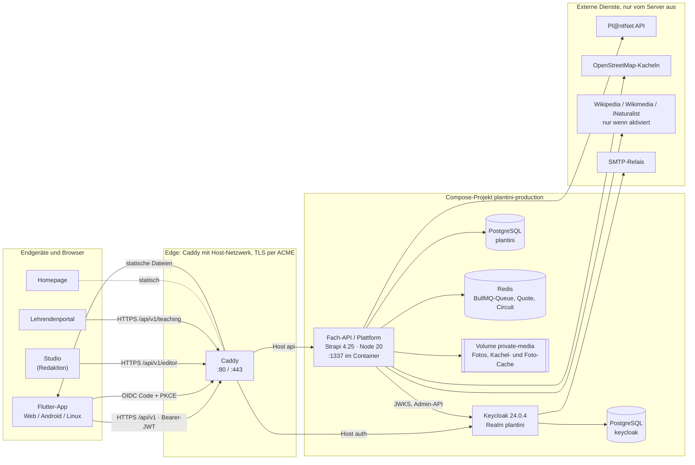
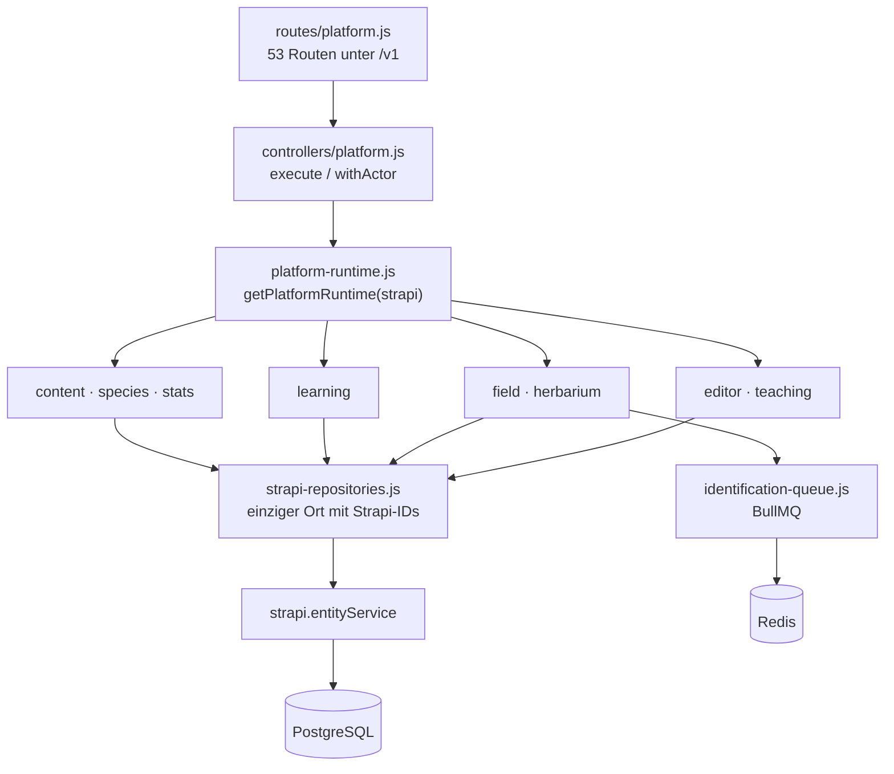
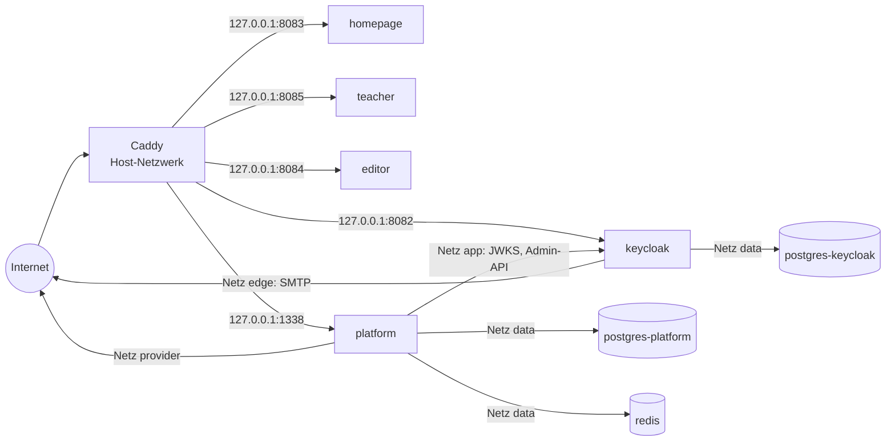

# Architektur im Überblick

Plantini besteht aus einer Flutter-App, einer Fach-API auf Basis von Strapi, einem Keycloak für Identitäten und drei kleinen statischen Webanwendungen (Studio, Lehrendenportal, Homepage). Diese Seite zeigt, welche Komponenten es gibt, wer mit wem sprechen darf und warum die App nur zwei Gegenstellen kennt: die Fach-API und Keycloak.

!!! note "Quelle der Wahrheit"
    Beschrieben ist der Stand des Codes im Repository (Oktober 2026), nicht der Soll-Zustand aus `knowledge/**`.
    Wo beides auseinanderläuft, steht der Widerspruch ausdrücklich im Text. Den Projektstatus
    (unveröffentlichter Teaser, nicht Open Source) erklärt [Projektstatus und Rechte](../start/status.md).

## Die Komponenten



Die Pfeile zeigen den tatsächlichen Verbindungsaufbau. Die App erreicht den Server nur über Caddy. Alles hinter Caddy
ist an `127.0.0.1` gebunden (siehe unten). Die Homepage, Studio und Portal werden als Container mit nginx ausgeliefert,
die Flutter-Web-App als Dateiverzeichnis direkt von Caddy.

### Komponente, Pfad, Port, Technologie

| Komponente | Repo-Pfad | Port (Container → Host-Loopback) | Technologie |
|---|---|---|---|
| Flutter-App (Web, Android, Linux, iOS) | `apps/flutter/` | Web: statische Dateien aus `/srv/web` (Caddy), E2E: `127.0.0.1:3000` | Flutter 3.47.1 / Dart 3.13.1, `dio`, `go_router`, `openid_client`, `isar_plus`, `flutter_map` |
| Fach-API / Plattform | `services/platform/` | `1337 → 127.0.0.1:${API_LOOPBACK_PORT:-1338}` | Strapi 4.25.10 (Koa), Node 20.20.2, `bullmq`, `ioredis`, optional `sharp` |
| Keycloak | `services/identity/` | `8080 → 127.0.0.1:${AUTH_LOOPBACK_PORT:-8082}` | Keycloak 24.0.4, Realm-Import `plantini-realm.json` |
| PostgreSQL (Plattform) | Image aus `POSTGRES_IMAGE` | `5432`, nur Netz `data` | PostgreSQL (E2E: `postgres:16.4-alpine`) |
| PostgreSQL (Keycloak) | Image aus `POSTGRES_IMAGE` | `5432`, nur Netz `data` | wie oben, eigene Datenbank und eigener Benutzer |
| Redis | Image aus `REDIS_IMAGE` | `6379`, nur Netz `data` | Redis mit `--appendonly yes --save 60 1000` |
| Pl@ntNet | extern | `https://my-api.plantnet.org` (`PLANTNET_BASE_URL`) | REST v2; lokal ersetzt durch `infra/plantnet-mock/` (Port `1080`) |
| Caddy | `infra/production/Caddyfile`, `infra/production/compose.proxy.yaml` | `:80`, `:443`, Host-Netzwerk | Caddy 2.8.4 (`caddy:2.8.4-alpine`) |
| Studio (Redaktion) | `apps/editor/` | `8080 → 127.0.0.1:${EDITOR_LOOPBACK_PORT:-8084}` | statisches HTML/JS, nginx (`nginxinc/nginx-unprivileged`) |
| Lehrendenportal | `apps/teacher/` | `8080 → 127.0.0.1:${TEACHER_LOOPBACK_PORT:-8085}` | statisches HTML/JS, nginx mit Konfigurations-Template |
| Homepage | `apps/homepage/` | `8080 → 127.0.0.1:${HOMEPAGE_LOOPBACK_PORT:-8083}` | Vite 8 + three.js, nginx |

!!! warning "Stolperfalle: Ports sind teilweise im Caddyfile fest verdrahtet"
    `infra/production/Caddyfile` liest die Ports von Homepage, Studio und Portal aus Umgebungsvariablen
    (`{$HOMEPAGE_PORT:8083}`, `{$EDITOR_PORT:8084}`, `{$TEACHER_PORT:8085}`), nutzt für die API aber fest
    `127.0.0.1:1338` und für Keycloak fest `127.0.0.1:8082`. Wer `API_LOOPBACK_PORT` oder `AUTH_LOOPBACK_PORT` in
    `infra/compose.production.yaml` ändert, muss das Caddyfile von Hand mitziehen.
    Vollständige Port- und Dienstliste: [Ports und Dienste](../referenz/ports-dienste.md).

## Wer ist wofür zuständig

### Fach-API (`services/platform`)

Strapi ist hier **Host-Anwendung**, nicht die API-Schicht der App. Alle Routen der App liegen in einer einzigen
Custom-Route-Datei (`services/platform/src/api/platform/routes/platform.js`) unter `/api/v1/…` (Strapi stellt `/api` voran) und
sind mit `config: { auth: false }` registriert. Das heißt: Strapis eigenes Auth-System (users-permissions) wird bewusst
**nicht** verwendet. Stattdessen prüft der Controller (`services/platform/src/api/platform/controllers/platform.js`) selbst:

1. `resolveActor()` in `services/platform/src/api/platform/services/core/platform-runtime.js` liest den Bearer-Token,
2. `KeycloakJwtValidator.validate()` prüft Signatur (RS256, JWKS), Issuer, Audience und Ablauf,
3. `ActorService.resolve()` bildet den `sub`-Claim auf ein internes Profil ab und liest die Rollen,
4. erst dann läuft die fachliche Aktion im jeweiligen Service.

```js title="services/platform/src/api/platform/routes/platform.js"
// Authentication is resolved by the controller's Keycloak verifier rather
// than Strapi's users-permissions plugin, so every protected route remains
// bound to the same issuer/audience/ownership rules.
const route = (method, path, handler) => ({
  method,
  path,
  handler: `api::platform.platform.${handler}`,
  config: { auth: false },
});
```

Die Schichten innerhalb der Plattform:



Die Kernregel steht im Kopf von `strapi-repositories.js`: Der Adapter ist die einzige Stelle, die numerische
Strapi-IDs kennt. Services sehen nur öffentliche UUIDs (`publicId`) und Besitzerfelder. Dadurch wird die
Datenbank-ID nie zum API- oder Sync-Schlüssel. Details zu den Services: [Services](../backend/services.md) und
[Plattform](../backend/plattform.md).

### Lebenszyklus beim Start

`services/platform/src/index.js` (`bootstrap`) erledigt beim Start in dieser Reihenfolge:

1. `runtime.teaching.ensureIndexes()` legt zwei zusätzliche Indizes an (`teaching_classes.owner_subject`, `level_attempts.owner_id`).
2. Nur wenn `PLATFORM_SEED_DEMO_CONTENT=true`: `seedDemoContent(strapi)`. Der Code loggt dazu eine Warnung
   („never use this flag in staging or production“). Die Produktions-Compose-Datei dokumentiert dagegen, dass die
   Demo-Inhalte das einzige Material sind und der Schalter per Variable gesetzt werden kann – ein Widerspruch,
   der im Betrieb bekannt sein muss.
3. Die Identifikations-Queue (`createIdentificationQueue`), der `RedisProviderGuard` und der `PlantNetProvider` werden verbunden,
   `createIdentificationWorker` startet mit `concurrency: 2`.
4. Ein Wiederaufnahme-Timer (`setInterval(recover, 30_000)`) stellt alle Aufträge mit Status `pending` erneut in die Queue.

### Keycloak und Rollen

Keycloak hält Identitäten, Sitzungen und Rollen. Die Fach-API legt beim ersten Aufruf ein eigenes Profil
(`plantini_profiles`) mit stabiler `profileId` an und verknüpft es über `keycloakSubject`. Details: [Sicherheit und Datenschutz](sicherheit-datenschutz.md)
und [Identity und Keycloak](../betrieb/identity-keycloak.md).

### Studio und Lehrendenportal

Beide sind reine Browser-Anwendungen ohne eigenes Backend: Sie führen den OIDC-Code-Flow mit PKCE selbst aus
(`apps/editor/app.js`, `apps/teacher/app.js`), halten Tokens nur im Arbeitsspeicher und sprechen ausschließlich die
Fach-API an (`/api/v1/editor/*` bzw. `/api/v1/teaching/*`). Sie haben weder Datenbank- noch Strapi-Admin-Zugriff
(Kommentar im Caddyfile: „it has no direct database or Strapi-admin access“). Siehe [Studio-Technik](../studio/studio-technik.md)
und [Portal-Technik](../studio/portal-technik.md).

## Netze und Vertrauensgrenzen

`infra/compose.production.yaml` definiert vier Netze:

| Netz | `internal` | Mitglieder | Zweck |
|---|---|---|---|
| `edge` | nein | `keycloak`, `homepage`, `teacher`, `editor` | Dienste, deren Port auf `127.0.0.1` veröffentlicht wird; Keycloak braucht außerdem ausgehendes SMTP |
| `app` | **ja** | `keycloak`, `platform` | Plattform ↔ Keycloak (JWKS, Admin-API) ohne Weg nach außen |
| `data` | **ja** | `postgres-platform`, `postgres-keycloak`, `redis`, `keycloak`, `platform` | Datenhaltung, nicht von außen und nicht ins Internet erreichbar |
| `provider` | nein | `platform` | ausgehender Verkehr der Plattform zu Pl@ntNet, OSM-Kacheln und Foto-Quellen |

Die Kommentare in der Compose-Datei nennen den Grund für die Aufteilung: Interne Netze können keine Host-Ports
veröffentlichen und keine ausgehende Verbindung aufbauen, deshalb liegen alle Dienste mit veröffentlichtem Port
oder SMTP-Bedarf (`keycloak`) auf einem normalen Netz.



Vertrauensgrenzen, die der Code erzwingt:

- **Internet → Caddy:** Nur ausgewählte Hosts und Pfade sind erreichbar (siehe unten).
- **Caddy → Dienste:** ausschließlich über Loopback-Ports. Caddy läuft mit `network_mode: host`
  (`infra/production/compose.proxy.yaml`), weil die Dienste nur an `127.0.0.1` binden.
- **Plattform → Datenhaltung:** nur über das interne Netz `data`.
- **Plattform → Internet:** über das Netz `provider`. Der Code spricht nur feste Ziele an
  (`tile.openstreetmap.org`, `my-api.plantnet.org`, Wikimedia-/iNaturalist-Hosts in `public-photo-cache.js`); das Netz selbst filtert nicht.
- **Keycloak → Internet:** Keycloak liegt auf `edge`, damit es SMTP erreicht. Das Netz beschränkt den Ausgang nicht;
  die Admin-Konsole und der Master-Realm sind aber nicht über Caddy erreichbar.

Was Caddy pro Host zulässt (`infra/production/Caddyfile`):

| Host | Inhalt |
|---|---|
| `<domain>` | Homepage (Reverse-Proxy) und `/download/*` (APK und Metadaten aus `/srv/downloads`); `www.<domain>` leitet permanent um |
| `app.<domain>` | Flutter-Web-App aus `/srv/web`, `/healthz`, Entry-Dateien mit `Cache-Control: no-cache` |
| `studio.<domain>` | Reverse-Proxy auf den `editor`-Container |
| `portal.<domain>` | Reverse-Proxy auf den `teacher`-Container |
| `api.<domain>` | **nur** `/api/v1/*` → Plattform, Request-Body bis 22 MB; alles andere `404` |
| `auth.<domain>` | **nur** `/realms/plantini/*`, `/resources/*`, `/robots.txt`; alles andere `404` |

!!! tip "Was bewusst nicht erreichbar ist"
    Strapis `/admin` und die eingebaute Registrierung `/api/auth/local/register` werden nicht durchgereicht, ebenso
    wenig die Keycloak-Admin-Konsole und der Master-Realm. Das Caddyfile sagt es selbst: „Administer through an SSH
    tunnel to 127.0.0.1:8082“. Auf der Plattform existieren Strapis generierte Kernrouten
    (`createCoreRouter` für `ecosystem`, `level`, `media`, `observation`, `plant`, `quiz`), sie sind aber nur über den
    Loopback-Port erreichbar, nicht über `api.<domain>`. Die Rechte der users-permissions-Rolle dahinter wurden nicht geprüft.

## Warum die App nur mit Fach-API und Keycloak spricht

Der Satz steht in `AGENT.md` als „nicht verhandelbare Systemgrenze“ und im Vertragskopf von `contracts/api.yaml`
(„Die App kommuniziert niemals direkt mit Strapi oder einem Identifikationsprovider“). Im Code lässt er sich an
mehreren Stellen belegen, und jede hat einen eigenen Grund:

1. **Geheimnisse bleiben auf dem Server.** Der Pl@ntNet-Schlüssel wird als Query-Parameter `api-key` an
   `/v2/identify/<project>` gehängt – aber nur in `PlantNetProvider.realIdentifyUrl()`
   (`services/platform/src/api/platform/services/core/field/plantnet-provider.js`). Die App bekommt nur normalisierte
   Kandidaten, nie den Schlüssel oder eine URL mit Schlüssel.
2. **Antwortschlüssel dürfen das CMS nicht verlassen.** In Strapi liegt die richtige Antwort jeder Quizfrage im
   Feld `quiz.data.correctChoiceId` und die Frage-/Antwortkarten in `plant.learningCards` (als `private` markiert).
   `mapQuizItem()` und `mapPlant()` in `services/platform/src/api/platform/services/core/content/content-service.js` geben nur `id` und `label` der Auswahlmöglichkeiten
   bzw. `heading` und `text` der Karten weiter. Würde die App Strapi direkt lesen, gäbe es diese Abbildung nicht.
   Der Levelabschluss wird deshalb auch serverseitig bewertet ([Datenflüsse](datenfluesse.md)).
3. **Besitz wird zentral erzwungen.** Alle Repository-Abfragen für private Daten filtern auf `ownerId`
   (`findPrivateMediaByPublicId(ownerId, publicId)`, `findObservationByPublicId(ownerId, …)`). Fremde Datensätze
   verhalten sich wie nicht vorhanden. Das ginge mit generischen CMS-Routen nicht.
4. **Drittanbieter sehen keine Nutzerdaten.** Karten- und Pflanzenfotos holt der Server und liefert sie aus seinem
   Cache aus (`tile-proxy.js`: „the app never contacts the tile provider (the provider would see every user's IP
   address and the places they look at)“). Die Bildschicht der App sendet das Bearer-Token nur an die API-Origin
   (`PlatformApiClient.getBytes`: `sameOrigin`-Prüfung).
5. **Ein stabiler Vertrag.** `AppConfig.fromValues()` verlangt, dass `PLANTINI_API_BASE_URL` auf `/api/v1` endet, und in
   Produktion `https` für API und OIDC. ADR-002 hält fest: „`contracts/api.yaml` ist der kanonische Vertrag“.
6. **Eine Angriffsfläche weniger.** CORS der Plattform erlaubt nur die konfigurierten Origins
   (`CORS_ORIGINS` = Web-App, Studio, Portal) und nur die Header `Content-Type`, `Authorization`, `Idempotency-Key`,
   `If-Match`, `If-None-Match`, `X-Correlation-Id` (`services/platform/config/middlewares.js`).

Die zweite Gegenstelle, Keycloak, ist für die App der Aussteller der Tokens: Die App holt sich über Authorization Code
mit PKCE ein Access-Token und schickt es an die Fach-API ([Anmeldung](datenfluesse.md)).

!!! note "Eine bewusste Ausnahme von der Strenge"
    Die Plattform reicht ihre eigenen Medien-URLs als Pfade weiter (zum Beispiel `/api/v1/media/<id>/content`).
    `PlatformApiClient.resolveContentUrl()` löst sie gegen die API-Basis-URL auf. Absolute Fremd-URLs aus Inhalten werden
    zwar technisch aufgelöst, aber ohne Token geladen. Ob alle Release-Inhalte nur API-eigene URLs enthalten, wurde nicht
    flächendeckend geprüft.

## Die Bausteine im Repository

| Pfad | Inhalt |
|---|---|
| `contracts/api.yaml` | OpenAPI 3.1, kanonischer Vertrag (1448 Zeilen); 8 Operationen sind mit `x-plantini-implementation-status: planned` markiert |
| `packages/api/` | aus dem Vertrag generierter Dart-Client (nicht von Hand ändern) |
| `infra/` | Compose-Dateien (dev, e2e, production), `infra/production/Caddyfile`, Backup-Skripte, PlantNet-Mock |
| `tools/e2e/` | Playwright-Tests und Stack-Skripte |
| `tools/blender/` | Generatoren der 3D-Module für die Lernwelt ([3D und Blender](../3d/index.md)) |
| `content/` | Seeds |

Eine kommentierte Karte aller Verzeichnisse: [Repo-Karte](../mitmachen/repo-karte.md).

## Weiterführend

- [Datenflüsse](datenfluesse.md) – Anmeldung, Foto → Bestimmung → Herbarium, Quiz, Sync, Releases, Kacheln.
- [Datenmodell](datenmodell.md) – alle Strapi-Inhaltstypen und Beziehungen.
- [Sicherheit und Datenschutz](sicherheit-datenschutz.md) – Rollen, Vertrauensgrenzen, Threat-Model.
- [Entscheidungen](entscheidungen.md) – warum es so gebaut ist.
- [Betrieb: Compose](../betrieb/compose.md) und [Ports und Dienste](../referenz/ports-dienste.md).
- Quellen: `infra/compose.production.yaml`, `infra/production/Caddyfile`, `infra/production/compose.proxy.yaml`,
  `services/platform/src/index.js`, `services/platform/src/api/platform/routes/platform.js`,
  `services/platform/src/api/platform/controllers/platform.js`, `services/platform/src/api/platform/services/core/platform-runtime.js`.
