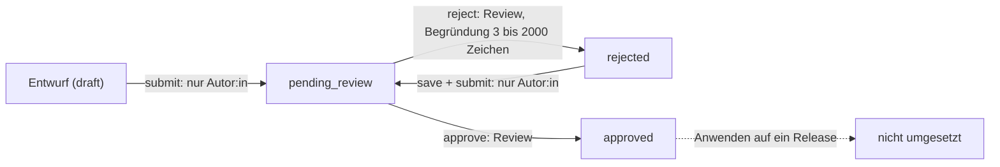

# Sicherheit und Datenschutz

Diese Seite beschreibt, wie Plantini Identitäten, Rollen und personenbezogene Daten schützt und wo der Code das tatsächlich erzwingt. Sie prüft die Aussagen aus `knowledge/architecture/security-and-privacy.md`, `SECURITY.md` und `AGENT.md` gegen die Implementierung und benennt Abweichungen und Lücken offen.

!!! warning "Stand"
    Plantini ist ein unveröffentlichter, unvollständiger Teaser (siehe [Projektstatus und Rechte](../start/status.md)). Es gab weder
    einen Pen-Test noch eine rechtliche Prüfung. Diese Seite ist eine technische Bestandsaufnahme, keine Rechtsberatung und keine
    Sicherheitszusage. Fehlendes steht ausdrücklich als „nicht umgesetzt“ oder „nicht geprüft“ da.

## Wo welche Daten liegen

| Ort | Inhalt | Beleg |
|---|---|---|
| Keycloak-Datenbank | Konten, Credentials, Sitzungen, Rollenzuordnung, Anmelde- und Admin-Ereignisse (Aufbewahrung 90 Tage, `eventsExpiration: 7776000`, Admin-Ereignisse ohne Details) | `services/identity/realm/plantini-realm.json` |
| Plattform-Datenbank | Profil (`displayName`, `locale`, `character`, `status`), Lernversuche und -ereignisse, Beobachtungen inkl. **Koordinaten und Notiz**, Identifikationsaufträge, Metadaten privater Fotos, Redaktionsentwürfe, Klassen/Schülerkonten (inkl. optionaler E-Mail), Audit der Lehrendenverwaltung | `services/platform/src/api/*/content-types/*/schema.json` |
| Volume `private-media` | Foto-Dateien (`<mediaId>-<uuid>`, Modus `0600`), Größenvarianten (`.w320`, `.w720`, `.w1280`), Kachel-Cache `map-tiles`, Foto-Cache `public-plant-photos` | `private-media-store.js`, `tile-proxy.js`, `public-photo-cache.js` |
| Redis | Queue-Einträge (nur Auftrags-UUIDs), Tageszähler und Circuit-Zustand des Pl@ntNet-Guards | `identification-queue.js`, `provider-guard.js` |
| Gerät (Web/Android/Linux) | OIDC-Credential (Android/Linux: System-Schlüsselspeicher, Web: verschlüsselt in `localStorage`, siehe unten), Herbarium-Cache und Lernsitzungen in `SharedPreferences`, Katalog in Isar, Bild- und Kachel-Cache | `credential_store.dart`, `offline_herbarium_repository.dart`, `image_disk_store_native.dart` |

Die Trennung „Keycloak = Identität, Plattform = Fachdaten“ ist real: Das Profil verknüpft beides nur über `keycloakSubject`
(`schema.json` von `profile`: `keycloakSubject` ist `unique`). E-Mail-Adresse und Passwort liegen nie in der Plattform-Datenbank;
die einzige Ausnahme ist die optionale E-Mail eines von Lehrenden angelegten Schülerkontos (`teaching_students.email`).

!!! note "Abweichung zu `AGENT.md`"
    `AGENT.md` sagt: „Strapi enthält … aber keine Passwörter, privaten Herbariumfotos oder exakten Fundorte.“ Die Fotos liegen tatsächlich auf einem Volume
    des Plattform-Containers, nicht in Strapis Upload-Verzeichnis. Die **Koordinaten** der Beobachtungen stehen dagegen als Klartext-Spalten
    (`latitude`, `longitude`, `locationAccuracyMeters`) in der Tabelle `observations` der Plattform-Datenbank. Sie sind vom Gerät vergröbert
    (siehe unten), aber nicht verschlüsselt.

## Rollen und wo sie geprüft werden

Rollen sind **Realm-Rollen in Keycloak**; die Fach-API liest sie aus dem Zugriffstoken. Maßgeblich sind drei Stellen:

1. `ActorService.resolve()` / `extractRoles()` in `services/platform/src/api/platform/services/core/auth/actor-service.js` übernimmt aus
   `realm_access.roles` (und optional aus `resource_access[PLATFORM_OIDC_ROLE_CLIENT_ID].roles`) nur Rollen aus der festen Liste
   `ALLOWED_ROLES`. Ist keine bekannte Rolle im Token, wird `['lernende']` gesetzt.
2. Die Services prüfen die Rolle selbst, bevor sie etwas tun.
3. Datensätze sind zusätzlich nach Besitzer gefiltert (`ownerId`, `ownerSubject`, `authorSubject`).

```js title="services/platform/src/api/platform/services/core/editor/editor-service.js"
const EDITOR_ROLES = new Set(['inhaltsredaktion', 'botanisches_review', 'systemadministration']);
const REVIEW_ROLES = new Set(['botanisches_review', 'systemadministration']);

function requireEditor(actor) {
  if (!actor?.roles?.some((role) => EDITOR_ROLES.has(role))) {
    throw new ProblemError('EDITOR_FORBIDDEN', { status: 403, detail: 'Für die Redaktion ist eine Redaktionsrolle erforderlich.' });
  }
}
```

| Rolle | Wofür | Geprüft in | Besonderheiten |
|---|---|---|---|
| `lernende` | Lernen, Fotos, Herbarium | `withActor` im Controller; Daten per `ownerId` | Standardrolle im Realm (`default-roles-plantini` enthält nur `lernende`) und Rückfallwert der API |
| `lehrende` | Klassen und Schülerkonten | `requireTeacher` in `services/platform/src/api/platform/services/core/teaching/teaching-service.js` (erlaubt `lehrende` und `systemadministration`) | Klassen per `ownerSubject`; ab Rolle im Token nur über den Portal-Client |
| `inhaltsredaktion` | Entwürfe anlegen, einreichen | `requireEditor` | darf eigene Entwürfe bearbeiten (`authorSubject`), sieht nur eigene Änderungen |
| `botanisches_review` | Entwürfe freigeben oder ablehnen | `requireReviewer` (ruft zuerst `requireEditor`) | sieht alle Änderungen (`REVIEW_ROLES`) |
| `systemadministration` | alle Redaktions- und Lehrendenrechte, Einladungen von Reviewern und Lehrenden | `requireEditor`, `requireReviewer`, `requireTeacher`, `KeycloakInvitations.invite` | Pflicht-TOTP im Realm |
| `organisationsadministration` | vorgesehen | **keine API-Prüfung** | nur Realm-TOTP und Schutzliste in `keycloak-students.js` |
| `forschende` | vorgesehen | **ignoriert** | im Realm definiert, aber nicht in `ALLOWED_ROLES`: `normalizeRole` verwirft sie |

!!! warning "Stolperfalle: Rollen sind nur im jeweiligen Client sichtbar"
    Alle App-Clients haben `fullScopeAllowed: false`. Sichtbar werden Redaktions- und Lehrrollen nur durch `scopeMappings` im Realm:
    `plantini-editor-*` erhält `inhaltsredaktion`, `botanisches_review`, `systemadministration`; `plantini-teacher-*` erhält
    `lehrende`, `systemadministration`. Ein Token aus der Lern-App (Clients `plantini-web-*`, `plantini-mobile-*`) trägt diese Rollen nicht.
    `validate-realm-security.mjs` prüft `fullScopeAllowed: false` für alle App-Clients und die Scope-Mappings der Editor- und Portal-Clients. Wer in Studio oder Portal „Keine Berechtigung“ sieht, obwohl die Rolle im
    Keycloak gesetzt ist, prüft zuerst, ob er sich am richtigen Client angemeldet hat.

### Wer darf was im Redaktionsablauf



Details aus `editor-service.js`: `save` und `submit` verlangen `record.authorSubject === actor.subject`; `reject` und `approve` verlangen
`requireReviewer` und einen unveränderten Inhalt (`payload_hash` wird beim Einreichen gebildet und beim Entscheiden verglichen,
`EDITOR_PAYLOAD_CHANGED`). Jede Zustandsänderung läuft als bedingtes SQL-`UPDATE` gegen Status **und** Payload und hängt ein
Ereignis an `review_events` (`transition`). Läuft dazwischen eine andere Änderung, antwortet die API `409 EDITOR_CHANGE_STATE_CHANGED`.

!!! note "Offene Frage: Vier-Augen-Prinzip"
    `approve` vergleicht nicht, ob Freigebende und Autor:in dieselbe Person sind. Wer die Rolle `botanisches_review` oder
    `systemadministration` hat, kann also einen eigenen Entwurf einreichen und freigeben. Die Wissensbasis fordert, die Inhaltsredaktion
    dürfe ihre eigenen Inhalte nicht fachlich freigeben; das gilt im Code nur, weil diese Rolle `requireReviewer` nicht besteht.
    Außerdem hat die Freigabe derzeit keine Wirkung auf die veröffentlichten Inhalte (siehe [Datenflüsse](datenfluesse.md)).

## Token, Audience, Sperren

Siehe den Ablauf in [Datenflüsse: Anmeldung](datenfluesse.md). Für die Sicherheit zählen diese Punkte:

- **Audience.** Nur Tokens mit `aud` ∋ `plantini-api` werden akzeptiert. Der Client `plantini-api` ist `bearerOnly`, ohne
  Redirects, Origins und Full Scope (`validate-realm-security.mjs`). Die Audience hängt der Client-Scope `plantini-api-audience` an.
- **Algorithmus.** Nur `RS256` (`allowedAlgorithms`), `kid` ist Pflicht; ein anderer `alg` führt zu `AUTH_TOKEN_INVALID`.
- **Issuer exakt.** `PLATFORM_OIDC_ISSUER` muss genau der Issuer im Token sein; JWKS wird davon getrennt intern geladen
  (`PLATFORM_OIDC_JWKS_URI = http://keycloak:8080/…`).
- **Lebensdauer.** Access-Token 300 s; Refresh-Tokens rotieren (`revokeRefreshToken: true`, `refreshTokenMaxReuse: 0`); Offline-Sitzungen
  höchstens 30 Tage (`offlineSessionMaxLifespan: 2592000`).
- **Sofortige Sperre.** Das Profilfeld `status` (`active`, `suspended`, `deletion_requested`) und `tokensValidAfter` wirken vor jeder
  Aktion: gesperrte Konten bekommen `403 ACCOUNT_SUSPENDED`, ältere Tokens `401 AUTH_SESSION_REVOKED`. Beim Deaktivieren eines Schülerkontos setzt die
  Lehrendenverwaltung `status: suspended` und `tokensValidAfter`, beim Passwort-Reset nur `tokensValidAfter`. In beiden Fällen beendet sie zusätzlich die Keycloak-Sitzungen (`KeycloakStudents.logout`).

```js title="services/platform/src/api/platform/services/core/platform-runtime.js"
  if (profile?.tokensValidAfter && (!Number.isFinite(claims.iat) || claims.iat <= Math.floor(Date.parse(profile.tokensValidAfter) / 1000))) {
    throw authenticationError('AUTH_SESSION_REVOKED', 'Die Sitzung wurde beendet. Bitte erneut anmelden.');
  }
```

## Was ohne Anmeldung erreichbar ist

Nur diese Routen laufen ohne Token (`execute` statt `withActor` im Controller): `GET /health`, `/content/manifest`,
`/content/packages/{version}/{packageId}`, `/content/changes`, `/ecosystems`, `/ecosystems/{id}`, `/plants/{id}`, `/plants/{id}/photo`.
Sie liefern ausschließlich veröffentlichte Inhalte der aktiven Release ohne Lösungsschlüssel. Alles andere – inklusive Level, Quizfragen,
Kacheln, Artkarten und Statistik – verlangt ein gültiges Token.

## Eingangsschutz: CORS, Größen, Raten

| Maßnahme | Wert | Beleg |
|---|---|---|
| CORS-Origins | nur `CORS_ORIGINS` = Web-App, Studio, Portal (aus `WEB_PUBLIC_URL`, `EDITOR_PUBLIC_URL`, `TEACHER_PUBLIC_URL`) | `services/platform/config/middlewares.js`, `infra/compose.production.yaml` |
| erlaubte Methoden und Header | `GET, POST, PATCH, DELETE, OPTIONS`; `Content-Type`, `Authorization`, `Idempotency-Key`, `If-Match`, `If-None-Match`, `X-Correlation-Id` | `services/platform/config/middlewares.js` |
| Request-Größe | Caddy: 22 MB für `api.<domain>`; Strapi: JSON 1 MB, Formular 21 MB, Datei 20 MB, höchstens 1 Datei | `Caddyfile`, `services/platform/config/middlewares.js` |
| Foto-Upload | höchstens 20 MiB, nur JPEG/PNG, Magic Bytes, Größe muss der Reservierung entsprechen | `field-service.js` |
| Pl@ntNet-Kontingent | Tageslimit minus Reserve, Circuit-Breaker nach Fehlern | `provider-guard.js` |
| Parallelität nach außen | Kacheln 6, Pflanzenfotos 4 gleichzeitig | `limiter.js` |
| Anmeldeversuche | Brute-Force-Schutz im Realm: `failureFactor: 5`, Wartezeit +60 s je Stufe, bis 900 s | `plantini-realm.json` |

!!! warning "Es gibt kein allgemeines API-Rate-Limit"
    Im Plattform-Code und im Caddyfile gibt es keine Begrenzung der Anfragen pro Nutzer oder IP (`grep` nach rate/throttle findet
    nur die Provider-bezogenen Stellen). Wer sich anmelden kann, kann die API ohne Drosselung aufrufen; das teuerste Ziel, Pl@ntNet, ist über den
    `RedisProviderGuard` geschützt, die Datenbank nicht. Das steht auch als Risiko in der Tabelle unten.

## Private Medien und Fundorte

**Fotos.** Sie werden nie über Strapis öffentliches Upload-Verzeichnis ausgeliefert. `GET /v1/media/{mediaId}/content` ist angemeldet und
besitzerbezogen: `findPrivateMediaByPublicId(actor.id, mediaId)` findet fremde IDs nicht, die Antwort ist `404 MEDIA_NOT_FOUND`.
Der Speicherschlüssel wird gegen Pfadausbruch geprüft (`PrivateMediaStore.resolve`). Die Antwort trägt `Cache-Control: private, max-age=31536000, immutable`
und `X-Content-Type-Options: nosniff`. `PRIVATE_UPLOAD_DIR` zeigt im Container auf `/var/lib/plantini/private-media`.

!!! note "Abweichung: kein Objektspeicher, keine signierten URLs"
    `knowledge/architecture/security-and-privacy.md` und ADR-005 fordern „getrennte private/public Buckets und kurzlebige signierte
    URLs“. Im Code gibt es das nicht: Der Dateispeicher ist ein Verzeichnis auf einem Docker-Volume, der Zugriff läuft immer über die API mit Bearer-Token.
    Der Kommentar in `private-media-store.js` („Production swaps this adapter for a private bucket“) beschreibt eine Absicht, keine Umsetzung. Die
    S3-Variablen im alten Dev-Compose (`infra/compose.yaml`: `S3_ENDPOINT`, `S3_ACCESS_KEY`) liest kein Plattform-Code.

**Fundorte.**

- Die **App** vergröbert vor dem Senden: `LocationPrivacy.coarsen()` rundet Breite und Länge auf zwei Nachkommastellen (etwa 1 km) und setzt die
  Genauigkeit auf 1000 m (`apps/flutter/lib/features/field/domain/location_privacy.dart`, aufgerufen in `_processQueuePayload`).
- Die **API** prüft nur Wertebereiche (`validateLocation`: −90…90, −180…180, Genauigkeit ≥ 0) und speichert, was ankommt. Sie vergröbert nicht selbst.
- Zurück gehen die Koordinaten **nur an die besitzende Person** (`mapObservation` wird nur für `actor.id` aufgerufen; andere Konten erhalten `404 OBSERVATION_NOT_FOUND`).
  Artkarten, Statistik, Studio-API und Lehrendenportal enthalten keine Orte (Lehrende sehen nur Versuche und Fortschritt, siehe `teaching-service.js`).
- Geändert wird das Foto-Verhalten über den Schalter „Ortsdaten aus dem Foto entfernen“ (Standard an). Schaltet die Person ihn aus, bleibt der
  GPS-Block im Bild; das Bild wird dann so gespeichert **und an Pl@ntNet gesendet**.

!!! warning "Widerspruch zu `SECURITY.md`"
    `SECURITY.md` behauptet: „GPS coordinates for minors are strictly rounded to 2 decimal places … on the server side“ und „All observations … are
    scoped to the organization ID“. Im Code stimmt beides nicht: Gerundet wird im **Client**, und die Zugriffskontrolle läuft über `ownerId`.
    `organisationId` wird zwar aus dem Token gelesen (`PLATFORM_ORGANISATION_CLAIM`, Standard `organisation_id`) und im Profil und in der `observation`-Spalte
    `organisationId` vorgesehen, aber für keine Berechtigungsentscheidung verwendet. Ein modifizierter Client könnte also unvergröberte Koordinaten senden.

## Statistik und die Kleingruppenregel

`GET /v1/stats/collection` und das Feld `collectedShare` der Artkarte liefern, wie viel Prozent der Konten eine Art gesammelt haben.
`StatsService` veröffentlicht nur Anteile, wenn mindestens `MIN_ACCOUNTS = 20` Konten existieren (Konten mit Status `deletion_requested` zählen nicht), sonst
`{ available: false, reason: 'not_enough_accounts' }`. Ergebnisse werden 10 Minuten zwischengespeichert. Der Code kommentiert die Absicht:
„Below this many accounts a percentage could single out individuals“. Die Lehrendenansicht ist davon bewusst ausgenommen: Lehrende sehen den
Fortschritt der von ihnen angelegten Konten einzeln.

## Kartenkacheln und Drittanbieter

Die Plattform holt Kacheln und – falls aktiviert – Pflanzenfotos selbst (siehe [Datenflüsse](datenfluesse.md)). Der OpenStreetMap-Server sieht daher die IP-Adresse
der Plattform und die angefragten Kachelkoordinaten, nicht die Adresse der Nutzenden. Pl@ntNet erhält das hochgeladene Bild und den API-Schlüssel (aus dem Server),
ohne Kontoangaben. Ortsangaben aus dem Foto gehen nur dann nicht mit, wenn der Schalter zum Entfernen der Foto-Ortsdaten an bleibt: Das Entfernen des GPS-Blocks geschieht ausschließlich im Client,
der Server speichert und sendet die Bytes unverändert weiter. Wikipedia/Wikimedia und iNaturalist werden nur kontaktiert, wenn `PLATFORM_EXTERNAL_PLANT_PHOTOS` nicht `disabled`
ist (Produktions-Compose: Standard `disabled`).

!!! note "Keine Drittanbieter-Requests der Clients"
    - **Homepage, Studio, Portal:** CSP `default-src 'self'`; `connect-src` nennt nur API und Keycloak. Die Homepage bündelt Schriften (`@fontsource-*`)
      und hat laut `package.json` „no third-party requests“.
    - **Flutter-Web:** Schriften sind eingebunden und Isar lädt `isar_plus.wasm` aus der eigenen Origin. Die Flutter-Engine (CanvasKit) lädt dagegen standardmäßig von
      `www.gstatic.com`, außer das Web-Bundle wird mit `--no-web-resources-cdn` gebaut. Das Flag steht nur im Handover
      `knowledge/handovers/herbarium-map-character-daytime.md`; CI und E2E bauen ohne. Kein Skript im Repository erzwingt es.

## Header und CSP je Website

| Host | Header | Beleg |
|---|---|---|
| alle Caddy-Hosts | `Strict-Transport-Security: max-age=31536000`, `X-Content-Type-Options: nosniff`, `Referrer-Policy: strict-origin-when-cross-origin`, `Server` entfernt | `Caddyfile` (`security_headers`) |
| Homepage (nginx) | `Content-Security-Policy` mit `default-src 'self'`, `form-action 'none'`, `frame-ancestors 'none'`; `X-Frame-Options: DENY`; `Permissions-Policy` ohne Kamera/Mikrofon/Standort | `apps/homepage/security-headers.conf` |
| Studio (nginx) | CSP mit `script-src 'self'`, `style-src 'self'`, `connect-src` auf API und Keycloak, `frame-ancestors 'none'`, `base-uri 'none'` | `apps/editor/nginx.conf` |
| Portal (nginx) | CSP wie Studio, Ursprünge aus `API_ORIGIN`/`OIDC_ORIGIN`; `Cache-Control: no-store`; `Permissions-Policy` | `apps/teacher/nginx.conf.template` |
| Keycloak | `contentSecurityPolicy: frame-src 'self'; frame-ancestors 'self'; object-src 'none'`, `X-Frame-Options: SAMEORIGIN`, HSTS inkl. Subdomains | Realm `browserSecurityHeaders` |
| Flutter-Web-App (`app.<domain>`) | **nur** die Caddy-Header oben; keine CSP, kein `X-Frame-Options` | `Caddyfile`, `apps/flutter/web/index.html` (keine CSP) |
| API (Strapi) | Standard von `strapi::security`, nicht angepasst | `services/platform/config/middlewares.js` |

```text title="apps/teacher/nginx.conf.template"
add_header Content-Security-Policy "default-src 'self'; script-src 'self'; style-src 'self'; connect-src 'self' ${API_ORIGIN} ${OIDC_ORIGIN}; img-src 'self'; object-src 'none'; frame-ancestors 'none'; base-uri 'none'; form-action 'self' ${OIDC_ORIGIN}" always;
```

Das Skript `apps/teacher/40-teacher-config.sh` validiert die Werte, bevor sie in den Header eingesetzt werden (nur einfache http(s)-URLs ohne Zugangsdaten, Query
oder Fragment). Die Studio-Konfiguration nennt die Hostnamen von API und Keycloak fest im CSP-Header von `apps/editor/nginx.conf` (`connect-src`, `img-src`, `form-action`);
für eine andere Installation muss sie angepasst werden. `apps/editor/app.js` leitet die Adressen dagegen aus dem eigenen Hostnamen ab (`studio.` → `api.` bzw. `auth.`).

## Passwörter, TOTP, Sperren

Aus dem Realm (`services/identity/realm/plantini-realm.json`), erzwungen durch `validate-realm-security.mjs` und `services/identity/test/realm-security.test.mjs`:

| Einstellung | Wert |
|---|---|
| Passwortrichtlinie | `length(14) and notUsername and notEmail and passwordHistory(5)` |
| Selbstregistrierung | aus (`registrationAllowed: false`); E-Mail-Bestätigung und Passwort-Reset an |
| TOTP | `HmacSHA1`, 6 Stellen, 30 s, Lookahead 1, Code nicht wiederverwendbar |
| TOTP-Pflicht | **nur** für `systemadministration` und `organisationsadministration` (bedingte OTP-Authenticators `plantini-systemadmin-otp`, `plantini-organisationadmin-otp`) |
| Brute-Force | `bruteForceProtected`, `failureFactor: 5`, `waitIncrementSeconds: 60`, `maxFailureWaitSeconds: 900`, kein permanenter Lockout |
| Flows | keine Identity-Provider (`identityProviders: []`), keine Direct Access Grants, kein Implicit Flow |
| SMTP | im versionierten Realm `mailpit`; `build-production-realm.mjs` setzt es neu, das Passwort kommt über `infra/production/configure-smtp.sh` |

Redaktions- und Review-Rollen haben **keine** TOTP-Pflicht; sie ist nur für die beiden Administrationsrollen konfiguriert.

### Schülerkonten (Lehrendenportal)

`TeachingService` und `KeycloakStudents` legen Konten über die Keycloak-Admin-API an. Der Dienst-Client
(`PLATFORM_KEYCLOAK_ADMIN_CLIENT_ID`/`_SECRET`) ist vertraulich und lebt nur im Server. Ohne diese Variablen meldet `GET /teaching/session`
`manageStudents: false`; in `infra/compose.production.yaml` sind sie optional (`:-`).

- Das Konto entsteht deaktiviert, mit Rolle `lernende`, Attribut `plantini_managed_student=true` und Pflicht-Aktion `UPDATE_PASSWORD`; das
  Einmalpasswort ist `Pn!` + 18 Zufallsbytes (Base64url) + `7aA` und wird nur in der Antwort der Erstellung ausgegeben.
- Das Profil in der Plattform startet `suspended` und wird erst nach erfolgreicher Aktivierung `active`.
- `requireManagedLearner` verweigert jede Änderung an Konten, die privilegierte Rollen tragen oder nicht als verwaltete Schülerkonten markiert sind
  (`TEACHING_ACCOUNT_PROTECTED`): Lehrende können keine Lehrenden- oder Administrationskonten zurücksetzen.
- Jede Aktion schreibt Audit-Einträge (`started`, `succeeded`/`failed`) in `teaching_audit`, mit `actorSubject` und Ziel-ID (kein Klartext zur Person).
- Grenzen: 100 Klassen je Lehrperson, 500 Konten je Klasse. Die Kontenverwaltung ist laut Vertrag nicht idempotent und darf nicht blind wiederholt werden.

## Stop-Bedingungen aus `AGENT.md`

Agenten und Mitwirkende halten an und klären, bevor sie weiterarbeiten, wenn eine Aufgabe eines davon braucht:

- Produktionszugang oder echte Provider-Secrets,
- reale Nutzerdaten,
- eine irreversible Migration,
- ungeklärte Bildrechte,
- eine Änderung an der Einwilligungslogik,
- einen Breaking Change der API.

Zusätzlich verlangt `AGENT.md`: Secrets (PlantNet-Schlüssel, OIDC-Secrets, Datenbankpasswörter, Signierschlüssel) gelangen nie in App, Repository, Image,
Testtrace oder Screenshot. Der versionierte Realm darf keine Benutzer und keine Secrets enthalten (`findSensitiveValues` in `validate-realm-security.mjs`).
Die Produktions-Compose verlangt jedes Geheimnis als Pflichtvariable (`${NAME:?missing …}`) und liest sie aus einer Datei außerhalb des Repositorys.

## Threat-Model

Jede Zeile nennt eine Bedrohung, die Gegenmaßnahme im Code und den Beleg. „Lücke“ heißt: Der Code schützt hier nicht oder nur teilweise.

| Bedrohung | Gegenmaßnahme | Beleg | Status |
|---|---|---|---|
| Gefälschtes oder fremdes Token | RS256/JWKS, `iss`, `aud=plantini-api`, `exp` | `jwt-validator.js`, `jwt-validator.test.js` | umgesetzt |
| Rechteausweitung über Rollen im Token | Rollen nur über Client-Scope-Mappings sichtbar; Prüfung im Service, nicht in der UI | Realm `scopeMappings`, `requireEditor` | umgesetzt |
| Zugriff auf fremde Funde, Fotos, Aufträge | Abfragen immer mit `ownerId`; fremde IDs wie „nicht vorhanden“ (404) | `strapi-repositories.js`, `herbarium-service.js` | umgesetzt |
| Wiederholte oder doppelte Schreibvorgänge | `Idempotency-Key` + Client-ID + `requestDigest` | `ids.js`, `idempotency-schema.test.js` | umgesetzt |
| Manipuliertes Quizergebnis | Bewertung serverseitig gegen `data.correctChoiceId`, Lösung wird nie ausgeliefert | `learning-service.js`, `content-service.js` (`mapQuizItem`) | umgesetzt |
| Manipulierte Inhaltspakete | SHA-256 und Größe auf Server und Client; HTTPS | `release-packages.js`, `content_sync_service.dart` | teilweise (keine Signatur) |
| Schadhafte Uploads | Typ, Größe, Magic Bytes, `0600`, Pfadprüfung | `field-service.js`, `private-media-store.js` | umgesetzt |
| SSRF über Foto- und Kachelquellen | feste Host-Liste, nur HTTPS, keine Weiterleitungen, Größen- und Zeitlimits | `public-photo-cache.js`, `tile-proxy.js` | umgesetzt |
| Erschöpfung des Pl@ntNet-Kontingents | Tageslimit, Reserve, Circuit-Breaker | `provider-guard.js`, `provider-guard.test.js` | umgesetzt |
| Missbrauch der API durch Anmeldete (Überlastung) | – | – | **Lücke** (kein allgemeines Rate-Limit) |
| Brute Force auf Anmeldungen | Keycloak-Sperrlogik, 14 Zeichen Mindestlänge | Realm | umgesetzt |
| Übernahme eines Administratorkontos | TOTP-Pflicht, Admin-Konsole nicht öffentlich | Realm-Flow `forms`, `Caddyfile` | umgesetzt für `systemadministration`/`organisationsadministration`; Redaktion/Review ohne TOTP |
| Freigabe eigener Entwürfe | `requireReviewer` | `editor-service.js` | teilweise (Autor:in = Freigebende:r nicht ausgeschlossen) |
| Lehrperson greift auf fremde Klassen oder höherrangige Konten zu | `ownerSubject`-Filter, `requireManagedLearner` | `teaching-service.js`, `keycloak-students.js` | umgesetzt |
| Weiterbenutzung gesperrter Konten | `status` + `tokensValidAfter` + Keycloak-Logout | `platform-runtime.js` | umgesetzt |
| Ortsleck durch ungerundete Koordinaten | Rundung im Client, Zugriff nur für Besitzende | `location_privacy.dart` | teilweise (Server vergröbert nicht) |
| Fremdzugriff auf die Datenbank über Strapi-Admin oder Registrierung | Caddy leitet nur `/api/v1/*` | `Caddyfile` | umgesetzt (Rechte der Strapi-Standardrouten nicht geprüft) |
| XSS in Studio/Portal | CSP ohne Inline-Skripte, Ausgabe-Escaping (`safe()` in `apps/editor/app.js`) | `nginx.conf` der Apps | umgesetzt |
| Clickjacking der Web-App | – | `Caddyfile` | **Lücke** (kein `X-Frame-Options`/CSP für `app.<domain>`) |
| Diebstahl des Refresh-Tokens aus dem Browser-Speicher (Web-App) | kurze Access-Token-Lebensdauer, Rotation der Refresh-Tokens; Speicherung verschlüsselt, aber der Schlüssel liegt daneben (kein Wrap-Key) | `credential_store.dart`, `flutter_secure_storage_web` 2.1.1 | **teilweise**; ohne CSP auf `app.<domain>` kann eingeschleustes Skript das Token lesen |
| Daten bleiben nach Abmeldung auf dem Gerät | – | `auth_service.dart` (`logout` löscht nur Credential) | **Lücke** (siehe unten) |
| Hängender Bestimmungsauftrag | Wiederaufnahme-Timer für `pending` | `services/platform/src/index.js` | **Lücke** (siehe unten) |
| Datenverlust | nächtliches Backup beider Datenbanken, Fotos, Konfiguration | `infra/production/backup.sh` | teilweise (gleicher Server, Wiederherstellung nicht geübt) |
| Auskunft, Export, Löschung (DSGVO) | `/privacy/exports`, `/privacy/deletions` im Vertrag | `contracts/api.yaml` | **nicht umgesetzt** (`planned`) |
| Einwilligung, Altersprüfung | – | `grep` nach consent/Einwilligung | **nicht umgesetzt** |

### Zu den Lücken im Detail

**Gemeinsam genutztes Gerät.** `AuthService.logout()` widerruft das Token und löscht das gespeicherte Credential. `plantini_app.dart` setzt zusätzlich den
Charakter-Cache zurück. Weder `herbarium.cache.v1` (Funde samt Koordinaten und Notiz), die Lernsitzungen (`SharedPreferencesLearningSessionStore`), noch die
Isar-Datenbank oder der Bild-Cache (eigene Fotos unter `<support>/images/`) werden dabei geleert (`ImageDiskStore` hat keine Löschfunktion). Der
Herbarium-Cache ist nicht nach Konto getrennt: `OfflineHerbariumRepository.listEntries` mischt alle lokal gespeicherten Einträge in die Anzeige. Aus dem Code
gelesen, nicht auf einem Gerät nachgestellt.

**Bestimmungsaufträge.** Der Wiederaufnahme-Timer stellt nur `pending`-Aufträge wieder ein. Aufträge, die nach einem Worker-Absturz in `processing` stehen,
und Aufträge in `failed` mit `retryAfter` (wiederholbarer Provider-Fehler) werden nicht wieder aufgenommen; ein manueller Retry ist nur nach `deadLetteredAt`
erlaubt. Die Details und die Nachstellung stehen in [Datenflüsse](datenfluesse.md).

**Löschung und Export.** Das Profil hat zwar den Status `deletion_requested` (er nimmt das Konto aus der Statistik), aber es gibt keinen Endpunkt, der ihn setzt,
und keinen Löschjob für Datensätze oder Foto-Dateien.

## Weiterführend

- [Architektur im Überblick](index.md) · [Datenflüsse](datenfluesse.md) · [Datenmodell](datenmodell.md) · [Entscheidungen](entscheidungen.md)
- [Identity und Keycloak](../betrieb/identity-keycloak.md) · [Anmeldung in der App](../app/auth.md) · [Studio-Technik](../studio/studio-technik.md) · [Portal-Technik](../studio/portal-technik.md)
- Quellen: `services/identity/realm/plantini-realm.json`, `services/identity/scripts/validate-realm-security.mjs`, `services/platform/src/api/platform/services/core/{auth,editor,teaching,species}/*`,
  `services/platform/config/middlewares.js`, `infra/production/Caddyfile`, `apps/{editor,teacher,homepage}/nginx*`, `AGENT.md`, `SECURITY.md`
