# Der OpenAPI-Vertrag

`contracts/api.yaml` ist die kanonische Beschreibung der Fach-API (OpenAPI 3.1). Aus ihr wird der Dart-Client unter `packages/api` generiert, und ein Prüfskript vergleicht sie mit den Routen des Servers. Diese Seite erklärt Aufbau, Konventionen, Generierung und Prüfungen – **nicht** jeden einzelnen Endpunkt; den Katalog erzeugt das Handbuch automatisch auf [API-Referenz](api-referenz.md).

## Kennzahlen (Stand dieses Arbeitsbaums)

| Größe | Wert | Ermittlung |
|---|---|---|
| Zeilen | 1 448 | `wc -l contracts/api.yaml` |
| Pfade | 53 | Zeilen `^  /…:` unter `paths:` |
| Vorgänge (operationId) | 60 | davon **52 `implemented`**, **8 `planned`** (`validate-api-contract.mjs`) |
| Tags | 7 | `Teaching` 8, `Profile` 6, `Content` 11, `Editor` 11, `Learning` 8, `Field` 6, `Herbarium` 10 Vorgänge |
| Schemas in `components.schemas` | rund 83 | Zählung der Schema-Schlüssel |
| Version | `info.version: 1.0.0-draft.1` | Kopf der Datei |

Die acht geplanten Vorgänge sind `listAchievements`, `createContentRelease`, `createImport`, `getAdminDashboard`, `listAdminUsers`, `suspendUser`, `createPrivacyExport` und `createPrivacyDeletion`. Für sie existiert **keine** Route im Server.

## Aufbau der Datei

```text
openapi: 3.1.0
info:            title, version, description (Hinweis zu Wiederholbarkeit)
servers:         http://127.0.0.1:1338/api/v1   (IPv4-Entwicklungs-Default)
security:        - bearerAuth: []                (global)
x-plantini-api-conventions:   Version, Header, Fehler-Medientyp, Pagination, …
tags:            Teaching, Profile, Content, Editor, Learning, Field, Herbarium
paths:           53 Pfade
components:
  securitySchemes:   bearerAuth (http bearer, JWT)
  parameters:        IdempotencyKey, IfMatch, IfNoneMatch, Page, PageSize, *Id (Pfad)
  headers:           CorrelationId, ApiVersion
  responses:         BadRequest, Unauthorized, NotFound, Conflict, Forbidden, Teaching*
  schemas:           ~83 Typen
```

### Eigene Erweiterungen

Der Kopf enthält ein herstellerspezifisches Objekt, das die Konventionen maschinen- und menschenlesbar festhält:

```yaml title="contracts/api.yaml"
x-plantini-api-conventions:
  version: v1
  versionHeader: X-API-Version
  correlationHeader: X-Correlation-Id
  errorMediaType: application/problem+json
  pagination: {pageParameter: page, pageSizeParameter: pageSize, maximumPageSize: 100}
  timestamps: RFC3339 UTC on output; timezone required on input
  idempotency: Idempotency-Key is required on retryable command operations
```

Jeder Vorgang kann `x-plantini-implementation-status: implemented | planned` tragen. **Fehlt die Zeile, gilt `implemented`** (Standard im Prüfskript). Die Teaching-Vorgänge (`implemented`) und die acht geplanten Vorgänge (`planned`) setzen sie explizit, die übrigen nicht.

### Sicherheit

`bearerAuth` (`type: http`, `scheme: bearer`, `bearerFormat: JWT`) gilt global. Öffentliche Vorgänge überschreiben das mit `security: []`:

| Öffentlich (`security: []`) | Geschützt |
|---|---|
| `getContentManifest`, `getContentPackage`, `getContentChanges`, `listEcosystems`, `getEcosystem`, `getPlant`, `getPlantPhoto` | alles andere, inkl. `getLevel`, `listQuizItems`, `getPrivateMediaContent`, `getMapTile` |

Der Vertrag beschreibt nur *dass* ein Bearer-Token nötig ist. Die Regeln dahinter (Issuer, Audience, Rollen, Besitz) stehen in [Fach-API-Schicht](plattform.md#auth-im-detail).

### Komponenten

**Parameter** (`components.parameters`): `IdempotencyKey` (Header, `required: true`, 16–128 Zeichen), `IfMatch` (Header, `required: true`), `IfNoneMatch` (Header, optional), `Page` (`minimum: 1`, Default 1), `PageSize` (1…100, Default 50) und die Pfadparameter `EcosystemId`, `LevelId`, `PlantId`, `AttemptId`, `JobId`, `ObservationId`, `UserId` – alle `$ref: Id`.

**Wiederverwendbare Antworten** (`components.responses`): `BadRequest`, `Unauthorized`, `NotFound`, `Conflict`, `Forbidden` und vier Teaching-Varianten (`TeachingForbidden`, `TeachingNotFound`, `TeachingConflict`, `TeachingIdentityUnavailable`). Jede trägt Medientyp `application/problem+json` mit `$ref: Problem` sowie die Header `X-Correlation-Id` und `X-API-Version`.

**Schemas.** Die Schemas folgen zwei Mustern: Domänenobjekte (`Ecosystem`, `Level`, `Plant`, `Observation`, `IdentificationJob` …) und Anfragen/Antworten (`CreateObservationRequest`, `ObservationPage`, `SyncRequest` …). Die Teaching-Schemas setzen durchgängig `additionalProperties: false`; ältere Schemas lassen zusätzliche Felder zu.

## Konventionen im Vertrag

| Thema | Regel | Beleg im Vertrag |
|---|---|---|
| **IDs** | alle Ressourcen-IDs sind UUIDs | `Id: {type: string, format: uuid}` |
| **Pagination** | `page` ≥ 1, `pageSize` 1…100, Antwort `…Page { items, page: PageMeta }`, `PageMeta { page, pageSize, total }` | `Page`, `PageSize`, `PageMeta`, `EcosystemPage`, `ObservationPage` |
| **Zeitstempel** | Ausgabe UTC (RFC 3339), Eingabe mit Zeitzone | `x-plantini-api-conventions.timestamps`, `format: date-time` |
| **Fehler** | RFC 9457, `application/problem+json`, `Problem { type, title, status, code, detail?, traceId, fieldErrors? }` | `components.schemas.Problem` |
| **Trace** | `X-Correlation-Id` (8–128 Zeichen `[A-Za-z0-9._-]`), `X-API-Version: v1` | `components.headers` |
| **Wiederholbarkeit** | `Idempotency-Key` bei Kommandos | `IdempotencyKey`, siehe [Idempotenz & Fehler](idempotenz-fehler.md) |
| **Optimistische Sperre** | `If-Match` mit Versions-UUID bei `PATCH`/`DELETE /observations/{id}` | `IfMatch` |
| **Bedingte GETs** | `If-None-Match` bei `GET /content/manifest`; `304` bei Manifest, Paketen, privaten Bildern | `IfNoneMatch`, Antworten `'304'` |

### ETag und `If-None-Match`

Im Vertrag ist nur der **Request**-Header `If-None-Match` modelliert (`IfNoneMatch`), und die `304`-Antworten sind aufgeführt. Die `ETag`-**Antwortheader** stehen nicht im Vertrag; der Server setzt sie trotzdem:

- `GET /content/manifest`: `ETag: "<release-version>"`.
- `GET /content/packages/{version}/{packageId}`: `ETag: "<sha256>"`, `Cache-Control: public, max-age=31536000, immutable`.
- `GET /media/{mediaId}/content`: `ETag: "<sha256>"` bzw. `"<sha256>-w<breite>"` für verkleinerte Varianten.

Der generierte Dart-Client hat für `getContentManifest` entsprechend einen Parameter `ifNoneMatch` (`packages/api/lib/src/api/content_api.dart`).

### Statuscodes für Wiederholungen

Der Vertrag führt für Kommandos mit Wiederholungssemantik zwei Erfolgsantworten: `201` (neu) und `200` (Replay) bei `startLevelAttempt`, `createMediaUpload`, `createObservation`; `202` (neu) und `200` (Replay) bei `createIdentification`. Ein Auszug:

```yaml title="contracts/api.yaml"
  /level-attempts:
    post:
      summary: Start or resume an idempotent level attempt
      description: Missing requiredLevelIds returns 409 LEVEL_LOCKED. Passed levels permit revisits; failed attempts can be retried using a new clientAttemptId.
      tags: [Learning]
      operationId: startLevelAttempt
      parameters: [{$ref: '#/components/parameters/IdempotencyKey'}]
      requestBody:
        required: true
        content: {application/json: {schema: {$ref: '#/components/schemas/StartLevelAttemptRequest'}}}
      responses:
        '200': {description: Idempotent replay, content: {application/json: {schema: {$ref: '#/components/schemas/LevelAttempt'}}}}
        '201': {description: New or resumed attempt, content: {application/json: {schema: {$ref: '#/components/schemas/LevelAttempt'}}}}
        '400': {$ref: '#/components/responses/BadRequest'}
        '401': {$ref: '#/components/responses/Unauthorized'}
        '409': {$ref: '#/components/responses/Conflict'}
```

## Vertrag vs. Server: bekannte Abweichungen

Der Vertrag ist normativ, der Code ist die Wahrheit über das Verhalten. Beim Lesen beider Seiten fielen diese Unterschiede auf (Details jeweils in den verlinkten Abschnitten):

| Punkt | Vertrag | Server | Wo |
|---|---|---|---|
| `Idempotency-Key` | `required: true` | bei Anlage-Operationen faktisch optional (Body-Felder oder Client-ID als Ersatz) | [Idempotenz](idempotenz-fehler.md#welcher-schlussel-gilt-wo) |
| Body-Felder `idempotencyKey`, `clientMutationId` | nicht in den Request-Schemas | akzeptiert von `rejectUnknownFields` | dort |
| `created` | nicht im Schema | steht laut Codelektüre in den Bodies von `createMediaUpload` und `createIdentification` (nicht gegen einen Stack geprüft) | dort |
| `Problem.instance` | nicht definiert | wird gesetzt | [Idempotenz & Fehler](idempotenz-fehler.md#stolperfallen) |
| `meta` bei `LEVEL_LOCKED` | – | im Code vorgesehen, geht verloren | dort |
| `ContentManifest.signature` | optional | wird nie erzeugt | [Inhalte & Releases](inhalte-releases.md) |
| `GET /health` | nicht enthalten | existiert (`allowedServerOnly` im Prüfskript) | `routes/platform.js` |
| `info.license` | `AGPL-3.0-or-later` | – | siehe Hinweis |

!!! note "Lizenzangabe im Vertrag"
    Der Kopf von `contracts/api.yaml` trägt `info.license` mit der SPDX-Kennung `AGPL-3.0-or-later`, ebenso das `license`-Feld in `services/platform/package.json`. Beides entspricht `LICENSE`.

## Client-Generierung

`packages/api` ist ein **vollständig generiertes** Dart-Paket (`name: openapi`, Dio + `built_value`). Du bearbeitest dort nichts von Hand. Erzeugt wird es mit:

```sh
cd /pfad/zu/plantini
tools/scripts/generate-api-client.sh
```



```mermaid
flowchart LR
  Y["contracts/api.yaml"] --> D["Docker: openapi-generator-cli<br/>v7.25.0 @ sha256:2ab0a968…<br/>-g dart-dio"]
  D --> T["temporäres Verzeichnis (mktemp)"]
  T -->|"rsync -a --delete<br/>(.dart_tool, build, pubspec.lock bleiben)"| P["packages/api/"]
  P --> A["tools/openapi/analysis_options.yaml<br/>nach packages/api/analysis_options.yaml"]
  A --> F["Leerraum am Zeilenende bereinigen (perl)"]
  F --> B["dart pub get · dart run build_runner build · dart format lib test"]
  B --> V["validate-api-contract.mjs --write-digests"]
  V --> S["SPEC_SHA256 · TREE_SHA256"]
```

Was das Skript (`tools/scripts/generate-api-client.sh`) im Einzelnen tut:

1. Startet `openapitools/openapi-generator-cli:v7.25.0@sha256:2ab0a9680222de65dc9d3baf861aa02b99e1b80c211d8221ebf3ae8f8a102524` mit `--user "$(id -u):$(id -g)"`, bindet `contracts/` **read-only** ein und erzeugt mit `-g dart-dio` und den Zusatzeigenschaften `pubName=openapi,pubVersion=1.0.0,serializationLibrary=built_value` in ein temporäres Verzeichnis.
2. Spiegelt das Ergebnis mit `rsync -a --delete` nach `packages/api/`, schließt aber `.dart_tool/`, `build/` und `pubspec.lock` aus. Handgeschriebene Dateien in `packages/api` würden dabei **gelöscht**.
3. Kopiert `tools/openapi/analysis_options.yaml` darüber (unterdrückt `unused_import` und `deprecated_member_use_from_same_package` für generatorbedingte Warnungen, behält aber Typfehler).
4. Entfernt Leerraum am Zeilenende in `*.dart`, `*.md`, `*.yaml` (Vorlagen erzeugen ihn).
5. Führt `dart pub get`, `dart run build_runner build` (erzeugt die `*.g.dart`-Serialisierer) und `dart format lib test` aus.
6. Ruft `node tools/scripts/validate-api-contract.mjs --write-digests` auf und schreibt die Prüfsummen.

Voraussetzungen: Docker, Dart/Flutter im `PATH`, `rsync`, `perl`. Die Datei `apps/flutter/openapitools.json` pinnt die Generator-CLI ebenfalls auf `7.25.0`.

### Pinning: warum Tag **und** Digest

Der Image-Tag `v7.25.0` allein wäre ein beweglicher Verweis; erst der `@sha256:…`-Digest macht die Generator-Binärdatei reproduzierbar. Das Prüfskript verlangt, dass der Digest wörtlich im Skript steht. Aktualisierst du den Generator, änderst du **alle** Stellen gleichzeitig: `generator-cli.version` in `apps/flutter/openapitools.json`, `packages/api/.openapi-generator/VERSION`, Image-Tag und Digest in `generate-api-client.sh` sowie `generatorVersion`/`generatorDigest` in `validate-api-contract.mjs`.

### Was eingecheckt ist

Alles unter `packages/api` ist versioniert (374 Dateien laut `git ls-files`), inklusive der 84 `*.g.dart`-Dateien (83 Modelle plus `serializers.g.dart`; per `git ls-files packages/api | grep -c '\.g\.dart$'` gezählt) und der generierten Tests unter `packages/api/test/`. Die Liste der vom Generator geschriebenen Dateien steht in `packages/api/.openapi-generator/FILES` (286 Einträge, **ohne** `*.g.dart`).

!!! note "Der Flutter-App-Code nutzt das Paket derzeit nicht"
    `apps/flutter/pubspec.yaml` deklariert `openapi: path: ../../packages/api`. In `apps/flutter` importiert aber keine `.dart`-Datei `package:openapi` (per `grep -rn "package:openapi" apps/flutter --include=*.dart` geprüft). Die App spricht über einen handgeschriebenen `PlatformApiClient` (`apps/flutter/lib/adapters/http/platform_api_client.dart`), dessen Kommentar das bewusst so begründet: Er bietet JSON- und Multipart-Primitive statt generierter Modelle; die DTO-Mapper der Features übersetzen den Vertrag in Domänenobjekte. Der generierte Client dient also heute als **prüfbarer Spiegel des Vertrags** (kompiliert, getestet in CI), nicht als Laufzeitabhängigkeit der Mapper. Das ist eine Beobachtung zum Arbeitsbaum, keine Planaussage.

## Validierung: `validate-api-contract.mjs`

`tools/scripts/validate-api-contract.mjs` ist ein reines Node-Skript ohne Abhängigkeiten. Aufruf:

```sh
cd /pfad/zu/plantini
node tools/scripts/validate-api-contract.mjs                  # prüfen
node tools/scripts/validate-api-contract.mjs --write-digests  # Prüfsummen schreiben (nur das Generierskript tut das)
```

Es prüft der Reihe nach:

| Prüfung | Fehlertext (Auszug) |
|---|---|
| Generator-Version in `apps/flutter/openapitools.json` = `7.25.0` | `Flutter generator version must be 7.25.0` |
| `packages/api/.openapi-generator/VERSION` = `7.25.0` | `Generated package version must be 7.25.0` |
| Skript enthält `v7.25.0@sha256:…` | `Generator script must pin the approved image tag and digest` |
| keine doppelten `operationId` | `Duplicate operationId values: …` |
| jeder `implemented`-Vorgang hat eine Route **und** eine Controller-Methode | `Implemented contract operation has no server route: …`, `Server handler is missing: …` |
| `planned`-Vorgänge haben **keine** Route | `Planned operation already has a route and must be marked implemented: …` |
| jede Server-Route ist dokumentiert (Ausnahme `GET /health`) | `Undocumented server route: …` |
| jede in `FILES` genannte Datei existiert | `Generated file listed but missing: …` |
| `SPEC_SHA256` und `TREE_SHA256` passen | `…/SPEC_SHA256 is stale; regenerate the Dart API client` |

Die Prüfsummen:

- **`SPEC_SHA256`** = SHA-256 der Rohbytes von `contracts/api.yaml`. Das ist streng: Eine zusätzliche Leerzeile ändert den Hash. Zum Gegenprüfen genügt `sha256sum contracts/api.yaml` und ein Vergleich mit `packages/api/.openapi-generator/SPEC_SHA256` (beide stimmen im Arbeitsbaum überein: `c98183f8…b5e8`).
- **`TREE_SHA256`** = SHA-256 über alle in `FILES` gelisteten Dateien (sortiert, eindeutig; je Datei Pfad, Nullbyte, Inhalt, Nullbyte). Er erkennt von Hand veränderte generierte Dateien. `*.g.dart` sind nicht in `FILES`; deren Konsistenz sichert die CI mit `dart run build_runner build` und `git diff --exit-code -- packages/api`.

Ausgabe bei Erfolg (Stand heute):

```text
API contract validation OK: 52 implemented, 8 planned, generator 7.25.0
```

!!! warning "Stolperfalle: der Prüfer ist ein Zeilenparser, kein YAML-Parser"
    `parseOperations` zerlegt die Datei zeilenweise mit festen Einrückungen: Pfad mit genau 2 Leerzeichen, Methode mit 4, `operationId` und `x-plantini-implementation-status` mit 6. Die Auswertung endet an der Zeile `components:`. Umformatierungen (Tabs, andere Einrückung, Flow-Stil für `operationId`) lassen Vorgänge verschwinden, ohne dass es dafür eine eigene Fehlermeldung gibt. Details und Beispiel in [Neuer Endpunkt](neuer-endpunkt.md).

## Lint

Zusätzlich läuft in der CI (`.gitlab-ci.yml`, Job `ci:configuration`) der Redocly-Linter:

```sh
cd /pfad/zu/plantini
npx --yes @redocly/cli@1.34.3 lint contracts/api.yaml
```

Es gibt im Repo keine eigene `redocly.yaml`; es gelten also Redoclys Standardregeln. Dieselben vier Schritte (`validate-ci-config.mjs`, `validate-api-contract.mjs`, Redocly, `validate_knowledge.py`) sind der Gate-Job `ci:configuration`; der Job `flutter:test` prüft danach `dart analyze`, `dart test` und `git diff --exit-code -- packages/api`.

## Versionierung und Änderungsregeln

| Aspekt | Stand im Code / in den Dokumenten |
|---|---|
| **Major-Version** | im Pfad (`/api/v1`) und im Header `X-API-Version: v1`; fest verdrahtet in `http-conventions.js` |
| **Vertragsversion** | `info.version: 1.0.0-draft.1` – noch ein Entwurf; es gibt keinen Mechanismus, der sie automatisch hochzählt |
| **Rückwärtskompatibilität** | im Code nicht erzwungen; ein Breaking-Change-Detektor (z. B. `oasdiff`) ist nicht eingerichtet *(nicht gefunden)* |
| **Neue Vorgänge** | `planned` im Vertrag vormerken; Route erst anlegen, wenn Controller/Dienst fertig sind, dann auf `implemented` umstellen |
| **Reihenfolge laut `knowledge/architecture/api-contract-v1.md`** | Backend (Route, Validierung, Dienst, Contract-Test) → Flutter (DTO-Mapper, Repository-Port) → QA (positive und negative Erwartung) → Client erneuern |
| **Nicht beschriebenes Verhalten** | "kein erlaubter Fallback"; wird als Änderungsantrag mit Requirement-ID dokumentiert (gleiche Datei) |

Zwei praktische Regeln, die aus dem Code folgen:

1. **Jede Änderung an `contracts/api.yaml` verlangt sofort einen neu generierten Client** – sonst ist `SPEC_SHA256` veraltet. Die Reihenfolge-Notiz in `knowledge/architecture/api-contract-v1.md` (Client "erst bei grünem Gate") beschreibt einen Arbeitsablauf, den der Prüfer bei jeder Vertragsänderung unterbindet. Im Zweifel gilt der Code.
2. **Feld-Ergänzungen sind nur sicher, wenn der Server sie kennt.** Fast alle Validatoren lehnen unbekannte Felder ab (`rejectUnknownFields`). Ein neues optionales Request-Feld muss im Dienst *und* im Vertrag stehen.

Für Antworten ist die Gegenrichtung entspannter: Der generierte Deserializer sammelt unbekannte JSON-Schlüssel im `default:`-Zweig in einer Liste `unhandled` und wirft nicht (geprüft in `packages/api/lib/src/model/problem.dart`; die übrigen Modelle folgen derselben Vorlage, einzeln nicht nachgesehen). Ob das auch für die Teaching-Schemas mit `additionalProperties: false` gilt, wurde nicht geprüft.

## Weiterführend

- Nachbarseiten: [Neuer Endpunkt](neuer-endpunkt.md), [Idempotenz & Fehler](idempotenz-fehler.md), [Fach-API-Schicht](plattform.md), [API-Referenz](api-referenz.md), [Mitmachen: Tests & CI](../mitmachen/tests-ci.md)
- Quellpfade: `contracts/api.yaml`, `tools/scripts/validate-api-contract.mjs`, `tools/scripts/generate-api-client.sh`, `tools/openapi/analysis_options.yaml`, `apps/flutter/openapitools.json`, `packages/api/.openapi-generator/`, `knowledge/architecture/api-contract-v1.md`, `.gitlab-ci.yml`
