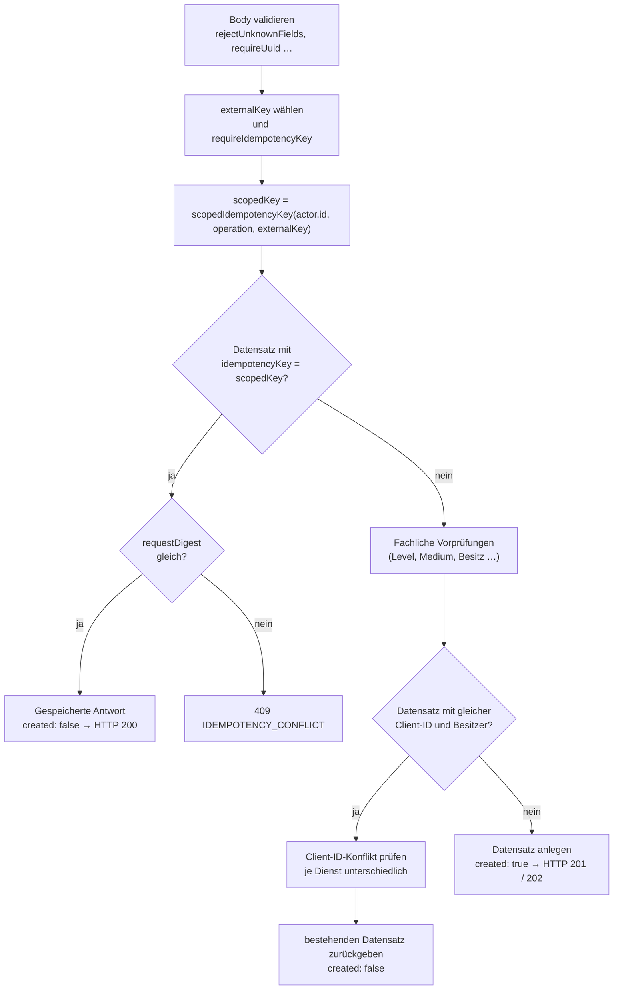

# Idempotenz und Fehlerformat

Plantini ist offline-first: Die App wiederholt schreibende Aufrufe, bis sie eine Antwort sieht. Deshalb muss jede Schreib-Operation **wiederholbar** sein, ohne doppelte Datensätze zu erzeugen, und jeder Fehler muss in einer **stabilen, maschinenlesbaren Form** ankommen. Diese Seite zeigt beide Mechanismen im Code und wie die Tests sie absichern.

## Das Prinzip in drei Sätzen

1. Der Client vergibt für jede Schreib-Operation eine **Client-ID** (UUID) und einen **Idempotency-Key** (16–128 Zeichen).
2. Der Server speichert pro Operation einen nicht umkehrbaren Hash des Schlüssels **plus** einen Hash der validierten Nutzlast. Eine Wiederholung mit gleichem Schlüssel und gleicher Nutzlast liefert die gespeicherte Antwort (HTTP 200), mit anderer Nutzlast `409 IDEMPOTENCY_CONFLICT`.
3. Zusätzlich verhindern **eindeutige Spalten** in der Datenbank, dass zwei gleichzeitige Requests dasselbe doppelt anlegen.

## Die Bausteine in `ids.js`

Datei `services/platform/src/api/platform/services/core/ids.js`:

```js title="services/platform/src/api/platform/services/core/ids.js"
function requireIdempotencyKey(value) {
  if (typeof value !== 'string' || value.length < 16 || value.length > 128) {
    throw invalidRequest({ 'Idempotency-Key': 'Muss zwischen 16 und 128 Zeichen lang sein.' });
  }
  if (!/^[A-Za-z0-9._~:/+=-]+$/.test(value)) {
    throw invalidRequest({ 'Idempotency-Key': 'Enthält unzulässige Zeichen.' });
  }
  return value;
}

function scopedIdempotencyKey(ownerId, operation, externalKey) {
  return createHash('sha256')
    .update(`${ownerId}\u0000${operation}\u0000${externalKey}`)
    .digest('hex');
}

function payloadDigest(value) {
  return createHash('sha256').update(stableStringify(value)).digest('hex');
}
```

| Funktion | Warum |
|---|---|
| `requireIdempotencyKey` | erzwingt Länge und Zeichensatz; triviale Schlüssel wie ein Zähler werden abgelehnt |
| `scopedIdempotencyKey(ownerId, operation, externalKey)` | der **extern** gesendete Schlüssel wird nie direkt gespeichert: Hash über Besitzer, Operationsname und Schlüssel. Zwei Konten können deshalb denselben Schlüssel benutzen, und derselbe Schlüssel in zwei Operationen kollidiert nicht |
| `payloadDigest(value)` | SHA-256 über `stableStringify` – ein JSON mit **sortierten Schlüsseln**, damit die Feldreihenfolge keine Rolle spielt |
| `requireUuid` | Client-IDs müssen UUIDs sein (Muster für Version 1–5) |

Ein Beispiel für `stableStringify` (lokal mit `node` ausgeführt):

```js
payloadDigest({ b: 1, a: [2, { d: 1, c: 2 }] })
// stableStringify → {"a":[2,{"c":2,"d":1}],"b":1}
// → 71669b868168f568bda0860b89ed77dabe80ad6cf7842eff8cafc1d81185ef9e
```

!!! note "Was der Digest abdeckt"
    `payloadDigest` bekommt das **validierte** Eingabeobjekt (Ausgabe von `validateStartAttempt` o. ä.), nicht den rohen Body. Unbekannte Felder können also gar nicht erst im Digest landen (sie führen vorher zu `400`), und normalisierte Werte (z. B. `requireDate` → UTC-String, getrimmte Strings) zählen in ihrer normalisierten Form.

## Entscheidungsbaum einer idempotenten Anlage

Alle "create"-Operationen (Versuch starten, Upload reservieren, Identifikation anlegen, Fund anlegen) folgen demselben Muster:



Der Schlüsselzweig kommt **vor** den fachlichen Prüfungen. Das ist Absicht: Eine Wiederholung soll auch dann die ursprüngliche Antwort liefern, wenn sich der Zustand inzwischen geändert hat (z. B. das Level inzwischen gesperrt wäre).

## Welcher Schlüssel gilt wo?

Für `startAttempt`, `reserveUpload`, `createIdentification` und `herbarium.create` lautet die Auswahl (hier aus `learning-service.js`):

```js title="services/platform/src/api/platform/services/core/learning/learning-service.js"
const idempotencyKey = requireIdempotencyKey(
  input.idempotencyKey || input.clientMutationId || idempotencyHeader || input.clientAttemptId);
const scopedKey = scopedIdempotencyKey(actor.id, 'level-attempt', idempotencyKey);
```

Die **Reihenfolge ist Body zuerst, Header danach, Client-ID zuletzt**. Weil die Client-ID eine UUID (36 Zeichen) ist, besteht sie `requireIdempotencyKey`; der Header ist für diese vier Operationen also faktisch optional – obwohl `contracts/api.yaml` ihn als `required: true` führt (`components/parameters/IdempotencyKey`).

| Endpunkt | Operationsname im Hash | Schlüsselquelle (Reihenfolge) | Header zwingend? | Erfolg / Replay |
|---|---|---|---|---|
| `POST /level-attempts` | `level-attempt` | `idempotencyKey` → `clientMutationId` → Header → `clientAttemptId` | nein | 201 / 200 |
| `POST /level-attempts/:id/complete` | `attempt-complete:<attemptId>` | nur Header | **ja** | 200 / 200 (gleiche Antwort) |
| `POST /learning-events/batch` | `learning-event` (je Ereignis) | Header wird nur **geprüft**; Deduplizierung über `clientEventId` | **ja** (nur Format) | 200 mit `acceptedClientEventIds` |
| `POST /sync` | wie Events | wie Events | **ja** (nur Format) | 200 |
| `POST /media/uploads` | `media-upload` | `idempotencyKey` → `clientMutationId` → Header → `clientMediaId` | nein | 201 / 200 |
| `POST /identifications` | `identification` | `idempotencyKey` → `clientMutationId` → Header → `clientJobId` | nein | 202 / 200 |
| `POST /identifications/:id/retry` | – | Header wird nur **geprüft** | **ja** (nur Format) | immer 202 |
| `POST /observations` | `observation` | `idempotencyKey` → `clientMutationId` → Header → `clientObservationId` | nein | 201 / 200 |
| `PATCH`/`DELETE /observations/:id` | – | **kein** Idempotency-Key, stattdessen `If-Match` (Versions-UUID) | `If-Match` ja | 200 bzw. 202 |
| `POST /teaching/*` | – | keine Idempotenz (im Vertrag vermerkt) | – | 201 / 200 |

!!! warning "Stolperfalle: Body-Felder, die im Vertrag fehlen"
    Der Server akzeptiert `idempotencyKey` und `clientMutationId` zusätzlich im Body (`rejectUnknownFields` listet sie). Die Schemas `StartLevelAttemptRequest`, `CreateUploadRequest` usw. in `contracts/api.yaml` kennen diese Felder nicht, der generierte Dart-Client sendet sie daher nicht. Der **Vertrag** ist die Referenz für Clients; die Body-Variante ist nur serverseitig vorhanden und sollte nicht ohne Vertragsänderung benutzt werden.

### Ereignisse: Deduplizierung pro Ereignis

`submitEvents` verarbeitet jedes Ereignis einzeln und fängt Fehler pro Ereignis ab:

```js title="services/platform/src/api/platform/services/core/learning/learning-service.js"
for (const rawEvent of input.events) {
  try {
    const event = validateEvent(rawEvent);
    const idempotencyKey = scopedIdempotencyKey(actor.id, 'learning-event', event.clientEventId);
    const requestDigest = payloadDigest(event);
    const existing = await this.repository.findEventByIdempotencyKey(idempotencyKey);
    if (existing) {
      assertSamePayload(existing.requestDigest, requestDigest);
    } else {
      await this.repository.createEvent({ /* … */ });
    }
    acceptedClientEventIds.push(event.clientEventId);
  } catch (error) {
    rejected.push(asProblem(error, traceId));
  }
}
return { acceptedClientEventIds, rejected };
```

Folgen: Ein Ereignis, das schon gespeichert ist, wird **erneut bestätigt** (steht wieder in `acceptedClientEventIds`), aber nicht doppelt gespeichert. Ein Ereignis mit bekannter `clientEventId` und anderer Nutzlast landet in `rejected[]` als Problem-Objekt mit `IDEMPOTENCY_CONFLICT`, ohne die anderen Ereignisse des Batches zu stoppen. Der Header `Idempotency-Key` des Batches wird nur auf Format geprüft – das ist der Grund, warum der Test `offline learning events are acknowledged exactly once` den Batch mit zwei **verschiedenen** Header-Schlüsseln absendet und trotzdem nur einen gespeicherten Datensatz erwartet.

### `assertSamePayload` gibt es dreimal

Es gibt **keine** geteilte Hilfsfunktion: `learning-service.js`, `field-service.js` und `herbarium-service.js` definieren jeweils dieselbe kleine Funktion:

```js title="services/platform/src/api/platform/services/core/field/field-service.js"
function assertSamePayload(storedDigest, requestDigest) {
  if (storedDigest !== requestDigest) {
    throw conflict('IDEMPOTENCY_CONFLICT', 'Der Idempotency-Key wurde bereits mit einer anderen Anfrage verwendet.');
  }
}
```

Ändert sich die Meldung oder der Code, musst du alle drei Kopien anfassen.

## Client-IDs: der zweite Schutz

Zusätzlich zum Schlüssel hat jede Operation eine Client-ID (`clientAttemptId`, `clientMediaId`, `clientJobId`, `clientObservationId`, `clientEventId`). Sie ist pro Besitzer eindeutig über die Hash-Spalte `owner…Key`:

```js title="services/platform/src/api/platform/services/core/strapi-repositories.js"
createAttempt: async (draft) => entities.create('api::level-attempt.level-attempt', {
  data: { ...draft, ownerClientAttemptKey: ownerClientKey(draft.ownerId, draft.clientAttemptId) },
}),
```

`test/idempotency-schema.test.js` stellt sicher, dass in den Schemas `private-media`, `identification-job` und `observation` die Felder `publicId`, `owner…Key` und `idempotencyKey` jeweils `required: true` **und** `unique: true` sind. `level-attempt` hat dieselben Spalten (`schema.json`); der Test deckt sie derzeit nicht ab.

Was bei einer **bekannten Client-ID, aber unbekanntem Schlüssel** passiert, ist je Dienst verschieden:

| Dienst | Prüfung bei bekannter Client-ID | Ergebnis bei Abweichung |
|---|---|---|
| Learning (`startAttempt`) | `levelPublicId` und `contentVersion` gleich? | `409 CLIENT_ATTEMPT_CONFLICT` |
| Field (`reserveUpload`) | `contentType` und `bytes` gleich? | `409 CLIENT_MEDIA_CONFLICT` |
| Field (`createIdentification`) | `mediaId` und `expectedPlantId` gleich? | `409 CLIENT_JOB_CONFLICT` |
| Herbarium (`create`) | **keine** Prüfung | gibt den bestehenden Fund zurück (`created: false`) |

!!! warning "Stolperfalle: der Herbarium-Pfad vergleicht nichts"
    `HerbariumService.create` gibt bei bekannter `clientObservationId` den vorhandenen Fund zurück, ohne Notiz, Zeitpunkt oder Ort zu vergleichen. Wer mit gleicher Client-ID, aber **neuem** Schlüssel und anderem Inhalt sendet, bekommt `200` mit dem **alten** Datensatz und glaubt, seine Änderung sei gespeichert. Änderungen laufen über `PATCH /observations/:id` mit `If-Match`.

## Status-Codes bei Replay

Das Muster "201 beim ersten Mal, 200 beim Replay" entsteht im **Controller** aus dem Feld `created`, das der Dienst mitliefert:

```js title="services/platform/src/api/platform/controllers/platform.js"
async createObservation(ctx) {
  return withActor(ctx, async (runtime, actor) => {
    const result = await runtime.herbarium.create(actor, ctx.request.body, ctx.get('idempotency-key'));
    ctx.status = result.created ? 201 : 200;
    return result.observation;
  });
},
```

!!! note "`created` ist Teil der Dienstantwort"
    Bei `reserveUpload` und `createIdentification` gibt der Dienst `{ …, created }` zurück und der Controller reicht das **ganze** Objekt weiter (`return upload` / `return job`). Das Feld `created` steht dort also auch im JSON-Body, obwohl der Vertrag es in `MediaUpload` / `IdentificationJob` nicht beschreibt. Bei `startLevelAttempt` und `createObservation` wird dagegen gezielt `result.attempt` bzw. `result.observation` zurückgegeben. Das wurde hier aus dem Code gelesen, nicht gegen einen laufenden Stack geprüft.

## Fehlerformat: `errors.js`

Alle Fehler verlassen die API als `application/problem+json` (RFC 9457). Das Format wird in `services/platform/src/api/platform/services/core/errors.js` erzeugt:

```js title="services/platform/src/api/platform/services/core/errors.js"
class ProblemError extends Error {
  constructor(code, options = {}) {
    super(options.detail || options.title || code);
    this.name = 'ProblemError';
    this.code = code;
    this.status = options.status || 400;
    this.title = options.title || defaultTitle(this.status);
    this.detail = options.detail;
    this.fieldErrors = options.fieldErrors;
  }
}

function asProblem(error, traceId, instance) {
  const known = error instanceof ProblemError;
  const status = known ? error.status : 500;
  const code = known ? error.code : 'INTERNAL_ERROR';
  const problem = {
    type: `/problems/${code.toLowerCase().replace(/_/g, '-')}`,
    title: known ? error.title : defaultTitle(status),
    status, code, traceId,
  };
  if (known && error.detail) problem.detail = error.detail;
  if (instance) problem.instance = instance;
  if (known && error.fieldErrors && Object.keys(error.fieldErrors).length > 0) {
    problem.fieldErrors = error.fieldErrors;
  }
  return problem;
}
```

Wichtige Eigenschaften:

- **Unbekannte Fehler lecken nichts.** Jede Exception, die kein `ProblemError` ist, wird zu `500 INTERNAL_ERROR` mit Standardtitel und **ohne** `detail`. Der Test `API-04 emits bounded RFC problem details without leaking internals` übergibt `new Error('database password=secret')` und erwartet exakt `{ type, title, status, code, traceId, instance }`.
- **`type` ist ein relativer URI** aus dem Code: `VALIDATION_FAILED` → `/problems/validation-failed`.
- **`title`** kommt aus `defaultTitle(status)` (deutsch: 400 "Ungültige Anfrage", 401 "Nicht authentifiziert", 403 "Nicht berechtigt", 404 "Nicht gefunden", 409 "Konflikt", 412, 422, 429, sonst "Interner Fehler"), kann aber pro Fehler überschrieben werden (503-Fälle nutzen eigene Titel).
- **`traceId`** ist die Correlation-ID aus `http-conventions.js`; sie steht auch im Header `X-Correlation-Id` – damit lässt sich ein Nutzerbericht im Log finden.
- **`fieldErrors`** ist ein Objekt `{ feldname: Meldung }`.

### Hilfskonstruktoren

| Funktion | Ergebnis |
|---|---|
| `invalidRequest(fieldErrors, detail?)` | `400 VALIDATION_FAILED` mit `fieldErrors` |
| `notFound(code = 'RESOURCE_NOT_FOUND')` | `404`, `detail`: "Die angefragte Ressource ist für dieses Konto nicht verfügbar." |
| `conflict(code, detail, fieldErrors?)` | `409` |
| `new ProblemError(code, { status, detail, title, fieldErrors })` | alles andere (401, 403, 503, …) |

### Beispielantworten

Die folgenden Objekte wurden mit `asProblem` lokal erzeugt (Node, `services/platform`); `traceId` und `instance` sind Beispielwerte.

**400, Validierung:**

```json
{
  "type": "/problems/validation-failed",
  "title": "Ungültige Anfrage",
  "status": 400,
  "code": "VALIDATION_FAILED",
  "traceId": "3f6c0d62-6f0e-4d6a-9a43-0c1f2a7b9e11",
  "detail": "Ein oder mehrere Felder sind ungültig.",
  "instance": "/api/v1/observations",
  "fieldErrors": { "observedAt": "Muss ein RFC-3339-Zeitstempel mit Zeitzone sein." }
}
```

**400, Header-Fehler** (`fieldErrors` darf auch Header-Namen als Schlüssel tragen):

```json
{
  "type": "/problems/validation-failed", "title": "Ungültige Anfrage", "status": 400,
  "code": "VALIDATION_FAILED", "traceId": "…", "detail": "Ein oder mehrere Felder sind ungültig.",
  "instance": "/api/v1/sync",
  "fieldErrors": { "Idempotency-Key": "Muss zwischen 16 und 128 Zeichen lang sein." }
}
```

**404, fremde oder fehlende Ressource** (gleiche Antwort in beiden Fällen):

```json
{
  "type": "/problems/observation-not-found", "title": "Nicht gefunden", "status": 404,
  "code": "OBSERVATION_NOT_FOUND", "traceId": "…",
  "detail": "Die angefragte Ressource ist für dieses Konto nicht verfügbar.",
  "instance": "/api/v1/observations/abc"
}
```

**409, Idempotenzkonflikt:**

```json
{
  "type": "/problems/idempotency-conflict", "title": "Konflikt", "status": 409,
  "code": "IDEMPOTENCY_CONFLICT", "traceId": "…",
  "detail": "Der Idempotency-Key wurde bereits mit einer anderen Anfrage verwendet.",
  "instance": "/api/v1/observations"
}
```

**500, unerwarteter Fehler** (nie mit Detailtext):

```json
{
  "type": "/problems/internal-error", "title": "Interner Fehler", "status": 500,
  "code": "INTERNAL_ERROR", "traceId": "trace-safe-123", "instance": "/api/v1/observations"
}
```

### Fehlercodes nach Bereich

Die Tabelle fasst die Codes zusammen, die im Quelltext von `services/platform/src` vorkommen (Status in Klammern):

| Bereich | Codes |
|---|---|
| Allgemein | `VALIDATION_FAILED` (400), `INVALID_QUERY` (400), `IDEMPOTENCY_CONFLICT` (409), `INTERNAL_ERROR` (500) |
| Auth | `AUTH_TOKEN_MISSING`, `AUTH_TOKEN_INVALID`, `AUTH_TOKEN_EXPIRED`, `AUTH_TOKEN_NOT_ACTIVE`, `AUTH_SESSION_REVOKED` (alle 401), `AUTH_KEYSET_UNAVAILABLE` (503), `ACCOUNT_SUSPENDED` (403) |
| Inhalt | `CONTENT_RELEASE_UNAVAILABLE`, `CONTENT_INTEGRITY_FAILED` (503), `CONTENT_PACKAGE_NOT_FOUND`, `ECOSYSTEM_NOT_FOUND`, `LEVEL_NOT_FOUND`, `PLANT_NOT_FOUND`, `PHOTO_NOT_FOUND` (404), `PHOTO_UNAVAILABLE` (503), `CONTENT_VERSION_CONFLICT`, `CONTENT_VERSION_UNAVAILABLE` (409) |
| Lernen | `LEVEL_ATTEMPT_NOT_FOUND` (404), `LEVEL_LOCKED`, `LEVEL_COLLECTION_INCOMPLETE`, `ATTEMPT_ALREADY_COMPLETED`, `CLIENT_ATTEMPT_CONFLICT` (409), `COLLECTION_GATE_UNAVAILABLE` (503) |
| Feld | `MEDIA_UPLOAD_NOT_FOUND`, `MEDIA_NOT_FOUND`, `IDENTIFICATION_NOT_FOUND` (404), `MEDIA_UPLOAD_EXPIRED`, `CLIENT_MEDIA_CONFLICT`, `CLIENT_JOB_CONFLICT`, `IDENTIFICATION_NOT_READY`, `IDENTIFICATION_NOT_RETRYABLE`, `IDENTIFICATION_MISMATCH_NOT_ACCEPTED` (409) |
| Herbarium | `OBSERVATION_NOT_FOUND` (404), `OBSERVATION_VERSION_CONFLICT` (409), `SPECIES_NOT_FOUND`, `SPECIES_PHOTO_NOT_FOUND` (404), `MAP_TILE_UNAVAILABLE` (502) |
| Redaktion | `EDITOR_FORBIDDEN`, `REVIEW_FORBIDDEN`, `EDITOR_INVITE_FORBIDDEN` (403), `EDITOR_ITEM_NOT_FOUND`, `EDITOR_CHANGE_NOT_FOUND`, `EDITOR_CHANGE_NOT_EDITABLE`, `EDITOR_CHANGE_NOT_PENDING` (404), `EDITOR_CHANGE_STATE_CHANGED`, `EDITOR_PAYLOAD_CHANGED`, `EDITOR_APPROVED_CONFLICT`, `EDITOR_BASE_CHANGED`, `EDITOR_TARGET_EXISTS`, `EDITOR_SLUG_EXISTS`, `EDITOR_INVITEE_EXISTS` (409), `EDITOR_INVITES_UNAVAILABLE` (503) |
| Lehre | `TEACHING_FORBIDDEN`, `TEACHING_ACCOUNT_PROTECTED` (403), `TEACHING_CLASS_NOT_FOUND`, `TEACHING_STUDENT_NOT_FOUND` (404), `TEACHING_USERNAME_EXISTS`, `TEACHING_LIMIT_REACHED` (409), `TEACHING_IDENTITY_UNAVAILABLE` (503) |

Codes sind **Teil der API**: Die App verzweigt auf `code`, nicht auf den deutschen Text. Benenne einen Code deshalb nie um, ohne App und Vertrag mitzuziehen.

## Stolperfallen

!!! warning "`meta` wird nicht serialisiert"
    `LearningService` wirft `new ProblemError('LEVEL_LOCKED', { status: 409, detail: …, meta: { missingLevelIds } })` und analog `LEVEL_COLLECTION_INCOMPLETE` mit `meta: { missingPlantIds }`. Weder der Konstruktor (er liest nur `detail`, `title`, `status`, `fieldErrors`) noch `asProblem` kennen `meta`. Die Antwort enthält die Listen daher **nicht**; ein lokal mit `node -e` erzeugter `LEVEL_LOCKED`-Fehler besteht nur aus `type, title, status, code, traceId, detail, instance`. Willst du solche Metadaten ausliefern, musst du `ProblemError`, `asProblem` **und** das `Problem`-Schema in `contracts/api.yaml` ergänzen.

!!! warning "Das `Problem`-Schema kennt `instance` nicht"
    `asProblem` setzt `instance` (= `ctx.path`), das Schema `components/schemas/Problem` in `contracts/api.yaml` listet es nicht (es hat keine `additionalProperties: false`, der Client ignoriert das Feld also). Beim Erweitern des Fehlerformats beide Seiten gleichzeitig ändern.

!!! note "Fehler vor dem Controller: vermutlich nicht Problem-JSON (nicht geprüft)"
    Alles, was in Strapis Middleware-Kette **vor** dem Controller scheitert (zum Beispiel ein nicht parsebarer JSON-Body durch `strapi::body`, ein zu großer Upload), erzeugt Strapis eigenes Fehlerformat, nicht `asProblem`. Das wurde hier nicht ausgeführt; die Aussage folgt aus der Reihenfolge `strapi::errors` → `strapi::body` in `config/middlewares.js` und dem Umstand, dass `execute` erst beim Controller beginnt.

!!! tip "`404` statt `403` bei fremden Ressourcen"
    Besitzfilter stehen in der Abfrage (`{ ownerId, publicId }`). Eine fremde ID ist darum nicht von einer fehlenden zu unterscheiden. Verrate in keiner Meldung, ob es eine Ressource gibt (`notFound` benutzt bewusst einen einheitlichen Text).

## Wie die Tests das prüfen

| Test | Datei | Was er zeigt |
|---|---|---|
| `server-authoritative attempts are idempotent …` | `test/learning-service.test.js` | gleicher Start zweimal → `created` `true`/`false`, gleiche ID, ein Datensatz; Abschluss mit gleichem Key und **anderen** Antworten → `IDEMPOTENCY_CONFLICT` |
| `offline learning events are acknowledged exactly once` | `test/learning-service.test.js` | zwei Batches, ein Datensatz |
| `herbarium observation creation is protected by idempotency key and clientMutationId` | `test/field-herbarium.test.js` | Replay → `created: false`; gleicher Key, andere Notiz → Konflikt; `clientMutationId` im Body funktioniert wie der Key |
| `media upload reservation is idempotent with body idempotencyKey` | `test/field-herbarium.test.js` | Replay und Konflikt bei geänderten `bytes` |
| `FIELD-03/OFFLINE-04: private write models enforce …` | `test/idempotency-schema.test.js` | `unique`/`required` in den Schemas |
| `API-04 emits bounded RFC problem details …` | `test/api-conventions.test.js` | Problem-JSON ohne Datenleck |
| `API-04 applies stable v1 and correlation headers …` | `test/api-conventions.test.js` | Correlation-ID-Übernahme/-Ersatz |

Ein eigener Test für einen neuen Dienst folgt dem Muster aus `learning-service.test.js`:

```js title="services/platform/test/learning-service.test.js"
await assert.rejects(
  () => service.completeAttempt(actor, first.attempt.id, {
    clientEventId: ids.clientEvent,
    answers: [ /* geänderte Antworten */ ],
  }, 'complete-idempotency-key-01'),
  (error) => error instanceof ProblemError && error.code === 'IDEMPOTENCY_CONFLICT',
);
```

Die Dienste bekommen eine Uhr (`clock: () => new Date('2026-01-01T00:00:00.000Z')`) und ein Repository-Objekt im Speicher; weder Strapi noch Datenbank noch Netz sind nötig.

## Beispiel: Wiederholung gegen einen laufenden Stack

Der folgende Ablauf ist aus dem Code abgeleitet und nicht gegen einen Stack mitgeschnitten. `$TOKEN` ist ein gültiges Zugriffstoken.

```sh
BODY='{"clientObservationId":"eeeeeeee-eeee-4eee-8eee-eeeeeeeeeeee","observedAt":"2026-01-01T00:00:00Z","note":"Erster Fund"}'
KEY='obs-2026-01-01-0001-abcd'

# 1. Anlage → 201
curl -sS -X POST http://127.0.0.1:1338/api/v1/observations \
  -H "Authorization: Bearer $TOKEN" -H "Idempotency-Key: $KEY" \
  -H 'Content-Type: application/json' -d "$BODY"

# 2. identische Wiederholung → 200, gleiche id/version
# 3. gleicher Key, andere Notiz → 409 IDEMPOTENCY_CONFLICT
```

## Weiterführend

- Nachbarseiten: [Dienste](services.md), [Fach-API-Schicht](plattform.md), [Neuer Endpunkt](neuer-endpunkt.md), [App: Offline](../app/offline.md)
- Quellpfade: `services/platform/src/api/platform/services/core/ids.js`, `services/platform/src/api/platform/services/core/errors.js`, `services/platform/src/api/platform/services/core/validation.js`, `services/platform/test/idempotency-schema.test.js`, `services/platform/test/api-conventions.test.js`, `contracts/api.yaml`
