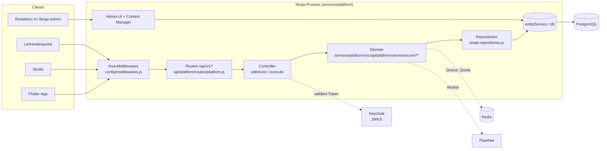

# Backend & API – Überblick

Das Backend von Plantini ist ein **Strapi-4.25-Projekt** (`services/platform`), das zwei Aufgaben erfüllt: Es ist das Redaktionssystem für die Inhalte (Ökosysteme, Level, Pflanzen, Quizfragen) und es trägt die eigene **Fach-API** unter `/api/v1`, mit der Flutter-App, Studio und Lehrendenportal sprechen. Diese Seite zeigt, wie das Projekt aufgebaut ist, wie beide Schichten zusammenhängen und wie du es baust und testest.

!!! note "Projektstatus"
    Plantini ist ein unveröffentlichter, unvollständiger Teaser und **nicht Open Source**. Dieses Handbuch beschreibt den Stand des Quelltexts im Arbeitsbaum. Wo etwas fehlt oder nicht geprüft wurde, steht das ausdrücklich dabei. Mitarbeit ist nach Absprache möglich (Kontakt `noah@illmann.net`).

## Technologie auf einen Blick

| Baustein | Version / Wert | Beleg |
|---|---|---|
| Framework | Strapi `4.25.10` (`@strapi/strapi`, `plugin-i18n`, `plugin-users-permissions`, `plugin-cloud`) | `services/platform/package.json` |
| Laufzeit | Node `20.20.2` im Image; `engines` erlaubt `>=18 <=20.x.x` | `services/platform/Dockerfile`, `package.json` |
| Datenbank | PostgreSQL (`pg`) in Compose und Produktion; **SQLite ist nur der Default in `config/database.js`** (`DATABASE_CLIENT` fehlt → `sqlite`) | `services/platform/config/database.js` |
| Queue / Guard | Redis über `bullmq 5.58.5` und `ioredis 5.11.1` (Identifikations-Queue, PlantNet-Quota, Circuit Breaker) | `src/index.js`, `field/identification-queue.js`, `field/provider-guard.js` |
| Auth | Keycloak-JWT (RS256, JWKS) – selbst validiert, **nicht** über Strapis Users-Permissions-Plugin | `auth/jwt-validator.js` |
| Bildverarbeitung | `sharp 0.32.6` – kommt **transitiv** über Strapi, steht nicht in der `package.json` des Projekts | `package-lock.json`, `private-media-store.js` |
| Tests | `node --test` (Node-Testrunner), kein Jest/Mocha | `package.json` → `test` |

## Verzeichnisstruktur

```text
services/platform/
├── Dockerfile                  # mehrstufig: npm ci → lint/check/test/build → Runtime (User plantini)
├── Dockerfile.release-overlay  # nur src/ auf ein vorhandenes Release-Image legen
├── eslint.config.mjs           # ESLint 10, CommonJS, globale `strapi`
├── config/                     # server, admin, api, database, middlewares, plugins
├── database/migrations/        # leer (.gitkeep) – das Schema entsteht aus den Content-Types
├── src/
│   ├── index.js                # register / bootstrap / destroy (Queue, Worker, Seed)
│   ├── api/
│   │   ├── platform/           # DIE Fach-API: routes, controllers, services/platform/src/api/platform/services/core/**
│   │   ├── ecosystem|level|plant|quiz|media/   # CMS-Content-Types (+ Core-Router)
│   │   ├── content-release|journey-blueprint|editor-change/
│   │   ├── profile|level-attempt|learning-event/
│   │   ├── private-media|identification-job|observation|species-card/
│   │   └── teaching-class|teaching-student|teaching-audit/
│   └── components/learning/    # fact-card (Lernkarte), journey-stop (Pflanzenstation)
├── test/                       # 14 Testdateien + helpers/memory-entities.js
└── types/generated/            # von Strapi erzeugte Typen
```

Jeder Ordner unter `src/api/<name>` ist eine Strapi-"API". Für die CMS-Typen enthält er `content-types/<name>/schema.json` (das Datenmodell) und teilweise `lifecycles.js` (Validierung beim Speichern/Veröffentlichen). `src/api/platform` hat dagegen **keinen** Content-Type: Er besteht nur aus Routen, einem Controller und den Diensten unter `services/platform/src/api/platform/services/core/`.

## Wie Strapi und die Fach-API zusammenhängen

Strapi liefert Admin-UI, Datenbankzugriff (`strapi.entityService`, `strapi.db`), Draft/Publish und den HTTP-Server (Koa). Die Fach-API sitzt als normale Strapi-API **obendrauf** und benutzt Strapi nur als Persistenzschicht:



Drei Regeln folgen daraus:

1. **Clients sprechen nie mit Strapi-Admin oder PlantNet**, nur mit `/api/v1/*` (Vertrag: `contracts/api.yaml`).
2. **Die Fach-API schaltet Strapis Authentifizierung ab** (`config: { auth: false }` pro Route) und prüft das Keycloak-Token selbst. Dadurch gelten Issuer, Audience, Besitzprüfung und Rollenregeln überall gleich (Kommentar in `routes/platform.js`).
3. **Nur der Repository-Adapter kennt numerische Strapi-IDs.** Dienste und API sprechen ausschließlich UUIDs (`publicId`, `profileId`). Das steht als Kommentar über `createStrapiRepositories` in `services/platform/src/api/platform/services/core/strapi-repositories.js`.

!!! note "Core-Router der Content-Types"
    Für `ecosystem`, `level`, `plant`, `quiz`, `media` und `observation` existieren zusätzlich Strapis generische CRUD-Router (`createCoreRouter(...)`, z. B. `src/api/level/routes/level.js`). Sie liefern Strapis Standard-Pfade (`/api/levels` usw.); ob sie in einer Umgebung für anonyme Aufrufer gesperrt sind, entscheidet die Rechtevergabe im Strapi-Admin. **Diese Rechte wurden hier nicht geprüft.** Die App darf ausschließlich `/api/v1` benutzen. Der Controller `api/observation/controllers/observation.js` kommentiert ausdrücklich: Es gibt keine öffentliche Strapi-Observation-API.

## Was beim Start passiert

`src/index.js` ist der einzige Ort, an dem Hintergrunddienste starten:

| Schritt in `bootstrap` | Zweck |
|---|---|
| `getPlatformRuntime(strapi)` | baut alle Dienste (und wirft sofort, wenn `PLATFORM_OIDC_ISSUER` / `PLATFORM_OIDC_AUDIENCE` fehlen) |
| `runtime.teaching.ensureIndexes()` | legt `teaching_classes_owner_idx` und `level_attempts_owner_idx` per `CREATE INDEX IF NOT EXISTS` an |
| `seedDemoContent(strapi)` | nur bei `PLATFORM_SEED_DEMO_CONTENT=true`; schreibt Demo-Inhalte und ein aktives Content-Release |
| `createIdentificationQueue()` | BullMQ-Queue `plantini-identifications` (verlangt `REDIS_URL`) |
| `new RedisProviderGuard()` + `PlantNetProvider` | Quota-Reserve und Circuit Breaker für den Identifikationsanbieter |
| `createIdentificationWorker(...)` | Worker mit `concurrency: 2`, ruft `runtime.field.processIdentification` |
| `recoverPendingJobs` alle 30 s | stellt `pending`-Jobs wieder in die Queue, falls Redis zwischendurch weg war |

`destroy` schließt Worker, Queue und Guard und stoppt den Recovery-Timer.

!!! warning "Stolperfalle: ohne Redis startet das Backend nicht"
    `createIdentificationQueue()` ruft `parseRedisConnection(process.env.REDIS_URL)` auf, und das wirft `REDIS_URL must be configured.` (`field/identification-queue.js`). Ein nacktes `npm run develop` ohne Redis scheitert deshalb im Bootstrap. Bricht Redis erst nach dem Start weg, läuft der Server weiter: `FieldService.enqueuePersistedJob` fängt Fehler beim Einreihen ab, der Job bleibt `pending` in der Datenbank und wird vom 30-Sekunden-Timer erneut eingereiht.

## Befehle

Alle Befehle werden in `services/platform` ausgeführt (immer mit absolutem `cd`, die Shell behält das Verzeichnis):

```sh
cd /pfad/zu/plantini/services/platform
npm ci
npm run lint     # eslint config src test
npm run check    # node --check src/index.js && node --check src/api/platform/controllers/platform.js
npm test         # node --test test/*.test.js
npm run build    # strapi build (Admin-Panel)
```

| Skript | Inhalt (aus `package.json`) | Hinweis |
|---|---|---|
| `develop` | `strapi develop` | Autoreload; braucht die Umgebungsvariablen unten |
| `start` | `strapi start` | wird im Image als `CMD ["npm", "run", "start"]` benutzt |
| `build` | `strapi build` | baut das Admin-Panel nach `build/` |
| `lint` | `eslint config src test` | Regeln in `eslint.config.mjs`; `no-unused-vars` mit Präfix `_` erlaubt |
| `check` | `node --check` auf `src/index.js` und den Controller | reine Syntaxprüfung |
| `test` / `test:unit` | `node --test test/*.test.js` | siehe unten |

Der Docker-Build (`services/platform/Dockerfile`, Stage `build`) führt `npm run lint && npm run check && npm test && npm run build` aus. Ein Image mit rotem Test entsteht also nicht. CI (`.gitlab-ci.yml`, Job `backend:test`) wiederholt dieselben vier Befehle und startet danach `node --test services/identity/test/*.test.mjs`.

!!! tip "Testlauf lokal (beobachtet)"
    `npm run check`, `npm run lint` und `npm test` liefen im Arbeitsbaum erfolgreich: **49 Tests, 45 bestanden, 4 übersprungen, 0 fehlgeschlagen.** Ausgeführt wurde lokal mit Node 26.10.0, obwohl `engines` und Dockerfile auf Node 20 zielen; verbindlich ist Node 20.20.2.

!!! warning "Stolperfalle: 4 Tests laufen ohne Redis nicht"
    `field-identification-queue.test.js` (2 Tests) und `provider-guard.test.js` (2 Tests) werden ohne `PLANTINI_TEST_REDIS_URL` mit `skip` übersprungen. "45 von 49 grün" ist daher kein Vollnachweis der Queue-Logik. Die übrigen Tests laufen nach Lage der Testdateien gegen Mocks (`fetch`-Doubles, In-Memory-Repositories) bzw. gegen `test/helpers/memory-entities.js` und brauchen keine Datenbank.

## Umgebungsvariablen (Namen aus dem Code)

Werte gehören nicht ins Repo; Vorlagen liegen unter `infra/` (`production.env.example`, Compose-Dateien). Die Tabelle nennt nur Namen und Zweck.

| Gruppe | Variablen | Quelle |
|---|---|---|
| Strapi-Pflicht | `APP_KEYS` (kommagetrennte Liste), `API_TOKEN_SALT`, `ADMIN_JWT_SECRET`, `TRANSFER_TOKEN_SALT` (Defaults gibt es nur für `HOST` = `0.0.0.0` und `PORT` = `1337`) | `config/server.js`, `config/admin.js` |
| Datenbank | `DATABASE_CLIENT` (`postgres`/`mysql`/`mysql2`/`sqlite`), `DATABASE_HOST`, `_PORT`, `_NAME`, `_USERNAME`, `_PASSWORD`, `_URL`, `_SSL*`, `_SCHEMA`, `DATABASE_POOL_MIN/MAX` | `config/database.js` |
| CORS | `CORS_ORIGINS` (Liste) | `config/middlewares.js` |
| OIDC | `PLATFORM_OIDC_ISSUER` und `PLATFORM_OIDC_AUDIENCE` (Pflicht), `PLATFORM_OIDC_JWKS_URI`, `PLATFORM_OIDC_ROLE_CLIENT_ID`, `PLATFORM_ORGANISATION_CLAIM` | `platform-runtime.js` |
| Redis | `REDIS_URL` (`redis://` oder `rediss://`) | `identification-queue.js` |
| PlantNet | `PLANTNET_MODE` (`mock`/`real`), `PLANTNET_BASE_URL`, `PLANTNET_API_KEY`, `PLANTNET_PROJECT`, `PLANTNET_LANGUAGE`, `PLANTNET_MAX_RESULTS`, `PLANTNET_DAILY_REQUEST_LIMIT`, `PLANTNET_QUOTA_RESERVE`, `PLANTNET_CIRCUIT_FAILURE_THRESHOLD`, `PLANTNET_CIRCUIT_COOLDOWN_MS` | `plantnet-provider.js`, `provider-guard.js` |
| Dateien | `PRIVATE_UPLOAD_DIR` (Default `/opt/plantini-private-media`; im Image `/var/lib/plantini/private-media`) | `private-media-store.js`, `Dockerfile` |
| Keycloak-Admin | `PLATFORM_KEYCLOAK_ADMIN_BASE_URL`, `_CLIENT_ID`, `_CLIENT_SECRET`, `PLATFORM_EDITOR_ORIGIN`, `PLATFORM_EDITOR_OIDC_CLIENT_ID`, `PLATFORM_TEACHER_ORIGIN`, `PLATFORM_TEACHER_OIDC_CLIENT_ID` | `keycloak-students.js`, `keycloak-invitations.js` |
| Schalter | `PLATFORM_SEED_DEMO_CONTENT`, `PLATFORM_EXTERNAL_PLANT_PHOTOS` (`disabled` schaltet Wikimedia/iNaturalist ab) | `src/index.js`, `platform-runtime.js` |

!!! note "Defaults je Umgebung"
    `infra/compose.production.yaml` setzt `PLATFORM_SEED_DEMO_CONTENT` standardmäßig auf `false`, `PLATFORM_EXTERNAL_PLANT_PHOTOS` auf `disabled` und `PLANTNET_MODE` auf `real`. `infra/compose.e2e.yaml` setzt Seed `true` und `PLANTNET_MODE: mock`. `src/index.js` loggt bei aktivem Seed eine Warnung: `Synthetic E2E content is enabled; never use this flag in staging or production.`

## CORS und Body-Limits

`config/middlewares.js` erlaubt die Methoden `GET, POST, PATCH, DELETE, OPTIONS` (kein `PUT`) und die Header `Content-Type, Authorization, Idempotency-Key, If-Match, If-None-Match, X-Correlation-Id`. Die Origins kommen aus `CORS_ORIGINS`; ist die Variable leer, ist die Liste leer. `strapi::body` begrenzt JSON auf 1 MB (`jsonLimit`), Formulare auf 21 MB, Uploads auf eine Datei mit 20 MB (`formidable.maxFileSize`).

!!! warning "Stolperfalle: neuer Header, neue CORS-Zeile"
    Führst du einen neuen Request-Header ein, den der Browser (Web-App, Studio, Portal) sendet, musst du ihn in `config/middlewares.js` unter `headers` ergänzen – sonst scheitert der Preflight, ohne dass Controller-Code läuft. Ein neues HTTP-Verb (z. B. `PUT`) braucht denselben Eintrag unter `methods`.

## Datenmodell in einem Satz pro Typ

Die ausführliche Beschreibung steht unter [Datenmodell](../architektur/datenmodell.md). Die Content-Types lassen sich in drei Gruppen teilen:

| Gruppe | Typen (`src/api/…`) | Besonderheit |
|---|---|---|
| Redaktionell, Draft/Publish | `ecosystem`, `level`, `plant`, `quiz`, `media`, `content-release` | `draftAndPublish: true`; `publicId` und `slug` global eindeutig |
| Redaktionsablauf | `editor-change`, `journey-blueprint` | kein Draft/Publish; Studio-Entwürfe bzw. Lernpfad-Generator |
| Personenbezogen / Besitz | `profile`, `level-attempt`, `learning-event`, `private-media`, `identification-job`, `observation`, `species-card`, `teaching-*` | immer mit `ownerId` bzw. `ownerSubject`; Idempotenz-Spalten mit `unique` |

## Wohin als Nächstes?

| Ich will … | Seite |
|---|---|
| verstehen, wie ein Request durch die Schicht läuft | [Fach-API-Schicht](plattform.md) |
| wissen, was jeder Dienst tut und garantiert | [Dienste](services.md) |
| Wiederholbarkeit und Fehlerformat nachvollziehen | [Idempotenz & Fehler](idempotenz-fehler.md) |
| selbst einen Endpunkt bauen | [Neuer Endpunkt](neuer-endpunkt.md) |
| wissen, wie Inhalte zu einem Release werden (und was noch fehlt) | [Inhalte & Releases](inhalte-releases.md) |
| den OpenAPI-Vertrag und die Client-Generierung verstehen | [API-Vertrag](api-vertrag.md) |
| alle Endpunkte nachschlagen | [API-Referenz](api-referenz.md) (automatisch erzeugt) |

## Weiterführend

- Nachbarseiten: [Fach-API-Schicht](plattform.md), [Dienste](services.md), [Mitmachen: Tests & CI](../mitmachen/tests-ci.md), [Betrieb: Konfiguration](../betrieb/konfiguration.md)
- Quellpfade: `services/platform/package.json`, `services/platform/src/index.js`, `services/platform/config/`, `services/platform/Dockerfile`, `.gitlab-ci.yml`
