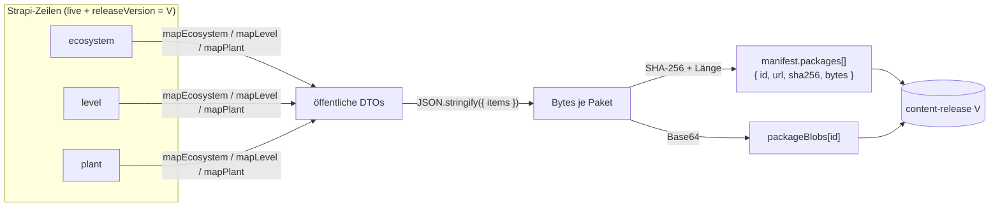
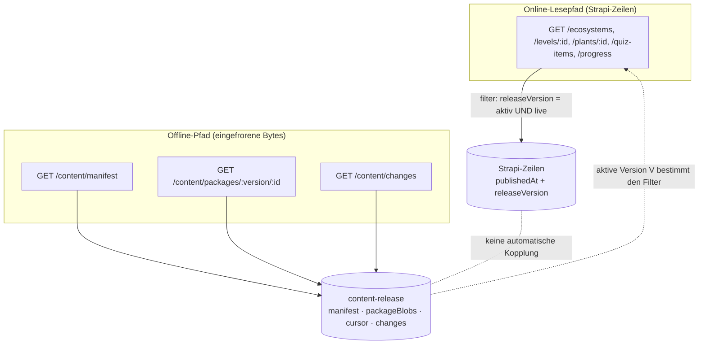
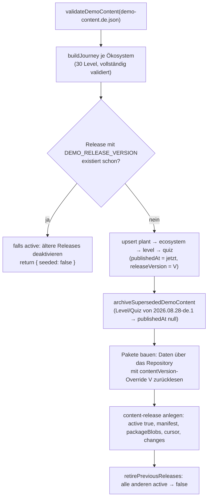
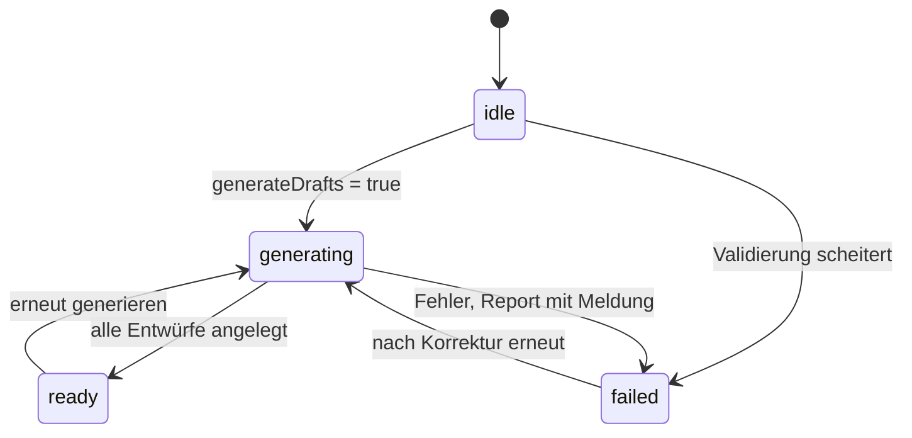
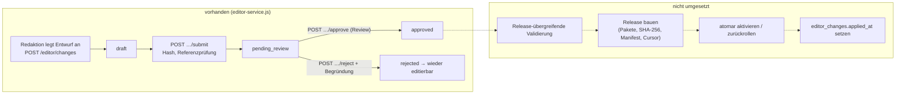

# Inhalte und Releases

Diese Seite beschreibt, wie Inhalte (Ökosysteme, Level, Pflanzen, Quizfragen) von der Redaktion zu den Lernenden kommen – und, ebenso wichtig, **wo der Weg heute endet**. Sie ist nach dem Quelltext geschrieben, nicht nach den Plänen: Was funktioniert, ist als funktionierend belegt; was fehlt, steht ausdrücklich als "nicht umgesetzt".

!!! danger "Kurzfassung des Ist-Zustands"
    - Es gibt **einen** Code-Pfad, der ein `content-release` anlegt und aktiviert: `seedDemoContent` (`services/platform/src/api/platform/services/core/content/demo-seed.js`), ausgelöst durch `PLATFORM_SEED_DEMO_CONTENT=true`.
    - Der Studio-Weg **Entwurf → Review → Freigabe** funktioniert bis zum Status `approved`. Ein Schritt, der freigegebene Änderungen in Inhalte oder ein Release überführt, **existiert nicht** (`appliedAt` wird nirgends geschrieben).
    - Der Vertragsendpunkt `POST /admin/content-releases` ist nur geplant (`x-plantini-implementation-status: planned`) und hat keine Route.
    - Online-Lesepfad und Offline-Pakete sind **nicht** an dieselbe Momentaufnahme gekoppelt (siehe unten, mit nachgestelltem Beleg).

## Drei Arten von "Release" – nicht verwechseln

| Begriff | Was es ist | Wo |
|---|---|---|
| **Content-Release** | Datensatz `api::content-release.content-release`: Version, Manifest, Pakete, Cursor, Änderungsliste. Gegenstand dieser Seite | `services/platform/src/api/content-release/` |
| **App-Release** | APK/Web-Build der Flutter-App | `tools/scripts/prepare-app-release.mjs`, [App: Bauen & Release](../app/bauen-release.md) |
| **Image-Release** | Docker-Image von Plattform/Studio/Portal, Tag = Commit | `infra/production/update-release-env.mjs`, `services/platform/Dockerfile.release-overlay` |

!!! note "Namensfalle in Strapi"
    `services/platform/types/generated/contentTypes.d.ts` enthält zwei ähnlich heißende Typen: Strapis eingebautes `plugin::content-releases.release` und das projekteigene `api::content-release.content-release`. Nur der zweite wird von der Fach-API benutzt.

## Das Datenmodell des Content-Release

Schema `services/platform/src/api/content-release/content-types/content-release/schema.json` (`draftAndPublish: true`):

| Feld | Typ | Bedeutung |
|---|---|---|
| `version` | string, `required`, `unique` | z. B. `2026.10.02-de.2`; Muster `^[a-zA-Z0-9._-]{1,80}$` (siehe `buildReleasePackages`) |
| `active` | boolean, Default `false` | genau ein Release ist aktiv (vom Seed so gehandhabt) |
| `manifest` | json, `required` | `version`, `releasedAt`, `schemaVersion`, `minimumAppVersion`, `packages[]` |
| `packageBlobs` | json | je Paket Base64 der Bytes: `{ ecosystems, levels, plants }` |
| `cursor` | string, `required`, `unique` | Versionsmarke für `GET /content/changes`; im Seed `sha256("<version>:<releasedAt>")` |
| `changes` | json | Liste `{ entity, id, operation, version }` |

Alle redaktionellen Typen (`ecosystem`, `level`, `plant`, `quiz`) tragen zusätzlich `releaseVersion` (String). Die `publicId` (UUID) und der `slug` sind **global eindeutig** (`unique: true`) – zwei Versionen derselben fachlichen Pflanze können also nicht als parallele Zeilen existieren; ein neues Release aktualisiert dieselben Zeilen.

### Manifest und Pakete



`buildReleasePackages(version, collections)` in `services/platform/src/api/platform/services/core/content/release-packages.js` baut genau drei Pakete (`PACKAGE_IDS = ['ecosystems', 'levels', 'plants']`). Jedes Paket ist ein JSON `{"items":[...]}`; Größe und SHA-256 stehen im Manifest, die Bytes liegen als **Base64-String** in `packageBlobs`:

```js title="services/platform/src/api/platform/services/core/content/release-packages.js"
const bytes = Buffer.from(JSON.stringify({ items }), 'utf8');
const sha256 = createHash('sha256').update(bytes).digest('hex');
// Base64 is intentional: Strapi's JSONB storage may reorder object keys,
// but package bytes must stay identical to the signed manifest checksum.
blobs[id] = bytes.toString('base64');
return {
  id,
  url: `/api/v1/content/packages/${encodeURIComponent(version)}/${id}`,
  sha256,
  bytes: bytes.length,
};
```

Warum Base64? Strapi legt JSON in `jsonb` ab, und PostgreSQL ordnet Objektschlüssel um. Eine Prüfsumme über JSON-Text ginge dabei verloren; ein Base64-String bleibt Byte für Byte erhalten. `readReleasePackage` dekodiert, rechnet Länge und SHA-256 nach und wirft `503 CONTENT_INTEGRITY_FAILED`, wenn sie vom Manifest abweichen. Der Controller liefert die Rohbytes mit `ETag: "<sha256>"` und `Cache-Control: public, max-age=31536000, immutable`.

Das Manifest, das der Seed schreibt (`demo-seed.js`):

```js title="services/platform/src/api/platform/services/core/content/demo-seed.js"
const manifest = {
  version: DEMO_RELEASE_VERSION, releasedAt: now, schemaVersion: '1.0',
  minimumAppVersion: '0.6.3', packages: packages.descriptors,
};
```

Ein tatsächlicher Lauf der Seed-Funktion gegen den In-Memory-Fixture (`test/helpers/memory-entities.js`, ohne Datenbank) ergibt für `2026.10.02-de.2` die Pakete `ecosystems: 4802 Bytes`, `levels: 63830 Bytes`, `plants: 40793 Bytes` und den ETag `"2026.10.02-de.2"`. Die Tests (`test/demo-content.test.js`) erwarten 3 Ökosysteme, 30 Pflanzen und 90 Quizfragen im Rohdatensatz; die 90 Level (3 Phasen × 30 Pflanzen) entstehen daraus in `demo-journeys.js`.

Das Manifest enthält **keine Signatur** (`signature` ist im Vertrag optional und wird vom Server nicht erzeugt), und Quizfragen sind **nicht** Teil der Pakete – Offline-Quizdaten sind laut `knowledge/editor-studio.md` ein offener Punkt.

### Cursor und `changes`

`GET /v1/content/changes?since=<cursor>` ruft `repositories.content.findChangesSince`:

```js title="services/platform/src/api/platform/services/core/strapi-repositories.js"
findChangesSince: async (cursor) => {
  const release = await activeRelease();
  if (!release) return { cursor: cursor || '', changes: [] };
  return {
    cursor: release.cursor,
    changes: cursor === release.cursor ? [] : normaliseArray(release.changes),
  };
},
```

Das ist **kein echtes Delta**: Entweder stimmt der Cursor mit dem des aktiven Release überein (→ leere Liste), oder der Client bekommt die komplette Änderungsliste dieses Release. Eine Differenz zwischen zwei früheren Releases wird nicht berechnet. Löschungen kennt die Liste als `operation: 'delete'` (Tombstones); der Seed erzeugt sie für archivierte Level und Quizfragen. `POST /sync` liefert aus diesem Aufruf nur den neuen `contentCursor` zurück, nicht die Änderungen selbst.

## Der Lesepfad: aktives Release **und** `live`

Alle Repository-Methoden für Lernende folgen einem Muster (`strapi-repositories.js`, `createContentRepository`):

```js title="services/platform/src/api/platform/services/core/strapi-repositories.js"
const activeRelease = () => findActiveContentRelease(entities);
const visibleVersion = async () => versionOverride || (await activeRelease())?.version;
// …
findPublishedPlant: async (publicId) => {
  const version = await visibleVersion();
  if (!version) return null;
  return findOne(entities, 'api::plant.plant', {
    filters: { publicId, releaseVersion: version },
    publicationState: 'live',
    populate: { /* learningCards, media … */ },
  });
},
```

Das heißt: Ein Datensatz ist online sichtbar, wenn er **veröffentlicht** ist (`publicationState: 'live'`, also `publishedAt` gesetzt) **und** seine `releaseVersion` der Version des aktiven Content-Release entspricht. Gibt es kein aktives Release, antworten die Lese-Endpunkte mit leeren Listen bzw. `404`, das Manifest mit `503 CONTENT_RELEASE_UNAVAILABLE`.

Daneben gibt es zwei weitere Quellen: Das **Manifest und die Pakete** kommen aus den eingefrorenen Bytes im Release-Datensatz, die **Änderungsliste** aus `release.changes`.



### Nachgestellter Beleg: Drift zwischen Online und Paketen

Mit dem In-Memory-Fixture lässt sich das Verhalten nachstellen (Skript in der Shell ausgeführt, nichts im Repo geändert):

1. `seedDemoContent` einmal ausführen; ein zweiter Lauf meldet `seeded: false` (Version existiert schon).
2. Eine Pflanze so ändern, wie es ein Redakteur im Strapi-Admin täte: neue `description`, `releaseVersion` **unverändert**.
3. `ContentService.getPlant` liefert sofort die neue Beschreibung (`GEÄNDERT im Admin`); `ContentService.getPackage(V, 'plants').sha256` ist **unverändert** – die Pakete enthalten weiter den alten Text.
4. Setzt man stattdessen `releaseVersion` der Pflanze auf einen anderen Wert, antwortet `getPlant` mit `404 PLANT_NOT_FOUND`: Die Pflanze ist online unsichtbar, solange kein Release mit dieser Version aktiv ist.

Der Fixture bildet `publicationState: 'live'` (nur Datensätze mit `publishedAt`) und die Filter nach, aber nicht das Verhalten von Strapi und PostgreSQL selbst; gegen einen echten Stack wurde das hier nicht wiederholt. Die Folge ist trotzdem eindeutig aus dem Code ableitbar:

!!! warning "Stolperfalle: Änderung im Strapi-Admin ändert Online, nicht Offline"
    Wer eine bereits veröffentlichte Pflanze im Strapi-Admin bearbeitet und erneut veröffentlicht, ohne die `releaseVersion` zu ändern, verändert den **Online**-Inhalt sofort (und für alle), während die ausgelieferten **Pakete** und der Cursor gleich bleiben. App-Installationen mit vollständig zwischengespeichertem Inhalt derselben Version sehen die Änderung nicht. Umgekehrt macht eine geänderte `releaseVersion` den Datensatz unsichtbar. Ein sauberer Weg dazwischen ist nicht implementiert (siehe "Geplant").

## Wirkung von `releaseVersion` / `contentVersion` auf Lernversuche

Der Server bindet jeden Versuch an die Inhaltsversion, mit der er begonnen wurde. Die Stellen im Code:

| Situation | Prüfung | Antwort |
|---|---|---|
| `POST /level-attempts` mit anderer `contentVersion` als das aktive Level | `level.releaseVersion !== input.contentVersion` (`startAttempt`) | `409 CONTENT_VERSION_CONFLICT` |
| `POST /level-attempts` für ein Level, das im aktiven Release nicht existiert | `findPublishedLevel` leer | `404 LEVEL_NOT_FOUND` |
| `POST /level-attempts/:id/complete`, nachdem ein anderes Release aktiv wurde | Level fehlt oder `level.releaseVersion !== attempt.contentVersion` (`completeAttempt`) | `409 CONTENT_VERSION_UNAVAILABLE` |
| `GET /quiz-items?levelId=…&contentVersion=…` mit abweichender Version | `listQuizItems` | `409 CONTENT_VERSION_UNAVAILABLE` |
| `GET /levels/:id`, Level nicht mehr in der Fortschrittsliste | `getLevelAccess` | `409 CONTENT_VERSION_UNAVAILABLE` |

Was **nicht** an die Version gebunden ist: der **Fortschritt**. `getProgress` gruppiert Versuche nach `levelPublicId`; bestandene Level bleiben bestanden, solange die `publicId` gleich bleibt. Die Demo-Inhalte haben stabile IDs, weil `stableContentId(kind, slug)` sie aus dem Slug ableitet (SHA-256 von `plantini:<kind>:<slug>`, auf UUID-v4-Form gebracht; `stableContentId('plant', 'stieleiche')` ergibt `2f45b87e-e05f-473d-b56d-2e14f10e45a5`). Ändert sich ein Slug, ändert sich die ID – und der Fortschritt dieses Levels ist weg.

!!! tip "Konsequenz für die App"
    Nach einem Releasewechsel kann ein angefangener (noch `active`) Versuch nicht mehr abgeschlossen werden. Die App muss bei `CONTENT_VERSION_UNAVAILABLE` das Manifest neu laden und einen neuen Versuch mit der neuen `contentVersion` starten. Die Gegenseite dazu steht unter [App: Offline](../app/offline.md).

## `demo-seed.js`: der einzige Release-Erzeuger

`seedDemoContent(strapi)` wird im `bootstrap` aufgerufen, wenn `PLATFORM_SEED_DEMO_CONTENT === 'true'`. Ablauf:



Eigenschaften, die aus dem Code und den Tests folgen:

- **Vor dem ersten Schreiben wird alles validiert** (`validateDemoContent`, `buildJourney`). Ein kaputter Datensatz bricht ab, bevor die Datenbank berührt wird (`test/game-journeys.test.js`: "malformed new collection rules and invalid journeys fail closed").
- **Schutz fremder Inhalte.** `createUpsertingEntityService.upsert` aktualisiert eine vorhandene Zeile nur, wenn `publicId` gleich ist **und** ihre `releaseVersion` in einer festen Liste bekannter Demo-Versionen steht; sonst `Refusing to overwrite non-demo content: <uid>/<slug>`. Redaktionell angelegte Inhalte mit kollidierendem Slug werden so nie überschrieben.
- **Wiederaufnahme.** Wurde der Seed zwischen "Release angelegt" und "alte Release-Marker deaktiviert" unterbrochen, deaktiviert der nächste Lauf die alten (`retirePreviousReleases`) und reaktiviert nie ein altes.
- **Nicht atomar.** CMS-Zeilen werden vor dem Release-Datensatz geschrieben, und das Umschalten der `active`-Marker ist keine Datenbanktransaktion. Während des Seeds können Inhalte kurzzeitig fehlen (fail-closed, aber kein atomarer Wechsel; so auch in `knowledge/architecture/backend-cms.md` festgehalten).
- **Test.** `test/game-journeys.test.js` deckt Migration (alte Demo-IDs werden still gelegt, Nutzerdaten bleiben), Wiederholung und unterbrochene Läufe ab.

!!! warning "Stolperfalle: JSON ändern ohne `DEMO_RELEASE_VERSION` zu erhöhen bewirkt nichts"
    Existiert ein Release mit `DEMO_RELEASE_VERSION` bereits, kehrt `seedDemoContent` sofort zurück (`seeded: false`). Änderst du `demo-content.de.json`, aber nicht die Konstante in `services/platform/src/api/platform/services/core/content/demo-content.js` (aktuell `2026.10.02-de.2`), passiert beim nächsten Start **nichts**. Die Pakete behalten ihre alten Bytes.

!!! warning "Stolperfalle: Versionserhöhung allein bricht den Seed"
    Erhöhst du `DEMO_RELEASE_VERSION` (z. B. auf `2026.10.03-de.1`), findet der Upsert Zeilen mit `releaseVersion: '2026.10.02-de.2'`. Diese Version steht **nicht** in der Positivliste in `createUpsertingEntityService` (`[DEMO_RELEASE_VERSION, '2026.10.02-de.1', '2026.09.22-de.1', '2026.09.07-de.1', '2026.08.28-de.1']`); der Seed wirft dann `Refusing to overwrite non-demo content: api::plant.plant/rotbuche`. Nachgestellt mit dem In-Memory-Fixture (erst Seed mit `.2`, dann die Konstante im Modul-Cache auf `.3` gesetzt). Die vorherige Version muss also in die Liste aufgenommen werden. Weil `seedDemoContent` im `bootstrap` ohne `try/catch` aufgerufen wird, verhindert der Fehler bei aktivem Seed-Flag den Serverstart.

!!! danger "Nie in Staging oder Produktion"
    `src/index.js` loggt: *"Synthetic E2E content is enabled; never use this flag in staging or production."* `infra/compose.production.yaml` und `infra/production.env.example` setzen den Wert auf `false`. Das Studio setzt ihn in `infra/compose.editor.local.yaml` ebenfalls auf `'false'`.

## `journey-authoring.js`: Blueprint → Entwürfe

Ein **Lernpfad-Generator** im Strapi-Admin erzeugt Level- und Quiz-**Entwürfe** aus zehn ausgewählten Pflanzen. Das ist ein deterministischer Compiler, kein KI-Werkzeug: Jede Frage stammt aus einer redaktionell erstellten Lernkarte; es werden weder Inhalte importiert noch Fakten erfunden noch veröffentlicht (Kommentar im Code).

**Auslöser.** Content-Type `journey-blueprint` (Anzeigename "Lernpfad-Generator", `draftAndPublish: false`) mit den Feldern `title`, `slug`, `releaseVersion`, `ecosystem`, `stations` (Komponente `learning.journey-stop`: `plant` + `collectionTarget`) und `generateDrafts`. Das Lifecycle `journey-blueprint/lifecycles.js` ruft bei `afterCreate`/`afterUpdate` mit `generateDrafts === true` die Funktion `generateBlueprintDrafts(strapi, id)` auf.



**Validierung (`compileBlueprint`).** Vor dem ersten Schreiben müssen gelten:

- ASCII-Slug (`^[a-z0-9]+(?:-[a-z0-9]+)*$`), nicht leere `releaseVersion`, Ökosystem mit UUID-`publicId`.
- Genau **zehn verschiedene** Stationen, genau **drei** davon als Sammelziel markiert.
- Jede Pflanze: UUID, Beschreibung, Sicherheitshinweis, mindestens eine Quelle mit `https://`, **genau drei** vollständige Lernkarten (`validateLearningCards`: Überschrift, Text, Frage, vier unterscheidbare Antworten; die richtige Antwort muss im Text vorkommen).

**Ergebnis.** 3 Phasen (`kennenlernen`, `wiederholen`, `festigen`) × 10 Pflanzen = **30 Level** mit je 3 Fragen = **90 Fragen**. Slugs: `cms-<blueprint-slug>-<fingerprint>-<laufende Nummer>` (der `fingerprint` sind 12 Hex-Zeichen eines SHA-256 über Quelltexte der Pflanzen). Die Antwortreihenfolge rotiert deterministisch (`rotateChoices`), die richtige Antwort steht also nicht immer an erster Stelle. Jedes Level bekommt die `completionRule`:

```js title="services/platform/src/api/platform/services/core/content/journey-authoring.js"
completionRule: {
  minimumScore: 2 / 3,
  requiredQuizIds: quizzes.map((quiz) => quiz.publicId),
  collectionScope: 'ecosystem', requiredPlantIds: sequence === 30 ? targets : [],
  requiredLevelIds: levels.length ? [levels[levels.length - 1].publicId] : [],
},
```

Level n verlangt also Level n−1 (`requiredLevelIds`), und die drei Sammelziele hängen am **letzten** Level (Ökosystem-Trophäe, siehe [Dienste: Learning](services.md#learning)).

**Schreiben.** Alle Datensätze entstehen als Entwurf (`publishedAt: null`, Quiz mit `reviewStatus: 'draft'`) über `createIfMissing` – bestehende Datensätze mit gleicher `publicId` bleiben unverändert. Ein In-Prozess-Set `active` verhindert doppelte parallele Läufe derselben Blueprint-ID. Der Report im Feld `generationReport` nennt bei Erfolg *"Entwurf <fingerprint>: 30 Level / 90 Fragen … Keine Veröffentlichung und kein Release aktiviert."*

**Wirkung des Lifecycles `level/lifecycles.js` (Veröffentlichungsprüfung).**

- `beforeCreate`: Ein generiertes Level (`generatedFromBlueprint`) darf nicht direkt veröffentlicht angelegt werden.
- `beforeUpdate` (nur für generierte Level; explizites Entveröffentlichen mit `publishedAt: null` ist immer erlaubt): Die Blueprint muss `generationState === 'ready'` haben und denselben `generationFingerprint`. Danach prüft `assertPublishedDependencies`: Ökosystem in derselben `releaseVersion` veröffentlicht; alle Pflanzen veröffentlicht, in derselben Version **und** `reviewStatus === 'approved'`; genau drei verschiedene Pflichtfragen, jeweils veröffentlicht, `approved`, mit `contentVersion` = `releaseVersion` des Levels. Relationen und `completionRule` dürfen im selben Speichervorgang nicht geändert werden ("zuerst im unveröffentlichten Entwurf speichern").

**Lücken in der Absicherung.** Das Veröffentlichungs-Gate ist bewusst nicht lückenlos:

| Typ | Lifecycle | Prüft |
|---|---|---|
| `plant` | `plant/lifecycles.js` | Veröffentlichen nur bei `reviewStatus === 'approved'` |
| `quiz` | `quiz/lifecycles.js` | dasselbe |
| `media` | `media/lifecycles.js` | `author` und `license` nicht leer (Anlegen/Ändern) |
| `level` | `level/lifecycles.js` | **nur** für aus Blueprint generierte Level; handgepflegte Level werden nicht geprüft |
| `ecosystem` | – | **kein** Lifecycle |
| `journey-blueprint` | stößt die Generierung an | – |

Das Veröffentlichen einer generierten Reihe sorgt also nicht für ein Release: Die neuen Level tragen `releaseVersion = blueprint.releaseVersion` und sind online erst sichtbar, wenn ein Content-Release **mit genau dieser Version aktiv** ist. Dafür gibt es keinen Code (siehe oben).

## `lesson-cards.js`

`validateLearningCards(cards, label)` ist die gemeinsame Regel für Steckbrief-Lernkarten und wird von Seed, Blueprint-Compiler und Editor-Service benutzt:

- genau **drei** Karten pro Pflanze,
- alle sieben Felder (`heading`, `text`, `question`, `correctAnswer`, `wrongAnswer1…3`) nicht leer,
- die vier Antworten sind nach Normalisierung (NFC, deutsche Kleinschreibung, Leerraum) verschieden,
- `text` muss die richtige Antwort wörtlich enthalten ("Die richtige Antwort muss im Steckbrief erklärt werden").

`quizzesFromCards(plant)` macht daraus je Karte eine Frage (`choice-1` ist die richtige Antwort), `rotateChoices(quiz, offset)` rotiert die Reihenfolge und vergibt die `correctChoiceId` neu. Die Pflicht, den Lösungstext im Steckbrief zu haben, ist didaktische Absicht: Fragen sollen aus dem Gelesenen beantwortbar sein.

## Studio-Änderung → Release: der tatsächliche Weg

Dieser Abschnitt trennt, was existiert, von dem, was fehlt.



**Was passiert bei `approve`?** `EditorService.approve` setzt Status `approved` und trägt Reviewer, Notiz und Zeitpunkt ein. Im Code steht dazu: *"Approval is an editorial decision only; applying it requires a separately validated, atomic content release."* Die veröffentlichten CMS-Zeilen bleiben unverändert (der Browser-Smoketest vom 02.10. in `knowledge/editor-studio.md` bestätigt: das öffentliche Ökosystem-Listing blieb unverändert).

**Was zählt das Dashboard?** `approvedPendingRelease` ist `count(editor_changes WHERE status = 'approved' AND appliedAt IS NULL)`. Da `appliedAt` nirgends gesetzt wird, **wächst die Zahl nur**.

**Was verhindert Konflikte?** Solange eine freigegebene, nicht angewendete Änderung für dasselbe Ziel (oder denselben Slug) existiert, lässt `validateReferences` keine zweite zur Einreichung oder Freigabe zu (`EDITOR_APPROVED_CONFLICT`). Mangels Anwendung bleibt ein Ziel damit dauerhaft blockiert.

**Vertrag.** `POST /admin/content-releases` (`operationId: createContentRelease`, Body `CreateContentReleaseRequest { releaseVersion, dryRun }`, Antwort `202 AdministrativeJob`) ist als `planned` markiert; es gibt keine Route, keinen Controller und keinen Dienst. Ebenso geplant: `/admin/imports`, `/admin/dashboard`, `/admin/users…`, `/privacy/…`.

### Geplante Reihenfolge laut `knowledge/editor-studio.md`

Die fünf Schritte, die dort für die Aktivierung der Veröffentlichung genannt sind (Stand 2026-10-01 bzw. 02.10.; nicht umgesetzt):

1. Release-übergreifende Validierung (Beziehungen, Quizlösungen, Quellen, Bildlizenz und Alt-Text).
2. Versionierten Release aus geprüften Datensätzen bauen; Pakete, SHA-256, Manifest und Cursor aus denselben Daten erzeugen.
3. Release atomar aktivieren und zurückrollen können; Online-Endpunkte strikt auf das aktive Release filtern.
4. Fachlich freigegebene Änderungen in den atomaren Release-Schritt einbinden (Reviewer dürfen eigene Inhalte freigeben; Redakteure brauchen Reviewer-Freigabe).
5. Bildverwaltung, Teamübersicht, Dashboard-Paginierung und einen Frischumgebungs-Test vom Entwurf bis zum App-Sync.

`knowledge/architecture/backend-cms.md` ergänzt das Kernproblem: Weil `publicId` und `slug` global eindeutig sind, können zwei Versionen derselben Entität nicht als parallele CMS-Zeilen existieren. Entweder müssen die Online-Reads aus einer separaten unveränderlichen Release-Momentaufnahme kommen oder die CMS-Schlüssel müssen versioniert werden. Ein zusätzlicher `active`-Filter genügt nicht. Das ist der Grund, warum Punkt 3 oben nicht trivial ist.

!!! note "Der Stand von heute für Redakteure"
    Redaktionelle Änderungen laufen im Studio bis zur fachlichen Freigabe; **veröffentlichen kann man damit nicht**. Das Studio ist laut Projektdokumentation ein "Redaktions-MVP für Entwürfe und fachliches Review, kein produktionsfertiger Veröffentlichungsweg". Der Moderationsablauf aus Nutzersicht steht unter [Moderation: Review](../moderation/review.md).

## Zusammenfassung: Was funktioniert, was nicht

| Funktion | Stand | Beleg |
|---|---|---|
| Aktives Release auslesen (Manifest, ETag, 304) | funktioniert | `ContentService.getManifest`, `test/content-service.test.js` |
| Pakete mit Prüfsummenkontrolle ausliefern, auch alte Versionen | funktioniert | `readReleasePackage`, `getContentPackage` |
| Online-Reads auf aktive Version beschränken | funktioniert | `strapi-repositories.js` (`visibleVersion`) |
| Demo-Release seeden, wiederholbar, mit Migration alter Demo-IDs | funktioniert | `test/game-journeys.test.js` |
| Level-/Quiz-Entwürfe aus Blueprint erzeugen | funktioniert (Code vorhanden; kein eigener Test) | `journey-authoring.js` |
| Veröffentlichungs-Gate für generierte Level, Pflanzen, Quizfragen | teilweise (siehe Lückentabelle) | `*/lifecycles.js` |
| Studio: Entwurf, Einreichen, Review, Freigabe | funktioniert bis `approved` | `editor-service.js` |
| Freigegebene Änderungen anwenden / Release bauen | **nicht umgesetzt** | `appliedAt` ungenutzt; `createContentRelease` `planned` |
| Atomarer Release-Wechsel, Rollback | **nicht umgesetzt** | Seed schreibt nicht transaktional |
| Signatur des Manifests, Offline-Quizdaten | **nicht umgesetzt** | `knowledge/editor-studio.md` |
| Echtes Delta in `/content/changes` | **nicht umgesetzt** | `findChangesSince` |
| Kopplung Online ↔ Pakete bei Admin-Änderungen | **nicht vorhanden** | Nachstellung oben |

## Weiterführend

- Nachbarseiten: [Dienste](services.md), [API-Vertrag](api-vertrag.md), [Datenmodell](../architektur/datenmodell.md), [Studio-Technik](../studio/studio-technik.md), [Moderation: Review](../moderation/review.md)
- Quellpfade: `services/platform/src/api/platform/services/core/content/` (`demo-seed.js`, `demo-content.js`, `demo-journeys.js`, `journey-authoring.js`, `lesson-cards.js`, `release-packages.js`, `content-service.js`), `services/platform/src/api/platform/services/core/strapi-repositories.js`, `services/platform/src/api/level/content-types/level/lifecycles.js`, `services/platform/src/api/content-release/content-types/content-release/schema.json`, `services/platform/src/api/journey-blueprint/`, `services/platform/src/api/platform/services/core/editor/editor-service.js`, `knowledge/editor-studio.md`, `knowledge/architecture/backend-cms.md`
