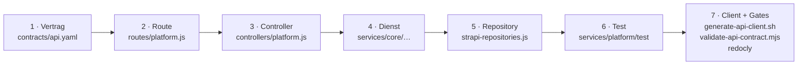

# Rezept: einen neuen Endpunkt hinzufügen

Diese Seite führt Schritt für Schritt durch einen neuen, kleinen Endpunkt – vom OpenAPI-Vertrag bis zum regenerierten Dart-Client. Das Beispiel ist erfunden und existiert **nicht** im Repo: `GET /api/v1/herbarium/summary` liefert dem angemeldeten Konto die Zahl seiner Funde und die Zahl der verschiedenen bestätigten Pflanzen. Die Codeausschnitte sind als **Ergänzung zu bestehenden Dateien** gedacht; es werden keine neuen Dateien angelegt.

!!! note "Nur beschrieben, nichts ausgeführt"
    Das Rezept beschreibt den Ablauf und zeigt Gerüste im Stil des echten Codes. Es wurde nichts im Repo geändert. Befehle, die Docker, Dart oder Netz brauchen (`generate-api-client.sh`, `redocly`), sind hier gegen die Skripte im Repo plausibilisiert, aber nicht neu ausgeführt.

## Überblick: sieben Stellen, eine Reihenfolge



Die Reihenfolge ist nicht beliebig: Der Vertragsprüfer (`tools/scripts/validate-api-contract.mjs`) vergleicht Vertrag, Routen und Controller-Methoden und prüft zusätzlich, dass der generierte Client zum Vertrag passt. Ein Vertrag ohne Route (oder umgekehrt) ist ein roter CI-Lauf.

## Schritt 0: Entwurf klären

Bevor du Code schreibst, beantworte:

| Frage | Für das Beispiel |
|---|---|
| Wer darf ihn aufrufen? | jedes angemeldete Konto → `withActor`, keine Rollenprüfung |
| Liest oder schreibt er? | liest → kein `Idempotency-Key`, kein `If-Match` |
| Welche Daten gehören dem Konto? | nur eigene Funde → Besitzfilter `ownerId` im Repository |
| Welcher Pfad? | `/herbarium/summary`. Nicht `/observations/summary`: Dort würde `summary` mit dem Parametersegment `:observationId` von `/v1/observations/:observationId` konkurrieren |
| Welche Fehler sind möglich? | `401` (Token), `400` (unbekannte Query-Parameter) |
| Neues Schema? | ja, `HerbariumSummary` |

Schreibende Endpunkte brauchen zusätzlich: Client-ID (UUID), `Idempotency-Key`, Antwortcodes 200/201, Konfliktverhalten – siehe [Idempotenz & Fehler](idempotenz-fehler.md).

## Schritt 1: Vertrag in `contracts/api.yaml`

Der Vertrag ist die kanonische Beschreibung; er kommt **zuerst**. Füge den Pfad im Abschnitt `paths:` ein (zum Beispiel direkt vor `/observations:`) und das Schema in `components.schemas`.

!!! warning "Stolperfalle: der Prüfer liest YAML zeilenweise mit festen Einrückungen"
    `parseOperations` in `validate-api-contract.mjs` ist kein YAML-Parser, sondern eine Zeilen-Regex. Erwartet werden **genau**: 2 Leerzeichen vor dem Pfad (`  /herbarium/summary:`), 4 vor der Methode (`    get:`), 6 vor `operationId:` und vor `x-plantini-implementation-status:`. Die `operationId` muss auf einer eigenen Zeile stehen (`^      operationId: [A-Za-z][A-Za-z0-9]*$`). Ein falsch eingerückter Eintrag wird **übersehen**, nicht gemeldet – der Pfad zählt dann als nicht dokumentiert, und die Route gilt als "Undocumented server route". Ohne die Statuszeile gilt ein Vorgang als `implemented`.

```yaml title="contracts/api.yaml (Ergänzung unter paths:)"
  /herbarium/summary:
    get:
      summary: Count the caller's herbarium observations and distinct plants
      tags: [Herbarium]
      operationId: getHerbariumSummary
      x-plantini-implementation-status: implemented
      responses:
        '200': {description: Caller-owned herbarium totals, content: {application/json: {schema: {$ref: '#/components/schemas/HerbariumSummary'}}}}
        '400': {$ref: '#/components/responses/BadRequest'}
        '401': {$ref: '#/components/responses/Unauthorized'}
```

```yaml title="contracts/api.yaml (Ergänzung unter components.schemas)"
    HerbariumSummary:
      type: object
      required: [observationCount, distinctPlantCount]
      properties:
        observationCount: {type: integer, minimum: 0}
        distinctPlantCount: {type: integer, minimum: 0}
```

Konventionen, die du einhältst (alle aus dem bestehenden Vertrag):

- **Sicherheit.** `security: [{bearerAuth: []}]` gilt global. Öffentliche Endpunkte setzen `security: []` (z. B. `/content/manifest`); dein Endpunkt ist geschützt und braucht nichts.
- **IDs** sind `{$ref: '#/components/schemas/Id'}` (`type: string, format: uuid`).
- **Listen** nutzen `#/components/parameters/Page` und `PageSize` (1…100, Standard 50) und eine `…Page`-Antwort mit `items` und `page`.
- **Fehler** referenzieren die wiederverwendbaren Antworten `BadRequest`, `Unauthorized`, `NotFound`, `Conflict`, `Forbidden` – sie tragen `application/problem+json` und die Header `X-Correlation-Id` / `X-API-Version`.
- **Idempotenz.** Schreibende Operationen binden `#/components/parameters/IdempotencyKey`; Änderungen bestehender Datensätze `IfMatch`.
- **Neue Routen zuerst als `planned`?** Möglich: Mit `x-plantini-implementation-status: planned` darf es noch keine Route geben (sonst meldet der Prüfer *"Planned operation already has a route and must be marked implemented"*). Sobald du die Route anlegst, stellst du auf `implemented` um.

## Schritt 2: Route

Eine Zeile in `routes/platform.js`, **im Einzeilenformat** (siehe Stolperfalle auf [Fach-API-Schicht](plattform.md#routen)):

```js title="services/platform/src/api/platform/routes/platform.js (Ergänzung)"
    route('GET', '/v1/herbarium/summary', 'getHerbariumSummary'),
```

Der Handlername muss exakt der Controller-Methode entsprechen; der Prüfer sucht im Controller nach `async getHerbariumSummary(`.

## Schritt 3: Controller

Ein Einzeiler im Stil der übrigen Methoden. Query-Parameter, die der Vertrag nicht kennt, lehnt `rejectUnknownQuery` ab (importiert ist die Funktion im Controller bereits):

```js title="services/platform/src/api/platform/controllers/platform.js (Ergänzung)"
  async getHerbariumSummary(ctx) {
    return withActor(ctx, (runtime, actor) => {
      rejectUnknownQuery(ctx.query, []);
      return runtime.herbarium.summary(actor);
    });
  },
```

`withActor` erledigt Token-Prüfung, Profil-Auflösung, `Cache-Control: no-store`, Correlation-ID und die Umwandlung jedes Fehlers in Problem-JSON. Der Erfolgsstatus ist automatisch `200`. Brauchst du `201`/`202`, setze `ctx.status` vor dem `return`.

## Schritt 4: Dienst

Die Regel gehört in den Dienst, nicht in den Controller. Hier ergänzt du `HerbariumService` um eine Methode – der Dienst bekommt das Repository im Konstruktor und kennt keine Strapi-Typen:

```js title="services/platform/src/api/platform/services/core/herbarium/herbarium-service.js (Ergänzung in der Klasse)"
  async summary(actor) {
    const rows = await this.repository.listObservationPlantIds(actor.id);
    const plantIds = new Set(rows.map((row) => row.confirmedPlantId).filter(Boolean));
    return { observationCount: rows.length, distinctPlantCount: plantIds.size };
  }
```

Für eingehende Daten gilt das Muster aus [Fach-API-Schicht](plattform.md#validierung-validationjs-und-idsjs): `requirePlainObject`, `rejectUnknownFields`, `requireUuid` und Co. – erst validieren, dann ein sauberes Objekt bauen. Dieser Endpunkt hat keinen Body, deshalb entfällt es hier.

## Schritt 5: Repository

Nur `strapi-repositories.js` darf `entityService` aufrufen. Ergänze die Abfrage im Herbarium-Repository und filtere **immer** nach Besitzer:

```js title="services/platform/src/api/platform/services/core/strapi-repositories.js (Ergänzung in createHerbariumRepository)"
    listObservationPlantIds: async (ownerId) => normaliseArray(await entities.findMany('api::observation.observation', {
      filters: { ownerId, syncStatus: { $ne: 'deleted' } },
      fields: ['confirmedPlantId'],
    })),
```

Der Filter `syncStatus: { $ne: 'deleted' }` schließt Tombstones aus (gelöschte Funde bleiben als Zeile bestehen). Wie `listObservations` lädt die Abfrage alle Treffer; bei sehr großen Herbarien wäre eine Datenbankaggregation besser.

!!! warning "Stolperfalle: Besitzfilter vergessen"
    Fast alle Repository-Methoden für Nutzerdaten haben `ownerId` im Filter. Eine Abfrage ohne ihn liefert Daten **aller** Konten. Das fällt in Unit-Tests mit nur einem Konto nicht auf – teste deshalb immer mit zwei Akteuren (siehe `herbarium enforces ownership …` in `test/field-herbarium.test.js`).

## Schritt 6: Test

Tests laufen mit dem Node-Runner ohne Datenbank. Der Herbarium-Test in `test/field-herbarium.test.js` baut ein Repository-Objekt im Speicher (`createRepositories()`); du ergänzt dort die neue Methode und einen Test:

```js title="services/platform/test/field-herbarium.test.js (Ergänzung in createRepositories().herbarium)"
      async listObservationPlantIds(ownerId) {
        return observations
          .filter((item) => item.ownerId === ownerId && item.syncStatus !== 'deleted')
          .map(({ confirmedPlantId }) => ({ confirmedPlantId }));
      },
```

```js title="services/platform/test/field-herbarium.test.js (neuer Test)"
test('herbarium summary counts only own, undeleted observations', async () => {
  const repositories = createRepositories();
  const service = new HerbariumService({
    repository: repositories.herbarium,
    fieldRepository: repositories.field,
  });
  repositories.observations.push(
    { id: 1, ownerId: ids.owner, syncStatus: 'synced', confirmedPlantId: ids.plant },
    { id: 2, ownerId: ids.owner, syncStatus: 'synced', confirmedPlantId: ids.plant },
    { id: 3, ownerId: ids.owner, syncStatus: 'deleted', confirmedPlantId: 'x' },
    { id: 4, ownerId: ids.other, syncStatus: 'synced', confirmedPlantId: ids.plant },
  );

  assert.deepEqual(await service.summary({ id: ids.owner }), {
    observationCount: 2,
    distinctPlantCount: 1,
  });
  assert.deepEqual(await service.summary({ id: ids.other }), {
    observationCount: 1,
    distinctPlantCount: 1,
  });
});
```

Für einen Test **über die Route** (Authentifizierung, 401, 400 bei unbekannter Query) ist `test/game-progress-api.test.js` die Vorlage: Er ersetzt `runtime.validator.validate` und `runtime.actorService.resolve`, ruft den Controller mit einem handgebauten `ctx` auf und prüft `ctx.status` und `ctx.body`.

```sh
cd /pfad/zu/plantini/services/platform
node --test test/field-herbarium.test.js   # eine Datei
npm run lint && npm run check && npm test  # wie die CI
```

## Schritt 7: Client erzeugen und Gates laufen lassen

Nach **jeder** Änderung an `contracts/api.yaml` muss der Dart-Client neu erzeugt werden. `packages/api/` ist vollständig generiert und wird **nie** von Hand bearbeitet.

```sh
cd /pfad/zu/plantini
tools/scripts/generate-api-client.sh
```

Das Skript (`tools/scripts/generate-api-client.sh`) startet den Docker-Generator `openapitools/openapi-generator-cli:v7.25.0@sha256:…` mit `-g dart-dio`, synchronisiert das Ergebnis per `rsync --delete` nach `packages/api/`, führt `dart pub get`, `dart run build_runner build` und `dart format lib test` aus und schreibt zuletzt die Prüfsummen (`validate-api-contract.mjs --write-digests`). Voraussetzung sind Docker und Dart/Flutter im `PATH`.

Danach die Gates, die auch in `.gitlab-ci.yml` (Job `ci:configuration`) laufen:

```sh
cd /pfad/zu/plantini
node tools/scripts/validate-api-contract.mjs
npx --yes @redocly/cli@1.34.3 lint contracts/api.yaml
git status packages/api   # die erzeugten Dateien gehören in denselben Commit wie die Vertragsänderung
```

Der Prüfer meldet bei Erfolg eine Zeile in dieser Form (heutiger Stand: 52 implementiert, 8 geplant):

```text
API contract validation OK: 52 implemented, 8 planned, generator 7.25.0
```

Bei einem Fehler listet er Punkte wie `Implemented contract operation has no server route`, `Server handler is missing: …`, `Undocumented server route: …` oder `packages/api/.openapi-generator/SPEC_SHA256 is stale; regenerate the Dart API client`.

!!! warning "Stolperfalle: Vertragsänderung ohne Client-Neuerzeugung ist sofort rot"
    `SPEC_SHA256` ist der SHA-256 der Datei `contracts/api.yaml`. Schon eine Leerzeile im Vertrag macht ihn ungültig. Die CI wiederholt außerdem `dart run build_runner build` und prüft `git diff --exit-code -- packages/api`: Vergessene `*.g.dart`-Dateien fallen dort auf. (Die Migrationsnotiz `knowledge/architecture/api-contract-v1.md` beschreibt die Client-Erneuerung als letzten Schritt "bei grünem Gate"; der Code erzwingt sie dagegen bei jeder Vertragsänderung.)

## Schritt 8: Dokumentation und Bestandsführung

- **API-Referenz** (`backend/api-referenz.md`) wird automatisch erzeugt – nicht von Hand ändern.
- Ein neues Konzept (nicht nur ein Endpunkt) gehört in die passende Handbuchseite, z. B. [Dienste](services.md).
- Projektwissen und Handover gehören nach `knowledge/` (siehe Projektregeln); neue Aufgaben-IDs in `todos.md` brauchen eine Zeile in `knowledge/state/STATUS_REGISTRY.csv`, sonst schlägt `python3 knowledge/scripts/validate_knowledge.py` fehl.
- Die App-Seite (DTO-Mapper, Repository-Port) ist nicht Teil dieses Rezepts; Einstiegspunkt ist [App: Überblick](../app/index.md).

## Checkliste

- [ ] Pfad kollidiert nicht mit einem Parametersegment einer bestehenden Route
- [ ] Vertrag: Pfad, Methode, `operationId` (eindeutig, lowerCamelCase), Tag, Antworten, Schema; Einrückung 2/4/6
- [ ] `x-plantini-implementation-status` korrekt (`implemented` nur mit Route)
- [ ] Route einzeilig in `routes/platform.js`
- [ ] Controller-Methode mit gleichem Namen, `withActor` bzw. `execute` (öffentlich)
- [ ] Unbekannte Felder/Query abgelehnt (`rejectUnknownFields`, `rejectUnknownQuery`)
- [ ] Besitzfilter im Repository; fremde Ressource → `404`, nicht `403`
- [ ] Schreibend: Client-ID, `Idempotency-Key` bzw. `If-Match`, `created`-Flag für 201/200
- [ ] Neue Fehlercodes im Dienst als `ProblemError`/`conflict`/`notFound`; im Vertrag erwähnt
- [ ] Neuer Request-Header/-Verb in `config/middlewares.js` (CORS) eingetragen
- [ ] Tests: Erfolg, Fehler, fremdes Konto, Wiederholung (bei Schreibzugriffen)
- [ ] `npm run lint && npm run check && npm test` grün
- [ ] `tools/scripts/generate-api-client.sh` gelaufen, `packages/api` committet
- [ ] `node tools/scripts/validate-api-contract.mjs` und Redocly-Lint grün
- [ ] Handbuch/Handover aktualisiert

## Weiterführend

- Nachbarseiten: [Fach-API-Schicht](plattform.md), [Dienste](services.md), [Idempotenz & Fehler](idempotenz-fehler.md), [API-Vertrag](api-vertrag.md)
- Quellpfade: `contracts/api.yaml`, `tools/scripts/validate-api-contract.mjs`, `tools/scripts/generate-api-client.sh`, `services/platform/src/api/platform/`, `services/platform/test/field-herbarium.test.js`, `services/platform/test/game-progress-api.test.js`, `.gitlab-ci.yml`
