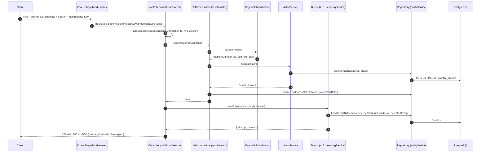

# Die Fach-API-Schicht im Detail

Die Fach-API (`services/platform/src/api/platform`) besteht aus vier Teilen: einer Routentabelle, **einem** Controller, einer Laufzeit-Verdrahtung (`platform-runtime.js`) und den Diensten unter `services/platform/src/api/platform/services/core/`. Diese Seite folgt einem Request von der Route bis zur Datenbank und zeigt die echten Auszüge.

## Dateien der Schicht

Alle Pfade relativ zu `services/platform/src/api/platform/`:

| Datei | Aufgabe |
|---|---|
| `routes/platform.js` | Tabelle `METHOD /v1/pfad → Controller-Methode` (53 Routen) |
| `controllers/platform.js` | dünne Adapter: `execute`, `withActor`, Statuscodes, Header, Binärantworten |
| `services/platform/src/api/platform/services/core/platform-runtime.js` | baut Repositories und Dienste einmal pro Strapi-Instanz; `resolveActor` |
| `services/platform/src/api/platform/services/core/strapi-repositories.js` | einziger Ort mit `strapi.entityService`-Aufrufen für die Fachdaten |
| `services/platform/src/api/platform/services/core/auth/jwt-validator.js` | Keycloak-JWT prüfen (JWKS, RS256) |
| `services/platform/src/api/platform/services/core/auth/actor-service.js` | Token-Claims → `actor` (Profil, Rollen, Organisation) |
| `services/platform/src/api/platform/services/core/validation.js`, `ids.js` | Eingabeprüfung, UUIDs, Idempotenz-Hilfen |
| `services/platform/src/api/platform/services/core/errors.js`, `http-conventions.js` | `ProblemError`, Problem-JSON, Header `X-Correlation-Id` / `X-API-Version` |

## Routen

`routes/platform.js` erzeugt jede Route über eine kleine Fabrik. Strapi setzt das Präfix `/api` davor, daraus wird die kanonische Grenze `/api/v1`:

```js title="services/platform/src/api/platform/routes/platform.js"
const route = (method, path, handler) => ({
  method,
  path,
  handler: `api::platform.platform.${handler}`,
  config: { auth: false },
});

module.exports = {
  routes: [
    route('GET', '/v1/health', 'health'),
    route('GET', '/v1/me', 'getMe'),
    route('PATCH', '/v1/me', 'updateMe'),
    // …
    route('POST', '/v1/level-attempts', 'startLevelAttempt'),
    route('POST', '/v1/level-attempts/:attemptId/complete', 'completeLevelAttempt'),
```

`config: { auth: false }` bedeutet: Strapi prüft **nichts**. Auch geschützte Routen sind aus Strapis Sicht öffentlich; der Schutz entsteht erst im Controller (`withActor`).

Die Routen gruppieren sich so:

| Gruppe | Pfade (`/v1/…`) | Auth im Controller |
|---|---|---|
| System | `health` | keine |
| Profil | `me` (GET/PATCH) | `withActor` |
| Inhalte, öffentlich | `content/manifest`, `content/packages/:version/:packageId`, `content/changes`, `ecosystems`, `ecosystems/:id`, `plants/:id`, `plants/:id/photo` | `execute` (ohne Token) |
| Inhalte, mit Konto | `levels/:id`, `ecosystems/:id/progress`, `quiz-items` | `withActor` |
| Lernen | `level-attempts`, `level-attempts/:id/complete`, `learning-events/batch`, `progress`, `sync` | `withActor` |
| Feld | `media/uploads`, `media/uploads/:id/content`, `media/:id/content`, `identifications*` | `withActor` |
| Herbarium | `observations*`, `tiles/:z/:x/:y`, `species/:key`, `species/:key/photo`, `stats/collection` | `withActor` |
| Redaktion | `editor/*` (Dashboard, Katalog, Entwürfe, Einreichen, Freigeben, Einladen) | `withActor` + Rolle im Dienst |
| Lehrende | `teaching/*` | `withActor` + Rolle im Dienst |

Den genauen Katalog mit Parametern und Schemas findest du in der automatisch erzeugten [API-Referenz](api-referenz.md).

!!! warning "Stolperfalle: das Routenformat ist Teil eines Prüfwerkzeugs"
    `tools/scripts/validate-api-contract.mjs` liest `routes/platform.js` mit dem regulären Ausdruck `route\('([A-Z]+)', '\/v1([^']*)', '([^']+)'\)`. Eine Route muss also **einzeilig** und exakt in der Form `route('GET', '/v1/…', 'handlerName')` stehen. Schreibst du sie mehrzeilig oder mit Template-String, sieht der Validator sie nicht – und meldet den Vertragseintrag als "ohne Server-Route". Die Details stehen unter [API-Vertrag](api-vertrag.md).

## Der Controller

`controllers/platform.js` exportiert ein Objekt mit einer `async`-Methode pro Route und zwei Hilfsfunktionen am Dateiende. Fast jede Methode ist ein Einzeiler:

```js title="services/platform/src/api/platform/controllers/platform.js"
async getMe(ctx) {
  return withActor(ctx, (runtime, actor) => runtime.profile.getMe(actor));
},

async startLevelAttempt(ctx) {
  return withActor(ctx, async (runtime, actor) => {
    const result = await runtime.learning.startAttempt(actor, ctx.request.body, ctx.get('idempotency-key'));
    ctx.status = result.created === false ? 200 : 201;
    return result.attempt;
  });
},
```

Die Regel dahinter: **Der Controller übersetzt, der Dienst entscheidet.** Der Controller liest Header (`idempotency-key`, `if-match`, `if-none-match`), Pfadparameter (`ctx.params`), Query (`ctx.query`) und Body (`ctx.request.body`), ruft genau eine Dienstmethode und setzt den Statuscode. Geschäftsregeln stehen nie im Controller.

### `execute` und `withActor`

```js title="services/platform/src/api/platform/controllers/platform.js"
async function withActor(ctx, action) {
  ctx.set('Cache-Control', 'no-store');
  return execute(ctx, async (runtime, traceId) => {
    const actor = await resolveActor(ctx, runtime);
    return action(runtime, actor, traceId);
  });
}

async function execute(ctx, action) {
  const traceId = applyResponseConventions(ctx);
  try {
    const runtime = getPlatformRuntime(strapi);
    const body = await action(runtime, traceId);
    if (body !== undefined && ctx.status !== 304) {
      if (![201, 202, 204].includes(ctx.status)) ctx.status = 200;
      ctx.type = 'application/json';
      ctx.body = body;
    }
  } catch (error) {
    const problem = asProblem(error, traceId, ctx.path);
    ctx.status = problem.status;
    ctx.body = problem;
    ctx.type = 'application/problem+json';
    ctx.set('Content-Type', 'application/problem+json');
  }
}
```

Was hier passiert:

- `execute` setzt **zuerst** `X-Correlation-Id` und `X-API-Version` – damit tragen auch Fehlerantworten die Header.
- Ein Fehler wird **nie** durchgereicht. Alles, was fliegt, geht durch `asProblem`; nur `ProblemError`-Instanzen behalten Status und Code, alles andere wird zu `500 INTERNAL_ERROR` ohne Detailtext (Details: [Idempotenz & Fehler](idempotenz-fehler.md)).
- Der Status wird nur auf `200` gesetzt, wenn der Handler nicht schon `201`, `202` oder `204` gewählt hat. Wer einen anderen Erfolgsstatus will, muss `ctx.status` **vor** dem Return setzen.
- `withActor` setzt `Cache-Control: no-store`; Handler, die Bilder oder Kacheln ausliefern, überschreiben das danach gezielt (z. B. `private, max-age=31536000, immutable` in `getPrivateMediaContent`).
- Rückgabe `undefined` heißt "ich habe Body und Status selbst gesetzt" (304, Binärdaten) bzw. "kein Body" (`deleteObservation` → 202 ohne Inhalt).

Welche Statuscodes die schreibenden Endpunkte setzen, zeigt die Tabelle:

| Methode | Erfolgsstatus | Regel im Controller |
|---|---|---|
| `startLevelAttempt` | 201, bei Replay 200 | `result.created === false ? 200 : 201` |
| `reserveUpload` | 201, bei Replay 200 | `upload.created === false ? 200 : 201` |
| `createIdentification` | 202, bei Replay 200 | `job.created === false ? 200 : 202` |
| `retryIdentification` | immer 202 | `ctx.status = 202` |
| `createObservation` | 201, bei Replay 200 | `result.created ? 201 : 200` |
| `deleteObservation` | 202 ohne Body | Tombstone; Rückgabe `undefined` |
| `editorSave`, `editorInvite`, `teachingCreateClass`, `teachingCreateStudent` | 201 | direkt gesetzt |
| `editorUpdate` (PATCH) | 200 | Dienst `save` mit `changeId` aus dem Pfad |

### Binäre und bedingte Antworten

Drei Handler liefern keine JSON-Objekte und zeigen die Techniken für Caching:

- `getManifest`: `ETag: "<version>"`; passt `If-None-Match`, antwortet der Handler mit `304` (`result.notModified`).
- `getContentPackage`: `ETag` ist der SHA-256 des Pakets, `Cache-Control: public, max-age=31536000, immutable`, `ctx.body = packageData.bytes` (Rohbytes, **nicht** neu serialisiert – sonst stimmt die Prüfsumme nicht mehr).
- `getPrivateMediaContent`: Besitzprüfung über `findPrivateMediaByPublicId(actor.id, mediaId)`, erlaubte `width`-Werte `320, 720, 1280`, `ETag` aus `sha256`, `ctx.fresh` → 304.

## Request-Lebenszyklus



Eine Fehlerantwort verlässt die Schleife an jeder Stelle: Ein `ProblemError` aus Schritt 5–10 landet im `catch` von `execute` und wird zu Problem-JSON.

## Laufzeit-Verdrahtung: `platform-runtime.js`

`getPlatformRuntime(strapi)` baut alle Dienste **einmal pro Strapi-Instanz** (Cache in einer `WeakMap`) und gibt dasselbe Objekt bei jedem Aufruf zurück. Die Reihenfolge ist wichtig, weil Dienste einander brauchen:

| Schlüssel in `runtime` | Instanz | Abhängigkeiten |
|---|---|---|
| `repositories` | `createStrapiRepositories(strapi)` | `strapi.entityService` |
| `validator` | `KeycloakJwtValidator` | `PLATFORM_OIDC_ISSUER`, `PLATFORM_OIDC_AUDIENCE`, optional `PLATFORM_OIDC_JWKS_URI` |
| `actorService` | `ActorService` | `repositories.profiles`, `PLATFORM_OIDC_ROLE_CLIENT_ID`, `PLATFORM_ORGANISATION_CLAIM` (Default `organisation_id`) |
| `profile` | `ProfileService` | `actorService` |
| `content` | `ContentService` | `repositories.content`, `photoCache`, `photoSource` |
| `species`, `stats` | `SpeciesService`, `StatsService` | `repositories.species` / `.stats` |
| `learning` | `LearningService` | `repositories.learning`, `repositories.herbarium` |
| `field` | `FieldService` | `repositories.field`, `enqueue` (Closure) |
| `herbarium` | `HerbariumService` | `repositories.herbarium`, `repositories.field`, `runtime.species` |
| `editor`, `teaching` | `EditorService`, `TeachingService` | bekommen `strapi` **und** `runtime` (für Repositories, Provider-Guard) |
| `editorInvitations` | `KeycloakInvitations` | Umgebungsvariablen (`PLATFORM_KEYCLOAK_ADMIN_*`) |
| `privateMediaStore`, `tiles`, `photoCache` | `PrivateMediaStore`, `TileProxy`, `PublicPhotoCache` | Dateisystem unter `PRIVATE_UPLOAD_DIR` |

Der Fotoanbieter wird abhängig von einer Umgebungsvariablen gewählt:

```js title="services/platform/src/api/platform/services/core/platform-runtime.js"
const photoSource = process.env.PLATFORM_EXTERNAL_PLANT_PHOTOS === 'disabled'
  ? undefined : new WikimediaPhotoSource({
    metadataStore: strapi.store({ type: 'core', name: 'plantini-photo-metadata-v1' }),
  });
```

Zwei Details, die man sonst übersieht:

- **Spät gebundene Teile.** `identificationQueue` und `providerGuard` sind beim Bau `undefined`. `src/index.js` setzt sie im `bootstrap`. Der `FieldService` bekommt deshalb eine Closure (`enqueue: async (jobId) => runtime.identificationQueue?.enqueue(jobId)`), die zur Aufrufzeit nachschlägt. Ohne Queue (z. B. im Test) wird der Aufruf zum No-op.
- **`getExistingPlatformRuntime`.** Der Typ-Generator von Strapi ruft `destroy` ohne vollständig initialisierten Entity-Service auf. `destroy` darf deshalb keine zweite Laufzeit erzeugen – dafür gibt es die Variante, die nur liest, was `bootstrap` schon gebaut hat.

!!! warning "Stolperfalle: fehlende OIDC-Variablen brechen den Start, nicht die erste Anfrage"
    `requiredEnvironment('PLATFORM_OIDC_ISSUER')` wirft `PLATFORM_OIDC_ISSUER must be configured for the platform API.` Weil `bootstrap` `getPlatformRuntime` aufruft, scheitert schon der Serverstart. Das gilt auch für Tests, die `getPlatformRuntime` benutzen: `test/game-progress-api.test.js` setzt beide Variablen vorher und räumt sie im `t.after` wieder auf.

### `resolveActor`: was nach der Signatur noch geprüft wird

```js title="services/platform/src/api/platform/services/core/platform-runtime.js"
async function resolveActor(ctx, runtime) {
  const header = ctx.get('authorization');
  if (!header || !/^Bearer\s+\S+$/i.test(header)) {
    throw authenticationError('AUTH_TOKEN_MISSING', 'Für diese Aktion ist eine Anmeldung erforderlich.');
  }
  const token = header.replace(/^Bearer\s+/i, '');
  const claims = await runtime.validator.validate(token);
  const actor = await runtime.actorService.resolve(claims);
  const profile = await runtime.repositories.profiles.findByProfileId(actor.id);
  if (profile?.status === 'suspended') {
    throw new ProblemError('ACCOUNT_SUSPENDED', { status: 403, detail: 'Dieses Konto ist gesperrt.' });
  }
  if (profile?.tokensValidAfter && (!Number.isFinite(claims.iat)
      || claims.iat <= Math.floor(Date.parse(profile.tokensValidAfter) / 1000))) {
    throw authenticationError('AUTH_SESSION_REVOKED', 'Die Sitzung wurde beendet. Bitte erneut anmelden.');
  }
  return actor;
}
```

Das ist der Mechanismus, mit dem das Lehrendenportal Schülerkonten **sofort** sperrt: `TeachingService` setzt `status: 'suspended'` und `tokensValidAfter` im Profil, und schon das nächste Request mit einem noch gültigen Access-Token scheitert mit `ACCOUNT_SUSPENDED` bzw. `AUTH_SESSION_REVOKED` – unabhängig von der Token-Lebensdauer.

## Auth im Detail

### `KeycloakJwtValidator`

Datei `services/platform/src/api/platform/services/core/auth/jwt-validator.js`. Die Prüfreihenfolge in `validate(token)`:

1. Länge 1…16 384 Zeichen, genau drei Teile, Header und Payload sind JSON-Objekte.
2. `header.alg` muss in `allowedAlgorithms` liegen (Standard nur `RS256`; `RS384`/`RS512` wären unterstützt) und `header.kid` muss gesetzt sein.
3. Schlüssel per `kid` aus dem JWKS (`findKey`): Cache 5 Minuten (`cacheTtlMs`); findet sich der `kid` nicht, wird **genau einmal** neu geladen (Keycloak-Rotation). Schlüssel mit `use: 'enc'` werden übersprungen.
4. Signatur mit `crypto.verify(...)` gegen `crypto.createPublicKey({ key, format: 'jwk' })`.
5. `validateClaims`: `iss` exakt gleich dem konfigurierten Issuer, `aud` (String oder Array) enthält die Audience, `exp` nicht abgelaufen (Toleranz 30 s), `nbf` nicht in der Zukunft, `sub` ist ein String mit 1…255 Zeichen.

Die JWKS-URL ist `PLATFORM_OIDC_JWKS_URI` oder, falls nicht gesetzt, `<issuer>/protocol/openid-connect/certs`.

| Fehlercode | HTTP | Auslöser |
|---|---|---|
| `AUTH_TOKEN_MISSING` | 401 | kein oder fehlerhafter `Authorization`-Header |
| `AUTH_TOKEN_INVALID` | 401 | Format, Signatur, Issuer, Audience, `sub`, unbekannter `kid`, falscher Organisations-Claim |
| `AUTH_TOKEN_EXPIRED` | 401 | `exp` abgelaufen |
| `AUTH_TOKEN_NOT_ACTIVE` | 401 | `nbf` in der Zukunft |
| `AUTH_SESSION_REVOKED` | 401 | `iat` ≤ `tokensValidAfter` des Profils |
| `AUTH_KEYSET_UNAVAILABLE` | 503 | JWKS nicht erreichbar oder ungültig |
| `ACCOUNT_SUSPENDED` | 403 | Profil hat `status: 'suspended'` |

!!! note "Der Validator ist dependency-frei"
    Es gibt keine JWT-Bibliothek; die Prüfung nutzt nur `node:crypto`. Die Tests in `test/jwt-validator.test.js` erzeugen sich selbst ein RSA-Schlüsselpaar (`crypto.generateKeyPairSync`), signieren Tokens und reichen ein `fetch`-Mock für das JWKS ein. Dasselbe Muster funktioniert für deine eigenen Tests.

### `ActorService` und Rollen

`actorService.resolve(claims)` macht aus den Claims einen `actor`:

```js title="services/platform/src/api/platform/services/core/auth/actor-service.js"
return {
  id: profile.profileId,
  subject: profile.keycloakSubject,
  displayName: profile.displayName,
  locale: profile.locale,
  organisationId: profile.organisationId || organisationId,
  ...(profile.character ? { character: profile.character } : {}),
  roles,
};
```

- **Profil anlegen beim ersten Login.** Gibt es zu `claims.sub` kein Profil (`findBySubject`), legt der Dienst eines an (`profileId = newId()`). Gewinnt bei gleichzeitigen Requests ein anderer Request das Rennen, fängt `isUniqueViolation` den Fehler (`23505`, `SQLITE_CONSTRAINT`, `ValidationError`) und liest das fertige Profil.
- **Interne ID statt Keycloak-ID.** Alle Besitzfelder (`ownerId`) verweisen auf `profileId`, nicht auf `sub`. Ausnahmen sind Redaktion und Lehre, die `actor.subject` verwenden (`authorSubject`, `ownerSubject`).
- **Rollen.** `extractRoles` vereinigt `realm_access.roles` und – nur wenn `PLATFORM_OIDC_ROLE_CLIENT_ID` gesetzt ist – `resource_access[clientId].roles`, normalisiert sie (klein, `-`/Leerzeichen → `_`) und behält nur die erlaubten:

| Rolle | Bedeutung im Code |
|---|---|
| `lernende` | Standard; wird eingesetzt, wenn **keine** bekannte Rolle im Token steht |
| `lehrende` | Lehrendenportal (`requireTeacher` in `teaching-service.js`) |
| `inhaltsredaktion` | Studio: Entwürfe anlegen/einreichen (`EDITOR_ROLES`) |
| `botanisches_review` | Studio: freigeben/zurückweisen (`REVIEW_ROLES`) |
| `systemadministration` | alles aus Redaktion, Review und Lehre; darf Reviewer und Lehrende einladen |
| `organisationsadministration` | wird akzeptiert, aber **von keinem Dienst ausgewertet** (nur in der Erlaubnisliste und in der Schutzliste von `keycloak-students.js`) |

- **Organisation.** `organisation_id` (oder `PLATFORM_ORGANISATION_CLAIM`) muss eine UUID sein, sonst `AUTH_TOKEN_INVALID` ("Der Organisation-Claim im Zugriffstoken ist ungültig.").

Die **Rollenprüfung passiert im Dienst**, nicht im Controller: `requireEditor` / `requireReviewer` in `editor/editor-service.js`, `requireTeacher` in `teaching/teaching-service.js`. Der Controller reicht den `actor` einfach durch.

## Repositories: `strapi-repositories.js`

`createStrapiRepositories(strapi, { contentVersion })` gibt ein Objekt mit sieben Repositories zurück: `profiles`, `content`, `learning`, `field`, `herbarium`, `species`, `stats`. Die Dienste kennen nur diese Schnittstelle – in Unit-Tests ersetzt man sie durch einfache In-Memory-Objekte (siehe `test/learning-service.test.js`, `createRepository()`).

Das Grundmuster ist `findOne` über `entityService.findMany(..., { limit: 1 })`:

```js title="services/platform/src/api/platform/services/core/strapi-repositories.js"
async function findOne(entities, uid, options) {
  const results = await entities.findMany(uid, { ...options, limit: 1 });
  return normaliseArray(results)[0] || null;
}

function ownerClientKey(ownerId, clientId) {
  return createHash('sha256').update(`${ownerId}\u0000${clientId}`).digest('hex');
}
```

Wichtige Eigenschaften:

- **Besitz ist Teil der Abfrage.** Fast jede Suche im Nutzerbereich filtert `{ ownerId, publicId }` (z. B. `findAttemptByPublicId`). Die Ressource eines anderen Kontos ist damit von einer fehlenden nicht zu unterscheiden → `404`.
- **Client-IDs sind pro Besitzer eindeutig.** `ownerClientKey` hasht `ownerId` und Client-ID in eine Spalte mit `unique: true` (`ownerClientAttemptKey`, `ownerClientMediaKey`, `ownerClientJobKey`, `ownerClientObservationKey`). Zwei Konten können dieselbe Client-UUID benutzen, ohne zu kollidieren.
- **Inhalte werden doppelt gefiltert.** Alle Lese-Repositories für Lernende (`listPublishedEcosystems`, `findPublishedLevel`, `findPublishedPlant`, `findPublishedQuizItems`, `listPublishedLevels`) verlangen `releaseVersion = <Version des aktiven Content-Release>` **und** `publicationState: 'live'`; verknüpfte Datensätze brauchen zusätzlich `publishedAt: { $notNull: true }`. Was das für Releases bedeutet, steht unter [Inhalte & Releases](inhalte-releases.md).
- **Paginierung im Speicher.** `listPublishedEcosystems` und `listObservations` laden die vollständige Treffermenge und schneiden dann mit `slice(start, start + pageSize)`. Für das heutige Datenvolumen (3 Ökosysteme) harmlos; für große Herbarien wäre ein Datenbank-`limit/offset` nötig.
- **Nur das Notwendige.** `stats.listConfirmedFinds` und `countAccounts` aggregieren über alle Konten, geben aber nur Besitz-IDs und Pflanzenschlüssel zurück, nie Notizen oder Orte.

!!! note "Direkter Datenbankzugriff"
    Zwei Dienste umgehen den Entity-Service bewusst: `EditorService` benutzt `strapi.db.connection('editor_changes')` mit Roh-SQL (`payload = ?::jsonb`), und `TeachingService.progressData` nutzt `strapi.db.query('api::level-attempt.level-attempt')`. Der Editor-Pfad **funktioniert nur mit PostgreSQL**; mit dem SQLite-Default aus `config/database.js` scheitert `save`/`submit`. Siehe [Dienste](services.md#editor).

## Validierung: `validation.js` und `ids.js`

Eingaben werden **nie** an die Datenbank durchgereicht, sondern erst in ein sauberes Objekt kopiert. Die Bausteine:

| Funktion | Zweck |
|---|---|
| `requirePlainObject(value, field)` | Body muss ein JSON-Objekt sein, kein Array |
| `rejectUnknownFields(value, allowed)` | unbekannte Felder → `400 VALIDATION_FAILED` mit `fieldErrors` je Feld |
| `rejectUnknownQuery(query, allowed)` | dasselbe für Query-Parameter |
| `requireString / optionalString` | Länge (`min`, `max`), Trimmen |
| `requireInteger / requireNumber / requireArray` | Wertebereiche |
| `requireDate / optionalDate` | nur RFC 3339 **mit** Zeitzone; Ausgabe normalisiert auf UTC (`toISOString`) |
| `pageFromQuery` | `page ≥ 1`, `pageSize` 1…100 (Default 50), kennt nur diese beiden Parameter |
| `parseIfMatch` | entfernt `W/` und Anführungszeichen aus `If-Match` |
| `requireUuid` (aus `ids.js`) | UUID v1–v5-Muster, gibt klein geschrieben zurück |
| `requireIdempotencyKey` | 16–128 Zeichen aus `[A-Za-z0-9._~:/+=-]` |

Ein typischer Validator aus `learning-service.js` zeigt das Muster:

```js title="services/platform/src/api/platform/services/core/learning/learning-service.js"
function validateCompletion(body) {
  const value = requirePlainObject(body);
  rejectUnknownFields(value, ['clientEventId', 'answers']);
  return {
    clientEventId: requireUuid(value.clientEventId, 'clientEventId'),
    answers: requireArray(value.answers, 'answers', { min: 1, max: 100 }).map((answer, index) => {
      const item = requirePlainObject(answer, `answers[${index}]`);
      rejectUnknownFields(item, ['quizItemId', 'choiceId']);
      return {
        quizItemId: requireUuid(item.quizItemId, `answers[${index}].quizItemId`),
        choiceId: requireString(item.choiceId, `answers[${index}].choiceId`, { max: 256 }),
      };
    }),
  };
}
```

!!! warning "Stolperfalle: unbekannte Felder sind ein Fehler, kein Ignorieren"
    Fast jeder Validator ruft `rejectUnknownFields`. Ergänzt der Vertrag ein neues Feld, der Dienst kennt es aber nicht, antwortet die API mit `400` und dem Text "Dieses Feld ist nicht im API-Vertrag definiert." Das Gegenstück gilt auch: Der Dart-Client sendet nur Felder aus dem Vertrag; ein serverseitig zusätzlich erlaubtes Feld (z. B. `idempotencyKey` im Body) taucht im generierten Client nicht auf.

## `http-conventions.js`

Die Datei ist klein, aber jede Antwort geht durch sie:

```js title="services/platform/src/api/platform/services/core/http-conventions.js"
const API_VERSION = 'v1';
const CORRELATION_PATTERN = /^[A-Za-z0-9._-]{8,128}$/;

function applyResponseConventions(ctx, idFactory = randomUUID) {
  const requested = ctx.get('x-correlation-id');
  const traceId = typeof requested === 'string' && CORRELATION_PATTERN.test(requested)
    ? requested
    : idFactory();
  ctx.set('X-Correlation-Id', traceId);
  ctx.set('X-API-Version', API_VERSION);
  return traceId;
}
```

- Ein vom Client gelieferter `X-Correlation-Id` wird **übernommen**, wenn er 8–128 Zeichen aus `[A-Za-z0-9._-]` hat; sonst erzeugt der Server eine UUID. Das Muster verhindert, dass Leerzeichen oder Geheimnisse in Logs und Header wandern (`test/api-conventions.test.js`: `'contains spaces and secrets'` wird verworfen).
- Dieselbe `traceId` steht im Problem-JSON und wird an `LearningService` weitergegeben (für `rejected[]` in Event-Batches).
- Es gibt keine automatische Versionsaushandlung. `v1` ist im Pfad und im Header festverdrahtet.

## Ein Beispiel von Anfang bis Ende

Anfrage und Antwort für `GET /api/v1/health` – die einzige Route ohne Datenbank und ohne Token:

```sh
curl -i http://127.0.0.1:1338/api/v1/health
```

```http
HTTP/1.1 200 OK
x-correlation-id: 6c1c3f9e-…
x-api-version: v1
content-type: application/json; charset=utf-8

{"status":"ok","apiVersion":"v1"}
```

(Port `1338` ist die Host-Seite des E2E-Stacks laut `infra/compose.e2e.yaml`: `127.0.0.1:1338:1337`. Die Antwortform ergibt sich aus `health` im Controller; die genauen Header-Namen und -Schreibweise hängen von Koa ab und sind hier nicht mitgeschnitten.)

Ohne Token auf einer geschützten Route:

```sh
curl -i http://127.0.0.1:1338/api/v1/me
```

```json
{
  "type": "/problems/auth-token-missing",
  "title": "Nicht authentifiziert",
  "status": 401,
  "code": "AUTH_TOKEN_MISSING",
  "traceId": "…",
  "detail": "Für diese Aktion ist eine Anmeldung erforderlich.",
  "instance": "/api/v1/me"
}
```

Die Struktur des Problem-JSON entspricht der Ausgabe von `asProblem` (lokal mit `node -e` nachgestellt); der konkrete Lauf gegen einen Stack wurde hier nicht durchgeführt.

## Weiterführend

- Nächste Seiten: [Dienste](services.md), [Idempotenz & Fehler](idempotenz-fehler.md), [Neuer Endpunkt](neuer-endpunkt.md)
- Architektur: [Sicherheit & Datenschutz](../architektur/sicherheit-datenschutz.md), [Identity & Keycloak](../betrieb/identity-keycloak.md)
- Quellpfade: `services/platform/src/api/platform/routes/platform.js`, `services/platform/src/api/platform/controllers/platform.js`, `services/platform/src/api/platform/services/core/platform-runtime.js`, `services/platform/src/api/platform/services/core/strapi-repositories.js`, `services/platform/src/api/platform/services/core/auth/`, `services/platform/test/jwt-validator.test.js`, `services/platform/test/api-conventions.test.js`
