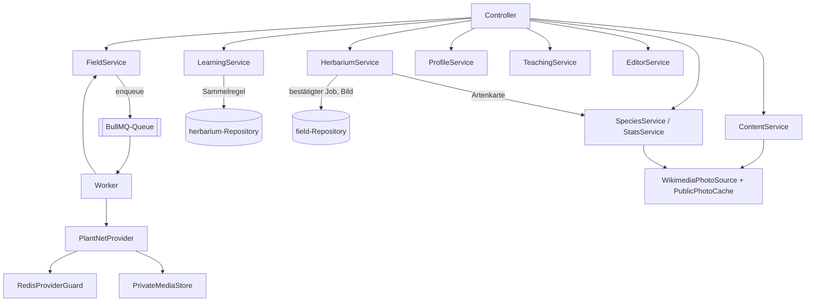
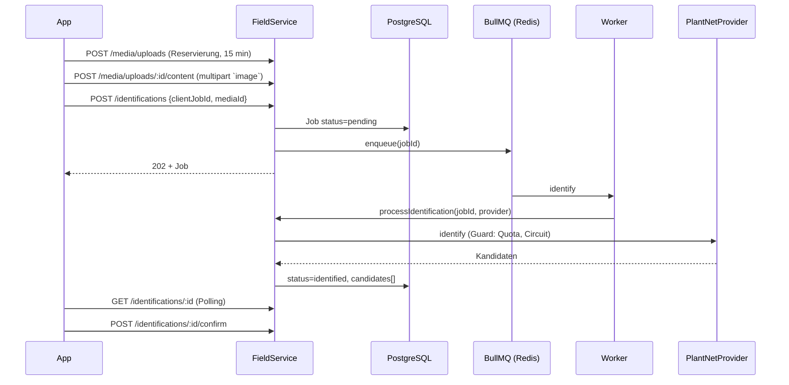
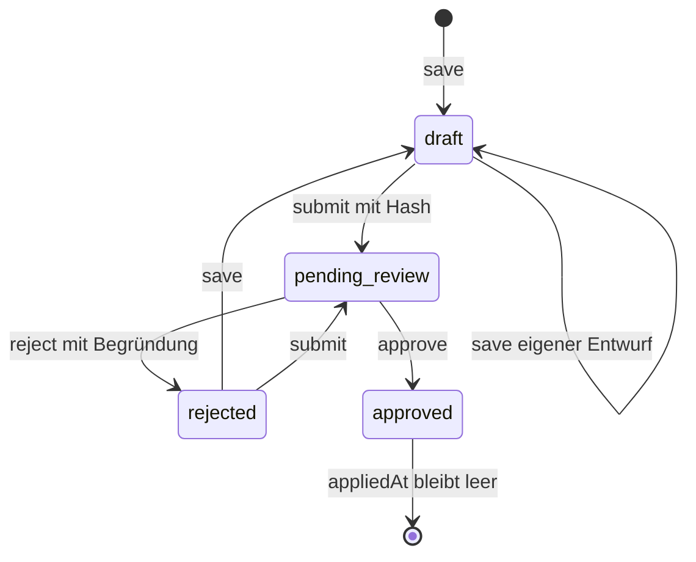

# Dienste unter `services/core`

Die Geschäftslogik der Fach-API steckt in Klassen unter `services/platform/src/api/platform/services/core/`. Jede Klasse bekommt ihre Abhängigkeiten im Konstruktor (Repositories, Uhr, Queue), kennt Strapi nicht direkt und ist deshalb mit einfachen In-Memory-Objekten testbar. Diese Seite beschreibt jeden Dienst mit Zweck, Methoden, Regeln und dem, was getestet ist – und was nicht.

Zur Orientierung, welcher Dienst welche Endpunkte bedient:

| Dienst (Ordner) | Klasse | Endpunkte (`/v1/…`) |
|---|---|---|
| `content/` | `ContentService` | `content/*`, `ecosystems*`, `levels/:id`, `plants/:id*`, `quiz-items` |
| `learning/` | `LearningService` | `level-attempts*`, `learning-events/batch`, `progress`, `sync`, `ecosystems/:id/progress` |
| `field/` | `FieldService` | `media/uploads*`, `identifications*` |
| `herbarium/` | `HerbariumService` | `observations*` |
| `profile/` | `ProfileService` | `me` |
| `species/` | `SpeciesService`, `StatsService` | `species/:key*`, `stats/collection` |
| `teaching/` | `TeachingService` | `teaching/*` |
| `editor/` | `EditorService`, `KeycloakInvitations` | `editor/*` |
| `auth/` | `KeycloakJwtValidator`, `ActorService` | (alle geschützten Routen) |

## Content

**Zweck.** Liefert die veröffentlichten, versionsgebundenen Inhalte: Manifest, Pakete, Ökosysteme, Level, Pflanzen, Quizfragen. Datei: `content/content-service.js`.

**Öffentliche Methoden.**

| Methode | Verhalten |
|---|---|
| `getManifest(ifNoneMatch)` | aktives Release holen, `validateManifest` ausführen, ETag `"<version>"`; ohne aktives Release `503 CONTENT_RELEASE_UNAVAILABLE` |
| `getPackage(version, packageId)` | Release **dieser** Version laden (auch inaktive), Bytes aus `packageBlobs` lesen und gegen Größe und SHA-256 prüfen (`readReleasePackage`) |
| `listEcosystems(query)` / `getEcosystem(id)` | Paginierung über `pageFromQuery`; Mapping auf öffentliches DTO |
| `getLevel(actor, id, accessState)` | Level plus kontospezifischer Zustand (`available`/`locked`/…); der Zustand kommt als Funktion von `LearningService.getLevelAccess` |
| `getPlant(id)` | Pflanzenprofil; ergänzt bis zu zehn Fotos (Autoren-Medien zuerst, dann Wikimedia/iNaturalist) |
| `getPlantPhoto(plantId, photoId)` | liefert die zwischengespeicherten Bytes über `PublicPhotoCache` |
| `listQuizItems(actor, levelId, contentVersion)` | Fragen **ohne** Lösung; bei abweichender `contentVersion` `409 CONTENT_VERSION_UNAVAILABLE` |

**Regeln und Invarianten.**

- `assertPublicContent` verlangt für jedes ausgelieferte Objekt `publishedAt`, eine gültige UUID-`publicId`, einen `slug` und eine `releaseVersion`. Sonst `503 CONTENT_INTEGRITY_FAILED` ("fail closed": lieber kein Inhalt als ein kaputter).
- `mapPlant` serialisiert **nie** die Lösungsfelder der Lernkarten, nur `heading` und `text` (`profileCards`).
- `mapQuizItem` enthält `choices` mit `id` und `label`, aber nicht `correctChoiceId`. Die Lösung bleibt im Feld `data` des Quiz-Datensatzes und wird nur von `LearningService.scoreAnswers` gelesen.
- `normaliseCompletionRule` ergänzt Standardwerte (`minimumScore: 1`, `collectionScope: 'level'`) und bricht bei `minimumScore` außerhalb 0…1, unbekanntem `collectionScope` oder einem `ecosystem`-Scope ohne explizite Pflanzen-UUIDs ab.
- Für aus Blueprint generierte Level (`level.generatedFromBlueprint`) muss jede Pflichtfrage veröffentlicht sein, sonst `CONTENT_INTEGRITY_FAILED`.
- Quiztypen sind `multiple_choice`, `flashcard`, `image_identification`, `feature_match`; `multiple-choice` und `identification` werden als Alias normalisiert.

**Tests.** `test/content-service.test.js` (Manifest/ETag, DTO-Mapping, 404), `test/demo-content.test.js` (Validator des Demo-Datensatzes), indirekt `test/game-journeys.test.js` (Seed + Lesepfad über `memory-entities`).

## Learning

**Zweck.** Serverseitig autoritativer Lernfortschritt: Versuche starten, Antworten bewerten, Offline-Ereignisse aufnehmen, Fortschritt berechnen. Datei: `learning/learning-service.js`. Der Server vertraut **keinem** vom Client gemeldeten Ergebnis.

**Öffentliche Methoden.**

| Methode | Kernlogik |
|---|---|
| `startAttempt(actor, body, header)` | idempotent starten; Level muss zur aktiven Version gehören (`CONTENT_VERSION_CONFLICT`) und freigeschaltet sein (`LEVEL_LOCKED`) |
| `completeAttempt(actor, attemptId, body, header)` | Antworten bewerten, Bestehensgrenze prüfen, ggf. Sammelregel prüfen, Versuch auf `completed` setzen |
| `submitEvents(actor, body, header, traceId)` | Batch von Offline-Ereignissen; jedes einzeln idempotent über `clientEventId` |
| `synchronize(actor, body, header, traceId, contentChanges)` | Events aufnehmen, Fortschritt neu berechnen, `contentCursor` zurückgeben |
| `getProgress(actor, since)` | berechnet pro veröffentlichtem Level `locked`/`available`/`in_progress`/`completed` |
| `getLevelAccess` / `requireLevelAccess` | Freischaltung anhand `completionRule.requiredLevelIds` |
| `getEcosystemProgress(actor, id)` | Ökosystem-Abschluss aus bestandenen Leveln **und** gesammelten Zielpflanzen |

**Regeln und Invarianten.**

- **Bewertung.** `scoreAnswers` verlangt für jede Pflichtfrage (`rule.requiredQuizIds`) genau eine Antwort, lehnt doppelte oder fremde Antworten ab (`400`) und rechnet `richtig / Pflichtfragen`. Bestanden ist `score >= rule.minimumScore`. Die Lösung liest `isCorrect` aus `question.data.correctChoiceId`; fehlt sie, `503 CONTENT_INTEGRITY_FAILED`.
- **Freischaltung.** `requireLevelAccess` lässt ein bereits bestandenes Level immer zu ("Revisit"). Sonst müssen alle `requiredLevelIds` bestanden sein, andernfalls `409 LEVEL_LOCKED`.
- **Sammelregel.** Bei `collectionScope: 'level'` und bestandenem Quiz prüft `requireCollectedPlants`, dass die Zielpflanzen im Herbarium bestätigt sind (`409 LEVEL_COLLECTION_INCOMPLETE`). Bei `collectionScope: 'ecosystem'` blockiert die Sammlung **kein** Level, sondern nur die Ökosystem-Trophäe (`getEcosystemProgress` meldet dann `collection_pending`).
- **Wiederholter Abschluss.** Ein schon abgeschlossener Versuch kann nur mit demselben Completion-Key und derselben Nutzlast wiederholt werden; ein anderer Key ergibt `409 ATTEMPT_ALREADY_COMPLETED`.
- **Fehlversuch.** Ein nicht bestandener Versuch ist ebenfalls `completed` (mit `passed: false`); zum Wiederholen startet die App einen neuen Versuch mit **neuer** `clientAttemptId`.

!!! warning "Stolperfalle: `synchronize` verschluckt abgelehnte Ereignisse"
    `synchronize` ruft intern `submitEvents` auf, gibt aber nur `acknowledgedClientEventIds` zurück. Das Feld `rejected` der Teilantwort wird verworfen. Ein Offline-Ereignis, das den Validator nicht besteht, taucht in `/sync` also nirgends auf; wer die Gründe sehen will, muss `POST /v1/learning-events/batch` benutzen, dessen Antwort `rejected[]` mit Problem-Objekten enthält.

!!! warning "Stolperfalle: `meta` im Fehler geht verloren"
    `LEVEL_LOCKED` und `LEVEL_COLLECTION_INCOMPLETE` übergeben `meta: { missingLevelIds … }` bzw. `meta: { missingPlantIds … }`. `ProblemError` behält `meta` aber nicht, und `asProblem` kennt es nicht – die IDs erreichen den Client nie. Siehe [Idempotenz & Fehler](idempotenz-fehler.md#stolperfallen).

**Tests.** `test/learning-service.test.js` (Idempotenz, Bewertung, Events, Sammel-Gate), `test/game-journeys.test.js` (30 Level je Ökosystem, Reihenfolge, Akteur-Isolation, Sammelregeln, Seed-Wiederholung), `test/game-progress-api.test.js` (Controller-Route inkl. 401/400).

## Field

**Zweck.** Private Foto-Uploads und asynchrone Pflanzenidentifikation. Datei: `field/field-service.js`; dazu `identification-queue.js` (BullMQ), `plantnet-provider.js` (Anbieter-Adapter) und `provider-guard.js` (Quota/Circuit Breaker).

**Ablauf einer Identifikation.**

**Öffentliche Methoden.**

| Methode | Kernlogik |
|---|---|
| `reserveUpload` | prüft `contentType` (`image/jpeg`, `image/png`), `bytes` (1…20 MiB); Reservierung gilt 15 Minuten (`RESERVATION_TTL_MS`) |
| `attachUpload` | prüft Reservierung (`reserved`, nicht abgelaufen → sonst `409 MEDIA_UPLOAD_EXPIRED`), Bytegröße gleich `bytes`, Medientyp gleich Reservierung, **Magic Bytes** (`hasExpectedMagicBytes`), speichert SHA-256 und `storageKey` |
| `createIdentification` | Medium muss dem Konto gehören und `uploaded` sein; optional `expectedPlantId` muss veröffentlicht sein; legt Job `pending` an und reiht ihn ein |
| `getIdentification`, `retryIdentification` | nur eigene Jobs; Retry nur für `failed` **mit** `deadLetteredAt` (`409 IDENTIFICATION_NOT_RETRYABLE`), setzt `attempts: 0` zurück |
| `confirmIdentification` | genau eines von `candidateId` / `confirmedPlantId`; weicht der Kandidat von der erwarteten Levelpflanze ab, ist `acceptMismatch: true` Pflicht (`409 IDENTIFICATION_MISMATCH_NOT_ACCEPTED`) |
| `processIdentification(jobId, provider)` | Worker-Einstieg (kein Besitzfilter): `pending` → `processing` → `identified` oder `failed` |
| `recoverPendingJobs(limit)` | reiht bis zu 100 `pending`-Jobs erneut ein |

**Regeln und Invarianten.**

- **Persistenz vor Queue.** `enqueuePersistedJob` fängt jeden Queue-Fehler ab. Der Job bleibt `pending` in der Datenbank und ist für den Nutzer sichtbar; `recoverPendingJobs` (alle 30 s aus `src/index.js`) holt ihn später nach. Das ist der Grund, warum Redis zwischendurch ausfallen darf.
- **Wiederholungen.** Höchstens `MAX_IDENTIFICATION_ATTEMPTS = 5`. Bei retrybaren Anbieterfehlern (`PROVIDER_RATE_LIMITED`, `PROVIDER_TIMEOUT`, `PROVIDER_UNAVAILABLE`, `PROVIDER_QUOTA_RESERVED`, `PROVIDER_CIRCUIT_OPEN`) wird `retryAfter` berechnet: `max(requestedDelay, min(60 s, 1 s · 2^(n−1))) + Jitter`, begrenzt auf 24 h. Der Jitter ist deterministisch (`deterministicJitter`, SHA-256 aus Job-ID und Versuch, 0…750 ms). Der Worker reiht den Job mit `delay` neu ein.
- **Kandidaten werden geprüft.** `validateProviderCandidates` erlaubt 1…10 Kandidaten mit `candidateId`, `scientificName`, `score` ∈ [0,1]. `enrichCandidateSafety` ergänzt `plantId` und `safetyNotice` (aus dem `warning` der veröffentlichten Pflanze), überschreibt aber niemals eine vom Anbieter bereits gesetzte `plantId`.
- **Erwartete Pflanze.** `matchExpectedPlant` setzt `expectedMatch` (`matched`/`mismatch`) und `expectedCandidateId`; der Vergleich läuft über `plantId` oder den normalisierten wissenschaftlichen Namen.

!!! warning "Stolperfalle: nicht retrybare Fehler enden als `PROVIDER_RETRY_EXHAUSTED`"
    Im `catch` von `processIdentification` bedeutet "`retryAfter` ist `undefined`" immer "Dead-Letter" – auch bei einem **nicht retrybaren** Fehler im ersten Versuch (z. B. `PROVIDER_CREDENTIALS_INVALID`, `PROVIDER_REJECTED`, ungültige Kandidaten). Der Job bekommt dann `failureCode: 'PROVIDER_RETRY_EXHAUSTED'` und `deadLetteredAt`, obwohl nie fünfmal versucht wurde (`field-service.js`, `retryAfterFor`/`catch`-Zweig). Das ist aus dem Code abgeleitet, nicht separat ausgeführt; getestet ist nur der Fall "fünfter Versuch (`attempts: 4`) schlägt mit `PROVIDER_UNAVAILABLE` fehl" in `test/field-herbarium.test.js`. Die eigentliche Ursache wird im `catch`-Zweig weder gespeichert noch geloggt; `failureCode` ist deshalb nur bei retrybaren Fehlern aussagekräftig.

**Anbieter-Adapter und Guard.**

- `PlantNetProvider` hat zwei Modi: `mock` (`POST <PLANTNET_BASE_URL>/v1/identify` mit Roh-Bytes; der Header `x-plantini-expected-plant-id` steuert den Mock) und `real` (Multipart an `/v2/identify/<project>`, Parameter `lang`, `nb-results`, `include-related-images=false`). Im Modus `real` ist `PLANTNET_API_KEY` Pflicht, und `dns.setDefaultResultOrder('ipv4first')` wird gesetzt – die Kommentare im Code begründen das mit fehlendem IPv6-Routing in den Zielumgebungen.
- Der Schlüssel steht nur im Worker; die App sieht normalisierte Kandidaten. Antworten mit 401/403 werden zu `PROVIDER_CREDENTIALS_INVALID`, 429 zu `PROVIDER_RATE_LIMITED` (mit `Retry-After` als Sekunden oder HTTP-Datum, Standard 5 s), ≥500 zu `PROVIDER_UNAVAILABLE`, Timeout (12 s) zu `PROVIDER_TIMEOUT`.
- `RedisProviderGuard.beforeRequest` führt ein Lua-Skript aus: Circuit offen? → `PROVIDER_CIRCUIT_OPEN`. Tageszähler `plantini:plantnet:quota:<YYYY-MM-DD>` (UTC) ≥ `dailyLimit − quotaReserve` (Standard 500 − 25) → `PROVIDER_QUOTA_RESERVED`. Fünf transiente Fehler (`PLANTNET_CIRCUIT_FAILURE_THRESHOLD`) öffnen den Circuit für `PLANTNET_CIRCUIT_COOLDOWN_MS` (60 s). Ein Erfolg setzt Fehlerzähler und Circuit zurück.

**Tests.** `test/field-herbarium.test.js` (Magic Bytes, Besitz, Mismatch, Dead-Letter, Retry), `test/plantnet-provider.test.js` (Real-Modus, Retry-After), `test/field-identification-queue.test.js` und `test/provider-guard.test.js` (**benötigen `PLANTINI_TEST_REDIS_URL`**, sonst übersprungen), `test/idempotency-schema.test.js` (Eindeutigkeit in den Schemas).

## Herbarium

**Zweck.** Das private Herbarium des Kontos: Funde anlegen, lesen, ändern, löschen. Datei: `herbarium/herbarium-service.js`.

| Methode | Kernlogik |
|---|---|
| `create(actor, body, header)` | idempotent; ein referenzierter `identificationJobId` muss `identified` **und** bestätigt sein; ein `mediaId` muss dem Konto gehören und `uploaded` sein |
| `list(actor, query)` / `get(actor, id)` | nur eigene, nicht gelöschte Funde, nach `timestamp` absteigend |
| `update(actor, id, body, ifMatch)` | optimistische Sperre über `version` (UUID) |
| `delete(actor, id, ifMatch)` | **Tombstone**: `syncStatus: 'deleted'`, `deletedAt`; Zeile bleibt bestehen |

**Regeln und Invarianten.**

- `version` wird bei jeder Änderung neu gewürfelt (`newId()`); `If-Match` muss exakt passen, sonst `409 OBSERVATION_VERSION_CONFLICT`.
- Das Foto eines Fundes wird aus dem Identifikations-Job übernommen, wenn der Client kein `mediaId` sendet – aber nur, wenn das Bild noch existiert. Ein fehlendes **abgeleitetes** Bild blockiert das Speichern nicht, ein fehlendes **vom Client genanntes** schon.
- Bestätigt der Nutzer eine Art außerhalb des Katalogs (`!identification.confirmedPlantId`), stößt `create` `species.ensureFromCandidate` an (`void`, fire-and-forget). Das darf das Speichern nie verzögern oder scheitern lassen.
- Standort: `latitude` ∈ [−90, 90], `longitude` ∈ [−180, 180], `accuracyMeters ≥ 0`. Exakte Fundorte sind privat und werden nur dem Besitzer ausgeliefert.

**Tests.** `test/field-herbarium.test.js` (Besitz, Versionen, Tombstones, Idempotenz, externer Kandidat).

## Profile

`profile/profile-service.js`: `getMe` und `updateMe`. Erlaubt sind `displayName` (1…100), `locale` (BCP-47-ähnlich, z. B. `de-DE`) und `character`. `profile/character-schema.js` erlaubt genau `{ v: 2, id }` mit einer von neun festen Figuren (`amara, mei, samira, heinrich, mateo, arjun, robin, nia, kai`); gespeicherte Figuren einer älteren Version (`v !== 2`) werden nicht zurückgegeben. Test: `test/character-schema.test.js` (prüft auch, dass die App für jede Figur ein Modell mitliefert).

## Species und Stats

**`SpeciesService`** (`species/species-service.js`) baut Info-Karten für Arten, die Nutzer gefunden haben, die aber in keinem Ökosystem vorkommen. `ensureFromCandidate` erzeugt den Schlüssel (`keyFor("Bellis perennis")` → `bellis-perennis`), prüft, ob die Karte jünger als eine Woche ist (`verifiedAt`), dedupliziert parallele Arbeit über `pending`, und holt per `WikimediaPhotoSource` eine Zusammenfassung (Wikipedia de, sonst en) und ein Foto. Schlägt eine Abfrage fehl, bleibt die alte Karte stehen und wird in etwa einer Stunde erneut versucht. Die Methode wirft nie.

**`StatsService`** (`species/stats-service.js`) berechnet, welcher Anteil der Konten eine Pflanze/Art gesammelt hat – gecacht für 10 Minuten. **Datenschutzregel:** Unter 20 Konten (`MIN_ACCOUNTS`) gibt es `available: false, reason: 'not_enough_accounts'` und keinerlei Anteile. Das Label zeigt Prozent, unter 1 % Promille (`label()`).

!!! note "Nicht getestet"
    Für `SpeciesService` und `StatsService` existiert keine eigene Testdatei (Stand dieses Arbeitsbaums).

## Teaching

**Zweck.** Backend des Lehrendenportals: Klassen und Schülerkonten verwalten. Datei: `teaching/teaching-service.js`, Keycloak-Adapter `teaching/keycloak-students.js`.

| Methode | Kernlogik |
|---|---|
| `session`, `classes`, `createClass`, `classroom`, `dashboard` | nur eigene Klassen (`ownerSubject`); maximal 100 Klassen je Lehrperson |
| `createStudent` | maximal 500 Konten je Klasse; legt Keycloak-Konto, Profil und `teaching-student` an, aktiviert zuletzt |
| `resetPassword` | setzt `tokensValidAfter`, vergibt ein Einmalpasswort, beendet bestehende Sitzungen |
| `updateStudent` | sperren/entsperren (`enabled`) |
| `ensureIndexes` | zwei Indizes, vom Bootstrap aufgerufen |

**Regeln und Invarianten.**

- Rolle `lehrende` oder `systemadministration` (`requireTeacher`) → sonst `403 TEACHING_FORBIDDEN`. Fremde Klassen/Schüler liefern `404`, nicht `403`.
- **Audit.** Jede Kontomutation läuft durch `audited(...)`: Zuerst wird `result: 'started'` geschrieben, am Ende `succeeded` oder `failed`. Schlägt das Schreiben von `succeeded` fehl, wird der Fehler nur geloggt – das Einmalpasswort darf nach erfolgreicher Mutation nicht verloren gehen.
- **Aufräumen bei Teilfehlern.** `createStudent` legt das Keycloak-Konto zuerst deaktiviert an; scheitert danach das Profil oder der Datensatz, wird das neue Konto wieder gelöscht (`removeNewAccount`). Scheitert nur die Aktivierung, bleibt ein sichtbares, gesperrtes Konto zurück, dessen Passwort die Lehrperson zurücksetzen kann.
- **Schutzliste.** `KeycloakStudents.requireManagedLearner` verlangt das Attribut `plantini_managed_student = true` und die Rolle `lernende`, aber keine privilegierte Rolle. Lehrende können so weder Lehrende noch Redaktion noch sich selbst zurücksetzen (`403 TEACHING_ACCOUNT_PROTECTED`).
- **Keine Idempotenz.** Die Kommandos akzeptieren keinen `Idempotency-Key` (Hinweis im Vertrag, Tag `Teaching`): Blindes Wiederholen von `createClass` legt eine weitere Klasse an, von `resetPassword` stellt es ein weiteres Passwort aus; `createStudent` ist durch den eindeutigen Benutzernamen geschützt (Keycloak antwortet `409`, der Dienst mappt auf `TEACHING_USERNAME_EXISTS`).
- Die Keycloak-Admin-API wird nur mit konfiguriertem Service-Account erreicht (`PLATFORM_KEYCLOAK_ADMIN_CLIENT_ID`/`_SECRET`); sonst `503 TEACHING_IDENTITY_UNAVAILABLE`, und `session().capabilities.manageStudents` ist `false`.

**Tests.** Keine eigene Testdatei im Backend (nicht geprüft). Der Produktionsnachweis läuft über `tools/scripts/verify-teacher-production.mjs`.

## Editor

**Zweck.** Backend des Studios: Entwürfe speichern, einreichen, prüfen, freigeben und Mitglieder einladen. Datei: `editor/editor-service.js`, Einladungen in `editor/keycloak-invitations.js`.

Zustandsautomat einer Änderung (`editor-change.status`):

| Methode | Rolle | Kernlogik |
|---|---|---|
| `dashboard`, `catalog`, `item`, `listChanges`, `change` | Redaktion | Zähler, Baum (max. 1000 je Typ), editierbare Nutzlast |
| `save` | Redaktion | validiert `data` je Typ; ohne `changeId` neuer Entwurf mit `baseUpdatedAt`; mit `changeId` nur eigener Entwurf in `draft`/`rejected` |
| `submit` | Autor | `validateReferences`, dann `pending_review` mit `payload_hash` |
| `reject`, `approve` | Review/Admin | prüfen `payloadHash` erneut; `reject` verlangt 3…2000 Zeichen Begründung |

**Regeln und Invarianten.**

- Typen und erlaubte Felder stehen in `TYPES` (`ecosystem`, `level`, `plant`, `quiz`). `validatePayload` lehnt unbekannte Felder ab. Pflanzen verlangen genau drei vollständige Lernkarten (`validateLearningCards`), Quizfragen vier unterscheidbare Antworten mit einer korrekten.
- **Konfliktschutz.** `validateReferences` prüft: keine zweite freigegebene, noch nicht angewendete Änderung für dasselbe Ziel oder denselben Slug (`EDITOR_APPROVED_CONFLICT`); das Ziel hat sich seit dem Entwurf nicht verändert (`baseUpdatedAt`, `EDITOR_BASE_CHANGED`); neues Ziel existiert nicht schon (`EDITOR_TARGET_EXISTS`); Slug nicht vergeben (`EDITOR_SLUG_EXISTS`); alle Referenzen (Ökosystem, Pflanzen, Quizfragen, Level) existieren.
- **Atomare Übergänge.** `transition` und `save` schreiben per SQL mit `WHERE status IN (…) AND payload = ?::jsonb`. Hat sich der Eintrag inzwischen verändert, ist `changed !== 1` und es gibt `409 EDITOR_CHANGE_STATE_CHANGED`. So kann eine verspätete Speicherung keine Einreichung überschreiben.
- Reviewer dürfen eigene Entwürfe freigeben (laut `knowledge/editor-studio.md` ausdrücklich so gewünscht – eine Ausnahme von der Vier-Augen-Regel).
- `KeycloakInvitations.invite`: Rollen `inhaltsredaktion`, `botanisches_review`, `lehrende`; die beiden letzten darf nur `systemadministration` einladen. Legt das Konto an, weist die Rolle zu und verschickt `execute-actions-email` (`VERIFY_EMAIL`, `UPDATE_PASSWORD`) mit Redirect auf Studio- bzw. Portal-Origin.

!!! danger "Genehmigen veröffentlicht nichts"
    `approve` setzt nur `status: 'approved'`. Im Code steht dazu: *"Approval is an editorial decision only; applying it requires a separately validated, atomic content release."* Ein Anwenden gibt es nicht – `appliedAt` wird nirgends geschrieben, `approvedPendingRelease` im Dashboard zählt also nur nach oben. Details und Plan: [Inhalte & Releases](inhalte-releases.md).

!!! warning "Stolperfalle: Editor-Pfad nur mit PostgreSQL"
    `editor-service.js` benutzt `strapi.db.connection('editor_changes')` mit `whereRaw('payload = ?::jsonb', …)` und das Dashboard `strapi.db.connection('private_media')`. Die `::jsonb`-Syntax kennt SQLite nicht. Mit `DATABASE_CLIENT=sqlite` (Default aus `config/database.js`) funktionieren `save`, `submit`, `approve`, `reject` nicht.

**Tests.** Keine Backend-Testdatei für den Editor (nicht geprüft). Das Studio hat einen Browser-Smoketest laut `knowledge/editor-studio.md` (02.10.).

## Auth

Beschrieben in [Fach-API-Schicht](plattform.md#auth-im-detail): `auth/jwt-validator.js` (`KeycloakJwtValidator`, `authenticationError`) und `auth/actor-service.js` (`ActorService`, `extractRoles`, `normalizeRole`). Tests: `test/jwt-validator.test.js` – gültiges Token, abgelaufenes Token, falsche Audience, Aktor-Auflösung mit Rollen.

## Hilfsdienste

### Private Medien: `private-media-store.js`

`PrivateMediaStore` schreibt hochgeladene Fotos in `PRIVATE_UPLOAD_DIR` (Datei `<mediaId>-<neue UUID>`, Rechte `0600`/`0700`, Schreiben über Temporärdatei und `rename`). `resolve(key)` erlaubt nur `[0-9a-f-]{36,80}` und prüft, dass der Pfad im Verzeichnis bleibt (Schutz vor Path Traversal).

**Varianten.** `readVariant(key, width)` erzeugt bei Bedarf ein verkleinertes JPEG mit `sharp` (längste Seite `width`, Qualität 82, `mozjpeg`) und legt es neben das Original (`<key>.w<width>`). `VARIANT_WIDTHS = [320, 720, 1280]`; andere Breiten lehnt der Controller mit `400` ab. Ist `sharp` nicht ladbar, liefert die Methode `undefined` und der Controller das Original.

!!! note "Kommentar vs. Code"
    Der Kopfkommentar nennt die Klasse einen *"Development storage adapter"* und kündigt an, dass Produktion einen privaten Bucket benutzt. Einen solchen Adapter gibt es im Repo nicht; auch in der Produktion schreibt `PrivateMediaStore` ins lokale Verzeichnis (Volume unter `/var/lib/plantini/private-media`).

### Öffentliche Fotos: `wikimedia-photo-source.js` und `public-photo-cache.js`

`WikimediaPhotoSource` sucht pro wissenschaftlichem Namen ein Foto. Die Identitätsprüfung ist streng: Der Wikipedia-Artikel muss ein Wikidata-Item haben, dessen Eigenschaft `P225` (Taxonname) **exakt** dem Namen entspricht; Weiterleitungen und unscharfe Treffer werden nie vertraut. Bilder kommen nur von festen Hosts (`upload.wikimedia.org`, `thumb.wikimedia.org`, iNaturalist). Fällt Wikimedia aus oder drosselt (429/503 → `providerRetryAt`, mindestens 60 s), greift iNaturalist. Ergebnisse werden im Speicher (je 500 Einträge) und persistent in `strapi.store` (`plantini-photo-metadata-v1`) gehalten, mit unterschiedlicher Lebensdauer: die Galerie (`findMany`) sieben Tage, ein Einzelfoto (`find`) einen Tag, ein leeres Ergebnis fünf Minuten, ein Fehlschlag 60 Sekunden. Sieben Tage gelten dort nur als Rückfallfrist (`verifiedAt`), in der ein früheres Ergebnis bei Ausfall des Anbieters weiter verwendet wird.

`PublicPhotoCache` lädt die eigentlichen Bytes (max. 2 MiB, nur `https`, nur vier erlaubte Hosts, keine Redirects, Timeout 5 s) und legt sie unter `<PRIVATE_UPLOAD_DIR>/public-plant-photos/<sha256(url)>`. Ein Foto gilt eine Woche (`REFRESH_MS`); ist die Quelle danach nicht erreichbar, wird die alte Kopie weiter ausgeliefert. Höchstens 4096 Dateien; bei Überlauf werden die ältesten fünf Prozent gelöscht. Parallelität begrenzt ein `Limiter(4)`, Fehlschläge sperren dieselbe URL 60 s lang.

!!! note "In der Produktion ausgeschaltet"
    `infra/compose.production.yaml` setzt `PLATFORM_EXTERNAL_PLANT_PHOTOS` standardmäßig auf `disabled`. Dann ist `photoSource` `undefined`: Es gibt keine automatischen Fotos, keine Artenkarten-Zusammenfassungen, und `getPlantPhoto` antwortet `404 PHOTO_NOT_FOUND`. Wer das einschaltet, muss die Lizenz- und Attributionsfelder der Fotos in der App anzeigen (sie sind im Pflanzenprofil enthalten).

### Karten: `tile-proxy.js`

`TileProxy` holt OpenStreetMap-Kacheln serverseitig und speichert sie unter `<PRIVATE_UPLOAD_DIR>/map-tiles/z/x/y.png`, damit die App den Kartenanbieter nie direkt kontaktiert (der Anbieter würde sonst IP-Adresse und betrachtete Orte sehen). `TileProxy.parse` prüft Zoom 0…18 und Kachelkoordinaten `< 2^zoom`; Antworten müssen PNG-Magic-Bytes tragen und höchstens 256 KiB groß sein. Frische: 14 Tage; nach Ablauf wird neu geladen, bei Fehler dient die alte Kachel. Tests: `test/tile-proxy.test.js` (Koordinaten, Cache, Altkopie, Nicht-PNG, höchstens sechs parallele Abrufe).

### `limiter.js`

`Limiter(limit, maxQueue = 256)` führt höchstens `limit` Aufgaben gleichzeitig aus; weitere warten in einer Schlange und werden erst ab `maxQueue` Einträgen mit `Too many queued requests` abgelehnt. Wird von `TileProxy` (6) und `PublicPhotoCache` (4) benutzt. Er hat keine eigene Testdatei; `test/tile-proxy.test.js` übt ihn indirekt.

### `provider-guard.js` und `identification-queue.js`

Siehe [Field](#field). Die Queue (`QUEUE_NAME = 'plantini-identifications'`) fügt Jobs mit `attempts: 1` ein und behält 500 abgeschlossene bzw. 1000 fehlgeschlagene BullMQ-Einträge; Wiederholungen steuert **nicht** BullMQ, sondern `FieldService` (persistierter `retryAfter`, Neu-Einreihen mit `delay`).

## Weiterführend

- Nächste Seiten: [Idempotenz & Fehler](idempotenz-fehler.md), [Inhalte & Releases](inhalte-releases.md), [Neuer Endpunkt](neuer-endpunkt.md)
- Vorherige Seite: [Fach-API-Schicht](plattform.md)
- Quellpfade: `services/platform/src/api/platform/services/core/` (je Ordner `content`, `learning`, `field`, `herbarium`, `profile`, `species`, `teaching`, `editor`, `auth`), `services/platform/test/`
