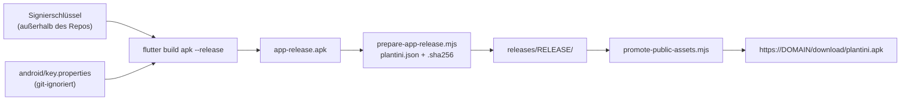

# Android-Release

Die Android-App wird als signierte APK zum Direktdownload ausgeliefert – es gibt keinen Play-Store-Eintrag. Diese Seite beschreibt Signierung, Bau, Prüfung, Veröffentlichung, Versionierung, Emulator-Test und die Einrichtung der verifizierten App Links, über die die Anmeldung in die App zurückkehrt.

!!! note "Abgrenzung"
    Der allgemeine Flutter-Build (Web, Desktop, Tests) steht in [App bauen und veröffentlichen](../app/bauen-release.md). Hier geht es um das Android-spezifische Release. Die Rückkehr-Logik im Dart-Code beschreibt [Authentifizierung in der App](../app/auth.md). Schlüsselpfade und Passwörter stehen nirgends in diesem Handbuch; sie liegen **außerhalb des Repositorys**.

## Überblick



| Eigenschaft | Wert | Quelle |
|---|---|---|
| Paket / `applicationId` | `eu.plantini.app` | `apps/flutter/android/app/build.gradle.kts` |
| Version | aus `pubspec.yaml` (`version: <Name>+<Code>`, derzeit `0.6.5+9`) | `apps/flutter/pubspec.yaml` |
| `compileSdk` | 37 | `build.gradle.kts` |
| `minSdk` / `targetSdk` | aus den Flutter-Vorgaben (`flutter.minSdkVersion`, `flutter.targetSdkVersion`); die Betriebsnotizen nennen 24 und 36 | `build.gradle.kts`; **kein fester Wert im Repo** |
| Klartext-HTTP | verboten (`android:usesCleartextTraffic="false"`) | `AndroidManifest.xml` |

## Signierschlüssel

Die Release-Signierung liest `android/key.properties`; die Datei ist git-ignoriert (`apps/flutter/android/.gitignore` führt `key.properties`, `**/*.keystore` und `**/*.jks`; das Wurzel-`.gitignore` ignoriert zusätzlich `*.jks` und `*.keystore`). `build.gradle.kts` erwartet darin die Schlüssel `storeFile`, `storePassword`, `keyAlias` und `keyPassword`:

```kotlin title="apps/flutter/android/app/build.gradle.kts"
signingConfigs {
    if (keyProperties.containsKey("storeFile")) {
        create("release") {
            storeFile = file(keyProperties.getProperty("storeFile"))
            storePassword = keyProperties.getProperty("storePassword")
            keyAlias = keyProperties.getProperty("keyAlias")
            keyPassword = keyProperties.getProperty("keyPassword")
        }
    }
}
buildTypes {
    release {
        signingConfig = if (keyProperties.containsKey("storeFile")) {
            signingConfigs.getByName("release")
        } else {
            signingConfigs.getByName("debug")
        }
    }
}
```

!!! danger "Stolperfalle: stilles Debug-Signieren"
    Fehlt `key.properties`, **fällt der Build ohne Fehlermeldung auf den Debug-Schlüssel zurück** (Kommentar in der Datei: „such an APK must never be distributed“). Das ist für `flutter run --release` bequem und für ein Release gefährlich. Prüfe jede APK vor der Veröffentlichung mit `apksigner` (siehe unten) auf das erwartete Zertifikat.

Einen Schlüssel erzeugst du einmalig mit dem JDK-Werkzeug `keytool` (Standardaufruf, nicht aus einem Repo-Skript):

```bash
keytool -genkeypair -v -keystore <pfad-außerhalb-des-repos>/release.jks \
  -alias <alias> -keyalg RSA -keysize 4096 -validity 10000
```

Anforderungen:

- Keystore und Passwörter liegen **außerhalb des Repositorys und nicht auf dem Server** und werden mehrfach gesichert (zwei getrennte Orte).
- **Geht der Schlüssel verloren, kann keine installierte App mehr aktualisiert werden**; Nutzer müssten deinstallieren. Android akzeptiert Updates nur mit demselben Signaturzertifikat.
- Der Fingerabdruck des Zertifikats gehört in `assetlinks.json` (siehe App Links) – bei einem Schlüsselwechsel muss er dort ebenfalls geändert werden.

Für einen sauberen Release-Build kopierst du `android/key.properties` und `android/local.properties` in den frischen Worktree ([Deployment](deployment.md#1-vorbereitung)).

## Bauen

```bash
cd apps/flutter
flutter build apk --release --target-platform android-arm64,android-arm,android-x64 \
  --dart-define=PLANTINI_ENV=production \
  --dart-define=PLANTINI_API_BASE_URL=https://api.<domain>/api/v1 \
  --dart-define=PLANTINI_OIDC_ISSUER_URL=https://auth.<domain>/realms/plantini \
  --dart-define=PLANTINI_OIDC_CLIENT_ID=plantini-mobile-production
```

Die vier `--dart-define`-Werte liest `AppConfig.fromDartDefines()` (`apps/flutter/lib/app/app_config.dart`). In `production` verlangt die Konfiguration HTTPS für API und Issuer, der API-Pfad muss auf `/api/v1` enden, und IPv6-Literale sind verboten – sonst bricht der Start mit einer Konfigurationsfehlermeldung ab.

!!! warning "Widerspruch in den Betriebsnotizen: zwei oder drei ABIs?"
    `knowledge/operations/android-release.md` zeigt im Beispielbefehl nur `android-arm64,android-arm`, verlangt im Text aber alle drei Engines: Die Plugins bringen auch x86_64-Bibliotheken mit; fehlt dann `libflutter.so` für x86_64, wählt Android auf x86-Geräten diese ABI und die App stürzt mit `UnsatisfiedLinkError … EM_AARCH64 instead of EM_X86_64` ab. Maßgeblich ist der Text. Daher steht oben `android-x64` im Befehl. Die erste veröffentlichte APK (alle drei ABIs) war rund 89 MB groß.

!!! danger "Stolperfalle: nie `--no-pub`"
    `flutter pub get` erzeugt `GeneratedPluginRegistrant.java` mit Dev-Plugins (etwa `integration_test`); erst `flutter build apk` **ohne** `--no-pub` erzeugt die Registrierung für das Release neu. Mit `--no-pub` passiert eines von zwei Dingen:

    1. der Build bricht ab (`package dev.flutter.plugins.integration_test does not exist`), oder
    2. nach dem Löschen der Datei entsteht eine APK **ohne registrierte Plugins**. Sie startet, zeigt aber „Plantini konnte nicht sicher gestartet werden“ (`ClassNotFoundException: io.flutter.plugins.GeneratedPluginRegistrant`, danach `PlatformException(channel-error … shared_preferences …)`).

    Genau das ist laut Betriebsnotizen bei Version 0.4.0 passiert. Lösche `GeneratedPluginRegistrant.java` nie von Hand.

Weitere Gradle-Einstellungen aus `apps/flutter/android/gradle.properties`:

- `android.suppressUnsupportedCompileSdk=37` – Android-Gradle-Plugin 9.1 empfiehlt `compileSdk` ≤ 36, zwei Plugins (`flutter_secure_storage`, `permission_handler`, laut Kommentar in `build.gradle.kts`) verlangen 37.
- `org.gradle.jvmargs=-Xmx8G …` – der Build benötigt viel Arbeitsspeicher.

## Prüfen

Prüfe die fertige APK, bevor sie den Rechner verlässt. Die Werkzeuge stammen aus den Android-Build-Tools (`$ANDROID_HOME/build-tools/<version>/`).

```bash
APK=apps/flutter/build/app/outputs/flutter-apk/app-release.apk
apksigner verify --print-certs "$APK"          # Signaturzertifikat, SHA-256 des Zertifikats
aapt2 dump badging "$APK" | head -20           # Paket, versionCode/versionName, Berechtigungen, minSdk
ls -l "$APK"                                   # Größe
```

Worauf du achtest:

| Prüfung | Erwartung |
|---|---|
| `apksigner verify` | „Verifies“; das ausgegebene Zertifikats-SHA-256 entspricht dem Release-Schlüssel (nicht dem Debug-Zertifikat) |
| `aapt2 dump badging` | `package: name='eu.plantini.app'`, `versionCode` und `versionName` wie in `pubspec.yaml`; Berechtigungen nur `INTERNET`, `ACCESS_NETWORK_STATE`, `CAMERA`, `READ_MEDIA_IMAGES` (und `READ_EXTERNAL_STORAGE` bis API 32), `ACCESS_FINE_LOCATION`, `ACCESS_COARSE_LOCATION` |
| Größe | plausibel zum Vorgänger (drei ABIs ≈ 89 MB) |

Kamera und Standort sind optional: das Manifest deklariert `uses-feature … android:required="false"` – die App läuft auch ohne.

## Metadaten und Veröffentlichung

`tools/scripts/prepare-app-release.mjs` erzeugt neben der APK zwei Dateien:

```bash
node tools/scripts/prepare-app-release.mjs apps/flutter/build/app/outputs/flutter-apk/app-release.apk
```

Aus dem Quelltext: Es liest `version:` aus `apps/flutter/pubspec.yaml` (Regex `^version:\s*(\d+\.\d+\.\d+)\+(\d+)\s*$` – ohne gültiges `Name+Code` bricht es ab), berechnet das SHA-256 der APK und schreibt neben die APK:

```json title="plantini.json (Struktur)"
{
  "versionName": "0.6.5",
  "versionCode": 9,
  "bytes": 93000000,
  "sha256": "<64 Hex-Zeichen>",
  "minAndroid": 7
}
```

und `plantini.apk.sha256` im Format `<sha256>  plantini.apk`. Beachte: `minAndroid` ist im Skript fest auf 7 gesetzt; die Zahl ist unabhängig vom `minSdk` aus Flutter und muss von dir bei Änderungen nachgezogen werden. Das Prüfsummen-Format nennt `plantini.apk` – benenne die APK also vor der Veröffentlichung in `plantini.apk` um.

Veröffentlicht wird gemeinsam mit der Web-App über `infra/production/promote-public-assets.mjs` ([Deployment](deployment.md#web-app-und-apk-veroffentlichen)); das Skript bricht ab, wenn Web-Version, `versionCode`, Größe oder SHA-256 nicht zusammenpassen, und sichert die vorigen Downloads in `previous-downloads/`. Caddy liefert `/download/*` aus dem Verzeichnis `downloads` des Servers (`infra/production/Caddyfile`):

- `*.apk` mit `Content-Type: application/vnd.android.package-archive` und `Content-Disposition: attachment; filename=plantini.apk`,
- `*.json` und `*.sha256` mit `Cache-Control: no-cache`.

Die Homepage zeigt Version, Größe und die ersten 16 Zeichen der Prüfsumme aus `/download/plantini.json` ([Homepage](homepage.md#download-hinweis)). Vergleiche nach dem Ausrollen die Prüfsumme des heruntergeladenen Pakets mit dem JSON-Feld (Befehle im [Deployment](deployment.md#smoke-checks-extern)).

!!! note "Die Betriebsnotizen beschreiben noch das manuelle Kopieren"
    `knowledge/operations/android-release.md` sagt, die APK werde „nach `…/downloads/plantini.apk` kopiert“. Für Web und APK gemeinsam ist inzwischen `promote-public-assets.mjs` der Weg; ein reines Kopieren der APK umgeht dessen Konsistenzprüfung.

## Versionierung

- Die Version steht **einmal**, in `apps/flutter/pubspec.yaml`: `version: 0.6.5+9`. Gradle übernimmt sie über `flutter.versionName` und `flutter.versionCode`; Web und `prepare-app-release.mjs` lesen dieselbe Zeile.
- `versionCode` (Teil nach `+`) muss pro APK-Release größer werden. Android installiert keine APK mit niedrigerem oder gleichem Code über eine vorhandene.
- Web-Build und APK gehören zusammen: `promote-public-assets.mjs` vergleicht `web/version.json` (`version`, `build_number`) mit `plantini.json` und lehnt abweichende Paare ab.
- Die Plattform kann eine Mindest-App-Version im Katalog-Manifest tragen (Feld `minimumAppVersion` in `services/platform/src/api/platform/services/core/content/content-service.js`); die Betriebsnotizen vermerken, dass die App dieses Minimum erzwingt. Details gehören in die Backend-Seiten.

## Anmeldung und App Links

Die Rückkehr nach dem Login auf Android (und iOS) läuft in `apps/flutter/lib/auth/auth_platform_io.dart` über drei Adressen:

| Zweck | Adresse | Wo festgelegt |
|---|---|---|
| Verifizierter App Link (Hauptweg) | `https://<domain>/app/login` | `mobileDeepLinkRedirectUri`, `AndroidManifest.xml` (Intent-Filter mit `android:autoVerify="true"`) |
| Fallback-Schema | `eu.plantini.app://oauth2redirect` | `mobileSchemeLink`, zweiter Intent-Filter |
| Desktop-Loopback | `http://127.0.0.1:4000/` | `desktopLoopbackRedirectUri` |

Ablauf auf dem Telefon: Die App öffnet die Keycloak-Anmeldeseite in einem Custom Tab (`LaunchMode.inAppBrowserView`), wartet bis zu 15 Minuten auf einen Deep Link (`app_links`) und tauscht den Code gegen Tokens. Keycloak leitet auf `https://<domain>/app/login` zurück; Android öffnet die App direkt. Wo der Browser nicht übergibt, liefert die Homepage die Seite `/app/login` (`apps/homepage/src/applink.js`), die `code`/`state` an `eu.plantini.app://oauth2redirect` weiterreicht und den Knopf „In Plantini öffnen“ zeigt – Browser erlauben den Sprung zu einem Schema nur nach einem Tipp.

Der Keycloak-Client `plantini-mobile-production` muss genau diese drei Redirect-URIs kennen (`tools/scripts/build-production-realm.mjs` setzt sie), öffentlich sein, PKCE S256 verlangen und `post.logout.redirect.uris` führen ([Identität und Keycloak](identity-keycloak.md)).

!!! warning "Widerspruch in den Betriebsnotizen: Loopback auf Android"
    Der Abschnitt „Anmeldung und Keycloak“ in `knowledge/operations/android-release.md` beschreibt noch den Loopback-Redirect `http://127.0.0.1:4000/` als Weg der Android-App. Im Code ist das nur noch der Desktop-Weg: `login(…)` ruft bei `_isPhone` (`Platform.isAndroid || Platform.isIOS`) `_loginWithDeepLink` mit dem App Link auf. Es gilt der Code.

### `assetlinks.json`

Damit Android den App Link ohne Rückfrage der App zuordnet, muss unter `https://<domain>/.well-known/assetlinks.json` eine Datei stehen, die Paket und Zertifikats-Fingerabdruck nennt. Sie liegt im Repository unter `apps/homepage/public/.well-known/assetlinks.json` und wird mit der Homepage ausgeliefert:

```json title="apps/homepage/public/.well-known/assetlinks.json (Struktur)"
[{
  "relation": ["delegate_permission/common.handle_all_urls"],
  "target": {
    "namespace": "android_app",
    "package_name": "eu.plantini.app",
    "sha256_cert_fingerprints": ["<SHA-256-Fingerabdruck>"]
  }
}]
```

Der Fingerabdruck ist das SHA-256 des **Release-Zertifikats** (aus `apksigner verify --print-certs`), als Großbuchstaben-Hex mit Doppelpunkten. `apksigner` gibt das Zertifikats-SHA-256 ohne Doppelpunkte aus; umformen lässt es sich z. B. so:

```bash
echo <hex-ohne-doppelpunkte> | tr 'a-f' 'A-F' | sed 's/../&:/g; s/:$//'
```

`apps/homepage/nginx.conf` liefert die Datei über den allgemeinen `location /`-Block aus (`Cache-Control: no-cache`). `/app/login` hat einen eigenen Block ohne Verzeichnis-Weiterleitung, damit `code` und `state` erhalten bleiben und Android die exakte URL sieht.

Prüfen auf dem Gerät oder Emulator:

```bash
adb shell pm get-app-links eu.plantini.app                      # Zeile „<domain>: verified“
adb shell pm verify-app-links --re-verify eu.plantini.app       # Neuprüfung anstoßen (Android 12+)
adb shell am start -a android.intent.action.VIEW \
  -d "https://<domain>/app/login?error=access_denied"            # öffnet die App direkt
```

Die Verifikation läuft beim Installieren; sie schlägt fehl, wenn `assetlinks.json` nicht erreichbar ist, nicht als JSON ausgeliefert wird oder der Fingerabdruck nicht zum Signaturzertifikat der installierten APK passt. Bei einer Debug-signierten APK passt er nie – ein weiterer Grund, jede APK vorher mit `apksigner` zu prüfen.

## Emulator-Test

Ein AVD mit Hardware-Beschleunigung (x86_64) reicht für Installation, Start und Anmeldung bis zur Rückkehr in die App:

```bash
emulator -avd <avd-name> -no-window -no-audio -gpu swiftshader_indirect &
adb install -r plantini.apk
adb shell am start -W -n eu.plantini.app/.MainActivity
adb logcat -d -s flutter          # Startfehler erscheinen als „Plantini bootstrap failed: …“
```

Beobachtungen aus den Betriebsnotizen (Stand der Prüfung, nicht erneut ausgeführt):

- Installation, Start bis zur Anmeldeseite, Öffnen des Custom Tabs mit der Keycloak-Seite und die Rückkehr über den verifizierten App Link funktionierten gegen die Produktion (`pm get-app-links` zeigte „verified“).
- Unter ARM-Übersetzung (`--abi arm64-v8a`) stürzt die Flutter-Engine auf x86-Emulatoren ab (SIGSEGV in der Übersetzung, kein App-Fehler). Auf ARM-Geräten wurde nicht getestet.
- Android 11+: Damit `canLaunchUrl` einen Browser findet, braucht das Manifest die `<queries>`-Abfrage für `https`-VIEW-Intents – sie steht im Manifest. Ohne sie meldet die App „Kein Browser kann die Anmeldung öffnen“.

## Nicht geprüft

- Echte Geräte (insbesondere Hersteller-Browser wie Samsung Internet oder Xiaomi) und der Fallback-Knopf auf einem Gerät.
- iOS: Das Schema ist eingetragen, einen Universal Link gibt es nicht.
- Kamera, GPS und Offline-Synchronisation auf Android.
- Kein Play-Store-Eintrag und keine Play-App-Signatur; Geräte können vor der Installation aus „unbekannten Quellen“ warnen (Play Protect).
- Eine Beobachtung zum Desktop-Weg: Der Loopback-Empfänger bindet laut Betriebsnotizen auf alle Schnittstellen statt nur `127.0.0.1` (Bibliothek `openid_client`); PKCE und `state` schützen den Ablauf.

## Weiterführend

- [Betrieb: Überblick](index.md) · [Deployment](deployment.md) · [Identität und Keycloak](identity-keycloak.md) · [Homepage](homepage.md)
- [App bauen und veröffentlichen](../app/bauen-release.md) · [Authentifizierung in der App](../app/auth.md)
- Quellen: `apps/flutter/android/app/build.gradle.kts`, `apps/flutter/android/gradle.properties`, `apps/flutter/android/app/src/main/AndroidManifest.xml`, `apps/flutter/lib/auth/auth_platform_io.dart`, `apps/flutter/lib/app/app_config.dart`, `tools/scripts/prepare-app-release.mjs`, `infra/production/promote-public-assets.mjs`, `apps/homepage/public/.well-known/assetlinks.json`
- Hintergrund: `knowledge/operations/android-release.md`
