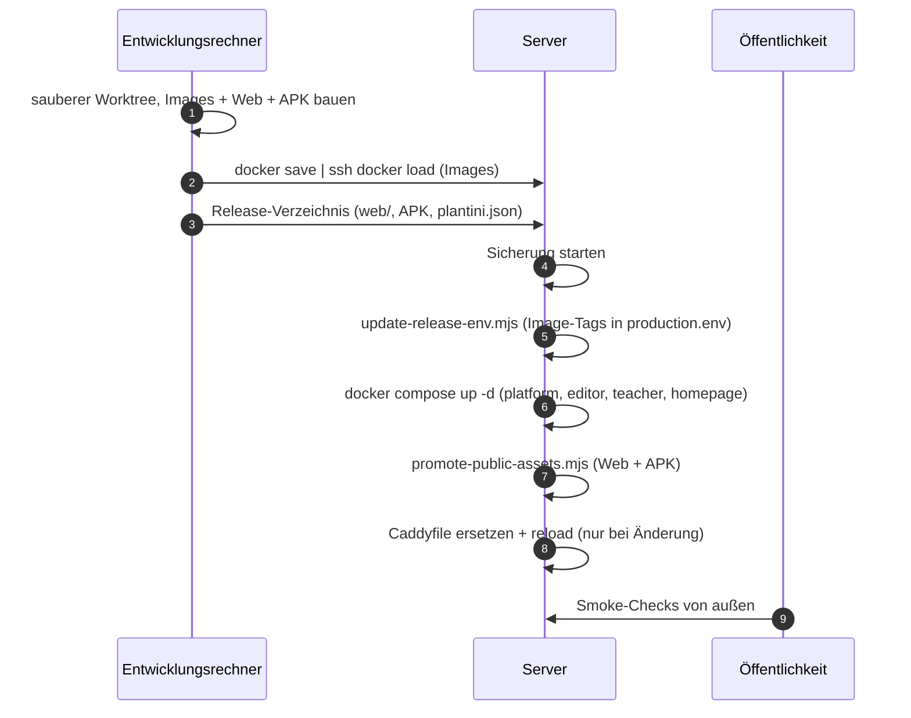

# Deployment

Ein Release besteht aus vier getrennten Teilen: Container-Images (Plattform, Studio, Portal, Homepage, selten Keycloak), dem Flutter-Web-Build, der Android-APK und der Eingangskonfiguration (Caddyfile). Es gibt keine Registry und keine CI-Pipeline für den Betrieb – alles wird auf dem Entwicklungsrechner gebaut und von dort auf den Server übertragen. Diese Seite beschreibt den Ablauf, die Rolle der beiden Hilfsskripte und das Zurückrollen.

!!! note "Hintergrund"
    Die Seite fasst `infra/`-Skripte (Code) und die Betriebsnotizen `knowledge/operations/production-stack.md` sowie das nicht öffentliche Betriebsprotokoll des Betreibers zusammen. Reale Hostnamen, Konten und Zeitpunkte sind durch Platzhalter ersetzt (`<domain>`, `<server>`, `<deploy-root>`, `<release>`). Bei Widersprüchen gilt der Code.

!!! warning "Veraltete Runbooks"
    `operations/runbooks/deployment.md` und `operations/runbooks/backup-restore.md` beschreiben einen älteren Aufbau (`infra/compose.yaml`, MinIO, Health-Pfad `/_health`, `git checkout tags/…` als Rollback). Sie passen nicht zum Produktionsstack und sind keine Grundlage für ein Deployment.

## Ablauf im Überblick



Die Reihenfolge ist eine Betriebsregel, kein technischer Zwang: Erst die API, dann Web-App und APK, die ihre Endpunkte nutzen – ein neuer Client gegen eine alte API wäre der unangenehmere Fehlerfall. Der Eingang kommt zuletzt, weil seine Änderung als einzige alle Hostnamen gleichzeitig betrifft.

## 1. Vorbereitung

- Der Stand ist committet und in der CI grün. Lokal bildet `tools/scripts/ci-check.sh` den kompletten CI-Lauf nach.
- Der Release-Bezeichner ist ein Commit-Hash: `update-release-env.mjs` akzeptiert nur Tags, die auf `/^[0-9a-f]{7,40}$/` passen.
- Die Versionsnummer in `apps/flutter/pubspec.yaml` (`version: <Name>+<Code>`) ist erhöht, wenn Web oder APK ausgeliefert werden. Der Code (Teil nach `+`) muss pro APK-Release wachsen.
- Das Serververzeichnis `<deploy-root>` existiert mit `production.env`, `realm-production.json` und einer Kopie von `infra/` (siehe [Überblick](index.md#was-liegt-wo)).

!!! tip "Sauberer Worktree"
    Baue aus einem frischen Worktree, damit keine uncommitteten Änderungen in ein Image oder die APK gelangen. Die Arbeitskopie bleibt unberührt:

    ```bash
    REL=$(git rev-parse --short HEAD)
    git worktree add ../plantini-release-$REL "$REL"
    cd ../plantini-release-$REL
    ```

    Für die Android-Signierung kopierst du anschließend `apps/flutter/android/key.properties` und `local.properties` aus deinem Arbeitsbaum dorthin (beide sind git-ignoriert, siehe [Android-Release](android-release.md)).

## 2. Images bauen

Die Tags der Anwendungsimages sind der Commit-Hash. Der Image-Name ist frei wählbar, nur muss er zu den Variablen in `production.env` passen; das Skript `update-release-env.mjs` setzt `plantini/platform:<release>`, `plantini/teacher:<release>` und `plantini/editor:<release>`.

```bash
docker build -t plantini/platform:$REL services/platform
docker build -t plantini/editor:$REL   apps/editor
docker build -t plantini/teacher:$REL  apps/teacher
docker build -t plantini/homepage:$REL \
  --build-arg PLANTINI_APP_URL=https://app.<domain> apps/homepage
# nur bei Keycloak-Versionswechsel:
docker build -t plantini/keycloak:<tag> services/identity
```

Was dabei passiert:

| Image | Dockerfile | Besonderheit |
|---|---|---|
| Plattform | `services/platform/Dockerfile` | Build-Stufe führt `npm run lint && npm run check && npm test && npm run build` aus – ein roter Test bricht den Image-Build ab. Laufzeit: Node 20.20.2, Benutzer `plantini` (UID 10001), `CMD ["npm", "run", "start"]` |
| Studio | `apps/editor/Dockerfile` | nginx-unprivileged; CSP mit festen Ursprüngen in `apps/editor/nginx.conf` |
| Portal | `apps/teacher/Dockerfile` | nginx-unprivileged; API, Issuer und Client-ID zur Laufzeit (`40-teacher-config.sh`) |
| Homepage | `apps/homepage/Dockerfile` | Vite-Build in Stufe 1, nginx-unprivileged in Stufe 2; `PLANTINI_APP_URL` wird beim Build in die HTML-Seiten eingesetzt |
| Keycloak | `services/identity/Dockerfile` | `kc.sh build` mit `KC_DB=postgres`, nötig für `start --optimized` |

!!! warning "Stolperfalle: `update-release-env.mjs` setzt alle drei Tags gemeinsam"
    Mit dem Standardumfang `all` setzt das Skript `PLATFORM_IMAGE`, `TEACHER_IMAGE` **und** `EDITOR_IMAGE` auf denselben Tag. Existiert eines der drei Images auf dem Server nicht mit diesem Tag, schlägt `up -d` beim Start dieses Dienstes fehl. Baue und übertrage deshalb immer alle drei – oder nutze den Umfang `teacher` (setzt nur `TEACHER_IMAGE`).

### Release-Overlays

Für kleine, reine Quelltext-Änderungen gibt es ein Dünn-Image auf einem bereits übertragenen Basis-Image. Es existiert für drei Komponenten:

```dockerfile title="services/platform/Dockerfile.release-overlay"
# A small, verified source-only update on an already transferred release image.
# BASE_IMAGE must be the locally inspected immutable image ID. Dependencies and
# content models must match that base; use the normal Dockerfile otherwise.
ARG BASE_IMAGE
FROM ${BASE_IMAGE}
COPY --chown=plantini:plantini src/ /opt/plantini/src/
RUN npm run lint && npm run check && npm test
```

```bash
docker build -f services/platform/Dockerfile.release-overlay \
  --build-arg BASE_IMAGE=<Image-ID-des-laufenden-Releases> \
  -t plantini/platform:$REL services/platform
```

| Overlay | Kopiert über das Basis-Image |
|---|---|
| `services/platform/Dockerfile.release-overlay` | `src/` (danach Lint, Check, Tests) |
| `apps/editor/Dockerfile.release-overlay` | `index.html`, `app.js`, `json-editor.js`, `style.css` |
| `apps/teacher/Dockerfile.release-overlay` | nur `app.js` |

Die Einschränkung steht in den Dateien selbst: Abhängigkeiten (`package.json`, `package-lock.json`) und Content-Modelle müssen mit dem Basis-Image übereinstimmen – sonst das normale Dockerfile verwenden. Das Overlay erspart den vollen `npm ci`, nicht die Prüfung. Das Basis-Image sollte nach der Image-ID (lokal geprüft), nicht nach einem veränderlichen Tag, referenziert werden.

## 3. Images ohne Registry übertragen

```bash
docker save plantini/platform:$REL plantini/editor:$REL plantini/teacher:$REL plantini/homepage:$REL \
  | ssh <admin-benutzer>@<server> docker load
```

`docker save` schreibt die Images in einen Tar-Strom, `docker load` auf dem Server liest ihn. Das ist langsam bei großen Images, aber ohne Registry-Betrieb. Prüfe danach auf dem Server mit `docker image ls plantini/platform`, dass der Tag da ist.

Konsequenz: Die Compose-Datei fordert unveränderliche Referenzen („tag plus digest“); solche Images haben aber keinen Repository-Digest. Der Betrieb nutzt deshalb Tags (siehe [Compose-Dateien](compose.md#composeproductionyaml)). Behalte die vorherigen Tags auf dem Server – sie sind dein Rollback (siehe unten).

Für die Fremd-Images (`POSTGRES_IMAGE`, `REDIS_IMAGE`, Caddy) gilt: Sie werden vom Server aus der Registry gezogen oder ebenfalls per `docker save` bereitgestellt; welche Referenzen in `production.env` stehen, entscheidest du.

## 4. Web-App und APK bauen

Die Web-App und die APK werden mit denselben `--dart-define`-Werten konfiguriert (`apps/flutter/lib/app/app_config.dart`: `PLANTINI_ENV`, `PLANTINI_API_BASE_URL`, `PLANTINI_OIDC_ISSUER_URL`, `PLANTINI_OIDC_CLIENT_ID`). Für den Betrieb verlangt `AppConfig` HTTPS bei API und Issuer und einen Pfad `/api/v1`.

```bash
cd apps/flutter
flutter pub get
flutter build web --release \
  --dart-define=PLANTINI_ENV=production \
  --dart-define=PLANTINI_API_BASE_URL=https://api.<domain>/api/v1 \
  --dart-define=PLANTINI_OIDC_ISSUER_URL=https://auth.<domain>/realms/plantini \
  --dart-define=PLANTINI_OIDC_CLIENT_ID=plantini-web-production
```

!!! note "Abgeleitet, nicht aus einem Skript"
    Für den Produktions-Web-Build gibt es im Repository kein Skript; die Werte sind aus `app_config.dart` und dem Muster in `tools/e2e/scripts/run-e2e-stack.sh` (dort mit `PLANTINI_ENV=development` und `plantini-web-dev`) abgeleitet. Prüfe sie vor dem ersten Einsatz gegen deine Realm-Datei (Client `plantini-web-production`).

Den APK-Build mit Signierung, Prüfung und den Metadaten beschreibt [Android-Release](android-release.md). Am Ende liegen vor:

- `apps/flutter/build/web/` (enthält `version.json`),
- die signierte APK, daneben `plantini.json` und `plantini.apk.sha256` (erzeugt von `node tools/scripts/prepare-app-release.mjs <apk-pfad>`).

Für `promote-public-assets.mjs` muss die APK `plantini.apk` heißen (so liest es das Skript). Lege die Release-Dateien so zusammen:

```
releases/<release>/
├── web/                 # Inhalt von apps/flutter/build/web/
├── plantini.apk
├── plantini.apk.sha256
└── plantini.json
```

und kopiere das Verzeichnis nach `<deploy-root>/releases/<release>/` (z. B. mit `rsync -a`).

## 5. Sicherung vor dem Update

```bash
sudo systemctl start plantini-backup.service
```

Der Dienst ist die Einheit aus `infra/production/plantini-backup.service` und führt `backup.sh` aus (Datenbanken, Fotos, Caddy-Zertifikate, Konfiguration). Warte, bis er fertig ist, und prüfe `systemctl status plantini-backup.service`. Einzelheiten und Grenzen: [Backup und Beobachtung](backup-monitoring.md).

## 6. `production.env` aktualisieren

`production.env` enthält alle Geheimnisse und Image-Verweise. Für den Release-Wechsel gibt es ein Skript, das nur die Image-Zeilen anfasst und **nie Inhalte ausgibt**:

```javascript title="infra/production/update-release-env.mjs"
const [file, release, scope = 'all'] = process.argv.slice(2);
if (!file || !/^[0-9a-f]{7,40}$/.test(release || '')) throw new Error('An environment path and exact commit tag are required.');
if (!['all', 'teacher'].includes(scope)) throw new Error('Release scope must be all or teacher.');
let source = await readFile(file, 'utf8');
await copyFile(file, `${file}.bak-${Date.now()}`);
```

Verhalten (aus dem Quelltext):

| Aspekt | Verhalten |
|---|---|
| Aufruf | `update-release-env.mjs <env-datei> <commit-tag> [all\|teacher]` |
| Sicherung | kopiert die Datei vor jeder Änderung nach `<env-datei>.bak-<Millisekunden>` |
| Umfang `all` | `PLATFORM_IMAGE`, `TEACHER_IMAGE`, `EDITOR_IMAGE` = `plantini/<name>:<release>`; **außerdem** `TEACHER_PUBLIC_URL` und `TEACHER_LOOPBACK_PORT=8085` mit fest im Skript stehenden Werten (Zeile 10) |
| Umfang `teacher` | nur `TEACHER_IMAGE` |
| Ersetzen/Anhängen | existierende Zeile `NAME=…` wird ersetzt, sonst eine neue Zeile angehängt |
| Rechte | schreibt mit Modus `0600` und ruft `chmod 0600` |
| Nicht angefasst | `HOMEPAGE_IMAGE`, `KEYCLOAK_IMAGE`, `POSTGRES_IMAGE`, `REDIS_IMAGE`, alle Geheimnisse |

Das Skript ist dafür gedacht, „on the host inside the existing Node image“ zu laufen, also ohne Node-Installation auf dem Host:

```bash
docker run --rm -v <deploy-root>:/workspace -w /workspace node:20.20.2-bookworm-slim \
  node infra/production/update-release-env.mjs /workspace/production.env <release>
```

(Das Image `node:20.20.2-bookworm-slim` ist das Build-Image der Homepage; jedes Node-≥20-Image genügt.)

!!! warning "Stolperfalle: feste Werte im Skript"
    In `update-release-env.mjs` stehen `TEACHER_PUBLIC_URL` (`https://portal.<Projektdomain>`) und der Port fest im Code. Mit dem Umfang `all` überschreibt das Skript deine eigene Portal-Adresse in `production.env`. Für eine fremde Instanz musst du die Zeile anpassen (Liste weiter unten) oder `teacher` bzw. Handarbeit verwenden. `HOMEPAGE_IMAGE` und `KEYCLOAK_IMAGE` musst du bei Bedarf von Hand setzen.

Die `.bak-*`-Dateien enthalten dieselben Geheimnisse wie `production.env`. Prüfe ihre Rechte und räume ältere regelmäßig weg; `backup.sh` sichert nur `production.env` selbst.

## 7. Stack aktualisieren

```bash
cd <deploy-root>
ENV=<deploy-root>/production.env
docker compose --env-file $ENV -f infra/compose.production.yaml config --quiet   # Pflichtvariablen vorhanden?
docker compose --env-file $ENV -f infra/compose.production.yaml up -d platform editor teacher homepage
docker compose --env-file $ENV -f infra/compose.production.yaml ps
```

- `up -d` erzeugt nur Container neu, deren Image oder Konfiguration sich geändert hat; Volumes bleiben unberührt (Daten, Konten und Clients bleiben erhalten).
- Beim Start der Plattform legt `bootstrap` Indizes an (`runtime.teaching.ensureIndexes()` in `services/platform/src/index.js`), und Strapi gleicht seine Content-Type-Schemata mit der Datenbank ab (Strapi-Standardverhalten); `services/platform/database/migrations/` ist leer (nur `.gitkeep`). Neue Tabellen oder Spalten entstehen also automatisch beim Start – und werden bei einem Rollback des Images **nicht** zurückgenommen.
- Der Healthcheck der Plattform hat `start_period: 40s`; warte bis `healthy`.
- **Nie** `docker compose down -v`, `docker volume rm` oder `docker system prune --volumes` auf dem Produktionsstack ausführen: Das löscht Datenbanken, Fotos und Zertifikate.

Keycloak wird nur neu erzeugt, wenn sich `KEYCLOAK_IMAGE` ändert. Der Realm-Import läuft dabei **nicht** erneut (siehe [Identität und Keycloak](identity-keycloak.md#import-nur-beim-ersten-start)).

## Web-App und APK veröffentlichen

`infra/production/promote-public-assets.mjs` veröffentlicht Web-App und APK gemeinsam. Es nimmt zwei Argumente: das Deployment-Wurzelverzeichnis und das Release-Verzeichnis (muss unterhalb `<root>/releases` liegen).

```bash
docker run --rm -v <deploy-root>:/workspace -w /workspace node:20.20.2-bookworm-slim \
  node infra/production/promote-public-assets.mjs /workspace /workspace/releases/<release>
```

Was das Skript tut, in der Reihenfolge des Quelltexts:

1. **Prüft den Pfad:** das Release-Verzeichnis muss ein Kind von `<root>/releases` sein.
2. **Prüft die Konsistenz:** `web/version.json` (`version`, `build_number`) muss zu `plantini.json` (`versionName`, `versionCode`) passen, die Größe der APK zu `bytes` und ihr SHA-256 zu `sha256`. Sonst bricht es mit `Web/APK versions or APK checksum differ.` ab. Web und APK können damit **nicht einzeln** veröffentlicht werden.
3. **Sichert die alten Downloads:** kopiert vorhandene `plantini.apk`, `plantini.json`, `plantini.apk.sha256` nach `<release>/previous-downloads/`.
4. **Kopiert das Web-Verzeichnis atomar:** jede Datei wird zuerst nach `<ziel>.release-<pid>` geschrieben und dann per `rename` an ihren Platz gestellt. Symlinks im Release führen zum Abbruch (`Public release assets must not contain symlinks.`).
5. **Kopiert Einstiegsdateien zuletzt:** `main.dart.js`, `flutter_bootstrap.js`, `flutter_service_worker.js`, `index.html` und – ganz am Ende – `version.json`. Besucher bekommen so nie eine Einstiegsdatei, deren Folgedateien noch fehlen.
6. **Veröffentlicht die Downloads** in der Reihenfolge APK, Prüfsumme, `plantini.json` (die Homepage liest zuerst die JSON-Datei).

Wichtig:

- **`WEB_ROOT` und `DOWNLOADS_DIR` müssen `<deploy-root>/web` und `<deploy-root>/downloads` sein.** Das Skript schreibt fest nach `join(root, 'web')` und `join(root, 'downloads')`, Caddy dagegen liefert, was `WEB_ROOT` und `DOWNLOADS_DIR` in `production.env` nennen (`compose.proxy.yaml`). Zeigen die Variablen woanders hin, veröffentlicht das Skript erfolgreich – und Caddy liefert weiter alte Dateien. `backup.sh` erwartet `downloads/plantini.json` ebenfalls unter `$ROOT`.
- Das Skript **kopiert in das bestehende Verzeichnis** `<root>/web`. Es ersetzt das Verzeichnis nicht (der Kommentar: „Preserve the web directory inode mounted by Caddy“) und **löscht nichts**. Alte, gehashte Dateien früherer Builds bleiben liegen.
- Caddy liefert die Einstiegsdateien mit `Cache-Control: no-cache` (`@entry`-Matcher im Caddyfile), `/download/*.json` und `*.sha256` ebenfalls; die Service-Worker-Logik der Flutter-Web-App aktualisiert den Rest.
- `web.previous` – das Vorversions-Verzeichnis, das in den Betriebsnotizen vorkommt – stammt von manuellen Rollouts und wird **nicht** von diesem Skript angelegt.

## Caddy aktualisieren

Nur nötig, wenn sich `infra/production/Caddyfile` ändert (neue Subdomain, neue Header).

```bash
cp <deploy-root>/infra/production/Caddyfile <deploy-root>/infra/production/Caddyfile.bak
cat neues-Caddyfile > <deploy-root>/infra/production/Caddyfile      # in place überschreiben
cd <deploy-root>/infra/production
docker compose --env-file <deploy-root>/production.env -f compose.proxy.yaml exec caddy \
  caddy validate --config /etc/caddy/Caddyfile
docker compose --env-file <deploy-root>/production.env -f compose.proxy.yaml exec caddy \
  caddy reload --config /etc/caddy/Caddyfile
```

!!! warning "Stolperfalle: Einzeldatei-Mount und Inode"
    `compose.proxy.yaml` bindet `./Caddyfile` als *einzelne Datei* in den Container. Ersetzt du die Datei, indem du sie löschst oder eine neue darüber verschiebst (`mv`, `cp` über einen temporären Namen, manche Editoren, `rsync` ohne `--inplace`), hängt der Container weiter an der alten Datei: Der Reload verläuft fehlerfrei, ändert aber nichts. Schreibe deshalb mit `cat … >` oder `cp` auf den bestehenden Dateinamen und prüfe danach im Container (`docker compose … exec caddy cat /etc/caddy/Caddyfile`). Dieser Befehl ist ein Standardmuster, nicht aus einem Repo-Skript.

Beim ersten Start fordert Caddy für jeden Host ein Zertifikat per ACME HTTP-01 an. Die DNS-Einträge müssen vorher auf den Host zeigen (Kommentar im `Caddyfile`).

## Smoke-Checks (extern)

Diese Prüfungen laufen von deinem Rechner gegen die öffentlichen Adressen. Die Erwartungen ergeben sich aus `infra/production/Caddyfile` und den Routen in `services/platform/src/api/platform/routes/platform.js`; für dieses Handbuch wurden sie nicht gegen eine laufende Produktion ausgeführt.

```bash
D=<domain>
curl -fsS https://api.$D/api/v1/health                                 # 200, {"status":"ok",...}
curl -s -o /dev/null -w '%{http_code}\n' https://api.$D/api/v1/me     # 401 ohne Token
curl -s -o /dev/null -w '%{http_code}\n' https://api.$D/admin         # 404 (nicht durchgereicht)
curl -s -o /dev/null -w '%{http_code}\n' https://api.$D/api/auth/local/register   # 404
curl -fsS https://auth.$D/realms/plantini/.well-known/openid-configuration | head -c 300
curl -s -o /dev/null -w '%{http_code}\n' https://auth.$D/admin/       # 404
curl -s -o /dev/null -w '%{http_code}\n' https://auth.$D/realms/master/   # 404
curl -fsS https://app.$D/healthz                                       # ok
curl -fsS https://app.$D/version.json                                  # Version und build_number
curl -fsS https://$D/healthz                                           # ok (Homepage-Container)
curl -fsS https://studio.$D/healthz; curl -fsS https://portal.$D/healthz   # ok
curl -fsS https://$D/download/plantini.json                            # versionName, versionCode, bytes, sha256
curl -fsS https://$D/.well-known/assetlinks.json | head -c 200
```

APK gegen die Metadaten prüfen:

```bash
curl -fsSL https://$D/download/plantini.apk | sha256sum
curl -fsS  https://$D/download/plantini.json     # Feld "sha256" muss übereinstimmen
```

CORS (nur die konfigurierten Ursprünge dürfen Antworten lesen):

```bash
curl -s -D - -o /dev/null -H "Origin: https://app.$D"     https://api.$D/api/v1/health | grep -i '^access-control-allow-origin'
curl -s -D - -o /dev/null -H "Origin: https://example.org" https://api.$D/api/v1/health | grep -i '^access-control-allow-origin'   # erwartet: keine Zeile
```

Zusätzlich im Browser: Login auf `app.<domain>` bis zur Katalogansicht, Anmeldung am Studio und am Portal (mit Konten, die deine Rollen tragen). Dazu eine echte Registrierung mit Wegwerfkonto samt Bestätigungsmail (die Selbstregistrierung ist an, `registrationAllowed = true` in `tools/scripts/build-production-realm.mjs`); das Konto danach löschen.

## Rollback

| Teil | Vorgehen | Grenze |
|---|---|---|
| Anwendungs-Images | Alte Tags sind noch auf dem Server geladen. Die gesicherte Datei `production.env.bak-<ms>` zurückkopieren (`cp … production.env`, `chmod 600`), dann `docker compose … up -d platform editor teacher` | Schemaänderungen, die der neue Plattformstart schon angelegt hat, bleiben bestehen. Sind sie inkompatibel: Datenbank aus der Sicherung vor dem Update wiederherstellen ([Backup und Beobachtung](backup-monitoring.md#wiederherstellung)) |
| Web-App | `promote-public-assets.mjs` mit dem Release-Verzeichnis der **früheren** Version erneut ausführen (jedes Release-Verzeichnis ist in sich konsistent: `web/`, APK, JSON) | Das Skript löscht keine Dateien: neue gehashte Dateien bleiben liegen, schaden aber nicht, weil `index.html` und `version.json` wieder auf die alten verweisen |
| APK | wie Web-App; die vorigen Dateien liegen zusätzlich in `<release>/previous-downloads/` | Schon installierte Geräte werden nicht zurückgesetzt – `versionCode` darf nicht sinken, sonst installiert Android die ältere APK nicht über die neuere |
| Caddyfile | `Caddyfile.bak` in place zurückschreiben (`cat Caddyfile.bak > Caddyfile`), dann reload | – |
| Keycloak-Realm | nicht „zurückrollbar“ per Import; Änderungen live rückgängig machen oder aus der Datenbank-Sicherung zurückspielen | Der Import läuft nur beim ersten Start |

Ein Rollback ändert keine Daten. Genau deshalb steht die Sicherung (Schritt 5) vor dem Update.

## Eigene Instanz: fest verdrahtete Werte

Der Betrieb ist für eine Domain geschrieben. Wer eine eigene Instanz aufsetzt, muss die Projektdomain (Hostnamen der Produktion) an diesen Stellen ersetzen. Die Liste stammt aus einer Suche im Quelltext (ohne `knowledge/`, `operations/`, Tests):

| Datei (Zeile) | Was dort steht | Was du tust |
|---|---|---|
| `infra/production/update-release-env.mjs:10` | `TEACHER_PUBLIC_URL`, `TEACHER_LOOPBACK_PORT` | auf deine Portal-Adresse ändern |
| `tools/scripts/build-production-realm.mjs:66` | Mobile-Redirect `https://<Projektdomain>/app/login` | auf `https://<domain>/app/login` setzen |
| `tools/scripts/configure-managed-accounts.mjs:12` | erlaubter Portal-Ursprung (Produktion) | auf `https://portal.<domain>` ändern |
| `tools/scripts/verify-teacher-production.mjs:56-58,118,125-126` | Prüft Produktionsursprünge | nur relevant, wenn du dieses Prüfskript nutzt |
| `apps/flutter/lib/auth/auth_platform_io.dart:23` | `mobileDeepLinkRedirectUri` | auf `https://<domain>/app/login` setzen |
| `apps/flutter/android/app/src/main/AndroidManifest.xml:49` | Intent-Filter `android:host` für den App Link | auf `<domain>` setzen |
| `services/identity/realm/plantini-realm.json:893` | Redirect im Dev-Client `plantini-mobile-dev` | anpassen, falls du Dev-Client und App Link testest |
| `apps/editor/nginx.conf:12` | CSP `connect-src`, `img-src`, `form-action` mit API- und Auth-Host | Image mit deinen Hostnamen neu bauen |
| `apps/teacher/Dockerfile:9-10`, `apps/teacher/40-teacher-config.sh:4-5`, `apps/teacher/config.json` | Standardwerte; im Betrieb von Compose überschrieben | nur Standardwerte, im Betrieb setzt `PLANTINI_*` im Compose-File sie |
| `apps/homepage/Dockerfile:7`, `apps/homepage/vite.config.js:5` | Standard für `PLANTINI_APP_URL` | per `--build-arg PLANTINI_APP_URL=…` überschreiben |
| `apps/homepage/index.html:12`, `apps/homepage/app/login/index.html:8` | `og:url`, Link zur Web-App | im HTML ersetzen |
| `apps/homepage/scripts/snapshot-content.mjs:9,22` | Standard-API-Ursprung | als Argument übergeben |
| `apps/homepage/public/.well-known/assetlinks.json` | Paketname und Signatur-Fingerabdruck | Fingerabdruck deines Release-Schlüssels eintragen |
| `apps/homepage/impressum/`, `datenschutz/` | Angaben zum Betreiber | durch deine eigenen Angaben ersetzen |
| `services/platform/src/api/platform/services/core/content/tile-proxy.js:19` | User-Agent der Kartenkachel-Abfragen | an dein Projekt anpassen (Nutzungsrichtlinien der Kachelquelle) |

Gut zu wissen: Das `Caddyfile` selbst ist **nicht** fest verdrahtet – es liest `{$PLANTINI_DOMAIN}` und `{$ACME_EMAIL}`. Die Plattform bekommt alle Adressen über `*_PUBLIC_URL` aus `production.env`.

## Checkliste „Release ausrollen“

Vorher

- [ ] Stand committet, CI grün (`tools/scripts/ci-check.sh` lokal bestanden)
- [ ] Release-Hash `REL` festgelegt, sauberer Worktree erstellt
- [ ] Versionsnummer und Code in `apps/flutter/pubspec.yaml` erhöht (bei Web/APK)
- [ ] Plattform-, Studio- und Portal-Image gebaut; Homepage/Keycloak nur bei Änderung
- [ ] Web-Build (`flutter build web --release …`) und signierte APK erstellt, `prepare-app-release.mjs` ausgeführt
- [ ] APK mit `apksigner verify` und `aapt2 dump badging` geprüft ([Android-Release](android-release.md))

Übertragen

- [ ] Images per `docker save | ssh <admin-benutzer>@<server> docker load` geladen, Tags geprüft
- [ ] `releases/<release>/` (`web/`, `plantini.apk`, `plantini.apk.sha256`, `plantini.json`) auf den Server kopiert
- [ ] Sicherung gestartet und erfolgreich (`plantini-backup.service`)

Ausrollen

- [ ] `update-release-env.mjs` ausgeführt; `.bak-*`-Datei vorhanden; `HOMEPAGE_IMAGE`/`KEYCLOAK_IMAGE` bei Bedarf von Hand gesetzt
- [ ] `docker compose … config --quiet` fehlerfrei
- [ ] `docker compose … up -d platform editor teacher homepage`, alle Dienste `healthy`
- [ ] `promote-public-assets.mjs` ohne Fehler (Web und APK konsistent)
- [ ] Caddyfile nur bei Änderung: in place ersetzt, `validate` und `reload` ausgeführt

Nachher

- [ ] Smoke-Checks von außen (API-Health, `/me` 401, `/admin` 404, Issuer, App, Homepage, Studio, Portal)
- [ ] APK-Prüfsumme aus dem Download entspricht `plantini.json`
- [ ] Anmeldung in Web-App, Studio und Portal getestet
- [ ] Worktree entfernt (`git worktree remove ../plantini-release-$REL`)
- [ ] Ergebnis und Release-Hash im Betriebsprotokoll festgehalten (`knowledge/operations/production-stack.md` ist der bisherige Ort)

## Weiterführend

- [Betrieb: Überblick](index.md) · [Compose-Dateien](compose.md) · [Identität und Keycloak](identity-keycloak.md)
- [Backup und Beobachtung](backup-monitoring.md) · [Android-Release](android-release.md) · [Projekt-Homepage](homepage.md)
- [App bauen und veröffentlichen](../app/bauen-release.md)
- Quellen: `infra/production/update-release-env.mjs`, `infra/production/promote-public-assets.mjs`, `infra/production/compose.proxy.yaml`, `infra/production/Caddyfile`, `services/platform/Dockerfile`, `services/platform/Dockerfile.release-overlay`, `apps/editor/Dockerfile.release-overlay`, `apps/teacher/Dockerfile.release-overlay`, `tools/scripts/prepare-app-release.mjs`
- Hintergrund: `knowledge/operations/production-stack.md`, `operations/runbooks/backup-restore.md`
