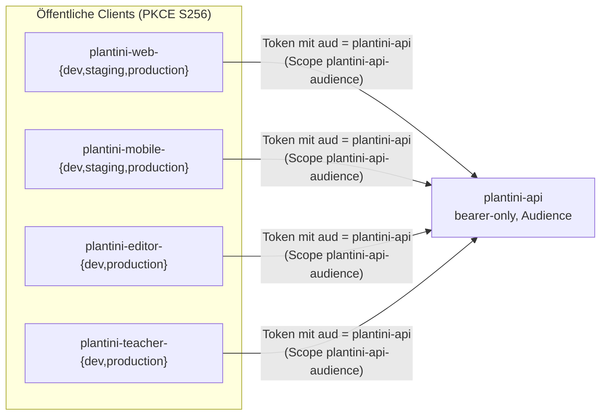

# Identität und Keycloak

Plantini nutzt Keycloak (Version 24.0.4) als einzigen Identitätsanbieter: ein Realm `plantini`, öffentliche PKCE-Clients für Web-App, Android-App, Studio und Portal, eine Ressource `plantini-api` für die Fach-API. Diese Seite erklärt die versionierte Realm-Quelle, warum Produktionsclients im Repo deaktiviert sind, wie du daraus einen Produktions-Realm erzeugst, wie du in einem **laufenden** Realm Clients anlegst, und wie SMTP, TOTP-Pflicht und verwaltete Konten eingerichtet werden.

!!! note "Abgrenzung"
    Der Client-Teil (Rückkehrwege, Token-Speicherung in der App) steht in [Authentifizierung in der App](../app/auth.md). Hier geht es um Realm und Betrieb. Die Platzhalter `<domain>` und `<admin-benutzer>` stehen für deine eigene Domain und einen Keycloak-Administrator.

## Dateien und Werkzeuge

| Pfad | Rolle |
|---|---|
| `services/identity/realm/plantini-realm.json` | versionierte Realm-Quelle (Entwicklung), ohne Benutzer und Geheimnisse |
| `services/identity/Dockerfile` | Keycloak-Image mit eingebackenen Build-Optionen für `start --optimized` |
| `services/identity/scripts/sanitize-realm-export.mjs` | entfernt Benutzer, Schlüsselmaterial und Geheimnisse aus einem Realm-Export |
| `services/identity/scripts/validate-realm-security.mjs` | Sicherheitsprüfung des Realms (Entwicklung, Staging, Produktion) |
| `services/identity/test/realm-security.test.mjs` | Tests für Validator und Sanitizer |
| `tools/scripts/build-production-realm.mjs` | erzeugt aus der Quelle die Produktions-Realm-Datei |
| `tools/scripts/configure-managed-accounts.mjs` | Portalclient und Verwaltungs-Servicekonto in einem laufenden Realm |
| `tools/scripts/configure-local-editor.mjs` | **nur lokal**: Studio-Client und Testkonten im E2E-Keycloak |
| `infra/production/configure-smtp.sh` | SMTP-Zugangsdaten in den laufenden Realm schreiben |
| `infra/scripts/keycloak-bootstrap-e2e.sh` | synthetischer Lerner im E2E-Keycloak |

## Die Realm-Quelle

`plantini-realm.json` ist eine bereinigte Keycloak-Realm-Darstellung (Version `24.0.4`). Wichtige Einstellungen, wie sie in der Datei stehen und vom Validator erzwungen werden:

| Bereich | Wert |
|---|---|
| Realm-Name | `plantini` |
| Signatur | `RS256` (`defaultSignatureAlgorithm`) |
| Selbstregistrierung | **an** (`registrationAllowed: true`, seit 10.11.2026 wieder öffentlich); E-Mail-Bestätigung (`verifyEmail`) und Passwort-Reset an. Der Validator verlangt alle drei zusammen. |
| Passwortrichtlinie | `length(14) and notUsername and notEmail and passwordHistory(5)` |
| Brute-Force-Schutz | an, `failureFactor` 5, `maxTemporaryLockouts` 5, kein permanentes Sperren |
| Token | Access-Token 300 s, SSO-Leerlauf 1800 s, SSO maximal 28800 s, Refresh-Token-Rotation (`revokeRefreshToken: true`) |
| Offline-Sitzungen | begrenzt auf 30 Tage (`offlineSessionMaxLifespan: 2592000`) |
| Ereignisse | Benutzer- und Admin-Ereignisse an, **ohne** Details, Aufbewahrung genau 90 Tage (`eventsExpiration: 7776000`), kein Ereignis-Listener |
| Anmeldename | E-Mail-Adresse (`registrationEmailAsUsername: true`, `loginWithEmailAllowed: true`) |
| Sprachen | Deutsch (Standard) und Englisch |
| SMTP (Quelle) | `mailpit:1025` – nur für lokale Stacks |

Der Realm enthält keine Benutzer (`users: []`), keine Identity-Provider und keine generierten Schlüssel (`org.keycloak.keys.KeyProvider`) – Keycloak erzeugt Signaturschlüssel beim Import. Der Validator meldet jeden Verstoß.

### Rollen

Sieben fachliche Realm-Rollen (Namen sind Deutsch und Teil des Vertrags):

| Rolle | Bedeutung | Wo sie im Token ankommt |
|---|---|---|
| `lernende` | Standardrolle (einzige Rolle in `default-roles-plantini`) | Fallback der Plattform |
| `lehrende` | Klassen und verwaltete Schülerkonten | Client `plantini-teacher-*` |
| `inhaltsredaktion` | Inhalte im Studio entwerfen | Client `plantini-editor-*` |
| `botanisches_review` | fachliche Freigabe | Client `plantini-editor-*` |
| `organisationsadministration` | reserviert, TOTP-Pflicht | – |
| `systemadministration` | volle Administration, TOTP-Pflicht | Studio und Portal |
| `forschende` | „Zugriff ausschliesslich ueber serverseitig freigegebene Forschungsprojekte“ | – |

Die Plattform liest Rollen aus `realm_access.roles` (und optional `resource_access.<client>.roles`, wenn `PLATFORM_OIDC_ROLE_CLIENT_ID` gesetzt ist) und ignoriert alles außerhalb der Liste `ALLOWED_ROLES` in `services/platform/src/api/platform/services/core/auth/actor-service.js`. **Fehlt jede bekannte Rolle im Token, gilt `['lernende']`.** Das ist Absicht – und Grundlage dafür, dass die Web- und Mobile-Clients keine Rollen brauchen.

### Clients



| Client-ID | Zweck | Dev | Staging | Produktion |
|---|---|---|---|---|
| `plantini-web-*` | Flutter-Web-App | aktiv (`http://127.0.0.1:3000/…`) | deaktiviert | deaktiviert → vom Skript aktiviert |
| `plantini-mobile-*` | Android (und Desktop) | aktiv | deaktiviert | deaktiviert → vom Skript aktiviert |
| `plantini-editor-*` | Studio | aktiv (`http://127.0.0.1:8084/`) | – | deaktiviert → vom Skript aktiviert |
| `plantini-teacher-*` | Portal | aktiv (`http://127.0.0.1:8085/`) | – | deaktiviert → vom Skript aktiviert |
| `plantini-api` | Ressourcenserver (Zielgruppe der Tokens) | – | – | `bearerOnly`, ohne Redirects |
| `plantini-flutter` | Altclient aus der Zeit mit Wildcard-Redirects | muss deaktiviert bleiben | | |
| `plantini-account-manager` | Servicekonto für Kontoverwaltung | **nicht im Realm**; wird live angelegt (siehe unten) | | |

Außerdem sind die Keycloak-Standardclients enthalten (`account`, `account-console`, `admin-cli`, `broker`, `realm-management`, `security-admin-console`).

!!! info "Wo die Client-IDs im Code stehen"
    Die Plattform erwartet `plantini-editor-production` und `plantini-teacher-production` als feste Werte im Compose-File (`PLATFORM_EDITOR_OIDC_CLIENT_ID`, `PLATFORM_TEACHER_OIDC_CLIENT_ID`). Die Web-App bekommt die Client-ID per `--dart-define=PLANTINI_OIDC_CLIENT_ID`.

### Sollzustand eines App-Clients

Das ist die Prüfliste, die `validateAppClient` in `validate-realm-security.mjs` für jeden der zehn App-Clients durchsetzt – und dein Maßstab für jeden neuen Client:

- [ ] öffentlicher Client mit Standard-Flow (Authorization Code): `publicClient`, nicht `bearerOnly`, `standardFlowEnabled`
- [ ] **kein** Implicit Flow, **keine** Direct Access Grants, `fullScopeAllowed: false`
- [ ] PKCE erzwungen: Attribut `pkce.code.challenge.method = S256`
- [ ] Standard-Scopes enthalten `roles` **und** `plantini-api-audience`
- [ ] Redirect-URIs und Web-Origins sind exakte Adressen – kein `*`, kein `+`
- [ ] `post.logout.redirect.uris` ist gesetzt (sonst scheitert der Abmelde-Rücksprung)

Zusätzlich verlangt der Validator `plantini-api` als aktiven, `bearerOnly`-Client ohne Redirects und ohne `fullScopeAllowed`.

### Warum `fullScopeAllowed: false` – und was das für neue Clients heißt

Mit `fullScopeAllowed: true` würde der Client alle Rollen des Benutzers im Token erhalten. Plantini schaltet das ab: Ein Client sieht nur Rollen, die ihm per **Scope-Mapping** zugewiesen sind. Im Realm stehen deshalb (`scopeMappings`):

```json title="services/identity/realm/plantini-realm.json (Auszug, sinngemäß)"
{ "client": "plantini-editor-production", "roles": ["inhaltsredaktion", "botanisches_review", "systemadministration"] }
{ "client": "plantini-teacher-production", "roles": ["lehrende", "systemadministration"] }
```

Web- und Mobile-Clients haben kein Scope-Mapping: Ihre Tokens enthalten keine fachlichen Rollen, die Plattform behandelt sie als `lernende`. Wer in der Web-App Studio-Funktionen hätte, würde sie vom Server nicht bekommen – eine Rechteausweitung über einen Client ist so ausgeschlossen. Der Validator prüft die Mappings für Studio und Portal (`editor roles must be visible in access tokens`).

Der zweite Scope, `plantini-api-audience`, fügt per Audience-Mapper `plantini-api` in `aud` ein. Die Plattform lehnt Tokens ohne diese Zielgruppe ab (`claims.aud` muss `PLATFORM_OIDC_AUDIENCE` enthalten, `jwt-validator.js`).

## Produktions-Realm erzeugen

Die Quelle ist für lokale Entwicklung gebaut. Alle sechs Clients für Staging und Produktion sind dort **deaktiviert und ohne Redirects**:

```json title="services/identity/realm/plantini-realm.json (Prinzip)"
{ "clientId": "plantini-web-production", "enabled": false, "redirectUris": [], "webOrigins": [] }
```

Das ist Absicht: Ein Produktionsclient darf erst aktiv sein, wenn die exakten HTTPS-Adressen festgelegt sind. Der Validator erzwingt im Nicht-Produktionsmodus „must remain disabled without an approved exact origin“. Das Skript `tools/scripts/build-production-realm.mjs` setzt diese Adressen und schaltet die Clients ein:

```bash
node tools/scripts/build-production-realm.mjs \
  https://app.<domain> <smtp-host> <smtp-port> <smtp-benutzer> realm-production.json
```

Was es tut (Quelltext):

| Schritt | Wirkung |
|---|---|
| Realm | `sslRequired = 'all'`, `registrationAllowed = true`, `verifyEmail = true`, `resetPasswordAllowed = true` |
| SMTP | `smtpServer` mit Host, Port, `from`/`user` = Benutzer, `ssl: 'true'`, `starttls: 'false'`, `auth: 'true'` – **ohne Passwort** |
| `plantini-web-production` | aktiv; Redirects `<origin>/`, `<origin>/auth/callback`, `<origin>/auth/logout-callback`; Web-Origin; Post-Logout-URI |
| `plantini-editor-production` | aktiv; Origin `studio.<domain>` (aus dem Argument abgeleitet: `app.` entfernt, `studio.` vorangestellt) |
| `plantini-teacher-production` | aktiv; Origin `portal.<domain>` (analog) |
| `plantini-mobile-production` | aktiv; Redirects `http://127.0.0.1:4000/`, App-Link-URL (fest im Skript, Zeile 66), `eu.plantini.app://oauth2redirect` |

Das erste Argument muss mit `https://` beginnen und eine Adresse der Form `app.<domain>` sein, damit die Ableitung für Studio und Portal stimmt.

!!! warning "Stolperfalle: Mobile-Redirect ist fest verdrahtet"
    Die App-Link-URL für `plantini-mobile-production` steht als Konstante im Skript (`build-production-realm.mjs:66`), nicht als Argument. Für eine eigene Domain musst du sie – wie im Manifest und in `auth_platform_io.dart` – ändern (Liste in [Deployment](deployment.md#eigene-instanz-fest-verdrahtete-werte)).

Prüfe das Ergebnis, bevor du es verwendest:

```bash
node services/identity/scripts/validate-realm-security.mjs realm-production.json --environment=production
# Realm security validation passed (production).
```

!!! warning "Stolperfalle: gegen die richtige Datei validieren"
    Die Betriebsnotizen behaupten, die Produktionsprüfung widerspreche sich selbst (Web-Client „muss deaktiviert bleiben“ gegenüber „muss aktiv sein“). Im aktuellen Code gilt das nicht mehr: `validate-realm-security.mjs` erzwingt „deaktiviert“ nur außerhalb von `--environment=production` (`if (environment !== 'production' && DISABLED_UNTIL_APPROVED.has(clientId))`). Ein mit `build-production-realm.mjs` erzeugter Realm besteht die Produktionsprüfung (mit Beispielwerten nachgeprüft). Umgekehrt scheitert die **versionierte Quelle** mit `--environment=production` absichtlich an sechs Punkten (`sslRequired`, SMTP und vier deaktivierte Clients) – die Vorprüfung in `knowledge/operations/production-stack.md` zeigt auf diese Datei und ist deshalb irreführend.

Die Produktionsprüfung (`validateProductionPromotion`) verlangt zusätzlich: `sslRequired = all`, kein Mailpit-SMTP, alle vier Produktionsclients aktiv mit Redirects, Web-/Studio-/Portal-Redirects ausschließlich `https://`.

### Import nur beim ersten Start

```yaml title="infra/compose.production.yaml"
# --import-realm only creates the realm when it does not exist yet.
command: ["start", "--optimized", "--import-realm"]
```

Das hat drei Folgen, die oft übersehen werden:

1. Änderungen an `realm-production.json` (neuer Client, neue Redirect-URI) haben auf einer bestehenden Instanz **keine Wirkung**. Das Verzeichnis `data/import` wird nur gelesen, wenn der Realm fehlt.
2. Konten, Clients und Einstellungen leben in der Datenbank `postgres-keycloak`. Sie überleben Image-Wechsel und `up -d`; sie gehen mit dem Volume `keycloak-db` verloren (siehe [Backup und Beobachtung](backup-monitoring.md)).
3. Änderungen im laufenden Betrieb erfolgen über die Admin-API oder `kcadm` – entweder von Hand oder mit Skripten wie `configure-managed-accounts.mjs` und `configure-smtp.sh`. Pflege dann auch die Quelldatei, damit ein frisches Setup denselben Stand erreicht.

Anders in den lokalen Stacks: `compose.e2e.yaml` importiert beim ersten Start des frischen Volumes ebenfalls nur einmal; `stack:up` löscht die Volumes vorher.

## Neuen Client live anlegen

Ein neuer Dienst (etwa ein weiteres Frontend) braucht einen Client im **laufenden** Realm. Das Repo enthält kein `kcadm`-Skript dafür; die geprüfte Vorlage ist die REST-Folge in `tools/scripts/configure-managed-accounts.mjs` (Portalclient) und `tools/scripts/configure-local-editor.mjs` (Studio-Client, lokal). Beide machen dasselbe:

| # | Aufruf (Admin-API des Realms `plantini`) | Zweck |
|---|---|---|
| 1 | `POST /realms/master/protocol/openid-connect/token` (`grant_type=password`, `client_id=admin-cli`) | Admin-Token holen |
| 2 | `GET /admin/realms/plantini/clients?clientId=<id>` | vorhanden? |
| 3 | `POST /clients` bzw. `PUT /clients/<uuid>` mit der Client-Definition (aus dem Realm-Template) | Client anlegen/aktualisieren |
| 4 | `PUT /clients/<uuid>/default-client-scopes/<scope-uuid>` für `roles` und `plantini-api-audience` | Standard-Scopes |
| 5 | `POST /clients/<uuid>/scope-mappings/realm` mit `[{ id, name }]` der erlaubten Rollen | Scope-Mapping |

Die Skripte laden die Definition aus dem Realm-Template (`realm.clients.find(…)`) und überschreiben nur Ursprung, Redirect und Post-Logout-URI:

```javascript title="tools/scripts/configure-managed-accounts.mjs"
const definition = { ...template, enabled: true, redirectUris: [`${origin.origin}/`], webOrigins: [origin.origin], attributes: { ...template.attributes, 'post.logout.redirect.uris': `${origin.origin}/` } };
if (clients[0]) await admin(`/clients/${clients[0].id}`, { method: 'PUT', body: { ...clients[0], ...definition } });
else await admin('/clients', { method: 'POST', body: definition });
```

Wichtig: Das Template trägt PKCE (`pkce.code.challenge.method = S256`), `fullScopeAllowed: false` und die Standard-Scopes mit; wer einen Client **ohne** Template von Hand anlegt, vergisst sie leicht. Die Betriebsnotizen halten fest, dass ein live angelegter Mobile-Client früher ohne PKCE-Methode und ohne `post.logout.redirect.uris` lief – beides wurde nachträglich ergänzt.

### Mit `kcadm` im Container

Wer ohne Node auskommen will, kann `kcadm` im Keycloak-Container verwenden – so wie `infra/production/configure-smtp.sh` es für den Realm tut (`kcadm.sh config credentials` gegen `http://127.0.0.1:8080`, dann `update realms/plantini`).

!!! warning "Nicht gegen eine laufende Instanz geprüft"
    Das Repository enthält kein Skript, das Clients mit `kcadm` anlegt. Die folgende Folge ist ein **Muster**, abgeleitet aus den REST-Aufrufen oben und den `kcadm`-Aufrufen in `configure-smtp.sh` und `infra/scripts/keycloak-bootstrap-e2e.sh`. Prüfe jede Zeile gegen deine Keycloak-Version, bevor du sie produktiv nutzt.

```bash
# Auf dem Server, interaktiv im Keycloak-Container:
docker compose --env-file <deploy-root>/production.env \
  -f <deploy-root>/infra/compose.production.yaml exec keycloak bash

KCADM=/opt/keycloak/bin/kcadm.sh
$KCADM config credentials --server http://127.0.0.1:8080 --realm master --user <admin-benutzer>
# (das Passwort wird abgefragt)

$KCADM create clients -r plantini \
  -s clientId=plantini-<name>-production -s publicClient=true \
  -s standardFlowEnabled=true -s implicitFlowEnabled=false \
  -s directAccessGrantsEnabled=false -s fullScopeAllowed=false \
  -s 'redirectUris=["https://<name>.<domain>/"]' \
  -s 'webOrigins=["https://<name>.<domain>"]' \
  -s 'attributes."pkce.code.challenge.method"=S256' \
  -s 'attributes."post.logout.redirect.uris"=https://<name>.<domain>/'

CID=$($KCADM get clients -r plantini -q clientId=plantini-<name>-production --fields id --format csv --noquotes)
SID_ROLES=$($KCADM get client-scopes -r plantini --fields id,name --format csv --noquotes | grep ',roles$' | cut -d, -f1)
SID_AUD=$($KCADM get client-scopes -r plantini --fields id,name --format csv --noquotes | grep ',plantini-api-audience$' | cut -d, -f1)
$KCADM update clients/$CID/default-client-scopes/$SID_ROLES -r plantini -n
$KCADM update clients/$CID/default-client-scopes/$SID_AUD   -r plantini -n
```

Für Clients, die fachliche Rollen im Token brauchen, kommt das Scope-Mapping hinzu (`POST /clients/<uuid>/scope-mappings/realm`, siehe Tabelle). Danach lässt du den Client vom Validator prüfen, indem du ihn in die Quelldatei übernimmst und `validate-realm-security.mjs` laufen lässt – und trägst die neue Client-ID in `APP_CLIENTS` ein, wenn er dauerhaft zum Realm gehört.

Zum Abschluss prüfst du von außen: Die Anmeldeseite mit der neuen `redirect_uri` muss erscheinen, eine fremde `redirect_uri` darf keine Anmeldung ermöglichen.

## Verwaltete Konten

`tools/scripts/configure-managed-accounts.mjs` ergänzt einen **bestehenden** Realm (deklarativ, mehrfach ausführbar) um alles, was das Lehrendenportal braucht:

```bash
node tools/scripts/configure-managed-accounts.mjs <env-datei> https://portal.<domain>
```

Argumente und Voraussetzungen aus dem Quelltext:

- `<env-datei>` ist die geschützte Umgebungsdatei (`production.env`). Das Skript liest daraus `KEYCLOAK_ADMIN_USERNAME` und `KEYCLOAK_ADMIN_PASSWORD` (lokal `E2E_KEYCLOAK_ADMIN_*`), meldet sich per `admin-cli` am **Loopback** `http://127.0.0.1:8082` an und schreibt Ergebnisse in dieselbe Datei zurück (Modus `0600`). Es muss also auf dem Server laufen (oder in einem Container mit `--network host`).
- Das zweite Argument ist der Portal-Ursprung. Im Skript sind nur `http://127.0.0.1:8085` (Entwicklung) und die Produktions-Portaladresse erlaubt; für eine eigene Domain ändere die Prüfung in Zeile 12.

Das Skript führt der Reihe nach aus:

| Schritt | Ergebnis |
|---|---|
| Portalclient anlegen/aktualisieren | aus dem Template `plantini-teacher-{dev,production}`, Redirect = Portal-Ursprung + `/` |
| Standard-Scopes | `roles`, `plantini-api-audience` |
| Scope-Mapping | `lehrende`, `systemadministration` |
| Client `plantini-account-manager` | vertraulich (`publicClient: false`), nur Servicekonto (`serviceAccountsEnabled`), Standard-Flow, Implicit und Direct Grants aus, `fullScopeAllowed: false` |
| Servicekonto-Rollen | `realm-management`: `manage-users`, `view-users`, `query-users`, `view-realm` (Rollenzuweisung **und** Scope-Mapping) |
| User-Profil | E-Mail, Vor- und Nachname nicht mehr Pflicht; neues Attribut `plantini_managed_student` (nur Admins sehen/ändern es) |
| Realm | `registrationAllowed: true`, `registrationEmailAsUsername: false` (Anmeldename ≠ E-Mail, weil Schülerkonten keine E-Mail brauchen) |
| Umgebungsdatei | `PLATFORM_KEYCLOAK_ADMIN_CLIENT_ID`, `PLATFORM_KEYCLOAK_ADMIN_CLIENT_SECRET`, `TEACHER_PUBLIC_URL` |

Danach startest du `platform` neu (`up -d platform`), damit die Variablen wirken. Ohne sie bleiben Einladungen und verwaltete Schülerkonten abgeschaltet.

!!! note "Vier Rollen statt drei"
    `infra/production.env.example` nennt für das Servicekonto drei Rollen (`view-users`, `manage-users`, `view-realm`). Das Skript vergibt vier, zusätzlich `query-users`. Maßgeblich ist das Skript.

Fachliche Hintergründe zu Rollen, Klassen und Audit stehen in [Portal-Technik](../studio/portal-technik.md). Die Anwendungssicht auf das Servicekonto – die Plattform greift über `http://keycloak:8080` im internen `app`-Netz auf die Admin-API zu (`PLATFORM_KEYCLOAK_ADMIN_BASE_URL`) – steht in [Compose-Dateien](compose.md#platform).

### Offene Registrierung neben verwalteten Konten

Seit 10.11.2026 ist die Selbstregistrierung wieder offen; die vom Portal angelegten Schülerkonten bleiben parallel bestehen. Was das im laufenden Realm bedeutet (abgeleitet aus `configure-managed-accounts.mjs`, nicht gegen die Live-Instanz geprüft):

- Selbst registrierte Konten bekommen nur `default-roles-plantini` → `lernende`. Studio und Portal bleiben ihnen verschlossen, bis jemand Rollen vergibt.
- Das Attribut `plantini_managed_student` ist nur für Admins sichtbar und änderbar. Ein selbst registriertes Konto kann sich also nicht als verwaltetes Schülerkonto ausgeben, und Lehrende können es nicht über das Portal übernehmen (`requireManagedLearner()`).
- Weil `configure-managed-accounts.mjs` `email` im User-Profil auf „nicht Pflicht“ setzt, verlangt auch das **Registrierungsformular** keine E-Mail-Adresse. Wer sich ohne E-Mail registriert, durchläuft keine Bestätigung und kann sein Passwort nicht selbst zurücksetzen. Eine Pflicht-E-Mail nur für Selbstregistrierte (`required.roles: ["user"]`) ist keine Lösung: `VERIFY_PROFILE` ist im Realm aktiv und würde dann auch Schüler beim nächsten Login nach einer E-Mail fragen.

## SMTP

Keycloak versendet Bestätigungs- und Reset-Mails. Der Realm enthält Host, Port und Absender, **nicht das Passwort**. Das Passwort schreibt `infra/production/configure-smtp.sh` per `kcadm` im laufenden Container:

```bash
sudo <deploy-root>/infra/production/configure-smtp.sh <deploy-root>/production.env
```

Es liest aus der Umgebungsdatei `SMTP_HOST`, `SMTP_PORT`, `SMTP_USER`, `SMTP_PASSWORD` sowie `KEYCLOAK_ADMIN_USERNAME`/`KEYCLOAK_ADMIN_PASSWORD` (die SMTP-Variablen stehen **nicht** in `infra/production.env.example` – du ergänzt sie in `production.env`), meldet sich per `kcadm config credentials` am Master-Realm an und führt `kcadm update realms/plantini` mit `smtpServer.host/port/from/user/password`, `ssl=true`, `starttls=false`, `auth=true` aus. Es ist also **implizites TLS** (typisch Port 465).

Hinweise aus dem Skript:

- Die Datei wird mit `set -a; . "$env_file"` als Shell-Skript gelesen – Werte mit Sonderzeichen müssen shell-sicher gequotet sein.
- Das Passwort bleibt außerhalb der versionierten Realm-Datei und der Shell-Historie.
- Kontrolle: `kcadm get realms/plantini` ausgeben und das Feld `smtpServer` im vollständigen Realm lesen. Der Kommentar vermerkt: `kcadm get --fields smtpServer` zeigt nur `{ }`.
- Keycloak hängt am `edge`-Netz, damit der ausgehende Verkehr zum Mailserver möglich ist ([Compose-Dateien](compose.md#netze)). Ob dein Hoster SMTP-Ausgang sperrt, hängt vom Anbieter ab.

## TOTP-Pflicht für Administration

Konten mit den Rollen `systemadministration` oder `organisationsadministration` müssen einen zweiten Faktor einrichten. Umgesetzt ist das im Browser-Flow `forms` des Realms mit zwei bedingten OTP-Schritten (`auth-conditional-otp-form`):

```json title="services/identity/realm/plantini-realm.json (authenticatorConfig)"
{ "alias": "plantini-systemadmin-otp",       "config": { "forceOtpRole": "systemadministration",       "defaultOtpOutcome": "skip" } }
{ "alias": "plantini-organisationadmin-otp", "config": { "forceOtpRole": "organisationsadministration", "defaultOtpOutcome": "skip" } }
```

Beide stehen mit `requirement: REQUIRED` im Flow. Wer die Rolle hat, wird zur TOTP-Eingabe gezwungen (beim ersten Mal zur Einrichtung); für alle anderen wird der Schritt übersprungen (`defaultOtpOutcome: skip`). Das ist das Standardverhalten des Keycloak-Authenticators und wurde hier nicht gegen eine laufende Instanz durchgespielt. Der Validator (`validatePrivilegedMfa`) prüft genau diese Konstruktion. OTP-Richtlinie des Realms: TOTP, 6 Stellen, 30 s, HmacSHA1.

Praktische Folge: Der erste Login eines neuen Systemadministrators im Studio oder Portal führt über die TOTP-Einrichtung. Dazu braucht er eine Authenticator-App.

## Konten lokal und in Tests

In den lokalen Stacks gibt es ausschließlich synthetische Konten; Passwörter werden bei jedem Aufsetzen neu erzeugt.

| Werkzeug | Was es anlegt | Wo die Zugangsdaten landen |
|---|---|---|
| `tools/e2e/scripts/prepare-e2e-env.mjs` | zufällige Passwörter, Namen für Admin und Lerner (`E2E_*`) | `tools/e2e/.runtime/e2e.env` (Modus `0600`, git-ignoriert) |
| `infra/scripts/keycloak-bootstrap-e2e.sh` (Dienst `keycloak-bootstrap`) | synthetischer Lerner (E-Mail-Adresse in der reservierten Test-Domain `.test`, siehe `prepare-e2e-env.mjs`), idempotent über E-Mail-Suche; Passwort nur bei Neuanlage | – |
| `tools/scripts/start-local-demo.sh` | startet den E2E-Stack und **druckt** Login und Passwort des Lerners | Terminal |
| `tools/scripts/configure-local-editor.mjs` | Client `plantini-editor-dev` samt Scopes/Mapping; zwei Konten mit `.invalid`-Adressen: ein Redakteur (Rolle `inhaltsredaktion`) und ein Reviewer (`botanisches_review`) | `tools/e2e/.runtime/editor-studio.env` (`0600`) |

Der Kommentar im letzten Skript ist unmissverständlich: „Local E2E-only Keycloak bootstrap. Never point this at a production realm.“ Der Grund für den E-Mail-Anmeldenamen steht in `prepare-e2e-env.mjs`: Der Realm hat `registrationEmailAsUsername` an, Tests müssen deshalb die E-Mail als Login verwenden.

Für den Produktionsbetrieb gibt es ein weiteres Prüfwerkzeug, `tools/scripts/verify-teacher-production.mjs` (`create` / `cleanup`): Es legt ausschließlich exakt markierte, synthetische Konten für eine Abnahme des Portals an und entfernt sie wieder; es ändert keine bestehenden Clients, Realm-Einstellungen oder Datenzeilen und gibt keine Tokens oder Passwörter aus. Es ist an die Produktionsursprünge des Projekts gebunden (siehe Liste in [Deployment](deployment.md#eigene-instanz-fest-verdrahtete-werte)) und nicht Teil des Standard-Ablaufs.

## Realm-Sicherheitstests

`services/identity/test/realm-security.test.mjs` läuft in der CI (`node --test services/identity/test/*.test.mjs`) und lokal in unter einer Sekunde. Fünf Tests:

| Test | Prüft |
|---|---|
| committed development realm passes | die versionierte Quelle erfüllt die Basis |
| wildcard redirect is rejected | `redirectUris = ['*']` an `plantini-web-dev` erzeugt den Fehler |
| direct access grant is rejected | `directAccessGrantsEnabled` an `plantini-api` erzeugt den Fehler |
| production gate refuses the development-only realm | die Quelle scheitert mit `production promotion requires sslRequired=all` |
| sanitization removes users, keys and secrets | `sanitizeRealmExport` leert `users`, entfernt `KeyProvider` und `secret` |

Der Sanitizer (`sanitize-realm-export.mjs <eingabe.json> <ausgabe.json>`) entfernt außerdem rekursiv alle Schlüssel namens `secret`, `privateKey`, `password`, `clientSecret`, `credentialData`, `secretData` (case-insensitiv). Wie ein Export aus einem laufenden Keycloak erzeugt wird, ist im Repository nicht dokumentiert (nicht geprüft); sicher ist nur, dass jede Quelldatei den Sanitizer und den Validator bestehen muss, bevor sie committet wird.

## Checkliste: Identität einer neuen Instanz

- [ ] `build-production-realm.mjs` mit deiner `https://app.<domain>`-Adresse ausgeführt, fest verdrahtete Mobile-URL angepasst
- [ ] `validate-realm-security.mjs … --environment=production` besteht
- [ ] `KEYCLOAK_REALM_FILE` zeigt auf die Datei; erster Start importiert den Realm
- [ ] SMTP-Variablen ergänzt, `configure-smtp.sh` ausgeführt, Test-Mail zugestellt
- [ ] `configure-managed-accounts.mjs` ausgeführt, `platform` neu gestartet
- [ ] erster Systemadministrator angelegt (TOTP-Einrichtung beim ersten Login)
- [ ] Realm-Datenbank in der nächtlichen Sicherung

## Weiterführend

- [Betrieb: Überblick](index.md) · [Compose-Dateien](compose.md) · [Deployment](deployment.md)
- [Authentifizierung in der App](../app/auth.md) · [Portal-Technik](../studio/portal-technik.md) · [Sicherheit und Datenschutz](../architektur/sicherheit-datenschutz.md)
- Quellen: `services/identity/realm/plantini-realm.json`, `services/identity/scripts/validate-realm-security.mjs`, `services/identity/scripts/sanitize-realm-export.mjs`, `tools/scripts/build-production-realm.mjs`, `tools/scripts/configure-managed-accounts.mjs`, `infra/production/configure-smtp.sh`
- Hintergrund: `knowledge/teacher-portal.md`, `knowledge/operations/production-stack.md`
