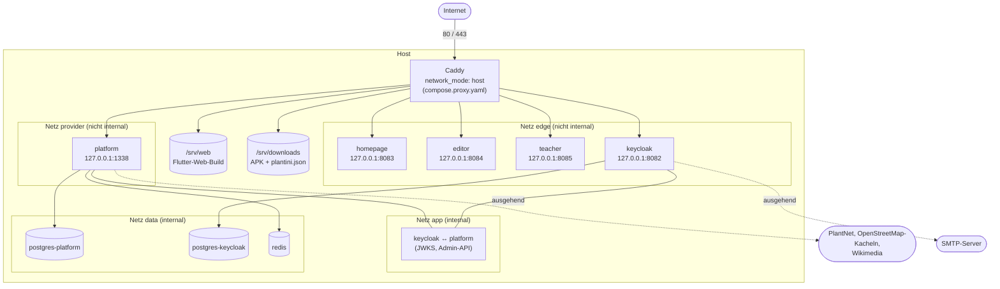

# Betrieb

Plantini läuft als Ein-Server-Betrieb: ein Linux-Host, Docker Compose für die Dienste und Caddy als einziger öffentlicher Eingang. Diese Spur beschreibt, wie das zusammengesetzt ist, wie ein Release ausgerollt wird und wie du daraus eine eigene Instanz aufsetzt – ohne Zugangsdaten und ohne Details der echten Produktion.

!!! note "Platzhalter in diesem Handbuch"
    Hostnamen, Konten und Verzeichnisse des echten Servers stehen hier bewusst nicht. Du liest `<domain>` (deine Basisdomain), `<server>` (dein Zielhost), `<deploy-root>` (Arbeitsverzeichnis auf dem Server; die Skripte im Repo nehmen als Voreinstellung `/opt/plantini` an), `<release>` (Commit-Hash des Releases) und `<admin-benutzer>` (ein Keycloak-Administrator). Setze eigene Werte ein.

!!! warning "Projektstatus"
    Plantini ist ein unveröffentlichter, unvollständiger Teaser und nicht Open Source (die Rechte liegen nicht beim Entwickler). Der hier beschriebene Betrieb ist ein Stand für Vorführung und Erprobung, kein produktionsreifer Dienst. Mitarbeit ist nach Absprache möglich: `noah@illmann.net`.

## Zielbild

Ein Host, ein Compose-Projekt (`name: plantini-production`) für alle Anwendungsdienste und ein zweites, unabhängiges Compose-Projekt (`name: plantini-proxy`) für den Eingang. Es gibt keine Registry, keine Orchestrierung und kein verteiltes Deployment: Images werden lokal gebaut und per `docker save | ssh … docker load` übertragen (siehe [Deployment](deployment.md)).

| Hostname | Inhalt | Wird ausgeliefert von |
|---|---|---|
| `<domain>` | Projekt-Homepage, plus `/download/*` für die Android-APK | Container `homepage` (Reverse Proxy) und Caddy `file_server` |
| `www.<domain>` | Weiterleitung (permanent) auf `<domain>` | Caddy |
| `app.<domain>` | Flutter-Web-App (statische Dateien) | Caddy direkt aus `/srv/web` |
| `api.<domain>` | Fach-API, nur `/api/v1/*` | Container `platform` (Strapi) |
| `auth.<domain>` | Keycloak, nur Realm `plantini` | Container `keycloak` |
| `studio.<domain>` | Redaktions-Studio | Container `editor` |
| `portal.<domain>` | Lehrendenportal | Container `teacher` |

Quelle: `infra/production/Caddyfile`. Jede Subdomain ist ein eigener Caddy-Site-Block mit gemeinsamen Sicherheits-Headern (`(security_headers)`: HSTS, `nosniff`, `Referrer-Policy`, `-Server`).

## Netze und Ports

Die Bedeutung der Netze im Detail steht in [Compose-Dateien](compose.md#netze). Kurz:

- `data` ist `internal: true`: Datenbanken und Redis haben weder eingehenden noch ausgehenden Internetzugang und veröffentlichen keine Ports.
- `app` ist `internal: true` und verbindet nur `keycloak` und `platform` (Schlüsselabruf `PLATFORM_OIDC_JWKS_URI`, Keycloak-Admin-API für Lehrende und Einladungen).
- `edge` und `provider` sind normale Netze, weil nur dort Ports an `127.0.0.1` veröffentlicht werden können und ausgehende Verbindungen möglich sind.

### Port-Tabelle

| Dienst | Container-Port | Host-Port (nur Loopback) | Variable | Standard |
|---|---|---|---|---|
| `platform` | 1337 | `127.0.0.1:1338` | `API_LOOPBACK_PORT` | 1338 |
| `keycloak` | 8080 | `127.0.0.1:8082` | `AUTH_LOOPBACK_PORT` | 8082 |
| `homepage` | 8080 | `127.0.0.1:8083` | `HOMEPAGE_LOOPBACK_PORT` | 8083 |
| `editor` | 8080 | `127.0.0.1:8084` | `EDITOR_LOOPBACK_PORT` | 8084 |
| `teacher` | 8080 | `127.0.0.1:8085` | `TEACHER_LOOPBACK_PORT` | 8085 |
| Caddy | – | `0.0.0.0:80`, `0.0.0.0:443` (Host-Netzwerk) | – | – |

Die generierte Gesamtübersicht aller Compose-Varianten steht in [Ports und Dienste](../referenz/ports-dienste.md); alle Umgebungsvariablen in [Konfiguration](konfiguration.md).

!!! warning "Stolperfalle: Caddy kennt nur die Standard-Ports"
    Im `Caddyfile` sind die Upstreams für `api.` und `auth.` fest als `127.0.0.1:1338` und `127.0.0.1:8082` eingetragen (`reverse_proxy 127.0.0.1:1338`). Für Homepage, Studio und Portal liest Caddy zwar `{$HOMEPAGE_PORT:8083}`, `{$EDITOR_PORT:8084}` und `{$TEACHER_PORT:8085}`, aber `infra/production/compose.proxy.yaml` reicht diese Variablen nicht in den Container durch (es setzt nur `PLANTINI_DOMAIN` und `ACME_EMAIL`). Ändert man einen der `*_LOOPBACK_PORT`-Werte in `production.env`, bricht der Eingang deshalb still: der Container läuft, Caddy schickt aber an den alten Port.

## Zwei Compose-Projekte, zwei Lebenszyklen

| Projekt (`name:`) | Datei | Enthält | Neu starten, wenn … |
|---|---|---|---|
| `plantini-production` | `infra/compose.production.yaml` | `postgres-platform`, `postgres-keycloak`, `redis`, `keycloak`, `platform`, `homepage`, `teacher`, `editor` | ein Image oder eine Variable wechselt |
| `plantini-proxy` | `infra/production/compose.proxy.yaml` | `caddy` | sich `Caddyfile` oder Caddy-Image ändert |

Die Trennung ist in `compose.proxy.yaml` begründet: „Independent from the stack … so the proxy can be restarted separately.“ Ein Anwendungs-Update berührt die TLS-Zertifikate und den Eingang nicht, und ein Caddy-Reload lässt die Anwendungen unberührt. Beide Projekte lesen dieselbe `production.env` (`--env-file`).

## Was liegt wo

=== "Im Repository (versioniert)"

    | Pfad | Zweck |
    |---|---|
    | `infra/compose.production.yaml` | Anwendungsstack |
    | `infra/production/compose.proxy.yaml`, `Caddyfile` | Eingang |
    | `infra/production.env.example` | Vorlage der Variablennamen (ohne Werte) |
    | `infra/production/update-release-env.mjs` | Image-Verweise in `production.env` setzen |
    | `infra/production/promote-public-assets.mjs` | Web-App und APK atomar veröffentlichen |
    | `infra/production/backup.sh`, `plantini-backup.service`, `plantini-backup.timer` | nächtliche Sicherung |
    | `infra/production/configure-smtp.sh` | SMTP im Keycloak-Realm setzen |
    | `services/identity/realm/plantini-realm.json` | Realm-Quelle (ohne Geheimnisse, Produktionsclients deaktiviert) |
    | `tools/scripts/build-production-realm.mjs` | erzeugt daraus die Produktions-Realm-Datei |
    | `tools/scripts/configure-managed-accounts.mjs` | Portalclient und Verwaltungs-Servicekonto in einem laufenden Realm |
    | `tools/scripts/prepare-app-release.mjs` | `plantini.json` und SHA-256 zur APK |

=== "Auf dem Server (nicht versioniert)"

    Alles unter `<deploy-root>`. Die Struktur ergibt sich aus den Skripten (`backup.sh`, `promote-public-assets.mjs`, `compose.proxy.yaml`):

    | Pfad unter `<deploy-root>` | Inhalt |
    |---|---|
    | `production.env` | alle Geheimnisse und Image-Verweise, nur für root lesbar (`0600`) |
    | `realm-production.json` | generierte Produktions-Realm-Datei (`KEYCLOAK_REALM_FILE`) |
    | `infra/` | Kopie von `infra/` aus dem Repository (Compose, Caddyfile, Skripte) |
    | `web/` | ausgelieferter Flutter-Web-Build (`WEB_ROOT`, in Caddy als `/srv/web` gemountet) |
    | `downloads/` | `plantini.apk`, `plantini.apk.sha256`, `plantini.json` (`DOWNLOADS_DIR`, in Caddy als `/srv/downloads`) |
    | `releases/<release>/` | pro Release: `web/`, APK, Metadaten, `previous-downloads/` |

    Auf dem Server liegt **kein** Git-Checkout des Quelltexts: es werden nur `infra/` und fertige Artefakte kopiert. Der APK-Signaturschlüssel liegt ebenfalls nicht auf dem Server (siehe [Android-Release](android-release.md)).

## Verantwortlichkeiten

| Aufgabe | Wer / was | Wo beschrieben |
|---|---|---|
| Release bauen und ausrollen | Betreiber, manuell, vom Entwicklungsrechner aus | [Deployment](deployment.md) |
| Identität (Realm, Clients, Konten, SMTP) | Betreiber über `kcadm`/Admin-API und Skripte | [Identität und Keycloak](identity-keycloak.md) |
| Sicherung | systemd-Timer auf dem Server | [Backup und Beobachtung](backup-monitoring.md) |
| Android-Paket | Betreiber mit Signaturschlüssel außerhalb des Repos | [Android-Release](android-release.md) |
| Projekt-Homepage | statisch, aus `apps/homepage` | [Homepage](homepage.md) |
| TLS-Zertifikate | Caddy automatisch (ACME, HTTP-01) | `infra/production/Caddyfile` (Kopfkommentar) |
| Inhalte (Katalog) | Redaktion über das Studio | [Moderation](../moderation/index.md) |

Im Repository sind weder Monitoring noch Alarmierung noch eine Rufbereitschaft angelegt (siehe [Backup und Beobachtung](backup-monitoring.md#ehrliche-lucken)).

## Absicherung auf einen Blick

- Alle Anwendungsports sind an `127.0.0.1` gebunden; öffentlich erreichbar sind nur 80 und 443 (Caddy).
- Strapi-Admin (`/admin`) und die eingebaute Registrierung (`/api/auth/local/register`) werden nicht durchgereicht: `api.<domain>` leitet ausschließlich `/api/v1/*` weiter, alles andere beantwortet Caddy mit 404.
- Keycloak ist nur mit `/realms/plantini/*`, `/resources/*` und `/robots.txt` öffentlich. Die Admin-Konsole und der `master`-Realm sind von außen nicht erreichbar; Administration läuft über einen Tunnel auf den Loopback-Port (`ssh -L 8082:127.0.0.1:8082 <admin-benutzer>@<server>`, dann `http://127.0.0.1:8082/admin`).
- Die Static-Container (`homepage`, `teacher`, `editor`) laufen `read_only` mit `cap_drop: [ALL]` und `no-new-privileges`.
- Geheimnisse stehen nie im Repository oder im Image: `compose.production.yaml` verlangt sie über `${VAR:?…}` und bricht ohne sie ab.

## Eine eigene Instanz aufsetzen – Reihenfolge

1. Server, Docker Engine mit Compose-Plugin, DNS-Einträge für `<domain>`, `www`, `app`, `api`, `auth`, `studio`, `portal` (alle auf den Host; Caddy benötigt sie für ACME HTTP-01, bevor es Zertifikate ausstellt).
2. Fest eingetragene Projektdomain in Skripten und Konfigurationen ersetzen – die vollständige Liste steht unter [Eigene Instanz: fest verdrahtete Werte](deployment.md#eigene-instanz-fest-verdrahtete-werte).
3. `production.env` aus `infra/production.env.example` anlegen und mit eigenen, zufälligen Werten füllen.
4. Produktions-Realm erzeugen: `node tools/scripts/build-production-realm.mjs https://app.<domain> …` ([Identität](identity-keycloak.md#produktions-realm-erzeugen)).
5. Images bauen und übertragen, `docker compose … up -d`, anschließend Caddy starten ([Deployment](deployment.md)).
6. SMTP setzen, Servicekonto für Einladungen anlegen, Sicherung aktivieren.

## Weiterführend

- [Compose-Dateien im Detail](compose.md)
- [Deployment-Ablauf mit Checkliste](deployment.md)
- [Identität und Keycloak](identity-keycloak.md)
- [Backup und Beobachtung](backup-monitoring.md)
- [Android-Release](android-release.md)
- [Projekt-Homepage](homepage.md)
- [Konfiguration (generiert)](konfiguration.md) und [Ports und Dienste (generiert)](../referenz/ports-dienste.md)
- Quellen: `infra/compose.production.yaml`, `infra/production/Caddyfile`, `infra/production/compose.proxy.yaml`, `knowledge/operations/production-stack.md` (Hintergrund, enthält teils veraltete Aussagen; bei Widerspruch gilt der Code)
