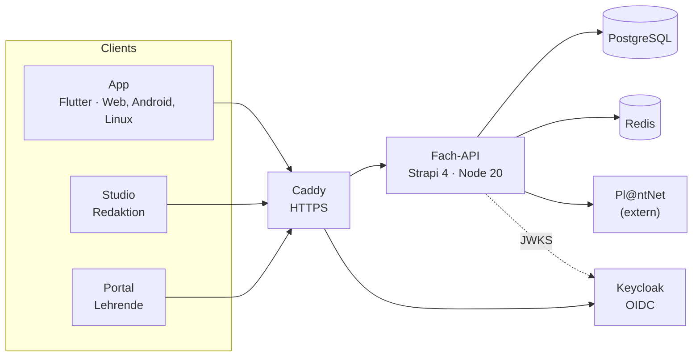

Handbuch für Mitwirkende

# Plantini verstehen, betreiben, erweitern.

Plantini macht Pflanzenkunde zugänglich: in Ökosystemen lernen, draußen entdecken, Pflanzen per Foto bestimmen
und im privaten Herbarium sammeln. Dieses Handbuch erklärt **wie Plantini gebaut ist**, wie du **mitentwickelst**,
wie Redaktion und Review **Inhalte pflegen** und wie das System **benutzt** wird.

**Projektstatus.** Plantini ist ein früher, unvollständiger Stand und **Open Source** (Code: AGPL-3.0-or-later,
Inhalte: CC BY-SA 4.0). Die Idee stammt von einer dritten Person, die der Veröffentlichung zugestimmt hat; Urheber
des Codes ist Noah Illmann. Es gibt keinen kommerziellen Hintergrund; es wurden und werden weder Spenden noch Zahlungen angenommen.
Details: [Projektstatus und Rechte](start/status.md).

## Wo möchtest du anfangen?

  <a class="pl-card" href="mitmachen/"><strong>Mitmachen</strong>Umgebung aufsetzen, Repository verstehen, Konventionen, Tests.</a>
  <a class="pl-card" href="architektur/"><strong>Architektur</strong>Komponenten, Datenflüsse, Datenmodell, Sicherheit, Entscheidungen.</a>
  <a class="pl-card" href="backend/"><strong>Backend &amp; API</strong>Strapi-Plattform, Fach-API, Vertrag, neue Endpunkte, Releases.</a>
  <a class="pl-card" href="app/"><strong>App</strong>Flutter: Struktur, Anmeldung, Offline, Bilder und Karte, Release.</a>
  <a class="pl-card" href="3d/"><strong>3D &amp; Blender</strong>Welt-Module, Tageszeit und Licht, Charaktere, Performance.</a>
  <a class="pl-card" href="studio/"><strong>Studio &amp; Portal</strong>Redaktions-Studio und Lehrendenportal technisch erklärt.</a>
  <a class="pl-card" href="betrieb/"><strong>Betrieb</strong>Compose, Deployment, Keycloak, Backups, Android-Release.</a>
  <a class="pl-card" href="moderation/"><strong>Moderation</strong>Inhalte pflegen, Review, Qualität und Bildlizenzen.</a>
  <a class="pl-card" href="nutzung/"><strong>Nutzung</strong>Die App und das Portal mit Screenshots und kurzen Animationen.</a>
  <a class="pl-card" href="referenz/stolperfallen/"><strong>Stolperfallen</strong>Fehler, die schon Zeit gekostet haben – und ihre Lösung.</a>

## Auf einen Blick

Die App spricht ausschließlich mit der Fach-API und mit Keycloak – nie mit Strapi-Admin, Datenbank oder Pl@ntNet.
Mehr dazu auf der Seite [Architektur](architektur/index.md).
