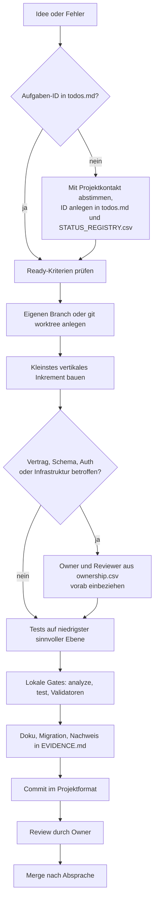

# Mitmachen

Plantini ist ein Entwicklungsprojekt mit mehreren Bausteinen (Flutter-App, Fach-API, Identität, Studio, Lehrendenportal, Homepage, 3D-Pipeline). Diese Seite sagt dir, unter welchen Bedingungen du mitarbeiten kannst, welche Spuren es gibt und wie eine Änderung von der Idee bis in den `main`-Zweig kommt.

## Projektstatus und Rechte

!!! warning "Unveröffentlicht, nicht Open Source"
    Plantini ist ein **unveröffentlichter, unvollständiger Teaser** ohne kommerziellen Hintergrund. Das Projekt ist **nicht Open Source**: Die Rechte liegen nicht beim Entwickler. Mitarbeit ist **nur nach Absprache** möglich. Schreib vorher an den Projektkontakt `noah@illmann.net`, bevor du Zeit investierst oder Code weitergibst.

Was daraus praktisch folgt:

- Das Repository ist nicht öffentlich nutzbar; Quelltext, Inhalte und Zugänge gibst du nicht an Dritte weiter.
- Es gibt keinen Anspruch auf Aufnahme eines Beitrags. Der Projektinhaber entscheidet über den Merge.
- Inhalte (Fotos, Texte, Modelle) dürfen nur mit geklärter Lizenz ins Projekt. Siehe `content/**` in der Ownership-Tabelle unten und die Lizenzregeln im Moderationsteil.
- Sicherheitslücken meldest du nicht öffentlich, sondern direkt an den Projektkontakt.

!!! note "Widersprüchliche Dateien im Repository"
    Im Repository liegen Dateien, die einen anderen Eindruck erwecken können (`README.md`, `LICENSE`, `NOTICE`, `knowledge/governance/*`). Sie sind **keine** Rechteeinräumung und beschreiben den tatsächlichen Rechtestand nicht verbindlich. Wende dich bei Fragen an den Projektkontakt. Die Vorlagen unter `knowledge/governance/` (`CONTRIBUTING.template.md` usw.) sind Vorlagen, kein gelebter Prozess.

Den fachlichen Stand des Projekts (was läuft, was fehlt) findest du unter [Projektstatus](../start/status.md); empfohlene Einstiegsreihenfolgen stehen in den [Lesepfaden](../start/lesepfade.md).

## Was „Mitmachen“ konkret heißt

Du kannst auf drei Arten beitragen:

| Art | Beispiele | Wo einsteigen |
|---|---|---|
| Code | Flutter-Screens, Fach-API-Endpunkte, Keycloak-Anpassungen, Studio/Portal | dieser Teil des Handbuchs, danach [Backend & API](../backend/index.md) bzw. [App](../app/index.md) |
| Inhalte | Steckbriefe, Quizfragen, Fotos mit Lizenz, botanisches Review | [Moderation](../moderation/index.md) |
| Prüfen | Tests, Barrierefreiheit, Review von Änderungen | [Tests und CI](tests-ci.md) |

Für alle Arten gilt: erst lokal laufen lassen ([Entwicklungsumgebung](setup.md)), dann die [Repo-Karte](repo-karte.md) lesen, dann die [Konventionen](konventionen.md).

## Mitwirkenden-Spuren

Das Repository kennt Rollen mit schreibendem Owner pro Pfad. Die Quelle ist `knowledge/agents/ownership.csv` (15 Zeilen inklusive Kopfzeile). Aus den Rollen ergeben sich die folgenden Spuren. Die Spalte „Rolle“ nennt die Rollen-ID aus der CSV; es sind **Rollen, keine Personen**. Die Rollenbeschreibungen liegen unter `knowledge/agents/NN-<rolle>.md`.

| Spur | Pfade | Rolle laut `ownership.csv` | Pflicht-Reviews laut CSV |
|---|---|---|---|
| App (Flutter) | `apps/flutter/**` | `flutter-frontend` | `ux-accessibility`, `qa-playwright` |
| App-Auth | `apps/flutter/lib/features/auth/**` (siehe Hinweis unten) | `flutter-frontend` | `auth-manager`, `security-privacy`, `qa-playwright` |
| Designsystem | `apps/flutter/lib/design_system/**` | `ux-accessibility` | `flutter-frontend`, `qa-playwright` |
| Backend/API | `services/platform/**` | `backend-api` | `security-privacy`, `qa-playwright` |
| CMS-Schema | `services/platform/src/api/content/**` (siehe Hinweis unten) | `cms-manager` | `backend-api`, `content-data`, `qa-playwright` |
| Identität/Sicherheit | `services/identity/**` | `auth-manager` | `security-privacy`, `devops-release`, `qa-playwright` |
| Vertrag | `contracts/**` | `orchestrator` | `backend-api`, `flutter-frontend`, `qa-playwright` |
| Betrieb | `infra/**` | `devops-release` | `security-privacy`, `backend-api`, `auth-manager` |
| QA | `tools/e2e/**` | `qa-playwright` | betroffener Feature-Owner |
| Inhalte | `content/**` | `content-data` | `cms-manager`, `ux-accessibility`, `product-manager` |
| Forschung | `docs/research/**` | `research-analytics` | `security-privacy`, `product-manager` |
| Sicherheitsdoku | `docs/security/**` | `security-privacy` | betroffener Owner, `orchestrator` |
| ADRs | `docs/adr/**` | `orchestrator` | betroffene Owner |
| Featurestatus | `knowledge/features/**` | `product-manager` | `orchestrator`, betroffener Owner |

!!! warning "Stolperfalle: Pfade ohne Treffer und Pfade ohne Eintrag"
    - Die beiden Zeilen für `apps/flutter/lib/features/auth/**` und `services/platform/src/api/content/**` verweisen auf Verzeichnisse, die es im Arbeitsbaum **nicht gibt**. Die Authentifizierung der App liegt in `apps/flutter/lib/auth/`, die Strapi-Inhaltstypen liegen in `services/platform/src/api/{ecosystem,level,plant,quiz,media,…}/`. Behandle die Review-Regel sinngemäß für diese echten Pfade.
    - Für `apps/editor` (Studio), `apps/teacher` (Portal), `apps/homepage`, `packages/api`, `tools/blender`, `tools/scripts` und `tools/openapi` gibt es **keinen Eintrag** in der CSV. Hier gilt: kein Owner definiert; sprich Änderungen vorher mit dem Projektkontakt ab. Ob die Spuren „Studio/Portal“ und „3D“ also fachlich zu einer bestehenden Rolle zählen, ist im Repository nicht festgelegt.

### Spuren im Alltag

Wie sich die Spuren in der Praxis schneiden, zeigt diese Übersicht. Die Spalte „Sprache“ nennt, was du können musst.

| Spur | Sprache/Framework | Typische Aufgabe | Einstieg im Handbuch |
|---|---|---|---|
| App | Dart, Flutter 3.47.1 | neuer Screen, Offline-Verhalten, Auth-Flow | [App](../app/index.md) |
| 3D/Blender | Python (Blender-API), Dart (`CustomPaint`) | neues Weltmodul, Lichtquellen, Charaktere | [3D & Blender](../3d/index.md) |
| Backend/API | JavaScript (CommonJS), Strapi 4.25 | neuer Endpunkt, Validierung, Idempotenz | [Backend & API](../backend/index.md) |
| Studio/Portal | JavaScript (Vanilla, ohne Build), Nginx | Redaktionsoberfläche, Klassenverwaltung | [Studio & Portal](../studio/index.md) |
| Betrieb | Docker Compose, Caddy, Shell | Deployment, Backup, Konfiguration | [Betrieb](../betrieb/index.md) |
| Identität/Sicherheit | Keycloak 24.0.4 (Realm-JSON), Node-Skripte | Clients, Rollen, Realm-Prüfungen | [Identität & Keycloak](../betrieb/identity-keycloak.md) |
| QA | TypeScript (Playwright), Dart-Tests, `node --test` | Tests, CI-Gates | [Tests und CI](tests-ci.md) |
| Inhalte | Studio-Oberfläche, JSON | Steckbriefe, Quizfragen, Fotos | [Moderation](../moderation/index.md) |

## Von der Idee bis zum Merge

Das Arbeitsprotokoll steht in `AGENT.md` (Abschnitt „Arbeitsprotokoll für jeden Agent“), das Koordinationsprotokoll in `knowledge/delivery/coordination-protocol.md`, die Abnahmekriterien in `knowledge/delivery/definition-of-ready-done.md`. Für menschliche Mitwirkende ergibt sich daraus dieser Ablauf:

Im Einzelnen:

1. **Aufgabe festlegen.** Jede Aufgabe hat eine ID wie `AUTH-03` oder `MEDIA-10` in `todos.md`. Zu jeder ID gehört eine Zeile in `knowledge/state/STATUS_REGISTRY.csv`. Details und der aktuell rote Prüfstand stehen in den [Konventionen](konventionen.md).
2. **Ready prüfen.** `knowledge/delivery/definition-of-ready-done.md` verlangt unter anderem: stabile Feature-ID und Priorität, benannte Owner und Reviewer, vorhandenen API-/Schema-Vertrag und bewertete Auswirkungen auf Offline, Sicherheit, Datenschutz und Barrierefreiheit.
3. **Arbeitsplatz trennen.** Jeder Beitrag arbeitet auf einem eigenen Branch oder `git worktree`. `knowledge/delivery/coordination-protocol.md` nennt Branchnamen wie `feat/FA033-plantnet-job` oder `fix/NFA020-sync-crash`. Im Repository existiert derzeit ein solcher Branch (`feat/FA020-profile-recall`); die Commits der Historie liegen überwiegend direkt auf `main`.
4. **Inkrement bauen.** Das kleinste Stück, das die Anforderung erfüllt. Keine spekulative Plattform.
5. **Engpassartefakte anmelden.** `contracts/**`, Datenmigrationen, der Keycloak-Realm, Strapi-Schemas und `infra/**` werden nie parallel ungeprüft überschrieben. Wer sie ändern will, kündigt das an und nennt die Reviewer aus der Ownership-Tabelle.
6. **Lokal prüfen.** Die Gates aus [Tests und CI](tests-ci.md): `flutter analyze` (ohne `lib`), `flutter test`, Backend-Tests, Vertragsprüfung. Erst dann committen.
7. **Nachweis ablegen.** Ergebnisse, die etwas belegen sollen, gehören nach `knowledge/state/EVIDENCE.md`; Projektwissen als Handover unter `knowledge/handovers/`.
8. **Committen.** Format `change|featre|bugfix|test|docs|wip (ID) Beschreibung`, siehe [Konventionen](konventionen.md). Es wird nicht gepusht, ohne dass der Projektinhaber das ausdrücklich verlangt.
9. **Review und Merge.** Die Reviewer aus der Ownership-Tabelle prüfen den Beitrag; bei Konflikten entscheidet laut Protokoll der Orchestrator über Architektur, der Product Manager über Scope und Akzeptanz, und `security-privacy` kann die Freigabe blockieren.

!!! tip "Nichts als „fertig“ markieren ohne Nachweis"
    Ein Beitrag setzt weder in `todos.md` ein `[x]` noch in der Statusregistry `verified`, solange keine Nachweis-ID aus `knowledge/state/EVIDENCE.md` existiert. „Production Ready“ oder „Release Candidate“ ist untersagt, solange der Release-Datensatz `RELEASE-2026-08-25` in der Registry `blocked` ist.

## Stopp-Bedingungen

`AGENT.md` fordert, bei folgenden Aufgaben anzuhalten und mit dem Projektinhaber zu klären, statt selbst zu entscheiden: Produktionszugang, echte Provider-Secrets, reale Nutzerdaten, eine irreversible Migration, ungeklärte Bildrechte, eine Änderung an der Einwilligungslogik oder ein Breaking API Change. Mehr dazu in den [Konventionen](konventionen.md#stopp-bedingungen-und-datenschutz).

## Was du als Nächstes liest

| Du willst … | Dann lies … |
|---|---|
| in 10 Minuten etwas laufen sehen | [Entwicklungsumgebung](setup.md) |
| wissen, wo etwas liegt | [Repo-Karte](repo-karte.md) |
| wissen, wie committet und geprüft wird | [Konventionen](konventionen.md) |
| Tests und CI verstehen | [Tests und CI](tests-ci.md) |
| Begriffe nachschlagen | [Glossar](../referenz/glossar.md) |
| bekannte Fallen vermeiden | [Stolperfallen](../referenz/stolperfallen.md) |

## Weiterführend

- [Projektstatus](../start/status.md) und [Lesepfade](../start/lesepfade.md)
- [Architektur](../architektur/index.md) für den Gesamtüberblick
- Quellen: `AGENT.md`, `knowledge/agents/ownership.csv`, `knowledge/agents/README.md`, `knowledge/delivery/coordination-protocol.md`, `knowledge/delivery/definition-of-ready-done.md`, `knowledge/state/STATUS_SCHEMA.md`
