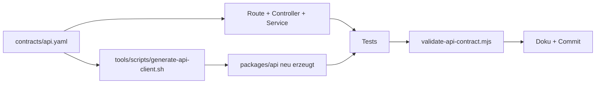

# Konventionen

Diese Seite sammelt die Regeln, nach denen im Repository gearbeitet wird: Commit-Format, Aufgaben-IDs und Statuspflege, Definition of Done, Code-Stil je Sprache, Review und Ownership, Umgang mit API-Änderungen, Datenschutz, Geheimnisse und das Arbeiten in einem Arbeitsbaum, den mehrere Sitzungen gleichzeitig verändern. Wo Code und Dokumentation sich widersprechen, steht der Widerspruch dabei.

## Commit-Format

```text
change|featre|bugfix|test|docs|wip (ID) Beschreibung
```

Beispiel aus der Historie (`git log`):

```text
change (MEDIA-10) audit and prefetch active release plant photos
change (RELEASE-11) version desktop and quiz application release
```

Regeln:

- **Präfix** aus `change`, `featre`, `bugfix`, `test`, `docs`, `wip`.
- **`featre` ist bewusst so geschrieben.** Das Wort steht so in `todos.md` (Zeile „Konvention `featre|bugfix|change (ID) Beschreibung`“) und wurde so in 18 Commits der Historie verwendet (`git log --format=%s | grep -c '^featre'`). Nicht „korrigieren“, sondern konsistent bleiben oder mit dem Projektinhaber klären.
- **ID** in Klammern: die Aufgaben-ID aus `todos.md` (`MEDIA-10`, `AUTH-03`, …).
- **Beschreibung** kurz, englisch, Kleinschreibung, ohne Punkt, meist mit Verb im Imperativ. Die Historie ist so gehalten; eine Prüfung per Hook gibt es nicht.
- **Kein Push** ohne ausdrückliche Anweisung des Projektinhabers.

Verteilung der Präfixe in der Historie am 05.10.2026 (219 Commits, gezählt aus `git log --format=%s`):

| Präfix | Anzahl | Anmerkung |
|---|---|---|
| `change` | 125 | Standard für Inkremente |
| `docs` | 27 | Dokumentation, Betriebsstand |
| `bugfix` | 26 | Fehlerbehebungen |
| `featre` | 18 | frühe Feature-Commits |
| `test` | 9 | |
| `wip` | 3 | Zwischenstände |
| `feat`, `fix`, `chore`, `first` | 6, 2, 2, 1 | ältere Commits vor der Konvention |

Branches: `knowledge/delivery/coordination-protocol.md` nennt Muster wie `feat/FA033-plantnet-job`, `fix/NFA020-sync-crash`, `chore/NFA023-ci-sbom`, `config/FA050-strapi-model` (Anforderungs-ID im Branchnamen). Das ist ein anderes Schema als bei Commits (Aufgaben-ID); beides existiert nebeneinander.

## Aufgaben-IDs und Statuspflege

Jede Aufgabe hat eine ID der Form `BEREICH-NN` (`AUTH-03`, `MEDIA-10`, `TEST-01`). Es gibt zwei Dateien, die zusammenpassen müssen:

| Datei | Rolle |
|---|---|
| `todos.md` | normativer Aufgabentext und Checkboxen; Zeilen der Form `- [ ] **P1 | CONTENT-05:** …` |
| `knowledge/state/STATUS_REGISTRY.csv` | die einzige veränderbare Statusquelle (laut `knowledge/state/STATUS_SCHEMA.md`) |

Eine Registry-Zeile für eine Aufgabe sieht so aus (echte Zeile, `TEST-01`):

```csv title="knowledge/state/STATUS_REGISTRY.csv"
id,record_type,priority,status,owner,requirement_refs,depends_on,evidence_refs,blocker_ids,scope,last_reviewed,next_action
TEST-01,work_item,P2,planned,qa-playwright,NFA022,NONE,NONE,NONE,alpha,2026-09-30,Repair the 13 Flutter tests that failed before these changes
```

Das Schema (`STATUS_SCHEMA.md`):

- `status` ist genau einer von `planned`, `ready`, `in_progress`, `verified`, `blocked`, `deferred`. Es gibt absichtlich kein `done`.
- `verified` verlangt mindestens eine Nachweis-ID in `evidence_refs` (IDs `E-…` aus `knowledge/state/EVIDENCE.md`).
- `blocked` verlangt mindestens eine Blocker-ID in `blocker_ids` (IDs `B-…` aus `knowledge/state/BLOCKERS.md`).
- „Release Candidate“, „Production Ready“, „complete“ und Prozentangaben dürfen nur in einem Release-Datensatz stehen, dessen Gate-Nachweise vorliegen. Der Release-Datensatz `RELEASE-2026-08-25` ist `blocked`.

### Das Prüfskript und sein aktueller Zustand

`python3 knowledge/scripts/validate_knowledge.py` prüft das alles und läuft als Gate in beiden CI-Konfigurationen. Es hat **fest einkodierte Zählwerte**:

```python title="knowledge/scripts/validate_knowledge.py (Auszug)"
if len(rows) != 95:
    errors.append(f"expected 95 features, got {len(rows)}")
...
if len(todo_ids) != 117:
    errors.append(f"expected 117 direct TODO ids, got {len(todo_ids)}")
```

!!! warning "Stolperfalle: das Wissens-Gate ist heute rot"
    Lokal gemessen am 05.10.2026:

    ```text
    Knowledge validation FAILED
    - expected 117 direct TODO ids, got 139
    - status registry missing TODO ids: CMS-09,CMS-10,CONTENT-09,CONTENT-10,CONTENT-11,CONTENT-12,DESIGN-09,DESIGN-10,GAME-07,GAME-08,LEARN-12,MEDIA-10,RELEASE-10,TEACH-01,WORLD-11
    ```

    Zwei Ursachen: (1) `todos.md` enthält 139 Aufgaben-IDs, das Skript erwartet 117; (2) 15 IDs fehlen in der Registry. Wer eine neue ID anlegt, muss deshalb **drei** Stellen anfassen: Zeile in `todos.md`, Zeile in `STATUS_REGISTRY.csv` und die Zahl im Skript. Ein Pull Request, der nur eine neue ID einführt, macht das Gate nicht grün, solange die 15 Altlasten bestehen.

Das Skript prüft außerdem: 95 Anforderungen in `knowledge/features/features.csv` (63 `FA…`, 32 `NFA…`), Rollen-Dateien unter `knowledge/agents/NN-*.md` für jede `primary_role`, Querverweise, gültige Statuswerte, doppelte IDs sowie die Auflösbarkeit aller `E-…`/`B-…`-Verweise.

### Statusquellen und ihre Drift

Reihenfolge der Verbindlichkeit laut `CLAUDE.md` und Schema:

1. `knowledge/state/STATUS_REGISTRY.csv` (laut Schema die Autorität, faktisch hinter `todos.md` zurück: `last_reviewed` überwiegend 2026-08-25),
2. `todos.md` (Aufgabentext; der Kopf „Stand: 26. August 2026“ ist überholt, der Inhalt reicht bis in den Oktober),
3. `knowledge/state/EVIDENCE.md`, `BLOCKERS.md`, `PROJECT_STATUS.md`,
4. `requirements/features.csv`, `knowledge/features/features.csv`, `knowledge/state/BACKLOG.csv`: **deprecated**, nur für Anforderungstexte.

## Definition of Done

Aus `knowledge/delivery/definition-of-ready-done.md`. **Done** heißt:

- Implementierung und Migration/Export versioniert
- Abnahmekriterium in produktionsnaher Umgebung nachgewiesen
- passende Unit-/Widget-/Contract-/Integrations-/E2E-Tests grün
- Fehler-, Offline-, Permission- und Wiederholungsfälle berücksichtigt
- OpenAPI-/Event-/Schema-/ADR-Dokumentation aktuell
- Telemetrie ohne personenbezogene Inhalte; Runbook/Alarm bei Betriebsrelevanz
- Accessibility und Datenschutz geprüft
- keine offenen Critical/High Security Findings
- Handoff geschrieben (`knowledge/delivery/handoff-template.md`) und Featurestatus vom Product Manager aktualisiert

**Ready** (vor dem Start): stabile Feature-ID mit Priorität, verständlicher Nutzerwert und Abnahmekriterium, benannte Owner/Reviewer/Pfade, vorhandener Vertrag oder expliziter Spike, bewertete Auswirkungen auf Daten, Offline, Sicherheit, Datenschutz und Barrierefreiheit, verfügbare Testdaten, keine offene Produktentscheidung.

!!! warning "Nicht behaupten, was nicht gelaufen ist"
    Ein erfolgreicher Build ist keine UI-Abnahme. Nutzerabnahmen (zum Beispiel `DESIGN-09`, `DESIGN-10`, `LEARN-12`, `GAME-08`, `WORLD-11`) bleiben offen, bis die zuständige Person sie bestätigt. Schreibe in Commit, Handover und Doku, was du ausgeführt hast und was nicht.

## Code-Stil je Sprache

| Bereich | Werkzeug | Aufruf | Konfiguration |
|---|---|---|---|
| Dart (App) | `dart format`, `flutter analyze` | `dart format --output=none --set-exit-if-changed lib test` und `flutter analyze` in `apps/flutter` | `apps/flutter/analysis_options.yaml`: `include: package:flutter_lints/flutter.yaml`, `linter.rules` leer |
| Dart (generiert) | `dart format`, `dart analyze`, `dart test` | in `packages/api` | `tools/openapi/analysis_options.yaml` wird beim Generieren hineinkopiert |
| JavaScript (Backend) | ESLint 10.9.1 | `npm run lint` in `services/platform` (`eslint config src test`) | `services/platform/eslint.config.mjs` |
| JavaScript (Studio, Portal, Homepage) | keine Linter-Konfiguration | `node --check app.js` | siehe unten |
| Python | keine | | |
| Shell | keine | `sh -n <datei>` | |

Details:

- **Dart.** Das Format-Gate prüft nur `lib` und `test`. Die CI führt es in `apps/flutter` und in `packages/api` aus. Fachmodule folgen dem Schnitt `domain/`, `application/`, `infrastructure/`, `presentation/` (`apps/flutter/lib/features/*`). Domain- und Application-Code kennen laut `AGENT.md` weder Flutter, Isar, HTTP, Kamera, GPS, Strapi noch PlantNet; Adapter implementieren Ports. In `analysis_options.yaml` sind `experimental_member_use`, `deprecated_member_use` und `use_null_aware_elements` auf `ignore` gestellt; `*.g.dart`, `build/`, `android/`, `ios/`, `web/` und `linux/` sind ausgeschlossen.
- **Backend-JavaScript.** CommonJS (`sourceType: 'commonjs'`, `ecmaVersion: 2022`), Basis `@eslint/js` recommended. Die Regel `no-unused-vars` ist ein Fehler; Argumente und Variablen mit Unterstrich-Präfix (`^_`) sind ausgenommen, `catch`-Variablen nicht geprüft. Erlaubte Globals sind explizit aufgelistet (unter anderem `fetch`, `structuredClone`, `strapi`). `validate-ci-config.mjs` verlangt, dass ESLint auf `10.9.1` gepinnt bleibt. Gelintet werden `config/`, `src/` und `test/`, nicht `build/` und `.cache/`. Nutzersichtbare Fehlermeldungen sind deutsch (siehe `services/platform/src/api/level/content-types/level/lifecycles.js`), Code und Kommentare englisch.
- **Studio, Portal, Homepage.** Es gibt kein Lint. Die Mindestprüfung ist `node --check apps/editor/app.js` bzw. `node --check apps/teacher/app.js` und `sh -n apps/teacher/40-teacher-config.sh`. Das Portal-README nennt zusätzlich `docker compose config --quiet`.
- **Nginx- und Compose-Dateien.** Container laufen unprivilegiert (`nginxinc/nginx-unprivileged`), mit `read_only` und `cap_drop` wo vorhanden (`infra/compose.teacher.local.yaml`). Neue Dienste folgen dem.

## API-Änderungen: Vertrag, Client, Tests, Doku

Eine Änderung am HTTP-Vertrag ist immer **ein** Inkrement aus fünf Teilen:



1. `contracts/api.yaml` ändern (jede Operation braucht eine eindeutige `operationId`).
2. Route in `services/platform/src/api/platform/routes/platform.js`, Handler in `controllers/platform.js`, Logik in `services/core/<bereich>/`.
3. **Client neu erzeugen** mit `tools/scripts/generate-api-client.sh`. Das Skript startet das gepinnte Docker-Image `openapitools/openapi-generator-cli:v7.25.0@sha256:…`, ersetzt `packages/api` mit `rsync --delete`, führt `dart pub get`, `dart run build_runner build`, `dart format lib test` aus und schreibt die Digest-Dateien mit `node tools/scripts/validate-api-contract.mjs --write-digests`.
4. Tests ergänzen (Backend: `services/platform/test/*.test.js`; App: `apps/flutter/test/`; E2E bei Bedarf).
5. `node tools/scripts/validate-api-contract.mjs` und `npx --yes @redocly/cli@1.34.3 lint contracts/api.yaml` laufen lassen.

Was `validate-api-contract.mjs` im Einzelnen erzwingt (Quelltext):

- Generator-Version `7.25.0` in `apps/flutter/openapitools.json`, `packages/api/.openapi-generator/VERSION` und im Skript mit Image-Digest.
- Operationen sind `implemented` (Standard) oder mit `x-plantini-implementation-status: planned` markiert. Eine implementierte Operation braucht eine passende Route **und** einen Handler `async <name>(` im Controller. Eine als `planned` markierte Operation darf noch keine Route haben.
- Jede Server-Route muss im Vertrag stehen. Einzige Ausnahme: `GET /health`.
- `SPEC_SHA256` und `TREE_SHA256` müssen zum aktuellen Vertrag und zu den generierten Dateien passen.

In der CI folgt auf `dart run build_runner build` im Paket der Schritt `git diff --exit-code -- packages/api`: ein nicht mitcommittetes Ergebnis der Generierung lässt die Pipeline scheitern.

!!! warning "Stolperfalle: `packages/api` nie von Hand ändern"
    Das Verzeichnis wird vollständig vom Generator besessen und bei jedem Lauf überschrieben (`rsync --delete`; erhalten bleiben nur `.dart_tool/`, `build/`, `pubspec.lock`). Handänderungen verschwinden beim nächsten Lauf und lassen die Digest-Prüfung scheitern.

Ein **Breaking Change** am Vertrag braucht laut `ownership.csv` (Zeile `contracts/**`) ein ADR (`docs/adr/`) und einen Migrationsplan, und die Review durch `backend-api`, `flutter-frontend` und `qa-playwright`. `AGENT.md` zählt ihn zu den Stopp-Bedingungen.

## Ownership und Review

Die Regeln stehen in `knowledge/agents/ownership.csv` (Übersicht und Lücken: [Mitmachen](index.md#mitwirkenden-spuren)). Kernaussagen:

- Ein Pfad hat zu einem Zeitpunkt genau einen schreibenden Owner.
- Engpassartefakte (`contracts/**`, Datenmigrationen, Keycloak-Realm, Strapi-Schemas, `infra/**`, `features.csv`) werden nie parallel ungeprüft überschrieben; wer sie ändert, kündigt es an und nennt die Reviewer.
- „Tests may not mutate product code silently“ (Zeile `tools/e2e/**`): E2E-Änderungen am Produktcode laufen als Vorschlag an den Owner.
- „Realm exports must contain no secrets“ (Zeile `services/identity/**`).
- „Every published item needs source license and review“ (Zeile `content/**`).
- Bei Konflikt: stoppen, Diff sichern, Owner informieren; kein „last writer wins“. Architektur entscheidet der Orchestrator, Scope und Akzeptanz der Product Manager, `security-privacy` kann Freigaben blockieren (`knowledge/delivery/coordination-protocol.md`).

## Stopp-Bedingungen und Datenschutz

Aus `AGENT.md`. Halte an und klär mit dem Projektinhaber, wenn eine Aufgabe eines davon braucht:

- Produktionszugang
- echte Provider-Secrets
- reale Nutzerdaten
- eine irreversible Migration
- ungeklärte Bildrechte
- eine Änderung an der Einwilligungslogik
- einen Breaking API Change

Die Systemgrenzen, die bei jeder Änderung gelten (Kurzfassung):

| Regel | Folge für dich |
|---|---|
| Die App spricht nur mit der Fach-API und Keycloak, nie mit dem Strapi-Admin oder PlantNet | keine PlantNet-Aufrufe aus Dart-Code; Bestimmung läuft serverseitig |
| Levelabschluss und PlantNet-Abgleich validiert der Server | ein Clientergebnis allein ist nie autoritativ |
| Offline-Schreibvorgänge haben stabile Client-IDs und sind idempotent | Wiederholung darf keine doppelten Funde, Events oder Bestimmungen erzeugen (siehe [Idempotenz und Fehler](../backend/idempotenz-fehler.md)) |
| Exakte Fundorte sind privat | optional, standardmäßig aus Exporten entfernt oder vergröbert |
| Strapi enthält keine Passwörter, privaten Herbariumfotos oder exakten Fundorte | neue Felder entsprechend einordnen |
| Keycloak enthält keine Lern- oder Herbariumdaten | Verbindung nur über stabile interne IDs |
| E-Mail, wissenschaftlicher Name und Provider-ID sind keine fachlichen Primärschlüssel | stabile IDs verwenden |
| Veröffentlichtes Lernmaterial ist versioniert | ein Client aktiviert ein Release erst nach vollständiger Prüfung von Manifest und Prüfsummen |

Mehr dazu in [Sicherheit und Datenschutz](../architektur/sicherheit-datenschutz.md).

## Geheimnisse

Nie lesen, ausgeben, committen oder in Doku, Screenshots und Testartefakte übernehmen:

| Datei oder Ort | Hinweis |
|---|---|
| `docs/plantnet-credentials` | lokaler PlantNet-Schlüssel, ignoriert |
| `todos-credentials`, `continue-codex` | lokale Dateien, ignoriert |
| `.env*`, `production.env` | Umgebungsdateien |
| `tools/e2e/.runtime/*` (`e2e.env`, `editor-studio.env`) | vom Stack erzeugt, Modus 0600 |
| `apps/flutter/android/key.properties`, `*.jks`, `*.keystore` | Android-Signierung |

Regeln und Hilfsmittel:

- PlantNet-Erreichbarkeit prüfst du nur über `node tools/scripts/verify-plantnet-credentials.mjs`; es gibt weder Schlüssel noch Antwort-Bodies aus (`knowledge/state/SECRETS.md`).
- Der Realm-Export im Repository ist geheimnisfrei; `services/identity/scripts/sanitize-realm-export.mjs` entfernt Nutzer, Schlüsselkomponenten und Client-Secrets, `validate-realm-security.mjs` erkennt eingecheckte Geheimnisse.
- Skripte, die Geheimnisse schreiben (`configure-managed-accounts.mjs`, `update-release-env.mjs`), schreiben nur in eine übergebene Datei mit Modus 0600 und geben sie nicht aus.
- Playwright-Traces und Screenshots sind standardmäßig aus (`PLANTINI_E2E_CAPTURE_FAILURE_ARTIFACTS`), im lokalen Stack aber auf `true` gesetzt; die Ablage ist `tools/e2e/.runtime/`.
- Fremdfotos und Texte nur mit geklärter Lizenz; Wikimedia-Abrufe liefern gelegentlich HTTP 429, keine Umgehung (siehe [Stolperfallen](../referenz/stolperfallen.md)).

## Arbeiten im geteilten Arbeitsbaum

Mehrere Sitzungen (Menschen, KI-Agenten) können gleichzeitig im selben Arbeitsbaum schreiben. Die Regeln aus `CLAUDE.md` und `knowledge/delivery/coordination-protocol.md`:

- **Nie** `git stash`, `git checkout`, `git reset` oder Formatierung über Dateien, die du nicht selbst geändert hast.
- **Nur eigene Dateien stagen** (`git add <pfad>` statt `git add -A`).
- **Vergleiche gegen `HEAD`** in einem eigenen `git worktree`, nicht im geteilten Baum:

    ```sh
    git worktree add <scratch>/head-check HEAD
    ```

- Fremde uncommittete Änderungen im `git status` bleiben unangetastet.
- Ein Agent committet nur eigene, logisch zusammenhängende Änderungen; Rebase und Integration übernimmt der Owner des Zielbereichs.
- Ein Pfad, ein schreibender Owner: Wer in einen fremden Pfad schreiben muss, spricht das vorher ab.

!!! tip "Handover statt Gedächtnis"
    Projektwissen, das Zeit gekostet hat, gehört nach `knowledge/` (ein Handover unter `knowledge/handovers/`), Nachweise nach `knowledge/state/EVIDENCE.md`. Siehe auch das Muster der vorhandenen Handover, zum Beispiel `knowledge/handovers/herbarium-map-character-daytime.md`.

## Weiterführend

- [Mitmachen](index.md), [Entwicklungsumgebung](setup.md), [Repo-Karte](repo-karte.md), [Tests und CI](tests-ci.md)
- [API-Vertrag](../backend/api-vertrag.md), [Neuer Endpunkt](../backend/neuer-endpunkt.md), [Idempotenz und Fehler](../backend/idempotenz-fehler.md)
- [Sicherheit und Datenschutz](../architektur/sicherheit-datenschutz.md), [Architekturentscheidungen](../architektur/entscheidungen.md)
- Quellen: `CLAUDE.md`, `AGENT.md`, `todos.md`, `knowledge/scripts/validate_knowledge.py`, `knowledge/state/STATUS_SCHEMA.md`, `knowledge/delivery/definition-of-ready-done.md`, `knowledge/delivery/coordination-protocol.md`, `tools/scripts/validate-api-contract.mjs`, `tools/scripts/validate-ci-config.mjs`, `services/platform/eslint.config.mjs`, `apps/flutter/analysis_options.yaml`
