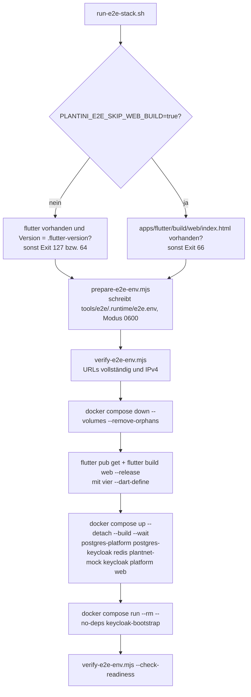

# Entwicklungsumgebung

Diese Seite führt dich von einem leeren Rechner zu einer laufenden lokalen Umgebung: Demo-Stack mit Web-App, Fach-API und Keycloak, danach optional Studio, Lehrendenportal, Linux-App und Homepage. Jeder Befehl wurde gegen die Skripte und Compose-Dateien im Repository abgeglichen; was ich nicht ausgeführt habe, ist als „nicht ausgeführt“ markiert.

!!! note "Konvention: absolute Pfade"
    Die Shell behält das Arbeitsverzeichnis zwischen Aufrufen. Setze dir eine Variable und wechsle immer explizit: `R=<pfad-zum-repository>` und dann `cd $R/tools/e2e && …`. Ein `npm`-Aufruf im falschen Ordner scheitert mit `ENOENT`.

## Voraussetzungen

| Werkzeug | Version | Quelle |
|---|---|---|
| Flutter | **3.47.1** (Dart `^3.13.1`) | `.flutter-version`, `apps/flutter/pubspec.yaml` (`sdk: ^3.13.1`) |
| Node.js | **20.20.2** für Backend, Tests und Images | `.gitlab-ci.yml`, `.github/workflows/ci.yml`, `services/platform/Dockerfile` |
| Node-Bereich im Paket | `>=18.0.0 <=20.x.x` | `engines` in `services/platform/package.json` |
| npm | `>=6.0.0` | `engines` in `services/platform/package.json` |
| Docker mit Compose v2 | aktuell | Stack-Skripte rufen `docker compose` auf |
| Playwright | 1.55.0 (Chromium) | `tools/e2e/package.json` |
| Python 3 | beliebig aktuell | `knowledge/scripts/validate_knowledge.py` |
| Blender | nur für die 3D-Spur | `tools/blender/*.py` (siehe [3D & Blender](../3d/index.md)) |

Hinweise zu den Versionen:

- **Flutter-Version ist hart geprüft.** `tools/e2e/scripts/run-e2e-stack.sh` bricht mit Exit-Code 64 ab, wenn `flutter --version` nicht genau dem Inhalt von `.flutter-version` entspricht (Ausnahme: `PLANTINI_E2E_FLUTTER_VERSION` überschreibt die Soll-Version). `tools/scripts/validate-ci-config.mjs` prüft zusätzlich, dass GitLab-CI (`FLUTTER_VERSION`) und GitHub-CI (`flutter-version-file`) dieselbe Version verwenden.
- **Node 20 ist die Zielversion, nicht erzwungen.** Im Repository gibt es keine `.npmrc` und keine `.nvmrc`; `engines` ist deshalb nur ein Hinweis von npm, kein harter Ausschluss. Die Backend-Tests (`node --test`) liefen am 05.10.2026 lokal auch unter Node 26.10.0 durch (49 Tests, 45 bestanden, 4 übersprungen). Ob Strapi 4.25.10 selbst unter Node >20 startet, habe ich **nicht geprüft**; das Docker-Image nutzt `node:20.20.2-bookworm`. Wenn du das Backend außerhalb von Docker startest, nimm Node 20.
- **Linux-Desktop-Build** braucht auf Debian/Ubuntu laut `.github/workflows/ci.yml`: `clang cmake ninja-build pkg-config libgtk-3-dev liblzma-dev libsecret-1-dev`. Zur Laufzeit genügen laut `apps/flutter/README.md` `libgtk-3-0` und `libsecret-1-0`.

## Schnellstart: die Demo

Ein Befehl startet einen **frischen, isolierten** Stack (Keycloak, zwei PostgreSQL-Instanzen, Redis, PlantNet-Mock, Fach-API, Nginx mit der Web-App), erzeugt einen Test-Lernenden und gibt die Zugangsdaten aus.

=== "Ohne Browser"

    ```sh
    R=<pfad-zum-repository>
    cd $R && tools/scripts/start-local-demo.sh --no-open
    ```

=== "Mit Browser-Start (xdg-open)"

    ```sh
    R=<pfad-zum-repository>
    cd $R && tools/scripts/start-local-demo.sh
    ```

Das Skript `tools/scripts/start-local-demo.sh` akzeptiert genau ein optionales Argument (`--no-open`); jedes andere Argument endet mit Exit-Code 64. Es ruft `npm run stack:up` in `tools/e2e` auf, prüft danach `http://127.0.0.1:1338/api/v1/health` und `http://127.0.0.1:3000/healthz`, und druckt:

```text
Plantini-Demo ist bereit.
Web-App:  http://127.0.0.1:3000
Login:    <E2E_USERNAME>
Passwort: <E2E_USER_PASSWORD>
Modus:    deterministischer PlantNet-Mock, IPv4
```

Das Passwort wird bei **jedem** Start neu gewürfelt (`prepare-e2e-env.mjs`). Der Anmeldename ist eine E-Mail-Adresse, weil der Realm `registrationEmailAsUsername` aktiviert hat (Kommentar in `tools/e2e/scripts/prepare-e2e-env.mjs`).

### Was `stack:up` im Einzelnen tut

`npm run stack:up` in `tools/e2e` führt `tools/e2e/scripts/run-e2e-stack.sh` aus:



Die wichtigsten Eigenschaften, jeweils mit Beleg im Skript:

- **`down --volumes` vor jedem Start.** Alle Volumes des Stacks (`e2e-platform-db`, `e2e-keycloak-db`, `e2e-redis`, `e2e-private-media`) werden gelöscht. Daten aus einem früheren Lauf sind weg.
- **`e2e.env` wird überschrieben.** `prepare-e2e-env.mjs` erzeugt Datenbank-, Strapi- und Test-Zugangsdaten zufällig neu (`randomBytes`) und schreibt sie nach `tools/e2e/.runtime/e2e.env`. Diese Datei enthält Geheimnisse: nicht ausgeben, nicht committen (`.runtime/` ist ignoriert).
- **Serielle Compose-Starts.** `COMPOSE_PARALLEL_LIMIT` steht standardmäßig auf `1` (Überschreibung mit `PLANTINI_E2E_COMPOSE_PARALLEL_LIMIT`). Der Kommentar im Skript begründet das mit einem Wettlauf bei doppelten Create-Requests in Docker Compose 5.5.
- **Keycloak-Bootstrap getrennt.** Der Dienst `keycloak-bootstrap` ist ein Einmal-Job. Das Skript startet nur die dauerhaften Dienste mit `up --wait` und führt den Bootstrap danach mit `run --rm --no-deps` aus, damit sein Exit-Code zählt. Er legt per `kcadm.sh` den synthetischen Lernenden an (`infra/scripts/keycloak-bootstrap-e2e.sh`).
- **`XDG_CACHE_HOME`.** Beim Web-Build setzt das Skript `XDG_CACHE_HOME` auf `/tmp/plantini-flutter-cache`, falls nichts gesetzt ist.

Aufräumen:

```sh
cd $R/tools/e2e && npm run stack:down
```

`stack:down` ist `docker compose --env-file .runtime/e2e.env -f ../../infra/compose.e2e.yaml down --volumes --remove-orphans` (aus `tools/e2e/package.json`).

### Ports und Dienste

Alle Host-Ports binden an `127.0.0.1` (IPv4), nie an `0.0.0.0` oder IPv6.

| Port | Dienst | Compose-Datei | Anmerkung |
|---|---|---|---|
| 3000 | Web-App (Nginx, statisches `apps/flutter/build/web`) | `infra/compose.e2e.yaml` | `GET /healthz` liefert `ok` |
| 1338 | Fach-API (Container-Port 1337) | `infra/compose.e2e.yaml` | `GET /api/v1/health` |
| 8082 | Keycloak 24.0.4 (Container-Port 8080) | `infra/compose.e2e.yaml` | Issuer `http://127.0.0.1:8082/realms/plantini` |
| 8084 | Studio | `infra/compose.editor.local.yaml` | nur mit Overlay |
| 8085 | Lehrendenportal | `infra/compose.teacher.local.yaml`, `apps/teacher/compose.yaml` | nur mit Overlay |
| 4000 | OIDC-Loopback der Desktop-App | `apps/flutter/lib/auth/auth_platform_io.dart` | muss frei sein, wenn die Linux-App läuft |
| 1080 | PlantNet-Mock (MockServer) | `infra/compose.yaml` | nur alter Stack; im E2E-Stack nicht veröffentlicht |
| 9000, 9002 | MinIO | `infra/compose.yaml` | nur alter Stack |
| 1025, 8025 | Mailpit (SMTP, Web) | `infra/compose.yaml` | nur alter Stack |

Eine vollständige Dienste- und Portübersicht inklusive Produktion steht unter [Ports und Dienste](../referenz/ports-dienste.md).

### Der alte Dev-Stack

`start.sh`, `stop.sh` und `infra/compose.yaml` sind der **ältere** Dev-Stack mit MinIO, Mailpit und MockServer. Er ist nicht der Weg für Demo und Tests. Belege, warum du ihn meiden solltest:

- `start.sh` prüft Routen wie `/api/manifest` und `/api/plants` und `http://localhost:1338/_health`. Die Fach-API besitzt diese Routen nicht: sie liegt unter `/api/v1/…` (siehe `services/platform/src/api/platform/routes/platform.js`).
- Der Dienst `platform` in `infra/compose.yaml` startet `node:20-alpine` mit gemountetem `services/platform` und führt nur dann `npm run develop` aus, wenn eine `package.json` vorhanden ist. Ein Abhängigkeits-Install ist nicht vorgesehen; der Volume `platform-node-modules` startet leer. Ob der Stack so tatsächlich hochkommt, habe ich **nicht geprüft**.
- Die Dev-Standardwerte für Passwörter und Admin-Zugang stehen im Klartext in der Compose-Datei und in `start.sh`. Sie gelten nur für lokale Entwicklung.

## Die E2E-Tests gegen den Stack

Nach `stack:up` laufen die Playwright-Tests im selben Verzeichnis:

```sh
cd $R/tools/e2e && npm ci && npm run install:browsers   # einmalig
cd $R/tools/e2e && npm test
```

`npm test` führt zuerst `check:stack` aus (liest `.runtime/e2e.env`, prüft Web, API-Health und OIDC-Discovery per IPv4, außerdem erreicht der Container `platform` seinen JWKS-Endpunkt), dann `playwright test`. Einzelne Projekte: `npm run test:health`, `test:contract`, `test:core`. Details, Projekte und bekannte Lücken: [Tests und CI](tests-ci.md).

## Backend entwickeln

Backend-Tests brauchen keinen Stack:

```sh
cd $R/services/platform && npm ci && npm run lint && npm run check && npm test
```

`npm test` ist `node --test test/*.test.js`. Vier Tests (zwei in `provider-guard.test.js`, zwei in `field-identification-queue.test.js`) werden **übersprungen**, solange `PLANTINI_TEST_REDIS_URL` nicht gesetzt ist. Um sie auszuführen, brauchst du einen erreichbaren Redis und setzt `PLANTINI_TEST_REDIS_URL=redis://<host>:<port>`. Der Redis des E2E-Stacks veröffentlicht keinen Host-Port (kein `ports:`-Eintrag in `infra/compose.e2e.yaml`); starte also einen eigenen.

### Quelltext live in den laufenden Container

Das Image `plantini/platform:e2e` enthält den gebauten Quelltext (`CMD ["npm", "run", "start"]` in `services/platform/Dockerfile`). Damit Änderungen aus deinem Arbeitsbaum wirken, gibt es das Overlay `infra/compose.authoring.local.yaml`, das `services/platform/src` read-only nach `/opt/plantini/src` hängt. Der Aufruf steht als Kommentar in der Datei:

```sh
cd $R && docker compose --env-file tools/e2e/.runtime/e2e.env \
  -f infra/compose.e2e.yaml -f infra/compose.authoring.local.yaml \
  up -d --no-build --wait platform
```

Das ist ausdrücklich für die lokale CMS-Entwicklung gedacht: „No volume reset or tests“. Der Server läuft im Produktionsmodus (`strapi start`), eine Änderung wird deshalb erst nach einem Neustart des Containers sichtbar. Dass Strapi hier selbständig neu lädt, ist **nicht belegt**.

!!! warning "Stolperfalle: Image-Build führt Tests aus"
    Das Image-Build (`docker compose … up --build`, Dockerfile-Stufe `build`) führt `npm run lint && npm run check && npm test && npm run build` aus. Ein roter Lint- oder Testlauf bricht also schon den Build des Stacks ab, nicht erst die CI.

### Eigene Env-Variablen der Fach-API

Die Fach-API verlangt mindestens `PLATFORM_OIDC_ISSUER` und `PLATFORM_OIDC_AUDIENCE` (`requiredEnvironment` in `services/platform/src/api/platform/services/core/platform-runtime.js`, Meldung `… must be configured for the platform API.`). Der Start verbindet außerdem immer Redis (`REDIS_URL`) für die Bestimmungs-Warteschlange (`src/index.js`). Die komplette Liste steht unter [Konfiguration](../betrieb/konfiguration.md).

## Studio lokal

Das Studio ist eine Schicht über dem E2E-Stack. Der Stack muss laufen (Keycloak gesund, `e2e.env` vorhanden).

```sh
cd $R && node tools/scripts/configure-local-editor.mjs
cd $R && docker compose --env-file tools/e2e/.runtime/e2e.env -p plantini-e2e \
  -f infra/compose.e2e.yaml -f infra/compose.authoring.local.yaml \
  -f infra/compose.editor.local.yaml up -d --build --wait editor platform
```

Was `tools/scripts/configure-local-editor.mjs` tut (Quelltext):

1. liest die Keycloak-Admin-Zugangsdaten aus `tools/e2e/.runtime/e2e.env`,
2. legt den Client `plantini-editor-dev` aus dem versionierten Realm an oder aktualisiert ihn,
3. weist die Client-Scopes `roles` und `plantini-api-audience` zu und erlaubt die Rollen `inhaltsredaktion`, `botanisches_review`, `systemadministration`,
4. legt zwei synthetische Konten an (Rolle Redaktion, Rolle Review), setzt deren Passwörter bei **jedem** Lauf neu und schreibt sie nach `tools/e2e/.runtime/editor-studio.env` (wird erzeugt, Modus 0600).

Das Studio öffnest du unter `http://127.0.0.1:8084/`. Das Overlay `infra/compose.editor.local.yaml` setzt `PLATFORM_SEED_DEMO_CONTENT` auf `false`, erweitert `CORS_ORIGINS` um `http://127.0.0.1:8084` und setzt `PLATFORM_EDITOR_ORIGIN` sowie `PLATFORM_EDITOR_OIDC_CLIENT_ID=plantini-editor-dev` für die Fach-API. Einladungen von Redakteuren funktionieren lokal nicht: dafür fehlen der Keycloak-Verwaltungsclient und SMTP. Hintergrund zur Anwendung: [Studio-Technik](../studio/studio-technik.md).

Wie das Studio seine Umgebung wählt: `apps/editor/app.js` setzt `production = location.hostname.startsWith('studio.')`. Bei jedem anderen Hostnamen nutzt es `http://127.0.0.1:1338` (API), `http://127.0.0.1:8082` (Keycloak) und den Client `plantini-editor-dev`. Du musst es deshalb über `127.0.0.1` aufrufen, nicht über `localhost`.

## Lehrendenportal lokal

Variante 1, empfohlen, auf dem E2E-Stack (Anleitung aus `knowledge/teacher-portal.md`, gegen die Compose-Datei abgeglichen):

```sh
cd $R && node tools/scripts/configure-managed-accounts.mjs tools/e2e/.runtime/e2e.env http://127.0.0.1:8085
cd $R && docker compose --env-file tools/e2e/.runtime/e2e.env -p plantini-e2e \
  -f infra/compose.e2e.yaml -f infra/compose.teacher.local.yaml \
  up -d --build --wait platform teacher
```

`tools/scripts/configure-managed-accounts.mjs <env-datei> <origin>` verlangt als Origin entweder `http://127.0.0.1:8085` (Entwicklung) oder eine fest hinterlegte Produktions-Origin. Für die Entwicklung nimmt es die Admin-Zugangsdaten aus `E2E_KEYCLOAK_ADMIN_USERNAME` und `E2E_KEYCLOAK_ADMIN_PASSWORD` der angegebenen Datei. Es

- legt bzw. aktualisiert den Client `plantini-teacher-dev` (PKCE S256, Redirect `http://127.0.0.1:8085/`),
- legt den vertraulichen Verwaltungsclient `plantini-account-manager` mit den Rollen `manage-users`, `view-users`, `query-users`, `view-realm` an,
- schaltet im Realm die Selbstregistrierung aus und registriert das Admin-only-Attribut `plantini_managed_student`,
- **schreibt `PLATFORM_KEYCLOAK_ADMIN_CLIENT_ID`, `PLATFORM_KEYCLOAK_ADMIN_CLIENT_SECRET` und `TEACHER_PUBLIC_URL` in die übergebene Env-Datei** (Modus 0600).

`infra/compose.teacher.local.yaml` erzwingt die beiden `PLATFORM_KEYCLOAK_ADMIN_*`-Werte mit `${…:?run configure-managed-accounts.mjs}`. Fehlen sie, bricht Compose mit genau diesem Hinweis ab.

!!! warning "Stolperfalle: `stack:up` löscht die Portal-Einrichtung"
    `npm run stack:up` schreibt `e2e.env` komplett neu und wirft alle Volumes weg. Danach fehlen die `PLATFORM_KEYCLOAK_ADMIN_*`-Zeilen und die lokalen Studio- und Portalkonten. Nach jedem frischen `stack:up` musst du `configure-local-editor.mjs` und `configure-managed-accounts.mjs` erneut ausführen, bevor du das jeweilige Overlay startest.

!!! warning "Stolperfalle: Overlays kombinieren"
    Beide Overlays setzen `CORS_ORIGINS` für den Dienst `platform`. Bei mehreren `-f`-Dateien gewinnt der Wert der **zuletzt** genannten Datei (Compose-Merge-Regel: spätere Dateien überschreiben gleiche Schlüssel). Willst du Studio und Portal gleichzeitig, nenne `compose.teacher.local.yaml` zuletzt, denn nur dieser Wert enthält beide Ports (`8084` und `8085`). Ausgeführt habe ich die Kombination nicht.

Variante 2, nur das Portal-Frontend (laut `apps/teacher/README.md`, aus `apps/teacher`):

```sh
cd $R/apps/teacher && \
TEACHER_HTTP_PORT=8085 \
PLANTINI_API_BASE_URL=http://127.0.0.1:1338/api/v1 \
PLANTINI_OIDC_ISSUER_URL=http://127.0.0.1:8082/realms/plantini \
PLANTINI_OIDC_CLIENT_ID=plantini-teacher-dev \
docker compose up --build
```

Statische Syntaxprüfung ohne Stack (ebenfalls laut README): `node --check app.js`, `sh -n 40-teacher-config.sh`, `docker compose config --quiet`. Mehr zum Portal: [Portal-Technik](../studio/portal-technik.md).

## Die App starten

Die App liest ihre Konfiguration ausschließlich zur **Build-Zeit** über `--dart-define` (`apps/flutter/lib/app/app_config.dart`). Es gibt keine Standard-Endpunkte; fehlt etwas, zeigt die App beim Start einen Konfigurationsfehler.

| Variable | Bedeutung | Prüfung in `AppConfig` |
|---|---|---|
| `PLANTINI_ENV` | `development`, `staging` oder `production` | Standard `development`; anderer Wert ist ein Fehler |
| `PLANTINI_API_BASE_URL` | API-Basis | absolute http/https-URL, Pfad **muss** `/api/v1` sein, kein IPv6-Literal |
| `PLANTINI_OIDC_ISSUER_URL` | Keycloak-Issuer | absolute URL, kein IPv6-Literal |
| `PLANTINI_OIDC_CLIENT_ID` | öffentlicher Client | nicht leer |
| `PLANTINI_DAYTIME` | optional: `morning`, `noon`, `evening`, `night` | fixiert die Tageszeit der Welten (Review der Beleuchtung) |

`production` verlangt HTTPS für API und Issuer.

=== "Web"

    Der Client `plantini-web-dev` erlaubt als Redirect nur `http://127.0.0.1:3000/`, `…/auth/callback` und `…/auth/logout-callback`. Die Web-App muss also auf **`127.0.0.1:3000`** laufen. Das ist derselbe Port wie der Nginx-Container `web` des E2E-Stacks; stoppe ihn vorher oder nutze direkt die dort ausgelieferte Version.

    ```sh
    cd $R/apps/flutter && flutter run -d web-server \
      --web-hostname 127.0.0.1 --web-port 3000 \
      --dart-define=PLANTINI_ENV=development \
      --dart-define=PLANTINI_API_BASE_URL=http://127.0.0.1:1338/api/v1 \
      --dart-define=PLANTINI_OIDC_ISSUER_URL=http://127.0.0.1:8082/realms/plantini \
      --dart-define=PLANTINI_OIDC_CLIENT_ID=plantini-web-dev
    ```

    Zusammengesetzt aus `start.sh` (`flutter run -d web-server --web-port 3000`) und den Dart-Defines aus `tools/e2e/scripts/run-e2e-stack.sh`. **Nicht ausgeführt.** `start.sh` selbst übergibt keine Dart-Defines und ist deshalb für den neuen Stack ungeeignet. Die CORS-Origin `http://127.0.0.1:3000` kennt die Fach-API im E2E-Stack bereits (`CORS_ORIGINS` in `infra/compose.e2e.yaml`).

=== "Linux-Desktop"

    Aus `knowledge/operations/local-presentation-stack.md` und `apps/flutter/README.md`:

    ```sh
    cd $R/apps/flutter && flutter run -d linux \
      --dart-define=PLANTINI_ENV=development \
      --dart-define=PLANTINI_API_BASE_URL=http://127.0.0.1:1338/api/v1 \
      --dart-define=PLANTINI_OIDC_ISSUER_URL=http://127.0.0.1:8082/realms/plantini \
      --dart-define=PLANTINI_OIDC_CLIENT_ID=plantini-mobile-dev
    ```

    Release-Bundle: `PLANTINI_ENV=… PLANTINI_API_BASE_URL=… PLANTINI_OIDC_ISSUER_URL=… PLANTINI_OIDC_CLIENT_ID=… apps/flutter/tool/build-linux.sh`. Das Skript bricht mit Exit-Code 64 ab, wenn eine der vier Variablen fehlt, `PLANTINI_ENV` ungültig ist oder ein Endpunkt ein IPv6-Literal (`[` oder `]`) enthält. Die Anmeldung läuft über einen lokalen Empfänger auf `http://127.0.0.1:4000/` (`desktopLoopbackRedirectUri` in `auth_platform_io.dart`); Port 4000 muss frei sein.

=== "Android"

    **Nicht geprüft.** Fakten aus dem Code, die du beachten musst:

    - Auf Telefonen (`Platform.isAndroid || Platform.isIOS`) kehrt die Anmeldung über einen App Link auf eine **fest einkompilierte Produktions-URL** zurück (`mobileDeepLinkRedirectUri` in `apps/flutter/lib/auth/auth_platform_io.dart`), nicht über den Loopback. Dieselbe Seite leitet bei Bedarf an `eu.plantini.app://oauth2redirect` weiter. Der Client `plantini-mobile-dev` erlaubt diese Redirects. Eine rein lokale Anmeldung gegen den Dev-Stack ist damit nicht ohne die Produktions-Homepage denkbar.
    - Ein Emulator erreicht `127.0.0.1` des Entwicklungsrechners nicht ohne Weiterleitung. Wie du das einrichtest, ist im Repository **nicht dokumentiert**.
    - Debug-Builds erlauben Klartext-HTTP (`apps/flutter/android/app/src/debug/AndroidManifest.xml`), Release-Builds nicht (`usesCleartextTraffic="false"` im Haupt-Manifest).
    - Release-Build und Signierung: [Android-Release](../betrieb/android-release.md).

## Homepage lokal

```sh
cd $R/apps/homepage && npm ci && npm run dev
```

`npm run build` erzeugt `dist/`. `node scripts/snapshot-content.mjs [api-origin]` zieht Steckbriefe und lizenzfreie Fotos neu. Aus `apps/homepage/README.md`; der Entwicklungsserver ist Vite, `package.json` verlangt `node >=20`.

## Typische Fehler

| Symptom | Ursache | Lösung |
|---|---|---|
| `E2E requires Flutter 3.47.1; found …` (Exit 64) | falsche Flutter-Version | Version aus `.flutter-version` installieren oder `PLANTINI_E2E_FLUTTER_VERSION` bewusst setzen |
| `Flutter is required to build the E2E web application.` (Exit 127) | `flutter` nicht im `PATH` | Flutter installieren oder `PLANTINI_E2E_SKIP_WEB_BUILD=true` mit fertigem `apps/flutter/build/web` |
| `PLANTINI_E2E_SKIP_WEB_BUILD requires the Flutter web artifact.` (Exit 66) | Skip-Flag ohne `apps/flutter/build/web/index.html` | Web-Build vorher erzeugen |
| `E2E environment is missing. Run npm run stack:up first.` | `tools/e2e/.runtime/e2e.env` fehlt | `npm run stack:up` ausführen |
| `Plantini E2E configuration is invalid: … needs an explicit IPv4 mapping` | Test-URL mit Hostnamen (`localhost`) statt `127.0.0.1` | IPv4-Literale verwenden oder `PLANTINI_E2E_IPV4_HOSTS=host=IPv4` setzen |
| `Plantini E2E stack is not ready: … not reachable through the IPv4 E2E route` | Stack unten oder Port belegt | `docker compose … ps`, Ports 3000, 1338, 8082 prüfen |
| `run configure-managed-accounts.mjs` von Compose | `PLATFORM_KEYCLOAK_ADMIN_*` fehlt in `e2e.env` | Skript erneut ausführen (nach jedem frischen `stack:up` nötig) |
| `PLATFORM_OIDC_ISSUER must be configured for the platform API.` | Env-Variable der Fach-API fehlt | in der Compose-Datei bzw. `production.env` setzen |
| `Missing required build variable: PLANTINI_ENV` (Exit 64) | `tool/build-linux.sh` ohne die vier Variablen | alle vier setzen |
| App zeigt `PLANTINI_API_BASE_URL muss auf /api/v1 enden.` | Pfad der API-URL falsch | URL mit `/api/v1` am Ende |
| App zeigt `Production verlangt HTTPS für API und OIDC.` | `PLANTINI_ENV=production` mit `http://` | HTTPS oder `development` |
| Keycloak: „Invalid parameter: redirect_uri“ im Browser | Web-App läuft auf anderem Host/Port als `127.0.0.1:3000` | genau diesen Origin verwenden |
| `Kein Browser kann die Anmeldung öffnen.` (Linux) | `canLaunchUrl` schlägt fehl (kein Browser/Desktop-Sitzung) | Browser installieren, grafische Sitzung nutzen |
| Docker-Build bricht in `npm run lint`/`npm test` ab | Dockerfile-Stufe `build` führt beides aus | lokal in `services/platform` beheben |
| Daten und Konten nach `stack:up` weg | `down --volumes` und neue `e2e.env` | beabsichtigt; Overlays neu konfigurieren |

Weitere, tiefere Fallstricke (Keycloak-Import, Caddy, Android-Build) stehen gesammelt unter [Stolperfallen](../referenz/stolperfallen.md).

## Weiterführend

- [Repo-Karte](repo-karte.md), [Konventionen](konventionen.md), [Tests und CI](tests-ci.md)
- [Compose-Dateien im Detail](../betrieb/compose.md), [Konfiguration](../betrieb/konfiguration.md), [Identität & Keycloak](../betrieb/identity-keycloak.md)
- [Studio-Technik](../studio/studio-technik.md), [Portal-Technik](../studio/portal-technik.md), [App-Auth](../app/auth.md)
- Quellen: `tools/scripts/start-local-demo.sh`, `tools/e2e/scripts/run-e2e-stack.sh`, `tools/e2e/scripts/prepare-e2e-env.mjs`, `tools/e2e/scripts/verify-e2e-env.mjs`, `infra/compose.e2e.yaml`, `infra/compose.editor.local.yaml`, `infra/compose.teacher.local.yaml`, `infra/compose.authoring.local.yaml`, `tools/scripts/configure-local-editor.mjs`, `tools/scripts/configure-managed-accounts.mjs`, `knowledge/teacher-portal.md`, `knowledge/editor-studio.md`
