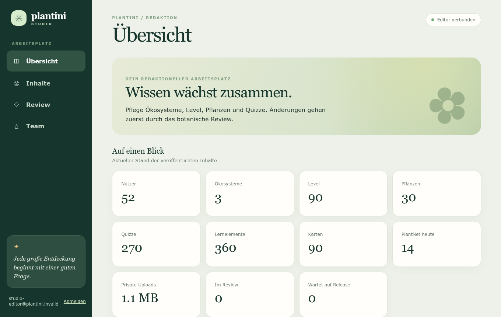
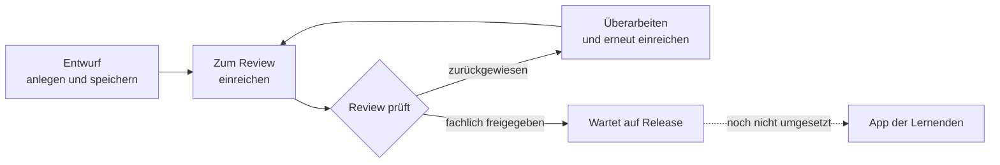

# Moderation: Einstieg

Diese Seiten richten sich an alle, die Lerninhalte von Plantini pflegen oder prüfen – ohne Programmierkenntnisse. Du arbeitest im **Studio**, einer Webanwendung, in der Ökosysteme, Level, Pflanzen-Steckbriefe und Quizfragen als Entwürfe entstehen und von einem botanischen Review freigegeben werden.

!!! note "Wichtig vorab: Freigabe ist nicht Veröffentlichung"
    Eine **fachliche Freigabe** ist heute möglich. Die **Veröffentlichung** in der App ist dagegen noch nicht freigeschaltet. Was das für deine Arbeit bedeutet, steht im Abschnitt [Vom Entwurf zur App](#vom-entwurf-zur-app).

<figure markdown="span">
  
  <figcaption>Die Übersicht des Studios: Kennzahlen und Einstieg in Inhalte und Review.</figcaption>
</figure>

## Rollen

Im Studio gibt es drei Rollen. Welche du hast, legt die Systemadministration in Keycloak fest; die Bezeichnungen sind die technischen Rollennamen.

| Rolle | Technischer Name | Was du darfst |
| --- | --- | --- |
| Redaktion | `inhaltsredaktion` | Entwürfe anlegen, bearbeiten und zur Prüfung einreichen. Du siehst auf der Seite „Review“ nur deine eigenen Änderungen. Du darfst weitere Redakteur:innen einladen. |
| Botanisches Review | `botanisches_review` | Alles, was die Redaktion darf, und zusätzlich: **alle** eingereichten Änderungen ansehen, fachlich freigeben oder mit Begründung zurückweisen. |
| Administration | `systemadministration` | Alles aus dem Review. Zusätzlich darfst du Reviewer:innen und Lehrende einladen. Die Anmeldung verlangt einen zweiten Faktor (TOTP-App). |

Zwei Regeln, die der Server erzwingt:

- **Bearbeiten darf nur, wer den Entwurf angelegt hat.** Auch Reviewer:innen können fremde Entwürfe nicht ändern; sie können sie ansehen und – sobald sie eingereicht sind – freigeben oder zurückweisen.
- **Nur Review und Administration geben frei.** Ein Konto mit ausschließlich `inhaltsredaktion` bekommt bei „Fachlich freigeben“ oder „Zurückweisen“ eine Fehlermeldung.

!!! warning "Eigene Entwürfe freigeben"
    Der Server verhindert es nicht, dass eine Reviewer:in ihren **eigenen** Entwurf freigibt. Das ist laut Projektunterlagen vom Auftraggeber ausdrücklich so vorgesehen, bedeutet aber, dass dann kein Vier-Augen-Prinzip stattfindet. Wie du damit verantwortungsvoll umgehst, steht im [Review-Prozess](review.md#selbstfreigabe).

## Was du im Studio tun kannst

| Bereich | Wozu |
| --- | --- |
| **Übersicht** | Zahlen auf einen Blick: Nutzer, Ökosysteme, Level, Pflanzen, Quizze, Lernelemente, Karten, PlantNet-Zugriffe heute, private Uploads, Änderungen im Review, Freigaben, die auf ein Release warten. |
| **Inhalte** | Baum Ökosystem → Level → Pflanzen und Quizze. Ein Klick öffnet einen Eintrag zum Bearbeiten; mit „+ Ökosystem“, „+ Level“, „+ Pflanze“, „+ Quiz“ legst du Neues an. |
| **Review** | Liste deiner Änderungen (Review sieht alle). Hier öffnest du Entwürfe wieder, prüfst Einreichungen und siehst den Verlauf. |
| **Team** | Personen per E-Mail einladen. |

Die Bedienung Schritt für Schritt erklärt das [Studio-Handbuch](studio-handbuch.md).

## Vom Entwurf zur App

Ein Inhalt durchläuft diese Zustände (Anzeige im Studio):

| Anzeige | Bedeutung |
| --- | --- |
| Entwurf | Du arbeitest daran; noch niemand prüft es. |
| Im Review | Eingereicht; du kannst es nicht mehr ändern, bis das Review entschieden hat. |
| Zurückgewiesen | Das Review hat eine Begründung hinterlassen. Du überarbeitest und reichst erneut ein. |
| Fachlich freigegeben · wartet auf Release | Das Review ist einverstanden. Der Inhalt ist **noch nicht** in der App. |

**Der ehrliche Stand:** Die Freigabe ist eine redaktionelle Entscheidung und wird gespeichert. Es gibt aber noch keinen geprüften, atomar aktivierbaren Release-Schritt, der freigegebene Entwürfe in die Inhalte übernimmt, die die App ausliefert. Deshalb gilt heute:

- Nach „Fachlich freigegeben“ ändert sich in der App **nichts**. Das ist kein Fehler, sondern der aktuelle Stand der Entwicklung.
- Freigegebene Änderungen **blockieren** ihr Ziel: Solange eine Freigabe auf ein Release wartet, kann für denselben Inhalt (oder denselben Slug) keine weitere Änderung eingereicht oder freigegeben werden (`EDITOR_APPROVED_CONFLICT`).
- Neue Level und Quizze können sich nur auf Ökosysteme, Pflanzen und Level beziehen, die **schon in der Datenbank** existieren. Ein Entwurf kann nicht auf einen anderen, noch nicht veröffentlichten Entwurf verweisen.
- Entwürfe erscheinen deshalb auch nicht im Inhaltsbaum, sondern nur unter „Review“.

Das ist Stand des Codes; im Browser durchgespielt wurde nur ein einfacher Fall (Entwurf für ein Ökosystem, Einreichung, Freigabe) laut `knowledge/editor-studio.md`. Für Entwickler:innen sind die Gründe in [Studio technisch](../studio/studio-technik.md#der-entwurfs-zustandsautomat) beschrieben.

!!! tip "Was du trotzdem sinnvoll tun kannst"
    Das Studio ist heute ein Redaktions-MVP für Entwürfe und fachliche Prüfung. Du kannst Inhalte vorbereiten, Quellen und Sicherheitshinweise prüfen und Freigaben dokumentieren, damit sie später gesammelt in ein Release übernommen werden können. Plane aber nicht damit, dass Lernende deine Änderung am selben Tag sehen.

## Glossar der Studio-Begriffe

| Begriff | Bedeutung |
| --- | --- |
| **Ökosystem** | Oberste Einheit, z. B. ein Lebensraum (Wald, Wiese). Enthält Level. |
| **Level** | Lerneinheit innerhalb eines Ökosystems mit Reihenfolge, Pflanzen (1 bis 30) und einer Abschlussregel. |
| **Pflanze / Steckbrief** | Eine Art mit wissenschaftlichem und deutschem Namen, Beschreibung, Sicherheitshinweis, Quellen und drei Lernkarten. |
| **Lernkarte** | Kurzer Lerntext zu einem Merkmal mit einer Frage, einer richtigen und drei falschen Antworten. Jede Pflanze hat genau drei. |
| **Quiz** | Eigene Frage mit vier Antworten, gehört zu einem Level und einer Pflanze. |
| **Abschlussregel** | Bedingung, wann ein Level als bestanden gilt: `minimumScore` (Anteil von 0 bis 1, z. B. 0,7 = 70 %) und Listen benötigter Quizze/Pflanzen/Level. |
| **Slug** | Technischer Kurzname in Kleinbuchstaben mit Bindestrichen, z. B. `rotbuche`. Muss eindeutig sein und ändert sich nicht beiläufig. |
| **Entwurf / Änderung** | Deine bearbeitete Fassung eines Inhalts (neu oder Änderung an Bestehendem). Sie ändert die veröffentlichten Inhalte nicht. |
| **Einreichen** | Den Entwurf zur Prüfung freigeben. Danach ist er gesperrt. |
| **Fachlich freigeben** | Review-Entscheidung: inhaltlich korrekt. Veröffentlicht noch nichts. |
| **Zurückweisen** | Review-Entscheidung mit Begründung (3 bis 2000 Zeichen); der Entwurf geht zur Überarbeitung zurück. |
| **Release** | Geprüfte, versionierte Inhaltsfassung, die die App lädt. Die Übernahme freigegebener Entwürfe in ein Release ist noch nicht umgesetzt. |
| **Prüfsumme (Hash)** | Fingerabdruck des eingereichten Inhalts. Meldung „Inhalt hat sich geändert“ heißt: Er passt nicht mehr zur Einreichung. |
| **Raw JSON** | Technische Textansicht eines verschachtelten Feldes (nur für Fortgeschrittene). |

## Verhaltensregeln für Inhalte

Diese Regeln sind redaktionelle Vorgaben des Projekts. Das Studio erzwingt nur einen Teil davon technisch (siehe Hinweis in jedem Punkt).

1. **Belege jede Sachaussage.** Jede Pflanze braucht mindestens eine Quelle als `https://`-Link (technisch erzwungen). Bevorzuge direkte Artenseiten (z. B. Flora-Portale, Naturschutzbehörden, Hochschulen) vor allgemeinen Suchseiten. Eine Quelle belegt nicht automatisch jede Detailaussage.
2. **Erfinde nichts.** Keine Angaben, die du nicht belegen kannst: Schutzstatus, Verwechslungsgefahr, Verzehr, Giftigkeit und Verbreitung sind besonders sorgfältig zu prüfen. „Nicht geprüft“ ist eine zulässige Aussage im Review-Kommentar.
3. **Sorgfalt bei Giftpflanzen.** Der Sicherheitshinweis (`warning`) einer Pflanze soll ausdrücklich vor Verzehr, Berühren, Sammeln und gefährlichen Verwechslungen warnen. Das Feld ist technisch **optional** – lass es bei Pflanzen mit Risiko nie leer. Lernende sollen Pflanzen beobachten und fotografieren, nicht pflücken, ausgraben oder probieren. Mehr in [Qualität & Lizenzen](qualitaet-lizenzen.md#giftpflanzen-und-verzehrhinweise).
4. **Eine eindeutig richtige Antwort.** Lernkarten und Quizfragen haben genau eine richtige Antwort und plausible, aber klar falsche Ablenker. Die richtige Antwort muss in der Lernkarte erklärt werden (wörtlich im Text; technisch geprüft).
5. **Keine personenbezogenen Daten in Inhalten.** Keine Namen, Fundorte von Privatpersonen oder Fotos von Personen.
6. **Bildrechte klären.** Bilder nur mit Urheber, Lizenz, Quelle und Alt-Text und nur mit freier Lizenz. Das Studio kann derzeit keine Bilder hochladen; Hinweise in [Qualität & Lizenzen](qualitaet-lizenzen.md#bilder-und-lizenzen).
7. **Sprache.** Klar, sachlich, ohne Fachjargon, den die Zielgruppe nicht kennt; Du-Form passend zum Rest der App.
8. **Begründe Entscheidungen.** Ein Review-Kommentar soll dem Gegenüber erlauben, ohne Rückfrage zu handeln.

## Wie geht es weiter?

- [Studio-Handbuch](studio-handbuch.md) – Anmelden, Entwurf anlegen, Formularfelder, Fehlermeldungen
- [Review-Prozess](review.md) – Was prüfen, freigeben oder zurückweisen, Konflikte
- [Qualität & Lizenzen](qualitaet-lizenzen.md) – Kriterien und Checkliste zum Ausdrucken
- Technischer Hintergrund (für Entwickler:innen): [Studio & Portal](../studio/index.md)

## Kontakt

Plantini ist Open Source; Lerninhalte stehen unter CC BY-SA 4.0. Beiträge laufen über Issues und Pull Requests (siehe `CONTRIBUTING.md`). Fragen zu Zugängen: `noah@illmann.net`.
