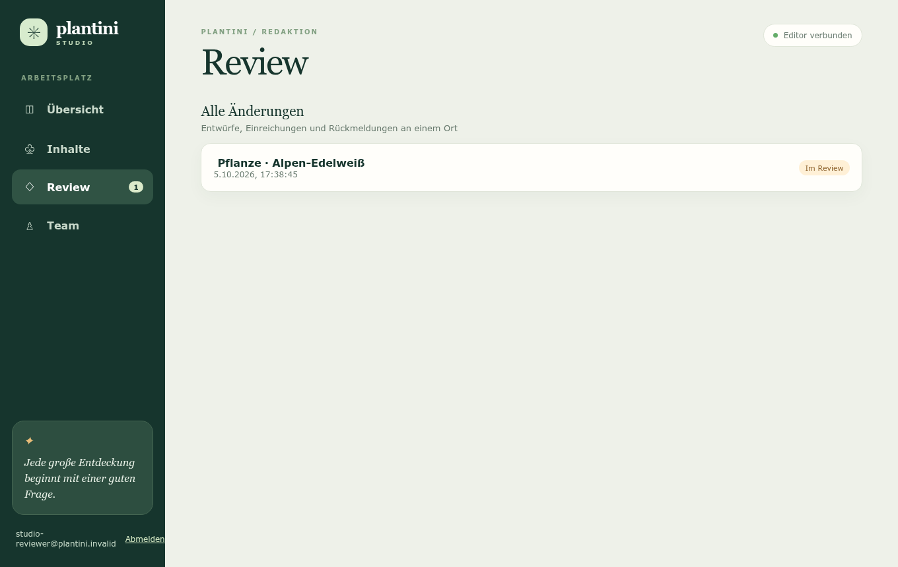

# Review-Prozess

Diese Seite ist für Personen mit der Rolle **botanisches Review** (`botanisches_review`) oder **Administration** (`systemadministration`). Du entscheidest, ob eingereichte Änderungen fachlich in Ordnung sind: Du gibst sie frei oder weist sie mit einer Begründung zurück.

!!! warning "Freigabe veröffentlicht heute noch nichts"
    „Fachlich freigeben“ speichert deine Entscheidung. Die Änderung gelangt **nicht** in die App, weil der Schritt „freigegebene Entwürfe in ein geprüftes Release übernehmen“ noch nicht umgesetzt ist. Dein Kommentar-Dialog sagt das auch ausdrücklich. Hintergrund: [Einstieg Moderation](index.md#vom-entwurf-zur-app).

## Die Review-Seite

<figure markdown="span">
  
  <figcaption>Review: Liste aller Änderungen und das Prüffenster mit den Schaltflächen „Fachlich freigeben“ und „Zurückweisen“.</figcaption>
</figure>

- Die Liste heißt für dich **„Alle Änderungen“** (für die Redaktion „Meine Änderungen“) und ist nach letzter Änderung sortiert (neueste zuerst, höchstens 500 Einträge).
- Ein Klick auf einen Eintrag öffnet das **Prüffenster** („Änderung prüfen“): Bei Status „Im Review“ oder „Fachlich freigegeben“ gibt es keine Schaltfläche zum Speichern.
- Das Badge an „Review“ in der Seitenleiste zeigt die Zahl der Änderungen im Status „Im Review“.
- Neben Typ und Titel (Name, Titel oder Deutscher Name) steht Datum und, falls vorhanden, die letzte Review-Notiz.

### Zustände

| Etikett | Status (technisch) | Was du tun kannst |
| --- | --- | --- |
| Entwurf | `draft` | nichts. Öffnest du den Entwurf einer anderen Person, bietet das Fenster „Entwurf speichern“ und „Zum Review einreichen“ an; beides scheitert mit „Die angefragte Ressource ist für dieses Konto nicht verfügbar.“ |
| Im Review | `pending_review` | **freigeben** oder **zurückweisen** |
| Zurückgewiesen | `rejected` | nichts; die Autor:in überarbeitet und reicht neu ein. |
| Fachlich freigegeben · wartet auf Release | `approved` | nichts; die Freigabe ist endgültig. |

!!! warning "Im Prüffenster nichts korrigieren"
    Im Status „Im Review“ lassen sich die einfachen Formularfelder (Texte, Auswahlfelder) im Fenster noch **eintippen**; nur die verschachtelten Felder (Quellen, Lernkarten, Quizantworten, Abschlussregel) sind gesperrt. Es gibt aber keine Schaltfläche zum Speichern – alles, was du tippst, geht beim Schließen verloren. Eine Korrektur gehört **in die Begründung der Zurückweisung**, nicht ins Formular.

Der Wechsel „Im Review → Fachlich freigegeben“ ist endgültig: Im Code gibt es keinen Weg zurück aus `approved`.

## Was du prüfst

Das Studio zeigt dir nur den eingereichten Inhalt, **keinen Vergleich** mit dem bisherigen Stand. Bei Änderungen an einem bestehenden Inhalt hilft es, den aktuellen Stand parallel im Inhaltsbaum zu öffnen (ohne zu speichern, dann schließen – ein Klick im Baum beginnt nur dann einen Entwurf, wenn du speicherst) und beide zu vergleichen.

### Checkliste

**Fachlich**

- [ ] Stimmen Art, wissenschaftlicher Name und deutscher Name überein? Passt die Familie?
- [ ] Sind Merkmale, Standort, Blüte-/Fruchtzeit und Verwechslungshinweise korrekt?
- [ ] Belegen die Quellen die Aussagen wirklich (direkte Artenseite statt allgemeiner Suchseite)? Sind die Links `https://`?
- [ ] Ist der Sicherheitshinweis vorhanden und korrekt (Verzehr, Berührung, Giftigkeit, Verwechslung mit giftigen Arten, Sammelverbot/Schutzstatus)? Fehlt er bei einer Risikoart, ist das ein Grund zur Zurückweisung.
- [ ] Stimmen Lernkarten und Quizfragen mit dem Steckbrief überein, ohne neue, unbelegte Behauptungen?
- [ ] Ist bei Aggregaten oder schwer trennbaren Arten klar, dass die Bestimmung Lernniveau ist, keine Feldgarantie?

**Sprachlich und didaktisch**

- [ ] Verständlich für die Zielgruppe, ohne Fehler in Rechtschreibung und Grammatik, einheitliche Anrede.
- [ ] Jede Frage hat **eine** eindeutig richtige Antwort; die falschen sind plausibel, aber klar falsch (keine Scherzantworten, keine zwei richtigen).
- [ ] Die richtige Antwort steht wörtlich im Lerntext der Karte (das prüft der Server; achte zusätzlich darauf, dass der Text sie wirklich erklärt).
- [ ] Schwierigkeit und Reihenfolge der Level sind sinnvoll; die Abschlussregel ist erreichbar (`minimumScore` zwischen 0 und 1).

**Rechtlich und Datenschutz**

- [ ] Keine personenbezogenen Daten (Namen, Fundorte von Privatpersonen) in Texten.
- [ ] Bilder (falls erwähnt): Urheber, Lizenz, Quelle und Alt-Text vorhanden; keine NC/ND-Lizenzen. Mehr in [Qualität & Lizenzen](qualitaet-lizenzen.md).
- [ ] Keine Texte, die aus fremden Quellen übernommen wurden, ohne dass ein Nutzungsrecht besteht.

## Freigeben

1. Öffne die Änderung im Status „Im Review“.
2. Klicke **Fachlich freigeben**.
3. Es erscheint ein Eingabefeld: „Optionaler Review-Kommentar (die Freigabe veröffentlicht noch nichts):“. Du kannst einen Kommentar eintragen (bis 2000 Zeichen) oder leer lassen und bestätigen. **Abbrechen** bricht die Freigabe ab.
4. Meldung: „Fachlich freigegeben. Veröffentlichung wartet auf ein geprüftes Release.“

<figure markdown="span">
  
  <figcaption>Ablauf einer Freigabe im Studio.</figcaption>
</figure>

Beim Freigeben prüft der Server erneut: dieselbe Prüfsumme, dass der Slug frei ist, dass alle Bezüge existieren und dass der Ausgangsstand unverändert ist.

## Zurückweisen

1. Klicke **Zurückweisen**.
2. Es erscheint ein Eingabefeld: „Bitte begründe die Zurückweisung (mindestens 3 Zeichen):“.
3. Trage eine **Begründung von 3 bis 2000 Zeichen** ein. Eine leere oder zu kurze Begründung wird abgelehnt: „note: Eine Begründung von 3 bis 2000 Zeichen ist erforderlich.“
4. Meldung: „Änderung wurde zurückgewiesen.“ Die Begründung sieht die Autor:in im Prüffenster („Review: …“) und in der Liste.

Danach bearbeitet die Autor:in den Entwurf (er wird beim Speichern wieder „Entwurf“) und reicht ihn erneut ein. Die frühere Begründung bleibt im Verlauf erhalten.

!!! tip "Ein einzelnes Eingabefeld"
    Der Kommentar wird in einem einfachen, einzeiligen Browser-Dialog eingegeben. Schreibe längere Rückmeldungen am besten vorab in einem Texteditor und füge sie ein.

## „Inhalt hat sich geändert“: die Prüfsumme

Beim Einreichen berechnet der Server einen Fingerabdruck (SHA-256) des Inhalts und speichert ihn. Beim Freigeben und Zurückweisen vergleicht er ihn mit dem aktuellen Inhalt. Weicht er ab, lautet die Meldung:

> Der eingereichte Inhalt hat sich geändert. Bitte erneut einreichen. (`EDITOR_PAYLOAD_CHANGED`)

Das bedeutet: Der Inhalt, den du siehst, ist nicht mehr der, der eingereicht wurde. Im normalen Studio-Betrieb kann das nicht passieren, weil eingereichte Entwürfe gesperrt sind; die Prüfung ist eine zusätzliche Sicherung gegen Eingriffe an der Datenbank vorbei. Tritt die Meldung doch auf, **weder** freigeben **noch** wiederholen, sondern die Entwicklung informieren.

## Konflikte

Konflikte erscheinen als rote Meldung; deine Entscheidung wird dann **nicht** gespeichert, die Änderung bleibt „Im Review“.

| Meldung | Code | Ursache | Was tun |
| --- | --- | --- | --- |
| „Der veröffentlichte Inhalt hat sich seit dem Entwurf geändert. Bitte neu erstellen.“ | `EDITOR_BASE_CHANGED` | Der Inhalt, auf dem der Entwurf aufbaut, wurde inzwischen geändert (oder gelöscht). | Zurückweisen mit Hinweis, dass der Entwurf auf dem aktuellen Stand neu erstellt werden muss. Die Autor:in kopiert ihre Texte (z. B. per Raw JSON) in einen neuen Entwurf. Ein erneutes Einreichen des alten Entwurfs scheitert wieder. |
| „Dieser Slug wird bereits verwendet.“ | `EDITOR_SLUG_EXISTS` | Ein anderer Inhalt desselben Typs trägt den Slug. | Zurückweisen und anderen Slug verlangen. |
| „Das neue Inhaltsziel existiert bereits. Bitte neu laden.“ | `EDITOR_TARGET_EXISTS` | Ein als „neu“ eingereichter Inhalt existiert inzwischen. | Zurückweisen; als Änderung am vorhandenen Inhalt neu beginnen. |
| „Für dieses Ziel oder diesen Slug wartet bereits eine freigegebene Änderung auf das Release.“ | `EDITOR_APPROVED_CONFLICT` | Für denselben Inhalt oder Slug liegt schon eine Freigabe vor, die noch nicht übernommen wurde. | Warten oder – bei einer echten Verbesserung – mit der Autor:in und der Entwicklung klären, wie die Freigaben zusammengeführt werden. |
| „Referenz [Typ]/[ID] ist nicht vorhanden.“ | `VALIDATION_FAILED` (`relations`) | Ein verwiesenes Ökosystem, Level, eine Pflanze oder ein Quiz gibt es nicht. | Zurückweisen und Bezug korrigieren lassen. |
| „Der Änderungsstatus hat sich inzwischen geändert. Bitte neu laden.“ | `EDITOR_CHANGE_STATE_CHANGED` | Zeitgleich hat jemand anderes entschieden. | Seite neu laden und aktuellen Status ansehen. |
| „Die angefragte Ressource ist für dieses Konto nicht verfügbar.“ | `EDITOR_CHANGE_NOT_PENDING` | Die Änderung ist nicht (mehr) „Im Review“. | Seite neu laden. |

!!! note "Wartende Freigaben blockieren"
    Solange keine Übernahme in ein Release existiert, bleibt jede Freigabe „wartend“. Dadurch kann für denselben Inhalt oder Slug keine zweite Änderung eingereicht oder freigegeben werden (`EDITOR_APPROVED_CONFLICT`). Gib Änderungen am selben Inhalt deshalb möglichst gebündelt frei und stimme dich mit der Autor:in ab.

## Verlauf (Review-Events)

Jede Einreichung und Entscheidung wird im Verlauf festgehalten (`reviewEvents`). Im Prüffenster steht er unter „Review-Verlauf“, eine Zeile je Ereignis:

```
05.10.2026, 09:12:44 · Eingereicht
05.10.2026, 10:03:10 · Zurückgewiesen: Quelle 2 belegt die Giftigkeitsangabe nicht. Bitte direkte Artenseite verlinken.
05.10.2026, 14:20:31 · Eingereicht
05.10.2026, 14:45:02 · Fachlich freigegeben: Quellen passen, Hinweis zum Verzehr ergänzt.
```

(Beispielzeilen; Format wie im Studio. Zeitstempel erscheinen in deutscher Schreibweise.) Der Verlauf bleibt auch nach einer Zurückweisung und erneutem Einreichen erhalten und lässt sich nicht bearbeiten. Er zeigt den Akteur nicht als Name an, sondern speichert intern die Kennung des Kontos.

## Selbstfreigabe

Der Server prüft **nicht**, ob die freigebende Person auch die Autor:in ist. Als Reviewer:in oder Administrator:in kannst du deine **eigenen** Entwürfe also freigeben. Das ist laut Projektunterlagen (`knowledge/editor-studio.md`) vom Auftraggeber ausdrücklich so vorgesehen, aber eine Ausnahme vom üblichen Vier-Augen-Prinzip.

Vorschlag für die Praxis (redaktionelle Empfehlung, nicht technisch erzwungen):

- Gib eigene Entwürfe nur frei, wenn niemand anderes kurzfristig prüfen kann, und vermerke das im Kommentar („Selbstfreigabe, nicht gegengeprüft“).
- Bei Inhalten mit Gesundheits- oder Giftigkeitsbezug bitte eine zweite Person ansehen lassen, bevor du freigibst.
- Die **Grenze**: Die Selbstfreigabe gilt nur für Reviewer und Administration. Ein Konto mit nur `inhaltsredaktion` kann gar nicht freigeben (`REVIEW_FORBIDDEN`: „Nur das botanische Review darf Inhalte freigeben.“). Beim späteren Einführen der Veröffentlichung muss die Regel bewusst neu entschieden werden.

## Was nach der Freigabe passiert

1. Status wird „Fachlich freigegeben · wartet auf Release“. In der Übersicht zählt die Kachel „Wartet auf Release“.
2. Im Prüffenster steht „Fachlich freigegeben; noch nicht in der App veröffentlicht.“
3. Der veröffentlichte Inhalt und die App bleiben unverändert.
4. Später soll ein geprüftes, versioniertes Release freigegebene Änderungen atomar übernehmen. Dieser Schritt ist **noch nicht umgesetzt**; die Anforderungen stehen in `knowledge/editor-studio.md`.

## Beispiele für gute Review-Kommentare

Ein guter Kommentar nennt **was**, **wo** und **was zu tun ist**.

| Situation | Weniger hilfreich | Hilfreich |
| --- | --- | --- |
| Quelle passt nicht | „Quelle falsch.“ | „Quellen, Eintrag 2: Die Seite beschreibt nur die Gattung, nicht die Art. Bitte die Artenseite der Flora verlinken, die den Standort belegt.“ |
| Sicherheitshinweis fehlt | „Hinweis fehlt.“ | „Sicherheitshinweis: Die Pflanze ist giftig und mit Bärlauch verwechselbar. Bitte warnen: nicht sammeln oder probieren; Geruch allein ist kein sicheres Merkmal.“ |
| Lernkarte unklar | „Frage schlecht.“ | „Lernkarte 2: Antwort B und C sind beide vertretbar. Bitte Antwort C so ändern, dass sie eindeutig falsch ist (z. B. andere Fruchtform).“ |
| Falsche Fachaussage | „Stimmt nicht.“ | „Beschreibung, 2. Satz: Die Blätter sind wechselständig, nicht gegenständig. Bitte korrigieren und Lernkarte 1 anpassen, die darauf aufbaut.“ |
| Freigabe | „OK.“ | „Fachlich geprüft anhand der verlinkten Artenseite; Sicherheitshinweis passt. Schutzstatus nicht geprüft.“ |
| Teilprüfung | – | „Nur Sprache und Quiz geprüft, botanische Details nicht.“ (Unsicheres ausdrücklich kennzeichnen.) |

## Weiterführend

- [Studio-Handbuch](studio-handbuch.md) – Bedienung und Fehlermeldungen aus Sicht der Redaktion
- [Qualität & Lizenzen](qualitaet-lizenzen.md) – Kriterien und Checkliste zum Ausdrucken
- [Einstieg Moderation](index.md) – Rollen und Glossar
- Technischer Hintergrund: [Studio technisch](../studio/studio-technik.md) (Zustandsautomat, Fehlercodes `EDITOR_*`)

