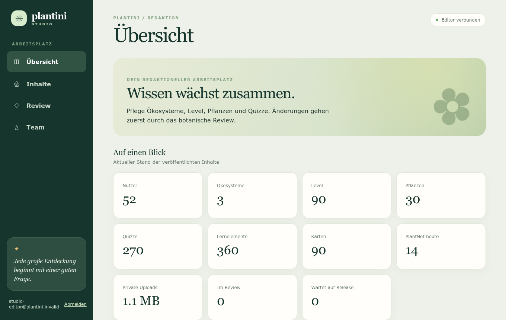
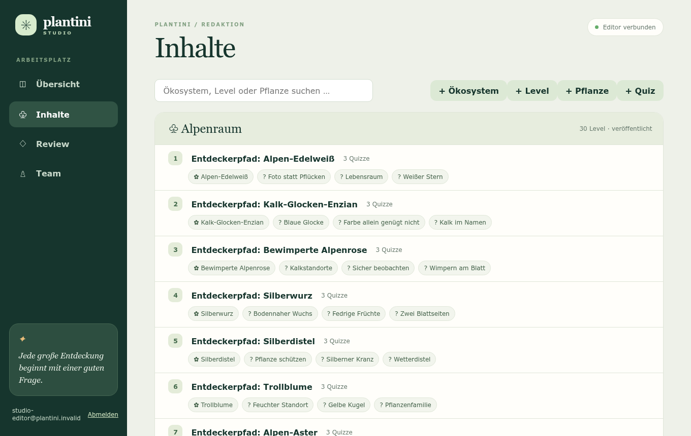
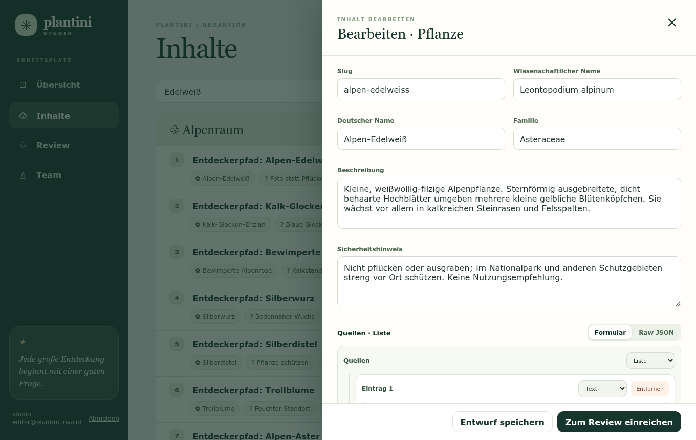
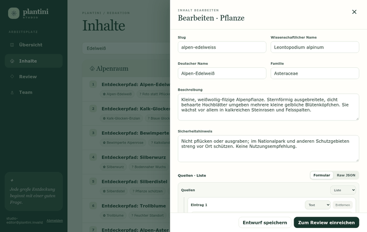
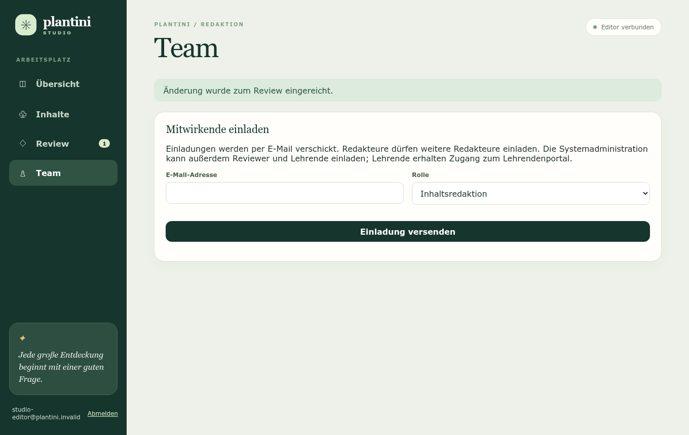

# Studio-Handbuch

Dieses Handbuch führt dich Schritt für Schritt durch das Studio: anmelden, die Übersicht lesen, einen Entwurf anlegen, alle Formularfelder ausfüllen, einreichen und Fehlermeldungen verstehen. Du brauchst dafür keine Programmierkenntnisse. Die Rollen und den Weg vom Entwurf zur App erklärt der [Einstieg für Moderation](index.md).

!!! note "Stand"
    Alle Bezeichnungen (Schaltflächen, Feldnamen, Meldungen) stammen aus dem aktuellen Code des Studios (`apps/editor/app.js`, `apps/editor/json-editor.js`) und des Servers (`services/platform/src/api/platform/services/core/editor/editor-service.js`). Freigaben veröffentlichen heute noch nichts in der App.

## 1. Anmelden

1. Öffne die Adresse des Studios, die du von der Systemadministration bekommen hast (sie beginnt mit `studio.`).
2. Das Studio leitet dich automatisch zur Anmeldeseite weiter. Melde dich mit deinem Konto an.
3. Nach dem Login landest du auf der **Übersicht**. In der Seitenleiste unten steht dein Name mit der Schaltfläche **Abmelden**.

**Neu eingeladen?** Du bekommst eine E-Mail mit einem Link. Du musst deine E-Mail-Adresse bestätigen und ein Passwort festlegen; danach führt dich der Link zurück ins Studio. Das Passwort muss die Vorgaben des Systems erfüllen (mindestens 14 Zeichen, nicht gleich Benutzername oder E-Mail, nicht eines der letzten fünf).

**Administration:** Für die Rolle `systemadministration` verlangt die Anmeldung zusätzlich einen Code aus einer Authenticator-App (TOTP, 6 Stellen, 30 Sekunden). Wie die erste Einrichtung der App abläuft, regelt Keycloak; der Ablauf im Browser wurde für dieses Handbuch **nicht** geprüft.

| Meldung beim Start | Bedeutung und Lösung |
| --- | --- |
| „Dieses Konto hat keine Redaktionsrolle. Bitte die Systemadministration kontaktieren.“ | Dein Konto hat keine der Rollen `inhaltsredaktion`, `botanisches_review`, `systemadministration`. Bitte die Administration um die Rolle. |
| „Anmeldung fehlgeschlagen: …“ | Keycloak hat die Anmeldung abgelehnt; der Text dahinter nennt den Grund. |
| „Ungültige Anmeldeantwort. Bitte erneut anmelden.“ | Die Seite wurde mit einem alten Anmeldelink geöffnet. Öffne das Studio neu über die normale Adresse. |
| „Anmeldung konnte nicht abgeschlossen werden.“ | Der Code wurde nicht akzeptiert. Neu laden und erneut anmelden. |

!!! warning "Speichere oft"
    Das Studio hält Eingaben nur im geöffneten Fenster. Wenn deine Sitzung abläuft (laut Realm-Vorlage gilt das Zugriffstoken 5 Minuten und wird im Hintergrund erneuert; nach etwa 30 Minuten Leerlauf endet die Anmeldung), schickt dich das Studio zur Anmeldeseite zurück – **nicht gespeicherte Eingaben sind dann weg**. Auch ein Neuladen der Seite verwirft sie. Klicke bei längeren Texten regelmäßig auf **Entwurf speichern**.

## 2. Die Übersicht lesen

<figure markdown="span">
  
  <figcaption>Übersicht: elf Kennzahlen und zwei Einstiegskarten.</figcaption>
</figure>

Die Kacheln zeigen **veröffentlichte** Inhalte bzw. den Stand der Entwürfe:

| Kachel | Was sie zählt |
| --- | --- |
| Nutzer | Angelegte Profile (Lernende, Lehrende, Redaktion). |
| Ökosysteme, Level, Pflanzen, Quizze | Veröffentlichte Datensätze der jeweiligen Art. |
| Lernelemente | Level plus Quizze. |
| Karten | Pflanzen × 3 (jede Pflanze hat drei Lernkarten). |
| PlantNet heute | Heutige Zugriffe auf den Bestimmungsdienst. „—“ heißt: nicht verfügbar, **nicht** null. |
| Private Uploads | Speicher der hochgeladenen privaten Fotos, in MB. |
| Im Review | Änderungen mit Status „Im Review“. |
| Wartet auf Release | Fachlich freigegebene Änderungen, die noch nicht übernommen wurden. |

Die Karte **Freigaben** weist darauf hin, dass Veröffentlichungen erst nach einem konsistenten Content-Release aktiviert werden.

## 3. Der Inhaltsbaum

<figure markdown="span">
  
  <figcaption>Inhalte: Ökosystem → Level → Pflanzen (✿) und Quizze (?).</figcaption>
</figure>

- Jedes **Ökosystem** ist ein Block; darunter stehen seine **Level** mit Nummer. An jedem Level hängen **Pflanzen** (✿) und **Quizze** (?) als anklickbare Chips.
- Pflanzen, die in keinem Level vorkommen, stehen unter „Nicht zugeordnete Pflanzen“.
- Das **Suchfeld** filtert nach Titel und Slug.
- Neben jedem Ökosystem steht „veröffentlicht“ oder „Entwurf“. „Entwurf“ bedeutet hier: Der Datensatz selbst ist in der Datenbank noch unveröffentlicht – es ist **nicht** dein Studio-Entwurf.
- Über **+ Ökosystem**, **+ Level**, **+ Pflanze**, **+ Quiz** legst du etwas Neues an.

!!! warning "Deine Entwürfe stehen nicht im Baum"
    Der Baum zeigt nur vorhandene Datensätze. Deine Entwürfe findest du unter **Review**. Klickst du im Baum auf einen Eintrag, beginnst du **immer einen neuen Entwurf** dafür. Willst du einen vorhandenen Entwurf weiterbearbeiten, öffne ihn über **Review**, sonst entstehen mehrere parallele Entwürfe desselben Inhalts.

## 4. Einen Entwurf anlegen und bearbeiten

<figure markdown="span">
  
  <figcaption>Das Bearbeitungsfenster (Drawer) mit Formularfeldern und Aktionen.</figcaption>
</figure>

<figure markdown="span">
  
  <figcaption>Ablauf von „+ Pflanze“ bis „Zum Review einreichen“.</figcaption>
</figure>

1. Klicke auf **+ Pflanze** (oder einen anderen Typ) oder auf einen vorhandenen Eintrag. Rechts öffnet sich das Bearbeitungsfenster. Die Überschrift lautet „Neu anlegen · Pflanze“ bzw. „Bearbeiten · …“.
2. Fülle die Felder aus (siehe Abschnitt 5). Bei einem vorhandenen Eintrag sind sie mit dem aktuellen Stand vorbefüllt – du änderst nur, was sich ändern soll.
3. **Entwurf speichern** sichert deinen Stand. Das Fenster bleibt offen; du kannst weiterarbeiten. Die Meldung „Entwurf gespeichert.“ erscheint kurz oben.
4. **Zum Review einreichen** speichert und reicht in einem Schritt ein. Danach schließt das Fenster, und es erscheint „Änderung wurde zum Review eingereicht.“
5. Mit **×** oder einem Klick neben das Fenster schließt du es **ohne** zu speichern.

### Speichern oder einreichen?

| | Entwurf speichern | Zum Review einreichen |
| --- | --- | --- |
| Prüft der Server | nur das Format (Pflichtfelder, Längen, Slug-Schreibweise, Lernkarten-Regeln) | zusätzlich: Slug noch frei, Bezüge vorhanden, Ausgangsstand unverändert, keine wartende Freigabe |
| Status danach | Entwurf | Im Review |
| Weiter bearbeiten | ja | nein, bis zur Entscheidung des Reviews |
| Sichtbar für | dich (Review sieht alle Änderungen) | dich und das Review |

Ein eingereichter Entwurf kann nicht mehr geändert werden: Es gibt dann keine Schaltfläche zum Speichern, und die verschachtelten Felder (Quellen, Lernkarten usw.) sind gesperrt. Einfache Textfelder lassen sich zwar noch eintippen, doch nichts davon wird gespeichert. Oben steht „Änderung prüfen“. Nach einer **Zurückweisung** bearbeitest du den Entwurf wieder: oben im Fenster steht die Begründung des Reviews („Review: …“), darunter der Review-Verlauf.

!!! warning "Wenn das Einreichen scheitert"
    **Zum Review einreichen** speichert zuerst. Scheitert danach die Prüfung (z. B. „Dieser Slug wird bereits verwendet.“), ist dein Entwurf **trotzdem gespeichert**. Klicke dann nicht erneut auf „Zum Review einreichen“, wenn du den Entwurf nicht vorher mit **Entwurf speichern** gesichert hattest – das legt einen weiteren Entwurf an (das Fenster merkt sich den neuen Entwurf erst nach „Entwurf speichern“). Korrigiere stattdessen den Fehler und öffne den gespeicherten Entwurf über **Review**.

## 5. Die Formularfelder je Inhaltstyp

Feldnamen erscheinen so, wie das Studio sie anzeigt. Felder, die als „Pflicht“ gekennzeichnet sind, prüft der Server; das Formular selbst markiert nur Auswahlfelder als erforderlich. Textfelder werden beim Speichern von Leerzeichen am Rand befreit.

!!! tip "Slug-Regel (für alle Typen)"
    Der **Slug** ist ein Kurzname aus Kleinbuchstaben a–z, Ziffern und einzelnen Bindestrichen, ohne Umlaute, Leerzeichen und Sonderzeichen. Gültig: `rotbuche`, `streuobstwiese-2`. Ungültig: `Rotbuche`, `rot buche`, `größe`, `-rotbuche`, `rot--buche`. Meldung bei Verstoß: „Slug: Ein eindeutiger ASCII-Slug ist erforderlich.“ Der Slug muss pro Typ **eindeutig** sein; das prüft der Server erst beim Einreichen.

### Ökosystem

| Feld | Pflicht | Grenze | Hinweis |
| --- | --- | --- | --- |
| Slug | ja | siehe Slug-Regel | z. B. `mitteleuropaeischer-laubwald` |
| Name | ja | höchstens 160 Zeichen | Anzeigename |
| Beschreibung | nein | höchstens 10 000 Zeichen | Kurzer Einführungstext |
| Klimazone | nein | 120 | z. B. „gemäßigte Zone“ |
| Region | nein | 120 | z. B. „Mitteleuropa“ |
| Jahreszeit | nein | 120 | z. B. „ganzjährig; Schwerpunkt März bis Oktober“ |
| Sprache | nein | 12 | Standard `de` |

### Level

| Feld | Pflicht | Grenze | Hinweis |
| --- | --- | --- | --- |
| Slug | ja | Slug-Regel | |
| Titel | ja | 200 | |
| Reihenfolge | ja | ganze Zahl 1 bis 10 000 | Position des Levels im Ökosystem |
| Schwierigkeit | nein | 80 | Freitext |
| Lernziel | nein | 10 000 | |
| `ecosystemId` (Auswahl) | ja | vorhandenes Ökosystem | Das Feld trägt den technischen Namen; wähle das Ökosystem aus der Liste. |
| Pflanzen in diesem Level | ja | 1 bis 30 Pflanzen | Kontrollkästchen; es werden alle vorhandenen Pflanzen angeboten. |
| Abschlussregel | ja | siehe unten | verschachteltes Feld |

**Abschlussregel** (Feld mit Formular-/Raw-JSON-Ansicht):

| Teilfeld | Bedeutung | Regel |
| --- | --- | --- |
| Mindestpunktzahl (`minimumScore`) | Anteil richtiger Antworten, ab dem das Level bestanden ist | Zahl von **0 bis 1** (Standard im neuen Entwurf: `0.7` = 70 %) |
| Benötigte Quiz-IDs (`requiredQuizIds`) | Quizze, die gelöst sein müssen | Liste von UUIDs, darf leer sein |
| Benötigte Pflanzen-IDs (`requiredPlantIds`) | Pflanzen, die gesammelt sein müssen | Liste von UUIDs, darf leer sein |
| Benötigte Level-IDs (`requiredLevelIds`) | Level, die zuvor bestanden sein müssen | Liste von UUIDs, darf leer sein |
| Sammelbereich (`collectionScope`) | Wo gesammelt wird | `level` oder `ecosystem` |

Die UUIDs musst du **von Hand eintragen**; es gibt keine Auswahlliste. Ungültige Einträge werden mit „Muss eine UUID sein.“ abgelehnt, nicht vorhandene Bezüge beim Einreichen.

### Pflanze

| Feld | Pflicht | Grenze | Hinweis |
| --- | --- | --- | --- |
| Slug | ja | Slug-Regel | z. B. `rotbuche` |
| Wissenschaftlicher Name | ja | 160 | z. B. „Fagus sylvatica“ |
| Deutscher Name | ja | 160 | |
| Familie | nein | 160 | z. B. „Buchengewächse (Fagaceae)“ |
| Beschreibung | ja | 20 000 | Steckbrief in eigenen Worten |
| Sicherheitshinweis | technisch nein, **fachlich ja bei Risiko** | 10 000 | Warnung zu Verzehr, Berühren, Sammeln, Verwechslung |
| Quellen | ja | mind. 1 Eintrag | jeder Eintrag beginnt mit `https://` |
| Merkmale | nein | Liste | freie Liste; ein bestimmter Aufbau wird nicht geprüft |
| Lernkarten | ja | **genau 3** | siehe unten |

**Lernkarten** – jede der drei Karten hat sieben Textfelder; alle müssen ausgefüllt sein:

| Feld | Bedeutung |
| --- | --- |
| Überschrift (`heading`) | Thema der Karte, z. B. „Rinde“ |
| Steckbrief-Text (`text`) | Lerntext, der **die richtige Antwort wörtlich enthält** |
| Frage (`question`) | Frage zur Karte |
| Richtige Antwort (`correctAnswer`) | genau eine |
| Falsche Antwort 1, 2, 3 | drei plausible, aber falsche Antworten |

Regeln des Servers (`validateLearningCards`): genau drei Karten; vier **verschiedene** Antworten (Groß-/Kleinschreibung und Leerraum zählen nicht); die richtige Antwort muss im Text vorkommen (ebenfalls ohne Beachtung von Groß-/Kleinschreibung). Beispiel einer gültigen Karte:

```json
{
  "heading": "Winterknospen",
  "text": "Auch ohne Blätter liefert der Zweig einen Hinweis: Die Winterknospen sind lang, schmal und spitz. Schau dir mehrere Knospen an, ohne sie abzubrechen.",
  "question": "Wie sehen die Winterknospen der Rotbuche typischerweise aus?",
  "correctAnswer": "Lang, schmal und spitz",
  "wrongAnswer1": "Kurz, rund und schwarz",
  "wrongAnswer2": "Grün und klebrig",
  "wrongAnswer3": "Unter Blattstielresten verborgen"
}
```

### Quiz

| Feld | Pflicht | Hinweis |
| --- | --- | --- |
| Slug | ja | Slug-Regel |
| Titel | ja | höchstens 200 Zeichen |
| Fragetyp | ja | Auswahl: `multiple-choice`, `flashcard`, `identification`, `feature-match` |
| Frage und Antworten | ja | siehe unten |
| `levelId` (Auswahl) | ja | zugehöriges Level |
| `plantId` (Auswahl) | ja | zugehörige Pflanze |

Der Aufbau von **Frage und Antworten** ist für alle vier Fragetypen gleich:

```json
{
  "prompt": "Welches Rindenmerkmal passt besonders gut zur Rotbuche?",
  "choices": [
    { "id": "choice-1", "label": "Glatt und weißgrau" },
    { "id": "choice-2", "label": "Tief gefurcht und schwarz" },
    { "id": "choice-3", "label": "Papierartig weiß abrollend" },
    { "id": "choice-4", "label": "Schuppig orange abblätternd" }
  ],
  "correctChoiceId": "choice-1"
}
```

Regeln: Frage (`prompt`) nicht leer; **genau vier** Antworten mit nicht leerem Text; die vier `id` und die vier Texte müssen sich unterscheiden (Groß-/Kleinschreibung zählt nicht); `correctChoiceId` muss die `id` einer der vier Antworten sein. Sonst erscheint „Frage und Antworten: Frage, vier Antworten und eine korrekte Antwort sind erforderlich.“

## 6. Verschachtelte Felder: Formular und Raw JSON

Quellen, Merkmale, Abschlussregel, Frage und Antworten sowie Lernkarten bearbeitest du in einem eingebetteten Editor (`apps/editor/json-editor.js`). Oben rechts im Feld wechselst du zwischen **Formular** und **Raw JSON**:

- **Formular:** Jeder Eintrag hat ein Eingabefeld, einen Datentyp (Text, Zahl, Ja/Nein, Objekt, Liste, Leer) und **Entfernen**. Mit **+ Eintrag** (Listen) oder **+ Feld** (Objekte, mit Feldname) fügst du etwas hinzu. Für die meisten Felder musst du den Datentyp nicht ändern.
- **Raw JSON:** Der gesamte Wert als Text. Nützlich, um z. B. eine vollständige Lernkarte hineinzukopieren. Achte auf korrekte Anführungszeichen und Kommas.
- Beim Wechsel zurück zu **Formular** wird dein Text geprüft. Bei einem Fehler bleibt die Ansicht stehen und es erscheint „Ungültiges JSON: …“.
- Beim Speichern in der Raw-Ansicht erscheint bei ungültigem Text „[Feldname]: ungültiges JSON.“
- Die Feldnamen `__proto__`, `prototype` und `constructor` sind gesperrt („Reservierter JSON-Feldname“).
- Bei Zahlen verlangt das Feld einen gültigen Wert; „Bitte zuerst die ungültige Zahl korrigieren.“ erscheint, wenn du mit einer leeren Zahl die Ansicht wechseln willst.

!!! tip "Typen nicht ändern"
    Ändere den Datentyp eines vorhandenen Feldes nur, wenn du genau weißt, was du tust – ein Wechsel ersetzt den Inhalt durch einen leeren Wert dieses Typs.

## 7. Bilder

Vorhandene Bilder einer Pflanze werden unter „Vorhandene Bilder“ mit Titel und Lizenz aufgelistet. Das Studio kann **keine Bilder hochladen oder zuordnen**; dort steht „Bildverwaltung folgt in einem eigenen Medien-Dialog.“ Hinweise zu Bildern: [Qualität & Lizenzen](qualitaet-lizenzen.md#bilder-und-lizenzen).

## 8. Fehlermeldungen und was sie bedeuten

Das Studio zeigt Fehler oben als rote Meldung (sie verschwindet nach etwa 7 Sekunden). Bei Formularfehlern steht „Feldname: Meldung“, mehrere getrennt durch „·“. Die Codes in Klammern sind die technischen Bezeichnungen (hilfreich für Rückfragen an die Entwicklung).

| Meldung | Code | Bedeutung und Lösung |
| --- | --- | --- |
| „Bitte markierte Formularfelder korrigieren.“ | – | Ein Auswahlfeld oder eine Zahl im Formular ist leer oder ungültig. |
| „Slug: Ein eindeutiger ASCII-Slug ist erforderlich.“ | `VALIDATION_FAILED` | Schreibweise prüfen (Slug-Regel). |
| „[Feld]: Text mit höchstens N Zeichen erforderlich.“ | `VALIDATION_FAILED` | Pflichtfeld leer oder zu lang. |
| „Quellen: Mindestens eine HTTPS-Quelle ist erforderlich.“ | `VALIDATION_FAILED` | Mindestens ein Link, jeder mit `https://` beginnend. |
| „Lernkarten: …: Genau drei vollständige Lernkarten erforderlich.“ | `VALIDATION_FAILED` | Genau drei Karten anlegen. |
| „Lernkarten: …, Lernkarte N: Überschrift, Text, Frage und vier Antworten ausfüllen.“ | `VALIDATION_FAILED` | In Karte N ist ein Feld leer. |
| „… Lernkarte N: Antworten müssen unterscheidbar sein.“ | `VALIDATION_FAILED` | Zwei Antworten sind (fast) gleich. |
| „… Lernkarte N: Die richtige Antwort muss im Steckbrief erklärt werden und wörtlich enthalten sein.“ | `VALIDATION_FAILED` | Die richtige Antwort muss im Steckbrief-Text stehen – passe Text oder Antwort an. |
| „Frage und Antworten: Frage, vier Antworten und eine korrekte Antwort sind erforderlich.“ | `VALIDATION_FAILED` | Quiz-Aufbau prüfen (Abschnitt 5, Quiz). |
| „Abschlussregel: Abschlussregel mit Punktzahl und ID-Listen erforderlich.“ | `VALIDATION_FAILED` | `minimumScore` zwischen 0 und 1 und alle drei ID-Listen müssen vorhanden sein. |
| „Reihenfolge: Reihenfolge muss eine positive Ganzzahl sein.“ | `VALIDATION_FAILED` | Zahl von 1 bis 10 000 eintragen. |
| „plantIds: Mindestens eine Pflanze und höchstens 30 Pflanzen auswählen.“ | `VALIDATION_FAILED` | Level braucht 1 bis 30 Pflanzen. |
| „relations: Referenz [Typ]/[ID] ist nicht vorhanden.“ | `VALIDATION_FAILED` | Ein verwiesener Inhalt existiert nicht (oder ist nur ein Entwurf). |
| „Unbekanntes Feld.“ | `VALIDATION_FAILED` | Nur bei Raw-JSON-Eingriffen: Es wurde ein nicht vorgesehenes Feld ergänzt. |
| „Dieser Slug wird bereits verwendet.“ | `EDITOR_SLUG_EXISTS` | Anderen Slug wählen. |
| „Das neue Inhaltsziel existiert bereits. Bitte neu laden.“ | `EDITOR_TARGET_EXISTS` | Den Inhalt gibt es inzwischen; Studio neu laden und als Änderung am vorhandenen Inhalt neu beginnen. |
| „Der veröffentlichte Inhalt hat sich seit dem Entwurf geändert. Bitte neu erstellen.“ | `EDITOR_BASE_CHANGED` | Jemand hat den Inhalt inzwischen geändert. Entwurf auf dem neuen Stand neu erstellen (siehe [Review-Prozess](review.md#konflikte)). |
| „Für dieses Ziel oder diesen Slug wartet bereits eine freigegebene Änderung auf das Release.“ | `EDITOR_APPROVED_CONFLICT` | Für denselben Inhalt (oder Slug) liegt schon eine Freigabe vor. Warten, bis sie übernommen ist. |
| „Der Entwurf wurde inzwischen geändert. Bitte neu laden.“ | `EDITOR_CHANGE_STATE_CHANGED` | Parallel (z. B. in zwei Tabs) gespeichert. Seite neu laden. |
| „Die angefragte Ressource ist für dieses Konto nicht verfügbar.“ | `EDITOR_CHANGE_NOT_EDITABLE` u. a. | Zusammengefasste Meldung für: nicht dein Entwurf, Status erlaubt keine Bearbeitung, Inhalt nicht gefunden. Prüfe Status und Autor:in. |
| „Für die Redaktion ist eine Redaktionsrolle erforderlich.“ | `EDITOR_FORBIDDEN` | Dein Konto hat keine Redaktionsrolle. |
| „Nur das botanische Review darf Inhalte freigeben.“ | `REVIEW_FORBIDDEN` | Du hast nur die Rolle Redaktion. |
| „Sitzung abgelaufen.“ | – | Du wirst zur Anmeldung geleitet; Eingaben gehen verloren. |
| „Anfrage fehlgeschlagen (N).“ | – | Allgemeiner Fehler ohne Detail (N = Statuscode); Entwicklung informieren. |

## 9. Team und Einladungen

<figure markdown="span">
  
  <figcaption>Team: Einladung per E-Mail mit Rollenauswahl.</figcaption>
</figure>

1. Öffne **Team**.
2. Trage die **E-Mail-Adresse** ein und wähle die **Rolle**.
3. Klicke **Einladung versenden**; die Meldung „Einladung wurde versendet.“ erscheint.

| Rolle in der Auswahl | Wer sie einladen darf |
| --- | --- |
| Inhaltsredaktion | Redaktion, Review, Administration |
| Botanisches Review | nur Administration |
| Lehrende · Lehrendenportal | nur Administration; die Person bekommt Zugang zum Lehrendenportal |

Die eingeladene Person erhält eine E-Mail zum Bestätigen der Adresse und Festlegen des Passworts. Eine Übersicht aller Teammitglieder gibt es im Studio noch nicht.

| Meldung | Code | Bedeutung |
| --- | --- | --- |
| „email: Eine gültige E-Mail-Adresse ist erforderlich.“ | `VALIDATION_FAILED` | Schreibweise der Adresse prüfen. |
| „Nur die Systemadministration darf Reviewer oder Lehrende einladen.“ | `EDITOR_INVITE_FORBIDDEN` | Diese Rolle kann nur die Administration vergeben. |
| „Für diese E-Mail-Adresse besteht bereits ein Keycloak-Konto.“ | `EDITOR_INVITEE_EXISTS` | Es gibt schon ein Konto. Rollen ändert die Administration direkt in Keycloak. |
| „Der Keycloak-Einladungsdienst ist nicht konfiguriert.“ | `EDITOR_INVITES_UNAVAILABLE` | Einladungen sind auf diesem System nicht eingerichtet (z. B. lokal). |
| „Das Konto wurde angelegt, die Rolle konnte aber nicht zugewiesen werden.“ / „Rolle zugewiesen, aber die Einladungs-E-Mail konnte nicht versendet werden.“ | `EDITOR_INVITES_UNAVAILABLE` | Teilweise gelungen: Das Konto existiert bereits. **Nicht** erneut einladen (das ergäbe „besteht bereits“), sondern die Administration bitten, das Konto in Keycloak zu prüfen. |

## 10. Kurzcheckliste vor dem Einreichen

- [ ] Slug klein geschrieben, ohne Umlaute, eindeutig.
- [ ] Pflichtfelder gefüllt, Namen korrekt geschrieben.
- [ ] Mindestens eine `https://`-Quelle, die die Aussagen wirklich belegt.
- [ ] Sicherheitshinweis bei Giftigkeit, Verwechslungsgefahr oder Schutzstatus gesetzt.
- [ ] Drei Lernkarten: Frage, eine richtige und drei falsche Antworten; die richtige Antwort steht im Text.
- [ ] Quiz: vier verschiedene Antworten, `correctChoiceId` passt.
- [ ] Gespeichert (**Entwurf speichern**), dann eingereicht.

Weiter mit dem [Review-Prozess](review.md) oder der [Checkliste in Qualität & Lizenzen](qualitaet-lizenzen.md#checkliste-zum-ausdrucken). Technische Details für Entwickler:innen: [Studio technisch](../studio/studio-technik.md).
