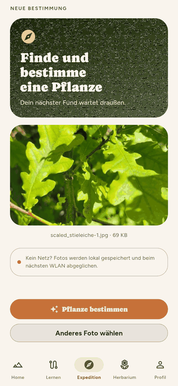
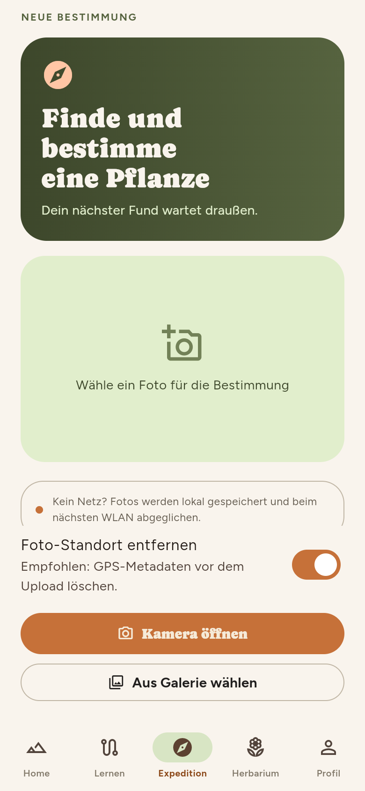
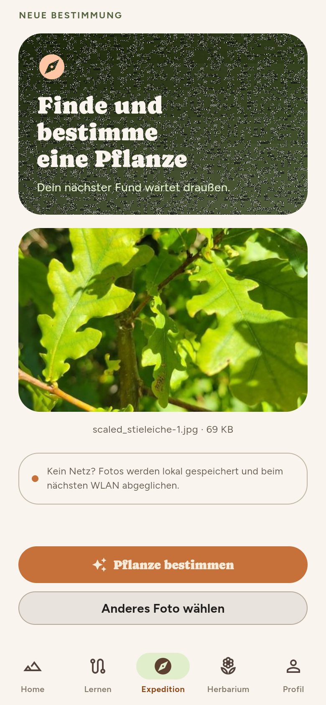
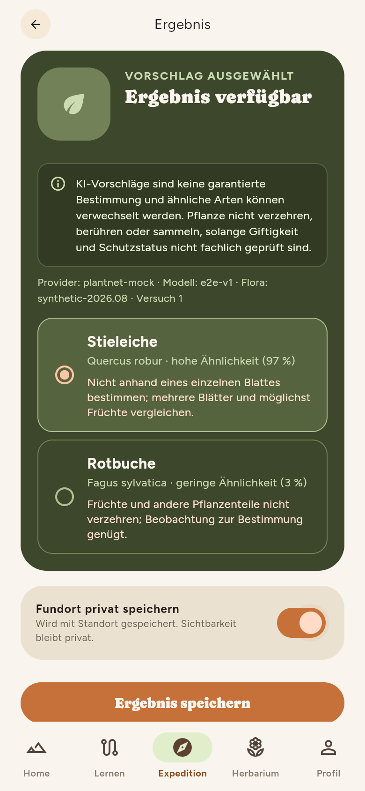

# Entdecken: Pflanzen bestimmen

Unter **Expedition** verbindest du das Gelernte mit der Natur: Du fotografierst eine Pflanze, die Plattform macht einen Bestimmungsvorschlag, du bestätigst – und der Fund landet im [Herbarium](herbarium.md).

!!! warning "Bitte nichts pflücken"
    Beobachten und fotografieren genügt. Viele Arten sind geschützt (der Steckbrief weist darauf hin). Eine Bestimmung ist ein **Vorschlag, keine garantierte Bestimmung** – das steht auch in der App. Giftige oder geschützte Pflanzen nie allein anhand eines Vorschlags beurteilen.

{ .pl-phone }

## Ablauf

1. **Foto aufnehmen oder wählen.** „Kamera öffnen“ nimmt ein neues Foto auf, „Aus Galerie wählen“ nimmt ein vorhandenes. Der Schalter **Foto-Standort entfernen** ist standardmäßig an: GPS-Angaben im Bild werden vor dem Upload gelöscht.
2. **Pflanze bestimmen.** Die App verkleinert das Bild, lädt es zur Plattform und startet die Bestimmung. Du siehst eine Ladeanimation; je nach Last dauert es einige Sekunden.
3. **Vorschlag wählen.** Die Plattform liefert mehrere Kandidaten mit Ähnlichkeit in Prozent. Wähle den passenden aus – oder keinen, wenn nichts stimmt.
4. **Fundort privat speichern.** Der Schalter ist standardmäßig **aus**; dann wird **kein** Standort gespeichert. Schaltest du ihn an, fragt die App nach der Standortfreigabe und speichert die Position des Fundes. Zum Server geht nur eine vergröberte Position (zwei Nachkommastellen, etwa 1 km). Verweigerst du die Freigabe oder ist der Standort zu ungenau (schlechter als 100 m), wird ohne Standort gespeichert.
5. **Ergebnis speichern.** Der Fund wird lokal angelegt und zum Server synchronisiert.

<figure markdown="span">
  { .pl-phone }
  <figcaption>Start der Expedition.</figcaption>
</figure>

<figure markdown="span">
  { .pl-phone }
  <figcaption>Foto gewählt.</figcaption>
</figure>

<figure markdown="span">
  { .pl-phone }
  <figcaption>Vorschlag ausgewählt.</figcaption>
</figure>

## Was mit dem Foto passiert

Das Bild geht an die Plattform und von dort an den Bestimmungsdienst **Pl@ntNet** (Frankreich). Das ist der einzige Fall, in dem Bilder das eigene System verlassen. Alle anderen Daten bleiben bei Plantini. Mehr dazu: [Sicherheit und Datenschutz](../architektur/sicherheit-datenschutz.md).

!!! info "Privat ist der Standard"
    Fotos und Fundorte sieht nur das eigene Konto. Der Server kennt höchstens die vergröberte Position; auch Lehrende sehen im Portal weder Fotos noch Orte, sondern nur den Lernfortschritt.

## Wenn etwas nicht klappt

| Meldung / Situation | Bedeutung | Was tun |
| --- | --- | --- |
| „Kein Netz? Fotos werden lokal gespeichert …“ | Hinweis im Formular | Foto wählen ist möglich; die Bestimmung selbst braucht Netz. |
| „Keine Verbindung“ | Upload oder Bestimmung nicht erreichbar | Netz prüfen, erneut versuchen. |
| Ergebnis dauert sehr lange | Der Bestimmungsdienst ist ausgelastet | Einige Minuten warten und erneut starten. |
| Keine Treffer | Das Bild zeigt keine erkennbare Pflanze | Näher heran, Blätter oder Blüten scharf im Bild, gutes Licht. |

??? tip "Für bessere Vorschläge"
    Ein Foto pro Organ (Blatt, Blüte, Frucht, Rinde) liefert deutlich bessere Treffer als eine Gesamtansicht aus der Ferne. Der Hintergrund sollte ruhig sein.

Der technische Ablauf (Upload, Auftrag, Abfrage, Bestätigung, Idempotenz) steht in [Bilder, Cache und Karte](../app/bilder-karte.md#feldablauf-von-der-kamera-zum-fund).

!!! bug "Bekannte Unstimmigkeit in der App"
    Ist der Schalter **aus**, zeigt die App darunter den Text „nur grobe Position · nie öffentlich · jederzeit löschbar“. Im Code (`_locationForSubmission` in `field_capture_screen.dart`) wird in diesem Fall aber überhaupt keine Position gesendet. Der Hilfetext verspricht also mehr, als passiert; er sollte angepasst werden.
