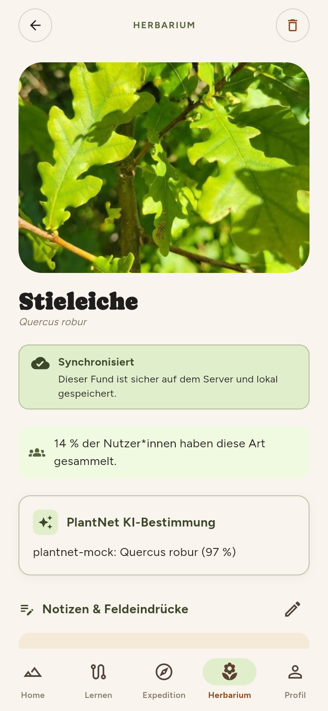
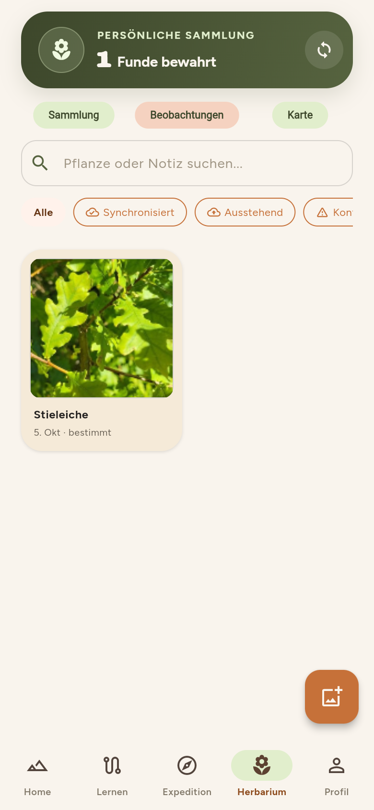
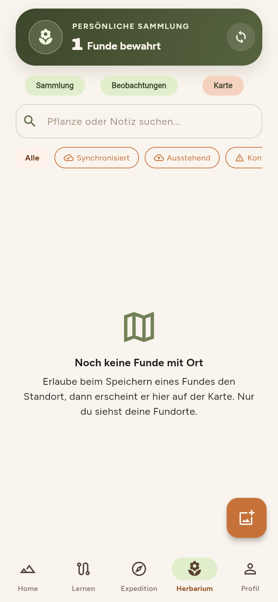

# Herbarium

Das Herbarium ist deine persönliche Sammlung. Es ist **offline lesbar**: Funde werden zuerst auf dem Gerät gespeichert und später mit dem Server abgeglichen.

<figure markdown="span">
  { .pl-phone }
  <figcaption>Sammlung: Regal je Ökosystem.</figcaption>
</figure>

<figure markdown="span">
  { .pl-phone }
  <figcaption>Beobachtungen: deine Funde als Karten.</figcaption>
</figure>

<figure markdown="span">
  { .pl-phone }
  <figcaption>Karte: nur Funde mit gespeichertem Ort.</figcaption>
</figure>

## Die drei Ansichten

| Ansicht | Inhalt |
| --- | --- |
| **Sammlung** | Ein „kleines Naturmuseum“: je Ökosystem ein Regal mit Glasflaschen für jede Art. Gefundene Arten sind gefüllt, fehlende zeigen „Noch zu entdecken“. Der Balken zeigt, wie viele Arten du hast. |
| **Beobachtungen** | Alle Funde als Karten mit Foto, Name und Datum; mit Suche und Filtern (zum Beispiel „Synchronisiert“, „Ausstehend“, „Konflikt“). |
| **Karte** | Deine Fundorte auf einer Karte. Funde ohne gespeicherten Ort erscheinen hier nicht. Nur du siehst die Karte. |

## Ein Fund im Detail

Ein Tipp auf eine Karte öffnet den Fund: großes Foto, deutscher und wissenschaftlicher Name, **Synchronisationsstatus**, ein Hinweis, wie viele Nutzer:innen die Art bereits haben (Prozentwert), das PlantNet-Ergebnis und Platz für **Notizen und Feldeindrücke**.

{ .pl-phone }

!!! note "Prozentwert der Sammelquote"
    Die Anzeige „x % der Nutzer:innen haben diese Art gesammelt“ erscheint nur, wenn genug Konten beteiligt sind (Mindestgrenze 20), damit keine Einzelpersonen erkennbar werden. Details: [Datenschutz](../architektur/sicherheit-datenschutz.md).

## Status eines Funds

| Status | Bedeutung |
| --- | --- |
| **Synchronisiert** | Der Fund liegt sicher auf dem Server und lokal. |
| **Ausstehend** | Gespeichert, wird bei der nächsten Verbindung gesendet. |
| **Konflikt** | Der Server hat eine neuere Version. Wird nicht automatisch überschrieben, sondern ist sichtbar und kann manuell erneut versucht werden. |

Ein kreisförmiger Pfeil oben rechts startet die Synchronisation von Hand.

## Funde löschen und Daten mitnehmen

Das Papierkorb-Symbol im Detail fragt „Fund löschen?“ und entfernt den Fund nach Bestätigung.

!!! warning "Datenexport"
    Im Profil gibt es eine Kachel „Daten exportieren“. Sie ist in der aktuellen App nur eine Anzeige ohne Funktion. Die Schnittstellen `/privacy/exports` und `/privacy/deletions` stehen im API-Vertrag, sind aber **nicht umgesetzt** (siehe [Sicherheit und Datenschutz](../architektur/sicherheit-datenschutz.md)). Auskunft und Löschung des Kontos laufen heute über die Betreiber (Kontakt im Impressum der Homepage).

## Für Entwickler:innen

- Lokale Speicherung, Queue, Konfliktstrategie: [Offline-Fähigkeit](../app/offline.md)
- Karte, Kachel-Proxy, Bilder-Cache: [Bilder, Cache und Karte](../app/bilder-karte.md)
- Datenmodell für Funde und Beobachtungen: [Datenmodell](../architektur/datenmodell.md)
