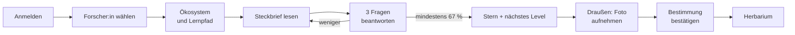

# Nutzung: Plantini Schritt für Schritt

Dieser Teil zeigt, wie sich Plantini für Lernende und Lehrende anfühlt – mit Screenshots und kurzen Animationen aus der echten App. Er ist auch für Entwickler:innen nützlich: Wer den Ablauf einmal gesehen hat, versteht die Architektur-Kapitel deutlich schneller.

!!! info "Womit die Bilder entstanden sind"
    Alle Aufnahmen stammen aus einer lokalen Testumgebung mit synthetischen Konten (`…@plantini.test`) und Beispielinhalten, nicht aus dem Produktionsbetrieb. Die Foto-Bestimmung läuft dort gegen einen Mock statt gegen Pl@ntNet; die Vorschläge im Bild („Stieleiche 97 %“) sind deshalb Testwerte.

## Die Reise in einem Bild

<a class="pl-card" href="lernen/" markdown>
**Lernen**

Anmelden, Forscher:in wählen, Lernpfad, Steckbrief und Quiz.
</a>

<a class="pl-card" href="entdecken/" markdown>
**Entdecken**

Pflanze fotografieren, Vorschlag prüfen, Fund speichern – und was mit dem Standort passiert.
</a>

<a class="pl-card" href="herbarium/" markdown>
**Herbarium**

Die persönliche Sammlung: Regal, Beobachtungen, Karte, Details, Synchronisation.
</a>

<a class="pl-card" href="lehrende/" markdown>
**Lehrendenportal**

Klassen anlegen, Schülerkonten ohne E-Mail erzeugen, Fortschritt ansehen.
</a>

Die Pflege der Inhalte (Studio) steht im Bereich [Moderation](../moderation/index.md).

## Bedienungsgrundsätze

- **Fünf Bereiche, unten erreichbar:** Home, Lernen, Expedition, Herbarium, Profil.
- **Der Server entscheidet.** Ob ein Level bestanden ist und welche Level frei sind, berechnet nie die App, sondern die Plattform.
- **Funde sind privat.** Ohne eigenes Zutun sieht niemand außer dir deine Fotos und Fundorte.
- **Offline ist begrenzt möglich.** Bereits geladene Inhalte und gespeicherte Funde bleiben lesbar; Anmeldung, Quizstart und Bestimmung brauchen Netz (Details: [Offline-Fähigkeit](../app/offline.md#was-offline-nicht-geht)).
