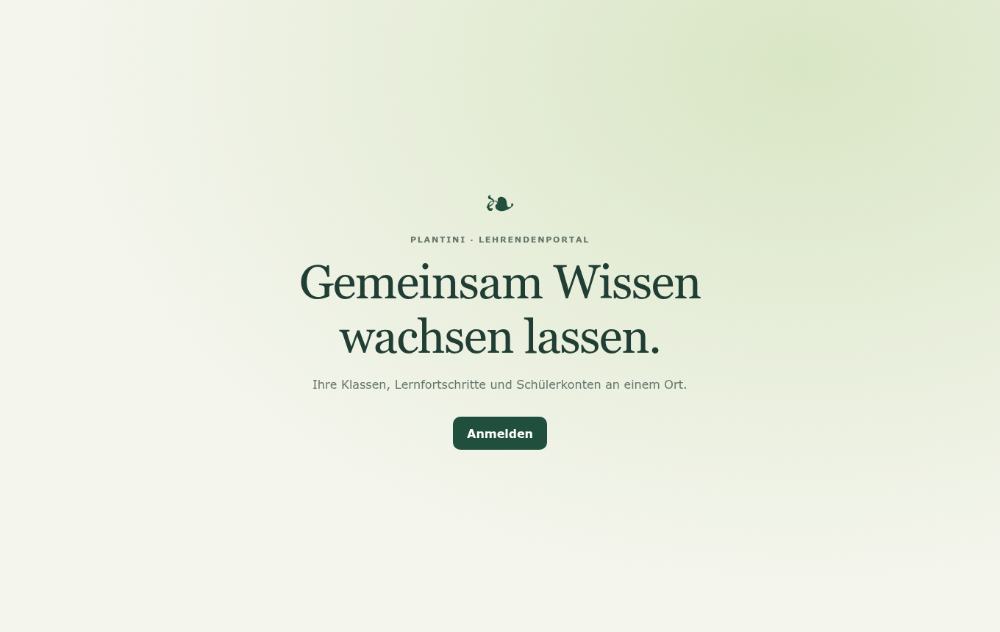
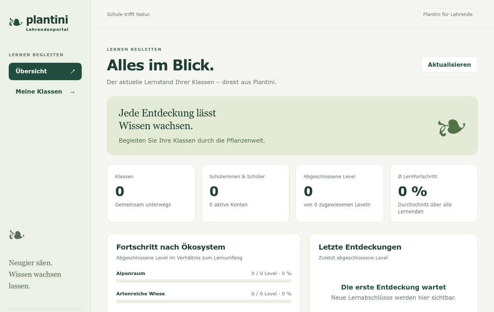
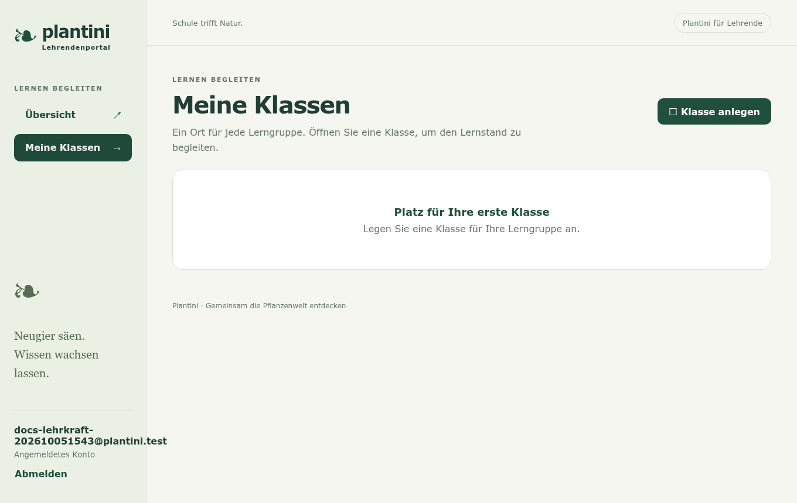
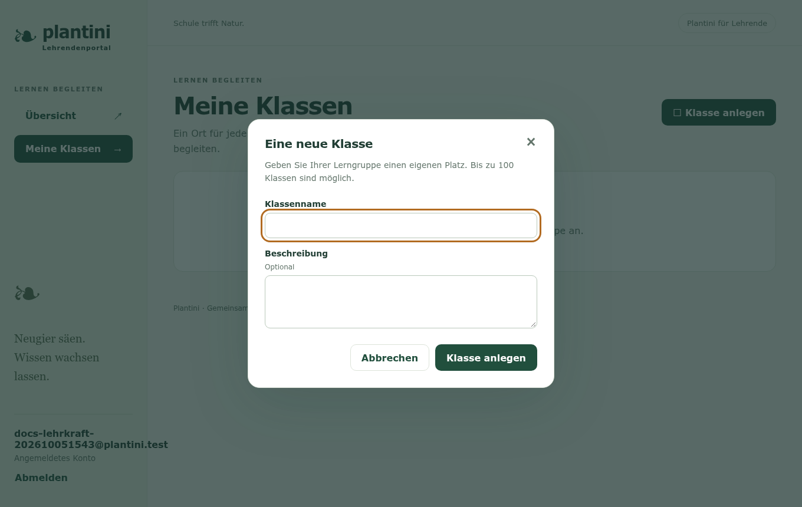
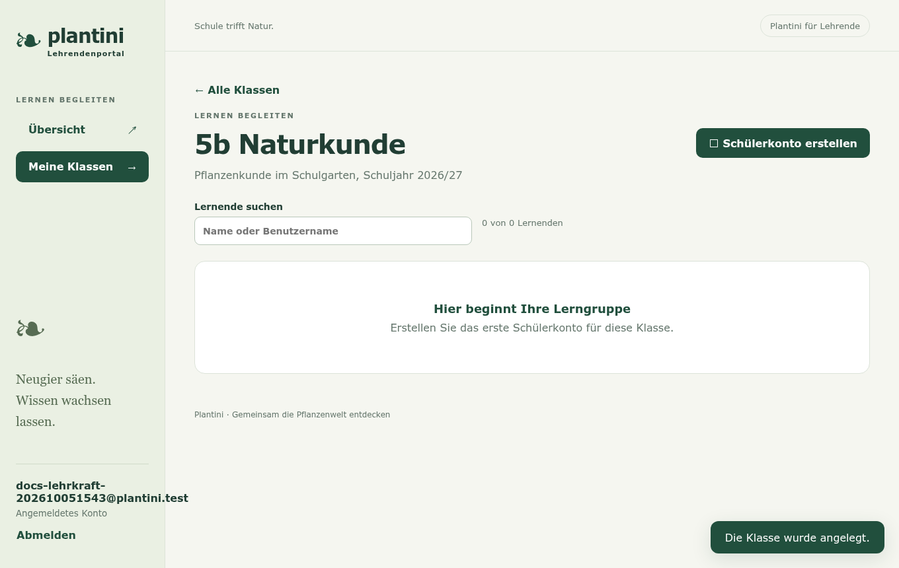
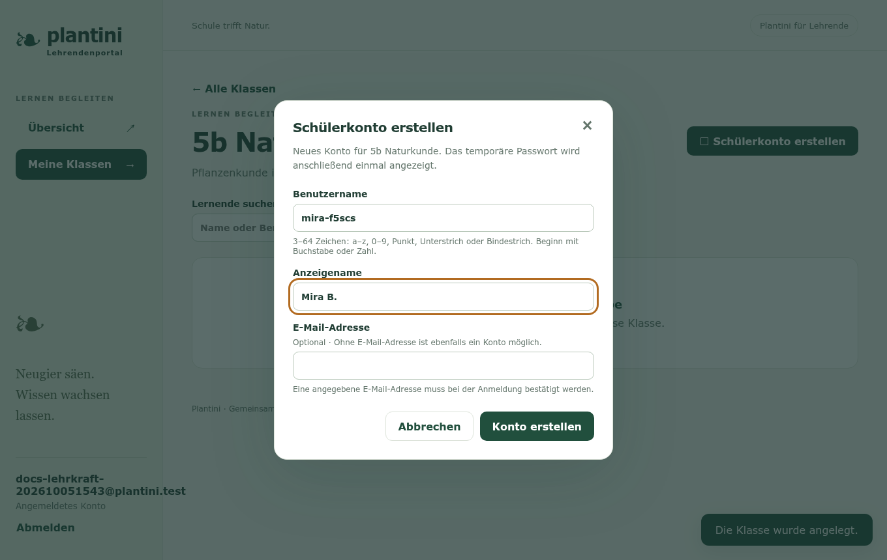
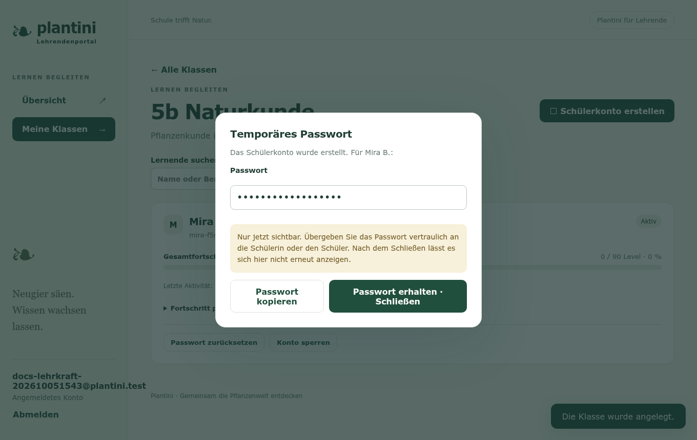
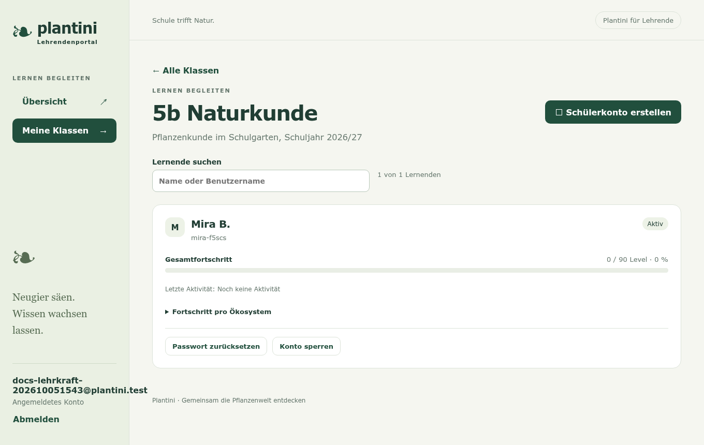
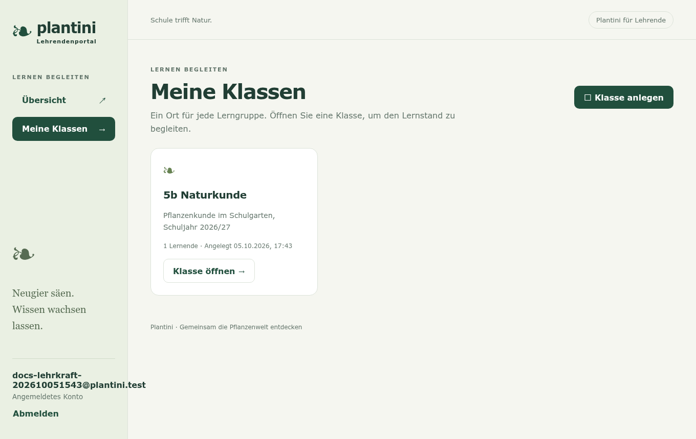

# Lehrendenportal

Das Portal ist eine Webseite für Lehrkräfte. Hier legst du Klassen an, erzeugst **Schülerkonten ohne E-Mail-Adresse** und siehst, wie weit die Lernenden gekommen sind. Du brauchst dafür ein Konto mit der Rolle `lehrende`; sie wird von der Systemadministration vergeben (im [Studio](../moderation/studio-handbuch.md) unter „Team“ einladbar).

!!! info "Was du siehst – und was nicht"
    Du siehst Anzeigename, Benutzername, Fortschritt je Ökosystem und die zuletzt bestandenen Level. Du siehst **keine** Herbariumfotos, keine Fundorte und keine einzelnen Quizantworten. Du kannst nur deine **eigenen** Klassen sehen; auch Administrator:innen sehen fremde Klassen nicht.

## Anmelden

Die Willkommensseite führt über „Anmelden“ zum Identitätsdienst. Nach der Anmeldung öffnet sich die Übersicht.

## Übersicht und Klassen

Die **Übersicht** zeigt Kennzahlen (Klassen, Schülerinnen und Schüler, abgeschlossene Level, durchschnittlicher Lernfortschritt), den Fortschritt je Ökosystem und die zuletzt abgeschlossenen Level. Unter **Meine Klassen** legst du neue Klassen an.

<figure markdown="span">
  
  <figcaption>Übersicht.</figcaption>
</figure>

<figure markdown="span">
  
  <figcaption>Noch keine Klasse.</figcaption>
</figure>

### Klasse anlegen

„Klasse anlegen“ öffnet einen Dialog. Pflicht ist ein Name (zum Beispiel „5b Naturkunde“), dazu optional eine Beschreibung. Pro Lehrperson sind bis zu 100 Klassen möglich.

<figure markdown="span">
  
  <figcaption>Dialog „Klasse anlegen“.</figcaption>
</figure>

<figure markdown="span">
  
  <figcaption>Die neue, noch leere Klasse.</figcaption>
</figure>

## Schülerkonto erstellen

In der Klasse legt „Schülerkonto erstellen“ ein Konto an. Du vergibst:

- einen **Anzeigenamen** (zum Beispiel „Mira B.“ – nutze am besten keine vollen Klarnamen),
- einen **Benutzernamen** mit 3 bis 64 Zeichen aus Kleinbuchstaben, Ziffern, Punkt, Unterstrich und Bindestrich, der mit einem Buchstaben oder einer Ziffer beginnt,
- optional eine E-Mail-Adresse. Ohne Adresse funktioniert das Konto genauso.

Ist der Benutzername schon vergeben, meldet das Portal „Dieser Benutzername ist bereits vergeben“ – wähle dann einen anderen.

<figure markdown="span">
  
  <figcaption>Konto anlegen.</figcaption>
</figure>

<figure markdown="span">
  
  <figcaption>Temporäres Passwort.</figcaption>
</figure>

!!! warning "Das Passwort wird nur einmal angezeigt"
    Das temporäre Passwort erscheint genau einmal, direkt nach dem Anlegen (in der Abbildung zum Schutz ausgeblendet). Es wird weder gespeichert noch protokolliert. Kopiere es mit „Passwort kopieren“ und gib es der Schülerin oder dem Schüler vertraulich. Nach dem Schließen ist es weg; bei Verlust hilft „Passwort zurücksetzen“.

Beim ersten Login muss das Kind ein **eigenes** Passwort festlegen. Das Konto ist dann ein normales Lernendenkonto: Es nutzt die App wie in [Lernen](lernen.md) beschrieben.

## Fortschritt ansehen

Die Klassenansicht listet jede Schülerin und jeden Schüler mit Gesamtfortschritt (bestandene Level von allen), letzter Aktivität und einem aufklappbaren Fortschritt je Ökosystem.

Ein Level zählt als bestanden, wenn mindestens ein Versuch mit mindestens 67 % abgeschlossen wurde; Wiederholungen zählen nicht doppelt. Die Suche oberhalb der Liste filtert nach Name oder Benutzername.

## Passwort zurücksetzen, Konto sperren

| Aktion | Wirkung |
| --- | --- |
| **Passwort zurücksetzen** | Erzeugt ein neues temporäres Passwort und beendet alle laufenden Sitzungen des Kontos. Das Kind muss beim nächsten Login wieder ein eigenes Passwort setzen. |
| **Konto sperren** | Sperrt das Konto sofort, auch für bereits ausgestellte Zugangsdaten. Die Daten bleiben erhalten; Entsperren ist jederzeit möglich. Gesperrte Konten zählen weiter zur Klasse. |

Du kannst nur Konten verwalten, die über das Portal als Schülerkonto angelegt wurden. Konten von Lehrenden, Redaktion oder Administration lassen sich damit nicht zurücksetzen oder sperren.

## Alle Klassen

Der Menüpunkt „Meine Klassen“ zeigt alle Klassen mit Zahl der Lernenden.

## Grenzen und Hinweise

- Bis zu 500 Lernende je Klasse, bis zu 100 Klassen je Lehrperson.
- Aktionen werden **nicht automatisch wiederholt**: Bricht die Verbindung mitten im Anlegen ab, lade die Klasse neu und prüfe, ob das Konto schon existiert, bevor du es erneut anlegst.
- Plantini ist ein früher, unvollständiger Stand (siehe [Status](../start/status.md)). Kläre vor einem Einsatz mit echten Schüler:innen die datenschutzrechtliche Zulässigkeit an deiner Einrichtung.

## Für Entwickler:innen

Rollenprüfung, Besitzlogik, Audit und Fehlerfälle: [Lehrendenportal technisch](../studio/portal-technik.md).
