# Lernen

Von der Anmeldung bis zum ersten Stern. Alles in diesem Kapitel ist in wenigen Minuten durchspielbar.

## 1. Anmelden

Die App zeigt einen Startbildschirm mit der Schaltfläche **Anmelden**. Sie öffnet die Anmeldeseite des Identitätsdienstes (Keycloak) im Browser; die App selbst sieht dein Passwort nie. Nach erfolgreicher Anmeldung springt der Browser zurück in die App.

<figure markdown="span">
  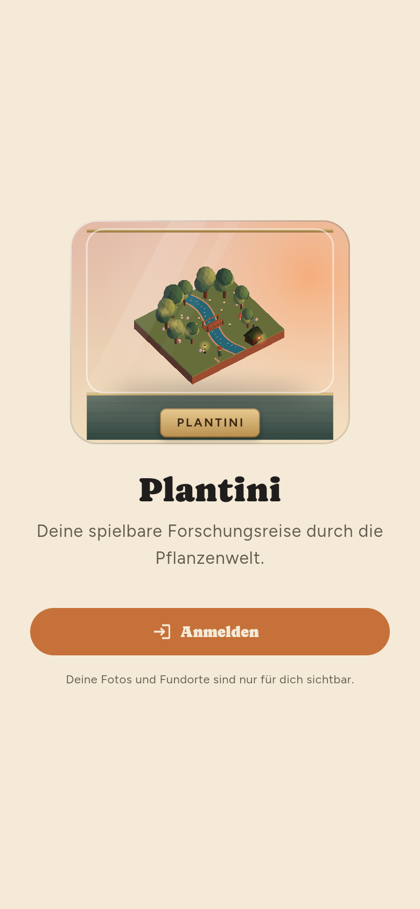{ .pl-phone }
  <figcaption>Startbildschirm.</figcaption>
</figure>

<figure markdown="span">
  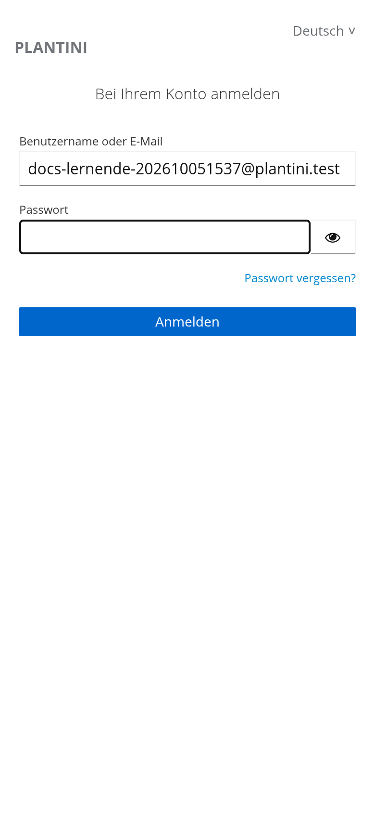{ .pl-phone }
  <figcaption>Anmeldeseite des Identitätsdienstes.</figcaption>
</figure>

!!! tip "Schülerkonten"
    Kinder melden sich mit dem Benutzernamen an, den die Lehrperson vergeben hat – eine E-Mail-Adresse ist nicht nötig. Beim ersten Login verlangt Keycloak ein **neues, eigenes Passwort**. Wie Lehrende Konten anlegen, steht im [Lehrendenportal](lehrende.md).

## 2. Forscher:in wählen

Beim ersten Start stellt sich die Frage „Wer erkundet mit dir?“. Es gibt **neun feste Begleitfiguren** (drei Frauen, drei Männer, drei diverse Figuren), alle im Forschungs- und Entdeckerstil. Ein Tipp wählt, **Ich bin …** bestätigt.

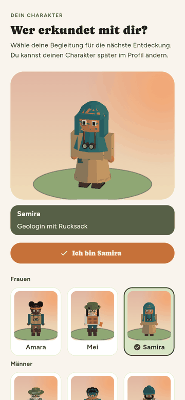{ .pl-phone }

Die Wahl lässt sich später im **Profil** über „Charakter wechseln“ ändern. Wie die Figuren entstehen, beschreibt [Charaktere](../3d/charaktere.md).

## 3. Home und Profil

Auf **Home** siehst du die nächste Expedition mit Sternenstand und einen Vorschlag für den nächsten Schritt („Weiter“). Im **Profil** wählst du deine Figur und die **Tageszeit der Ökosysteme**. Die Kacheln „Sprache“, „Datenschutz“, „Daten exportieren“ und „Hilfe & Feedback“ sind in der aktuellen Version nur Anzeigen ohne Funktion (`_ProfileTile` in `lib/app/router.dart` hat keinen Tipp-Handler).

<figure markdown="span">
  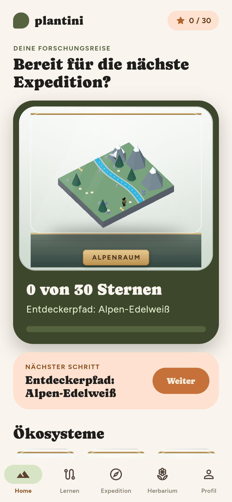{ .pl-phone }
  <figcaption>Home: nächster Schritt und Ökosysteme.</figcaption>
</figure>

<figure markdown="span">
  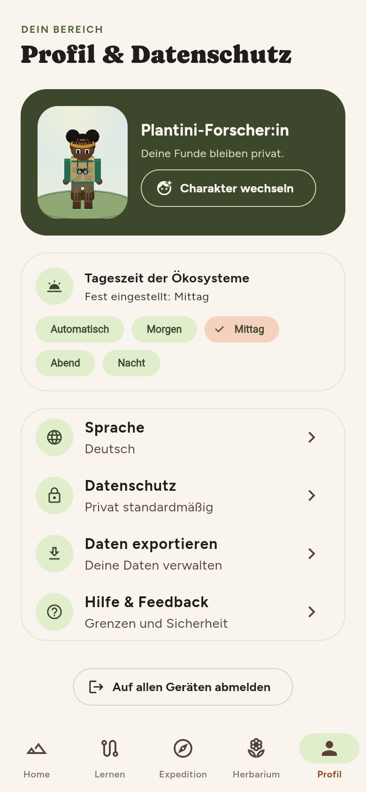{ .pl-phone }
  <figcaption>Profil &amp; Datenschutz.</figcaption>
</figure>

### Tageszeit der Ökosysteme

Die 3D-Welten wechseln das Licht. Im Profil stehen **Automatisch** (folgt der Uhrzeit des Geräts), **Morgen**, **Mittag**, **Abend** und **Nacht** zur Wahl. Abends und nachts leuchten Hütten und Laternen, auf der Wiese tanzen Glühwürmchen.

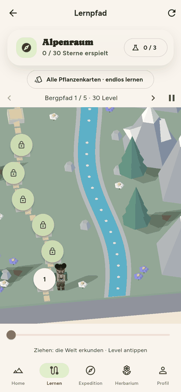{ .pl-phone }

Technisch erklärt das [Tageszeit und Licht](../3d/tageszeit-licht.md).

## 4. Ökosystem und Lernpfad

Unter **Lernen** wählst du ein Ökosystem – etwa den Alpenraum. Der **Lernpfad** ist eine 3D-Landkarte mit nummerierten Stationen; gesperrte Level zeigen ein Schloss, das aktuelle Level ist hervorgehoben. Du kannst die Welt ziehen und erkunden. Über „Alle Pflanzenkarten · endlos lernen“ kommst du zu einem freien Übungsmodus.

<figure markdown="span">
  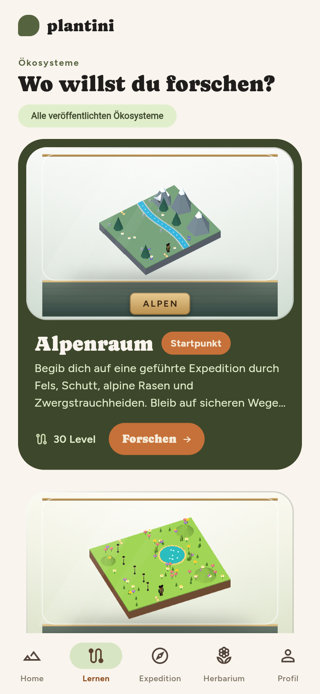{ .pl-phone }
  <figcaption>Ökosystem wählen.</figcaption>
</figure>

<figure markdown="span">
  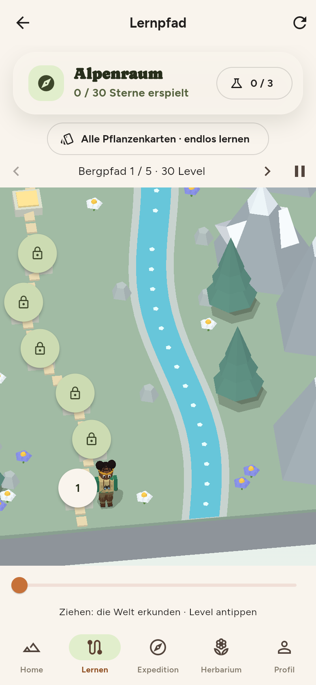{ .pl-phone }
  <figcaption>Der Lernpfad.</figcaption>
</figure>

<figure markdown="span">
  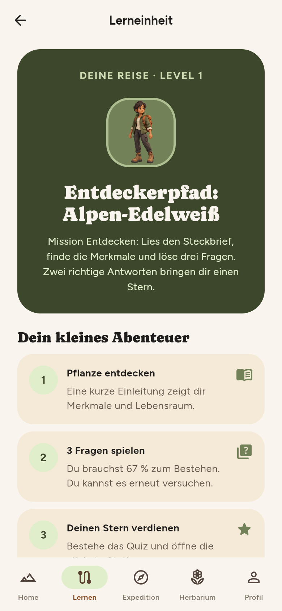{ .pl-phone }
  <figcaption>Level 1: drei Schritte.</figcaption>
</figure>

## 5. Steckbrief lesen

Jedes Level hat drei Schritte: **Pflanze entdecken** (Steckbrief), **3 Fragen spielen**, **Stern verdienen**. Der Steckbrief zeigt Foto, Merkmale, Standort, Naturschutzhinweise und Quellen. Am Ende steht „Jetzt 3 Fragen beantworten“.

<figure markdown="span">
  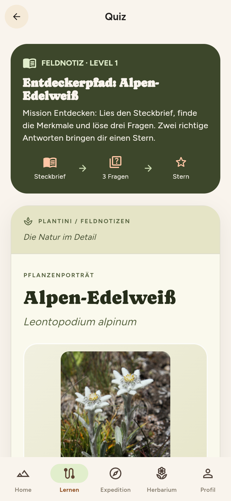{ .pl-phone }
  <figcaption>Steckbrief mit Foto und Merkmalen.</figcaption>
</figure>

<figure markdown="span">
  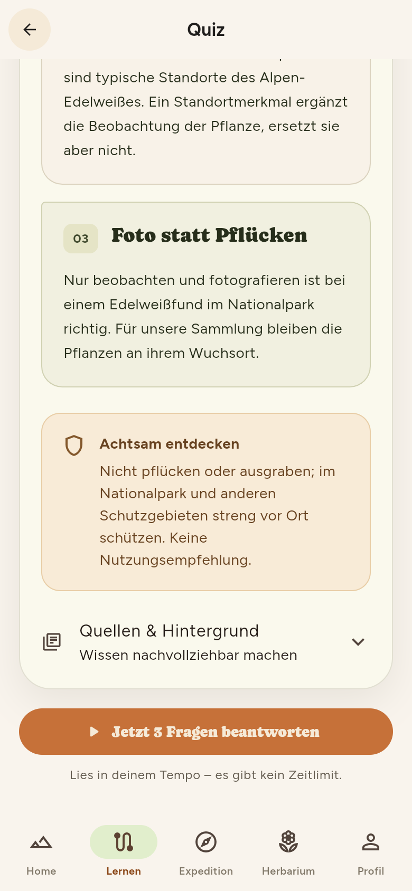{ .pl-phone }
  <figcaption>Ende: Schutzhinweis und Start des Quiz.</figcaption>
</figure>

## 6. Quiz spielen

Drei Fragen mit je vier Antworten. Du darfst jederzeit zum Steckbrief zurück („Steckbrief nachschlagen“). Ein Level gilt ab **67 %** als bestanden – bei drei Fragen also mit **zwei richtigen Antworten**.

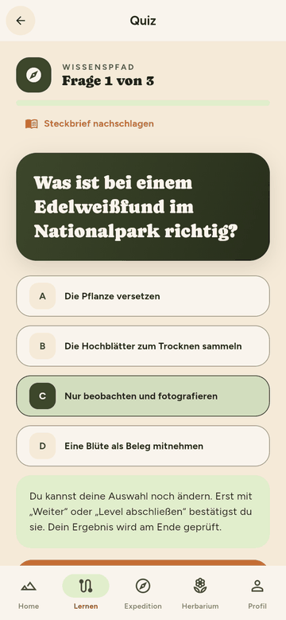{ .pl-phone }

<figure markdown="span">
  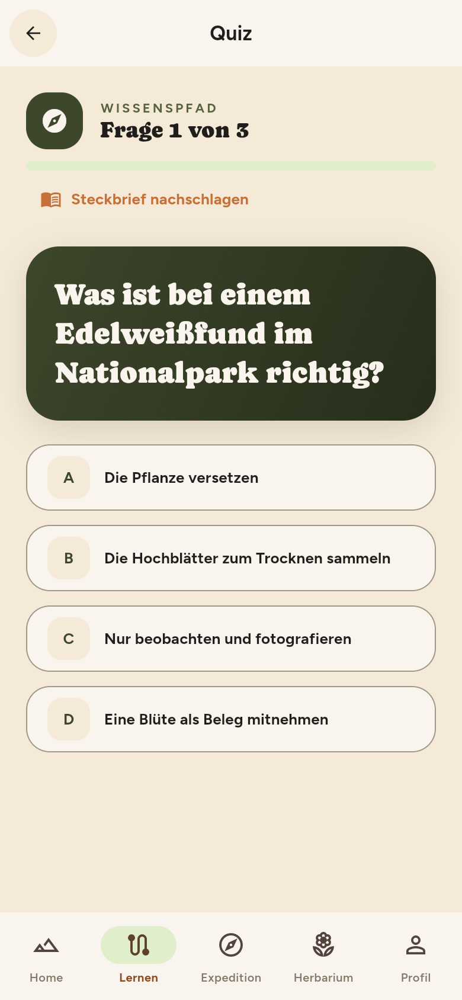{ .pl-phone }
  <figcaption>Eine Frage, vier Antworten.</figcaption>
</figure>

<figure markdown="span">
  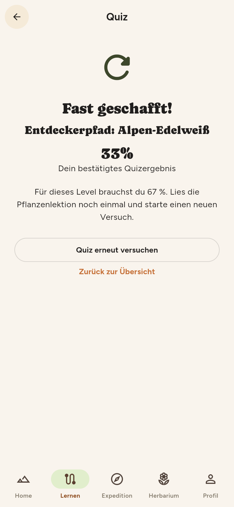{ .pl-phone }
  <figcaption>Nicht bestanden: Steckbrief lesen, erneut versuchen.</figcaption>
</figure>

!!! note "Wer bewertet?"
    Die Antworten gehen an die Plattform; sie bewertet und schaltet das nächste Level frei. Eine Manipulation in der App ändert daran nichts. Technisch: [Daten- und Prozessflüsse](../architektur/datenfluesse.md) und [Idempotenz](../backend/idempotenz-fehler.md).

## Häufige Fragen

??? question "Ich habe einen Versuch abgebrochen. Ist er weg?"
    Der Versuch gilt als nicht abgeschlossen. Du kannst jederzeit neu starten; mehrere Versuche zählen nicht doppelt.

??? question "Die App hat mich plötzlich abgemeldet, nachdem ich länger offline war."
    Das kann vorkommen: Das Anmelde-Token ist nur kurz gültig und lässt sich ohne Netz nicht erneuern. Gespeicherte Funde bleiben erhalten und werden nach dem erneuten Anmelden weiter synchronisiert. Hintergrund: [Offline-Fähigkeit](../app/offline.md#was-offline-nicht-geht).

??? question "Warum ist ein Level gesperrt?"
    Level werden der Reihe nach freigeschaltet. Das Schloss verschwindet, sobald das Level davor bestanden ist.
