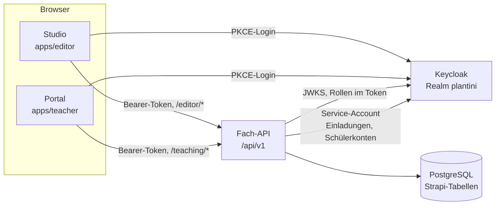

# Studio & Portal

Neben der Flutter-App gibt es zwei kleine, eigenständige Weboberflächen: das **Studio** (`apps/editor`) für die Redaktion und das **Lehrendenportal** (`apps/teacher`) für Lehrende. Beide sind statische Seiten ohne Build-Schritt, melden sich per OIDC bei Keycloak an und sprechen ausschließlich mit der Fach-API.

!!! note "Projektstatus"
    Plantini ist Open Source (Code: AGPL-3.0-or-later, Inhalte: CC BY-SA 4.0; siehe `LICENSE` und `NOTICE`) und ein früher, unvollständiger Stand. Beide Oberflächen sind funktionsfähige Minimalstände, kein fertiges Produkt. Beiträge: siehe `CONTRIBUTING.md`.

## Die beiden Oberflächen im Vergleich

| | Studio | Lehrendenportal |
| --- | --- | --- |
| Quellcode | `apps/editor/` | `apps/teacher/` |
| Zielgruppe | Redaktion, botanisches Review, Systemadministration | Lehrende (und Systemadministration) |
| Aufgabe | Lerninhalte als **Entwürfe** bearbeiten, einreichen, prüfen | Klassen anlegen, Schülerkonten verwalten, Lernfortschritt ansehen |
| API-Präfix | `/api/v1/editor/*` | `/api/v1/teaching/*` |
| Server-Code | `services/platform/src/api/platform/services/core/editor/` | `services/platform/src/api/platform/services/core/teaching/` |
| Keycloak-Clients | `plantini-editor-dev`, `plantini-editor-production` | `plantini-teacher-dev`, `plantini-teacher-production` |
| Erforderliche Rollen | `inhaltsredaktion`, `botanisches_review`, `systemadministration` | `lehrende`, `systemadministration` |
| Host-Erkennung im Browser | ja: `studio.<domain>` ⇒ `api.<domain>` und `auth.<domain>` | nein: liest `/config.json` |
| Konfiguration | im Code (`app.js`) | Umgebungsvariablen des Containers |
| Lokaler Port | `127.0.0.1:8084` | `127.0.0.1:8085` |
| Technik-Doku | [Studio technisch](studio-technik.md) | [Lehrendenportal technisch](portal-technik.md) |
| Bedienung | [Moderation](../moderation/index.md) | [Nutzung für Lehrende](../nutzung/lehrende.md) |

Beide Oberflächen **ersetzen nicht** das interne Strapi-Admin. Beide sind reine Browser-Frontends hinter einem eigenen Host; laut Kommentar in `infra/production/Caddyfile` hat das Studio „no direct database or Strapi-admin access“, und das Portal läuft mit einem eigenen PKCE-Client in einem eigenen Container.

## Wie sie sich zur Fach-API verhalten

Die wichtigsten Eigenschaften, jeweils im Code belegt:

- **Öffentliche Clients mit PKCE.** Beide Frontends sind öffentliche OIDC-Clients (kein Secret) mit Authorization Code und `S256`. Die Tokens liegen nur im Arbeitsspeicher der Seite, in `sessionStorage` steht nur der kurzlebige PKCE-Zustand (`apps/editor/app.js`, `apps/teacher/app.js`).
- **Rechte entscheidet der Server.** Beide Frontends prüfen die Rolle im Browser nur, um eine verständliche Meldung zu zeigen. Jede Route der Fach-API prüft die Rolle erneut (`requireEditor`, `requireReviewer` in `editor-service.js`; `requireTeacher` in `teaching-service.js`). Rollen kommen aus dem Access-Token und werden in `services/platform/src/api/platform/services/core/auth/actor-service.js` normalisiert.
- **Keine Admin-Zugangsdaten im Browser.** Einladungen (Studio) und Schülerkonten (Portal) ruft der **Server** über einen eigenen, eng berechtigten Keycloak-Service-Account auf (`PLATFORM_KEYCLOAK_ADMIN_CLIENT_ID`/`_SECRET`). Ohne ihn sind diese Funktionen abgeschaltet.
- **Gleiche Fehlersprache.** Fehler sind `application/problem+json` mit Feld `code` (`EDITOR_*`, `TEACHING_*`, `VALIDATION_FAILED`); siehe [Idempotenz & Fehler](../backend/idempotenz-fehler.md).

## Rollen

Die Rollen sind Realm-Rollen in `services/identity/realm/plantini-realm.json`. Das Studio akzeptiert drei Rollen, das Portal zwei (`lehrende`, `systemadministration`):

| Rolle | Studio | Portal |
| --- | --- | --- |
| `inhaltsredaktion` | Entwürfe anlegen, bearbeiten, einreichen; eigene Änderungen sehen; Redakteure einladen | – |
| `botanisches_review` | zusätzlich: alle Änderungen sehen, freigeben oder zurückweisen | – |
| `systemadministration` | alles aus Review; zusätzlich Reviewer und Lehrende einladen | wie `lehrende`, nur eigene Klassen |
| `lehrende` | – | Klassen und Schülerkonten (nur eigene) |
| `lernende` | kein Zugang (`EDITOR_FORBIDDEN`) | kein Zugang (`TEACHING_FORBIDDEN`) |

Für `systemadministration` erzwingt der Realm einen zweiten Faktor (TOTP); Details in [Studio technisch](studio-technik.md#anmeldung-pkce-im-browser).

## Host- und Domain-Erkennung

Die beiden Oberflächen lösen ihre Ziele verschieden auf:

=== "Studio"

    `apps/editor/app.js` entscheidet am Hostnamen: beginnt er mit `studio.`, gelten `https://api.<domain>` und `https://auth.<domain>` sowie der Client `plantini-editor-production`. In jedem anderen Fall (z. B. `127.0.0.1:8084`) greift die lokale Entwicklung: API `http://127.0.0.1:1338`, Keycloak `http://127.0.0.1:8082`, Client `plantini-editor-dev`.

=== "Portal"

    `apps/teacher/app.js` kennt keine Hostnamen. Es lädt `/config.json` (`apiBase`, `issuer`, `clientId`). Der Container erzeugt diese Datei beim Start aus `PLANTINI_API_BASE_URL`, `PLANTINI_OIDC_ISSUER_URL`, `PLANTINI_OIDC_CLIENT_ID` (`apps/teacher/40-teacher-config.sh`) und leitet daraus auch die Content-Security-Policy ab.

!!! warning "Stolperfalle"
    Die Content-Security-Policy des Studios (`apps/editor/nginx.conf`) trägt die erlaubten API-/Auth-Hosts **fest** ein. Die Host-Ableitung im Code allein genügt deshalb nicht, um das Studio unter einer anderen Domain zu betreiben. Details in [Studio technisch](studio-technik.md#host-erkennung-und-konfiguration).

## Deployment-Form

Beide Oberflächen sind schlanke Container auf Basis von `nginxinc/nginx-unprivileged:1.27.4-alpine`:

| Eigenschaft | Studio (`editor`) | Portal (`teacher`) |
| --- | --- | --- |
| Port im Container | 8080 | 8080 (`TEACHER_LISTEN_PORT`) |
| Hostbindung (Produktion) | `127.0.0.1:${EDITOR_LOOPBACK_PORT:-8084}` | `127.0.0.1:${TEACHER_LOOPBACK_PORT:-8085}` |
| Healthcheck | `GET /healthz` ⇒ `ok` | `GET /healthz` ⇒ `ok` |
| Härtung | `read_only`, `tmpfs`, `cap_drop: [ALL]`, `no-new-privileges` | dasselbe |
| Image-Referenz | `EDITOR_IMAGE` | `TEACHER_IMAGE` |
| Overlay für reine Code-Updates | `apps/editor/Dockerfile.release-overlay` (alle statischen Dateien) | `apps/teacher/Dockerfile.release-overlay` (**nur** `app.js`) |

Die Definitionen stehen in `infra/compose.production.yaml`. Davor sitzt der Reverse-Proxy (`infra/production/Caddyfile`), der `studio.{$PLANTINI_DOMAIN}` an den Studio-Port und `portal.{$PLANTINI_DOMAIN}` an den Portal-Port weiterleitet; die Fach-API hängt unter `api.{$PLANTINI_DOMAIN}`, Keycloak unter `auth.`. Konkrete Domains, Server und Zugangsdaten stehen bewusst nicht in diesem Handbuch; die Vorlage mit Platzhaltern ist `infra/production.env.example`.

!!! warning "Stolperfalle: zwei verschiedene Port-Variablen"
    `infra/production/Caddyfile` leitet an `{$EDITOR_PORT:8084}` und `{$TEACHER_PORT:8085}` weiter, `infra/compose.production.yaml` bindet dagegen `EDITOR_LOOPBACK_PORT` und `TEACHER_LOOPBACK_PORT`. Im Repo gibt es keine Abbildung zwischen den Namen. Solange die Standardwerte (8084/8085) gelten, passt es; wer einen Loopback-Port ändert, muss den Proxy separat anpassen, sonst läuft die Weiterleitung ins Leere.

Zwei Voraussetzungen gelten für beide:

1. **CORS.** Die Plattform erlaubt nur Origins aus `CORS_ORIGINS` (`services/platform/config/middlewares.js`); in Produktion setzt `infra/compose.production.yaml` dort `WEB_PUBLIC_URL`, `EDITOR_PUBLIC_URL` und `TEACHER_PUBLIC_URL` ein.
2. **Keycloak-Clients.** Die Produktions-Clients sind im versionierten Realm angelegt, aber ohne Redirect-URIs; `tools/scripts/build-production-realm.mjs` trägt `https://studio.<domain>/` und `https://portal.<domain>/` ein. Auf einem bereits laufenden Realm genügt ein erneuter Import nicht; für das Portal gibt es dafür `tools/scripts/configure-managed-accounts.mjs`.

## Was heute funktioniert und was nicht

| Bereich | Stand laut Code |
| --- | --- |
| Entwürfe anlegen, bearbeiten, einreichen | umgesetzt |
| Review: freigeben / zurückweisen mit Verlauf | umgesetzt |
| **Veröffentlichung freigegebener Entwürfe** | **nicht umgesetzt**; `appliedAt` wird nirgends geschrieben |
| Bilder im Studio hochladen/zuordnen | nicht umgesetzt (nur Anzeige vorhandener Bilder) |
| Einladungen per E-Mail | umgesetzt, benötigt Service-Account und SMTP |
| Klassen und Schülerkonten (Portal) | umgesetzt, benötigt Service-Account |
| Automatisierte Tests für Studio/Portal | nicht vorhanden |

Die Begründung zur fehlenden Veröffentlichung und ihre Folgen für Moderator:innen stehen in [Studio technisch](studio-technik.md#der-entwurfs-zustandsautomat) und in der [Einführung für Moderation](../moderation/index.md).

## Lokal ausprobieren

Beide Overlays setzen den isolierten E2E-Stack voraus (gitignorierte Datei `tools/e2e/.runtime/e2e.env`, Inhalt nicht Teil dieses Handbuchs):

| Ziel | Skript | Compose-Overlay |
| --- | --- | --- |
| Studio auf `127.0.0.1:8084` | `tools/scripts/configure-local-editor.mjs` | `infra/compose.editor.local.yaml` (mit `infra/compose.authoring.local.yaml`) |
| Portal auf `127.0.0.1:8085` | `tools/scripts/configure-managed-accounts.mjs` | `infra/compose.teacher.local.yaml` |

Vollständige Befehle stehen auf den beiden Technikseiten. Die Einrichtung des Stacks selbst beschreibt [Setup](../mitmachen/setup.md).

## Weiterführend

- [Studio technisch](studio-technik.md) – Zustandsautomat, Validierung, Routen, Fehlercodes
- [Lehrendenportal technisch](portal-technik.md) – Klassen, Schülerkonten, Datenschutz
- [Identity & Keycloak](../betrieb/identity-keycloak.md) – Realm, Clients, Rollen, SMTP
- [Moderation](../moderation/index.md) und [Nutzung für Lehrende](../nutzung/lehrende.md) – Bedienung ohne Technikkenntnisse
- [Sicherheit & Datenschutz](../architektur/sicherheit-datenschutz.md) – Grenzen und Rollenmodell
- Quellpfade: `apps/editor/`, `apps/teacher/`, `infra/compose.production.yaml`, `infra/production/Caddyfile`, `services/identity/realm/plantini-realm.json`
