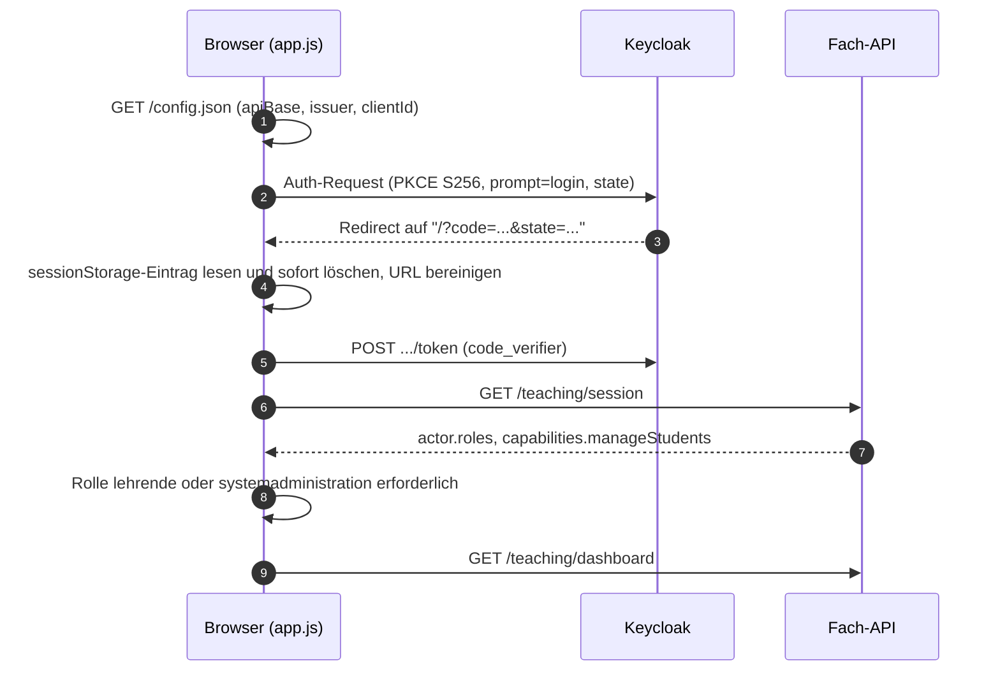
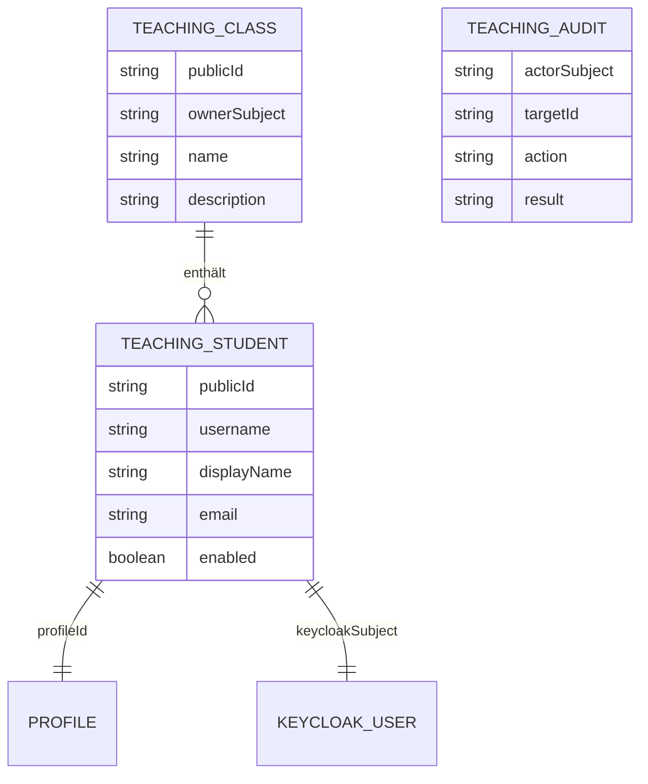
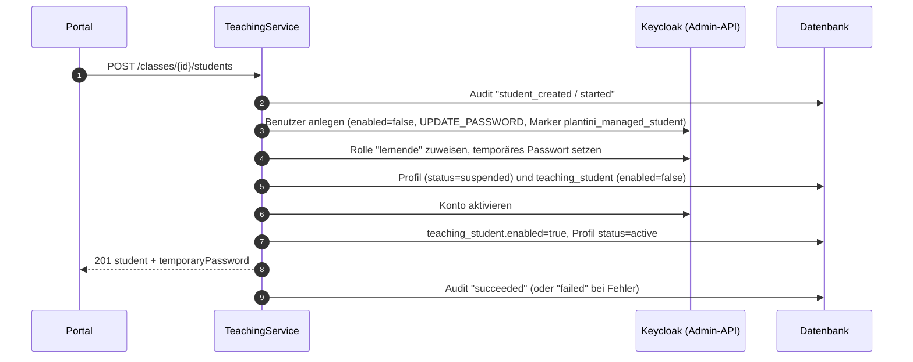

# Lehrendenportal technisch

Das Lehrendenportal (`apps/teacher`) ist eine statische Weboberfläche, über die Lehrende Klassen anlegen, **Schülerkonten ohne E-Mail-Adresse** erzeugen und den Lernfortschritt ansehen. Die Logik liegt im Server (`services/platform/src/api/platform/services/core/teaching/`), Konten leben ausschließlich in Keycloak.

!!! note "Stand der Quellen"
    Grundlage sind der Code im Arbeitsbaum und `contracts/api.yaml`; `apps/teacher/README.md` und `knowledge/teacher-portal.md` dienten als Hintergrund. Befehle wurden nur gegen die vorhandenen Dateien plausibilisiert. Das Skript `tools/scripts/verify-teacher-production.mjs` wurde **nicht** geprüft (es ist im Arbeitsbaum gerade in Änderung und bezieht sich auf den Produktionsbetrieb).

## Dateien im Überblick

| Datei | Zweck |
| --- | --- |
| `apps/teacher/index.html` | Willkommensseite, Shell mit Navigation „Übersicht“ und „Meine Klassen“, `<dialog>` für Formulare |
| `apps/teacher/app.js` | OIDC-Login mit PKCE, API-Aufrufe, Rendering, Dialoge (Klasse, Konto, Passwort, Sperre) |
| `apps/teacher/style.css` | Layout, Fokus-Stile, schmale Ansicht, `prefers-reduced-motion` |
| `apps/teacher/config.json` | Konfiguration für einfache statische Entwicklungsserver; im Container wird sie zur Laufzeit neu erzeugt |
| `apps/teacher/nginx.conf.template` | Nginx-Konfiguration mit Platzhaltern `${TEACHER_LISTEN_PORT}`, `${API_ORIGIN}`, `${OIDC_ORIGIN}` |
| `apps/teacher/40-teacher-config.sh` | Entrypoint: validiert Umgebungsvariablen, schreibt `/tmp/teacher-config.json` und `/tmp/teacher-nginx.conf`, testet mit `nginx -t` |
| `apps/teacher/Dockerfile` | Basis `nginxinc/nginx-unprivileged:1.27.4-alpine` plus `jq`; Entrypoint statt Standardskripten |
| `apps/teacher/Dockerfile.release-overlay` | Kopiert nur `app.js` auf ein geprüftes Basis-Image |
| `apps/teacher/compose.yaml` | Eigenständiges Compose zum lokalen Start (Port `127.0.0.1:${TEACHER_HTTP_PORT:-8085}`, `read_only: true`) |
| `apps/teacher/README.md` | Betriebsnotizen des Portals |

## Konfiguration zur Laufzeit

Anders als das [Studio](studio-technik.md) erkennt das Portal **keinen Hostnamen** (`portal.`). Es lädt beim Start `/config.json` und liest `apiBase`, `issuer` und `clientId`. Der Container erzeugt die Datei bei jedem Start aus Umgebungsvariablen:

| Variable | Bedeutung | Standard im Image |
| --- | --- | --- |
| `PLANTINI_API_BASE_URL` | API-Basis inklusive `/api/v1` | (Produktionsstandard des Projekts) |
| `PLANTINI_OIDC_ISSUER_URL` | Realm-URL, endet auf `/realms/plantini` | (Produktionsstandard des Projekts) |
| `PLANTINI_OIDC_CLIENT_ID` | öffentlicher OIDC-Client | `plantini-teacher-production` |
| `TEACHER_LISTEN_PORT` | Port im Container (1024 bis 65535) | `8080` |

Lokal setzt `infra/compose.teacher.local.yaml` die Werte `http://127.0.0.1:1338/api/v1`, `http://127.0.0.1:8082/realms/plantini` und den Client `plantini-teacher-dev`; in Produktion liefert `infra/compose.production.yaml` sie aus `API_PUBLIC_URL` und `AUTH_PUBLIC_URL`.

```sh title="apps/teacher/40-teacher-config.sh (Auszug)"
validate_url() {
  jq -en --arg value "$1" '$value | test("^https?://[A-Za-z0-9.-]+(:[0-9]{1,5})?(/[A-Za-z0-9._~/-]*)?$")' >/dev/null
}
...
API_ORIGIN=$(jq -nr --arg value "$PLANTINI_API_BASE_URL" '$value | capture("^(?<origin>https?://[^/]+)").origin')
OIDC_ORIGIN=$(jq -nr --arg value "$PLANTINI_OIDC_ISSUER_URL" '$value | capture("^(?<origin>https?://[^/]+)").origin')
export TEACHER_LISTEN_PORT API_ORIGIN OIDC_ORIGIN
umask 077
jq -n --arg apiBase "$PLANTINI_API_BASE_URL" --arg issuer "$PLANTINI_OIDC_ISSUER_URL" --arg clientId "$PLANTINI_OIDC_CLIENT_ID" \
  '{apiBase:$apiBase,issuer:$issuer,clientId:$clientId}' > /tmp/teacher-config.json
envsubst '${TEACHER_LISTEN_PORT} ${API_ORIGIN} ${OIDC_ORIGIN}' \
  < /opt/teacher/nginx.conf.template > /tmp/teacher-nginx.conf
nginx -t -c /tmp/teacher-nginx.conf
```

Der Entrypoint bricht mit Exit-Code 1 ab, wenn URLs Zugangsdaten, Query oder Fragment enthalten, die Client-ID nicht `^[A-Za-z0-9._-]+$` entspricht oder der Port außerhalb von 1024 bis 65535 liegt. Das Image enthält also **keine** Geheimnisse; die Konfiguration ist öffentlich.

Die Content-Security-Policy entsteht aus denselben Variablen (`apps/teacher/nginx.conf.template`):

```nginx title="apps/teacher/nginx.conf.template (Auszug)"
add_header Cache-Control "no-store" always;
add_header Permissions-Policy "camera=(), microphone=(), geolocation=()" always;
add_header Content-Security-Policy "default-src 'self'; script-src 'self'; style-src 'self';
  connect-src 'self' ${API_ORIGIN} ${OIDC_ORIGIN}; img-src 'self'; object-src 'none';
  frame-ancestors 'none'; base-uri 'none'; form-action 'self' ${OIDC_ORIGIN}" always;
location = /healthz { access_log off; default_type text/plain; return 200 'ok'; }
location = /config.json { default_type application/json; alias /tmp/teacher-config.json; }
```

PID-Datei, Temp-Verzeichnisse und generierte Dateien liegen unter `/tmp`; dadurch läuft der Container mit `read_only: true` und `tmpfs` für `/tmp`, `/var/cache/nginx`, `/var/run` (`cap_drop: [ALL]` in den Compose-Dateien unter `infra/`).

!!! warning "Stolperfalle: `config.json` im Quellverzeichnis ist nur für Entwicklungsserver"
    `apps/teacher/config.json` enthält die Produktionswerte als Standard. Im Container überdeckt `location = /config.json` sie durch die zur Laufzeit erzeugte Datei. Wer das Verzeichnis dagegen mit einem beliebigen statischen Server ausliefert, spricht ohne Anpassung mit dem Produktionssystem.

!!! warning "Stolperfalle: Overlay aktualisiert nur `app.js`"
    `apps/teacher/Dockerfile.release-overlay` kopiert ausschließlich `app.js`. Änderungen an `index.html`, `style.css`, `nginx.conf.template` oder `40-teacher-config.sh` kommen damit **nicht** auf das Zielsystem; dafür braucht es einen vollständigen Image-Bau (`apps/teacher/Dockerfile`). Das Studio-Overlay (`apps/editor/Dockerfile.release-overlay`) kopiert dagegen alle vier statischen Dateien.

## Anmeldung und Sitzung

`apps/teacher/app.js` nutzt Authorization Code mit PKCE (S256) gegen den öffentlichen Client (`plantini-teacher-dev` bzw. `-production`; beide mit `standardFlowEnabled`, ohne Direct Grant, `fullScopeAllowed: false` in `services/identity/realm/plantini-realm.json`).



- **`prompt=login`.** Auf geteilten Rechnern (Klassenzimmer) soll eine bestehende SSO-Sitzung eines Kindes nicht zu einer Schleife aus 403-Antworten führen; ein expliziter Login erlaubt den Kontowechsel (Kommentar in `login()`).
- **Gültigkeit des Rücksprungs.** `verifier`, `state` und `createdAt` liegen in `sessionStorage` (Schlüssel `plantini-teacher-pkce`). Beim Rücksprung wird der Eintrag **vor** dem Token-Austausch gelöscht und die URL per `history.replaceState` bereinigt. Ein Rücksprung ist 600 000 ms (zehn Minuten) gültig.
- **Tokens nur im Speicher.** Access-, Refresh- und ID-Token stehen in Modulvariablen. `refresh()` führt parallele Aufrufe zusammen (`refreshPending`) und plant den nächsten Refresh 30 s vor Ablauf. Nach `pagehide` bzw. `pageshow` mit `persisted` wird der Zustand verworfen (`signedOut`).
- **Rollen.** Nach `GET /teaching/session` prüft das Frontend, ob `actor.roles` `lehrende` oder `systemadministration` enthält; sonst erscheint „Dieses Portal ist für Lehrende und die Systemadministration vorgesehen.“ Maßgeblich ist wieder der Server (`requireTeacher`).
- **401/403.** Bei 401 wird der Zustand verworfen („Ihre Sitzung ist abgelaufen“). Bei 403 erscheint „Für diese Aktion fehlt die Berechtigung.“

## Server: `teaching-service.js`

`TeachingService` (`services/platform/src/api/platform/services/core/teaching/teaching-service.js`) wird in `platform-runtime.js` als `runtime.teaching` aufgebaut; `services/platform/src/index.js` ruft beim Start `runtime.teaching.ensureIndexes()` auf (Indizes `teaching_classes_owner_idx` auf `owner_subject` und `level_attempts_owner_idx` auf `owner_id`, `CREATE INDEX IF NOT EXISTS`).

### Inhaltstypen

| Content-Type (Pfad unter `services/platform/src/api/`) | Tabelle | Felder |
| --- | --- | --- |
| `teaching-class/content-types/teaching-class/schema.json` | `teaching_classes` | `publicId`, `ownerSubject` (privat), `name` (höchstens 100), `description` (höchstens 1000), Relation `students` |
| `teaching-student/content-types/teaching-student/schema.json` | `teaching_students` | `publicId`, `keycloakSubject` (privat, eindeutig), `profileId` (privat, eindeutig), `username` (eindeutig), `displayName`, `email` (optional), `enabled`, Relation `classroom` |
| `teaching-audit/content-types/teaching-audit/schema.json` | `teaching_audit` | `publicId`, `actorSubject` (privat), `targetId`, `action` (`class_created`, `student_created`, `password_reset`, `student_enabled`, `student_disabled`), `result` (`started`, `succeeded`, `failed`) |



`TEACHING_AUDIT` hat bewusst keine Relation: Es speichert nur Akteur-Subject, Ziel-ID, Aktion und Ergebnis, **keine** Passwörter oder Token.

### API-Routen

Registriert in `services/platform/src/api/platform/routes/platform.js`, Handler in `controllers/platform.js` (alle über `withActor`), Schemas in `contracts/api.yaml` (Tag `Teaching`).

| Methode und Pfad | Service-Methode | Antwort | Fehler laut Code |
| --- | --- | --- | --- |
| `GET /v1/teaching/session` | `session()` | `{ actor: {id, displayName, roles}, capabilities: {manageStudents} }` | 403 `TEACHING_FORBIDDEN` |
| `GET /v1/teaching/dashboard` | `dashboard()` | Zähler, Fortschritt je Ökosystem, bis zu 8 letzte Abschlüsse | 403 |
| `GET /v1/teaching/classes` | `classes()` | `{ classes: [...] }` | 403 |
| `POST /v1/teaching/classes` | `createClass()` | 201, Klassenobjekt | 400, 403, 409 `TEACHING_LIMIT_REACHED` |
| `GET /v1/teaching/classes/:classId` | `classroom()` | `{ class, students }` mit Fortschritt | 404 `TEACHING_CLASS_NOT_FOUND` |
| `POST /v1/teaching/classes/:classId/students` | `createStudent()` | 201, `{ student, temporaryPassword }` | 400, 404, 409, 503 |
| `POST /v1/teaching/students/:studentId/reset-password` | `resetPassword()` | `{ temporaryPassword }` | 403 `TEACHING_ACCOUNT_PROTECTED`, 404, 503 |
| `PATCH /v1/teaching/students/:studentId` | `updateStudent()` | `{ student }` | 400, 403, 404, 503 |

### Rollen und Eigentum

- `requireTeacher(actor)` lässt `lehrende` und `systemadministration` zu, sonst `TEACHING_FORBIDDEN` (403, „Dieses Portal ist für Lehrende freigeschaltet.“). Lernende bekommen also 403.
- **Eigentum statt Rolle.** Jede Klasse gehört dem Keycloak-Subject der anlegenden Person (`ownerSubject`). `requireClass()` filtert auf `{ publicId, ownerSubject: actor.subject }`, `requireStudent()` auf `classroom.ownerSubject`. Fremde Klassen und Schüler-IDs liefern **404** (nicht 403), damit keine Existenz verraten wird. Auch `systemadministration` sieht nur eigene Klassen; einen globalen Zugriff gibt es im Code nicht.
- **Grenzen.** Höchstens 100 Klassen je Lehrperson (`createClass`) und 500 Schüler je Klasse (`createStudent`); Überschreitung → 409 `TEACHING_LIMIT_REACHED`. Listen laden mit `limit: 101` bzw. `501`, das Dashboard mit `limit: 50001`.
- **`capabilities.manageStudents`** ist `identity.configured`, also ob `PLATFORM_KEYCLOAK_ADMIN_CLIENT_ID` und `_SECRET` gesetzt sind. Ohne Service-Account zeigt das Portal die Klassenfunktionen, blendet aber die Kontoverwaltung aus („Kontoverwaltung derzeit …“).

### Schülerkonto anlegen: `createStudent()`

Validierung (`requireString`, `rejectUnknownFields`): erlaubte Felder `username`, `displayName`, `email`. `username` 3 bis 64 Zeichen, wird kleingeschrieben und muss `^[a-z0-9][a-z0-9._-]+$` erfüllen; `displayName` höchstens 100; `email` optional, höchstens 254 und syntaktisch gültig.

Die Anlage läuft in `audited(actor, publicId, 'student_created', task)` und ist als Folge von Schritten gebaut, die bei Fehlern zurückgerollt werden:



- Das Konto entsteht zuerst **deaktiviert**. Schlägt die Datenbankanlage fehl, werden Keycloak-Konto (`removeNewAccount`) und Profil gelöscht. Schlägt nur die Aktivierung fehl, bleibt ein sichtbares, gesperrtes Konto bestehen („Retain a visible, disabled account…“); die Lehrperson kann das Passwort zurücksetzen und es später aktivieren.
- Anlage in Keycloak (`keycloak-students.js`, `create()`): `username`, `firstName = displayName`, `lastName = ''`, optional `email`, `enabled: false`, `emailVerified: !email`, Attribut `plantini_managed_student = ['true']`, `requiredActions: ['UPDATE_PASSWORD']`. Das Passwort wird mit `temporary: true` gesetzt – Kinder müssen es beim ersten Login ändern.
- Generiertes Passwort: 18 Zufallsbytes (base64url) plus feste Zeichen, damit die Realm-Policy `length(14) and notUsername and notEmail and passwordHistory(5)` erfüllt ist (Funktion `password()` in `keycloak-students.js`).
- Eine angegebene E-Mail-Adresse muss im Realm bestätigt werden (`verifyEmail: true` im Realm); der Code setzt dafür keine eigene Required Action, sondern `emailVerified: false`. Konten ohne Adresse sind ausdrücklich unterstützt (`emailVerified: true`).
- Doppelte Benutzernamen oder E-Mail-Adressen: Keycloak antwortet 409, der Server wandelt das in `TEACHING_USERNAME_EXISTS` um.

!!! warning "Stolperfalle: Befehle sind nicht wiederholbar"
    Die Teaching-Kommandos akzeptieren **keinen** `Idempotency-Key` (`contracts/api.yaml`, Tag `Teaching`: „must not be retried blindly“). Antwortet ein POST nicht (Netzabbruch), kann das Konto trotzdem angelegt sein. Das Portal wiederholt deshalb nichts automatisch und weist nach einem `TypeError` an, die Klasse neu zu laden, bevor man die Aktion erneut ausführt.

### Passwort zurücksetzen und Konto sperren

- `resetPassword()` prüft Eigentum, ruft `requireManagedLearner()`, setzt vorher und nachher `tokensValidAfter` am Profil (damit auch während des Resets erneuerte Tokens ungültig werden) und beendet die Keycloak-Sitzungen (`logout`). Das neue temporäre Passwort steht nur in der Antwort.
- `updateStudent()` akzeptiert nur `{ "enabled": boolean }`. Beim Sperren wird zuerst das Profil auf `suspended` gesetzt und `tokensValidAfter` aktualisiert – damit ist der API-Zugriff auch mit bereits ausgestellten Access-Tokens sofort verwehrt (`resolveActor` in `platform-runtime.js` prüft `status === 'suspended'` und `iat <= tokensValidAfter`). Danach folgt Keycloak (`setEnabled`, bei `false` zusätzlich `logout`). Bei Fehlern fällt der Zustand auf „gesperrt“ zurück.

### Schutz vor Fremdkonten: `requireManagedLearner()`

Vor jeder Kontoänderung liest der Server Benutzer und effektive Realm-Rollen aus Keycloak und lehnt ab (`TEACHING_ACCOUNT_PROTECTED`, 403), wenn

- das Attribut `plantini_managed_student` nicht `'true'` ist,
- die Rolle `lernende` fehlt, oder
- eine der Rollen `lehrende`, `inhaltsredaktion`, `botanisches_review`, `organisationsadministration`, `systemadministration` vorhanden ist.

Selbst bei manipulierter Datenbank (z. B. falsche `keycloakSubject`-Zuordnung) kann das Portal damit keine Lehrenden- oder Administrationskonten zurücksetzen.

## Fortschritt und Datenschutz

`dashboard()` und `classroom()` berechnen den Fortschritt serverseitig aus der Tabelle `level_attempts` (`progressData()`): Ein Level zählt als abgeschlossen, wenn mindestens ein Versuch `status = 'completed'` und `passed = true` hat; wiederholte Versuche erzeugen keine zusätzlichen Abschlüsse. Berechnungsgrundlage ist der aktive Katalog (`listPublishedLevels`). Der Durchschnitt ist `Summe bestandener Level / (Schülerzahl × Levelzahl)`; Konten ohne Aktivität zählen mit 0, gesperrte Konten bleiben Teil der Gruppe. Das Portal rechnet nichts nach (`averageProgress` kommt direkt aus der Antwort).

Was die API an Lehrende liefert: Benutzername, Anzeigename, optionale E-Mail, `enabled`, Zahl bestandener Level je Ökosystem, `lastActivityAt` und die letzten acht bestandenen Level (Anzeigename, Klassenname, Levelname, Zeitpunkt). **Nicht** geliefert werden Herbariumfotos, Fundorte, einzelne Antworten oder Passwörter.

!!! note "Eine Kleingruppenregel gibt es im Portal nicht"
    Die Mindestgrenze von 20 Konten (`MIN_ACCOUNTS = 20` in `services/platform/src/api/platform/services/core/species/stats-service.js`) gilt für die **Artenstatistik** (Sammelquoten), nicht für das Lehrendenportal. Lehrende sehen den Fortschritt einzelner Lernender namentlich, auch bei Klassen mit wenigen Kindern. Das ist eine bewusste Eigenschaft der Klassenverwaltung; eine zusätzliche Aggregationsregel ist im Code **nicht vorhanden**.

Weitere Datenschutzaspekte aus dem Code:

- Schülerkonten brauchen keine E-Mail-Adresse; der Keycloak-Benutzername ist der von der Lehrperson vergebene Anmeldename, `firstName` der Anzeigename.
- Das temporäre Passwort wird weder gespeichert noch geloggt. Im Browser steht es nur im geöffneten Dialog (`showPassword()`); beim Schließen wird der Dialoginhalt entfernt (`$('dialog').replaceChildren()` im `close`-Handler). Während einer laufenden Anfrage lässt sich der Dialog nicht schließen (`cancel`-Handler), damit die einmalige Antwort sichtbar bleibt.
- `Cache-Control: no-store` für alle Portal-Dateien und API-Antworten (`withActor` setzt `no-store`).

## Der Verwaltungs-Client: `configure-managed-accounts.mjs`

`tools/scripts/configure-managed-accounts.mjs <env-datei> <portal-origin>` aktualisiert einen **bestehenden** Realm (ein erneuter Realm-Import aktualisiert Clients nicht). Es liest Bootstrap-Zugangsdaten aus der angegebenen geschützten Env-Datei, nennt oder schreibt sie nicht in die Ausgabe und tut Folgendes:

1. Legt den Portal-Client an oder aktualisiert ihn (`plantini-teacher-dev` bei `http://127.0.0.1:8085`, sonst `plantini-teacher-production`), setzt Redirect-URI, Web-Origin und Post-Logout-URI auf die Portal-Origin mit `/`.
2. Weist die Default-Scopes `roles` und `plantini-api-audience` zu und erlaubt dem Client per Scope-Mapping die Realm-Rollen `lehrende` und `systemadministration`.
3. Legt den vertraulichen Client `plantini-account-manager` an (`serviceAccountsEnabled: true`, kein Browser-Flow, `fullScopeAllowed: false`) und gibt dessen Service-Account die `realm-management`-Rollen `manage-users`, `view-users`, `query-users`, `view-realm`. Keine Realm- oder Clientverwaltung.
4. Ändert das **globale** User-Profile des Realms: `email`, `firstName`, `lastName` sind nicht mehr Pflicht, und das Attribut `plantini_managed_student` wird als reines Admin-Attribut (`view`/`edit`: `admin`, Wert nur `true`) deklariert.
5. Schaltet `registrationAllowed` aus.
6. Schreibt `PLATFORM_KEYCLOAK_ADMIN_CLIENT_ID`, `PLATFORM_KEYCLOAK_ADMIN_CLIENT_SECRET` und `TEACHER_PUBLIC_URL` in die Env-Datei (Modus 0600).

!!! warning "Stolperfalle: Skript akzeptiert nur zwei Origins"
    Das Skript bricht ab („An approved exact portal origin is required.“), wenn die Origin weder die lokale `http://127.0.0.1:8085` noch die fest einprogrammierte Produktions-Origin ist. Wer das Portal unter einer anderen `<domain>` betreibt, muss das Skript ändern. Außerdem erreicht es Keycloak fest unter `http://127.0.0.1:8082` – es ist für den Lauf auf dem Host bzw. im lokalen Stack gedacht.

!!! warning "Stolperfalle: Der Service-Account ist mächtiger als er aussieht"
    `manage-users` erlaubt es im Prinzip, **jeden** Benutzer des Realms zu ändern. Die Absicherung liegt in der Anwendung (Eigentumsprüfung, `requireManagedLearner()`), nicht in Keycloak. Das ist beim Ändern von `keycloak-students.js` zu beachten. Die Vorlage `infra/production.env.example` nennt drei Rollen, das Skript vergibt vier (zusätzlich `query-users`).

Dieselben Zugangsdaten nutzt auch der Einladungsdienst des Studios (`keycloak-invitations.js`); sie aktivieren damit beide Funktionen. Lehrende selbst lädt die Systemadministration im Studio unter „Team“ ein (Rolle `lehrende`, Rücksprung zum Portal); das Portal kann nur Lernende erzeugen.

## Lokale Entwicklung

Zwei Wege:

=== "Nur das Portal (eigenes Compose)"

    Gegen ein bereits laufendes System, aus dem Verzeichnis `apps/teacher`:

    ```sh
    cd apps/teacher
    TEACHER_HTTP_PORT=8085 \
    PLANTINI_API_BASE_URL=http://127.0.0.1:1338/api/v1 \
    PLANTINI_OIDC_ISSUER_URL=http://127.0.0.1:8082/realms/plantini \
    PLANTINI_OIDC_CLIENT_ID=plantini-teacher-dev \
    docker compose up --build
    ```

    Aufruf: `http://127.0.0.1:8085/`. API- und OIDC-Adressen gelten aus Sicht des **Browsers**.

=== "Im E2E-Stack"

    Voraussetzung: der isolierte E2E-Stack mit der gitignorierten `tools/e2e/.runtime/e2e.env`. Der Overlay `infra/compose.teacher.local.yaml` verlangt `PLATFORM_KEYCLOAK_ADMIN_CLIENT_ID` und `_SECRET` (`:?run configure-managed-accounts.mjs`), die das Skript einträgt.

    ```sh
    node tools/scripts/configure-managed-accounts.mjs tools/e2e/.runtime/e2e.env http://127.0.0.1:8085
    docker compose --env-file tools/e2e/.runtime/e2e.env -p plantini-e2e \
      -f infra/compose.e2e.yaml -f infra/compose.teacher.local.yaml \
      up -d --build --wait platform teacher
    ```

Der Teacher-Overlay erweitert `CORS_ORIGINS` der Plattform um `http://127.0.0.1:8085` und setzt `PLATFORM_TEACHER_ORIGIN` sowie `PLATFORM_TEACHER_OIDC_CLIENT_ID=plantini-teacher-dev`.

Prüfen ohne Stack (laut `apps/teacher/README.md`; `node --check` und `sh -n` wurden für dieses Handbuch ausgeführt, `docker compose config` nicht):

```sh
node --check apps/teacher/app.js
sh -n apps/teacher/40-teacher-config.sh
docker compose -f apps/teacher/compose.yaml config --quiet
```

!!! note "Keine automatisierten Tests"
    Eine Suche nach `teaching`, `editor`, `studio`, `8085` in `services/platform/test/` und `tools/e2e/` findet keinen Treffer, es gibt also keine Tests für Teaching; das README des Portals sagt „Keine Tests angelegt“. Abgenommen wurde laut `knowledge/teacher-portal.md` manuell am 05.10.2026 (PKCE-Login, Schüleranlage mit Passwortwechsel, Reset mit Token-Sperre, Sperre/Aktivierung). Dieser Nachweis ist hier **nicht** nachvollzogen worden.

## Beispiele

Platzhalter wie `<access_token>`; ein Token bekommst du aus einer Browser-Sitzung des Portals (der Client erlaubt keinen Passwort-Grant).

=== "Klasse anlegen"

    ```http
    POST /api/v1/teaching/classes HTTP/1.1
    Authorization: Bearer <access_token>
    Content-Type: application/json

    { "name": "Klasse 5b", "description": "Waldexpedition im Frühjahr" }
    ```

    Antwort `201`:

    ```json
    {
      "id": "<uuid>",
      "name": "Klasse 5b",
      "description": "Waldexpedition im Frühjahr",
      "studentCount": 0,
      "createdAt": "2026-10-05T08:30:00.000Z"
    }
    ```

=== "Schülerkonto anlegen"

    ```http
    POST /api/v1/teaching/classes/<classId>/students HTTP/1.1
    Authorization: Bearer <access_token>
    Content-Type: application/json

    { "username": "eiche.05b", "displayName": "Eiche 5b" }
    ```

    Antwort `201`:

    ```json
    {
      "student": { "id": "<uuid>", "username": "eiche.05b", "displayName": "Eiche 5b", "enabled": true },
      "temporaryPassword": "<einmalig angezeigt>"
    }
    ```

=== "Konto sperren"

    ```http
    PATCH /api/v1/teaching/students/<studentId> HTTP/1.1
    Authorization: Bearer <access_token>
    Content-Type: application/json

    { "enabled": false }
    ```

    Antwort `200`: `{ "student": { …, "enabled": false } }`. Das Profil steht danach auf `suspended`; die API antwortet für dieses Konto mit `ACCOUNT_SUSPENDED` (403).

## Fehlerfälle

Fehlerantworten haben die Form `application/problem+json` (siehe Beispiel in [Studio technisch](studio-technik.md#fehlerformat-und-codes)).

| Situation | Antwort | Anzeige im Portal (`app.js`, `api()`) |
| --- | --- | --- |
| Benutzername oder E-Mail vergeben | 409 `TEACHING_USERNAME_EXISTS` | „Dieser Benutzername ist bereits vergeben. Bitte wählen Sie einen anderen.“ |
| 100 Klassen / 500 Konten erreicht | 409 `TEACHING_LIMIT_REACHED` | „Sie können höchstens 100 Klassen anlegen.“ bzw. „Eine Klasse kann höchstens 500 Schülerkonten enthalten.“ |
| Keycloak nicht erreichbar oder Service-Account fehlt | 503 `TEACHING_IDENTITY_UNAVAILABLE` | „Die Kontoverwaltung ist gerade nicht verfügbar. Bitte versuchen Sie es später erneut.“ |
| Ziel ist kein verwaltetes Lernendenkonto | 403 `TEACHING_ACCOUNT_PROTECTED` | „Für diese Aktion fehlt die Berechtigung.“ (jedes 403 wird so angezeigt) |
| Fremde oder unbekannte Klasse/Konto | 404 `TEACHING_CLASS_NOT_FOUND` / `TEACHING_STUDENT_NOT_FOUND` | „Dieser Eintrag ist nicht mehr verfügbar.“ |
| Ungültige Eingabe | 400 `VALIDATION_FAILED` | „Bitte prüfen Sie die eingegebenen Angaben.“ |

Hinweis zum Vertrag: `TeachingClass.studentCount` ist laut `contracts/api.yaml` bei Anlage und Detail „currently zero“; im Code liefert `classroom()` die tatsächliche Zahl (`students.length`) und auch die Klassenliste zählt korrekt (Relation `students` mit `publicId` befüllt); nur `createClass()` gibt für die frisch angelegte Klasse 0 zurück. Die Beschreibung im Vertrag ist an dieser Stelle also zu pessimistisch.

## Weiterführend

- Überblick: [Studio & Portal](index.md), Gegenstück: [Studio technisch](studio-technik.md)
- Konten und Realm: [Identity & Keycloak](../betrieb/identity-keycloak.md), Deployment: [Betrieb](../betrieb/index.md)
- Bedienung aus Sicht der Lehrenden: [Nutzung für Lehrende](../nutzung/lehrende.md)
- API-Grundlagen: [Services](../backend/services.md), [API-Vertrag](../backend/api-vertrag.md), [Idempotenz und Fehler](../backend/idempotenz-fehler.md)
- Quellpfade: `apps/teacher/`, `services/platform/src/api/platform/services/core/teaching/teaching-service.js`, `services/platform/src/api/platform/services/core/teaching/keycloak-students.js`, `tools/scripts/configure-managed-accounts.mjs`, `infra/compose.teacher.local.yaml`, `infra/compose.production.yaml`, `contracts/api.yaml`, `knowledge/teacher-portal.md`
