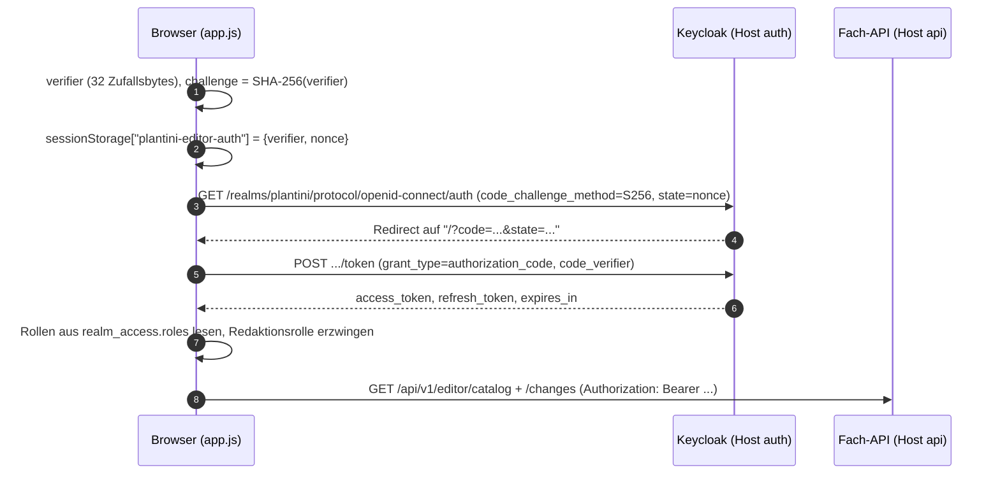
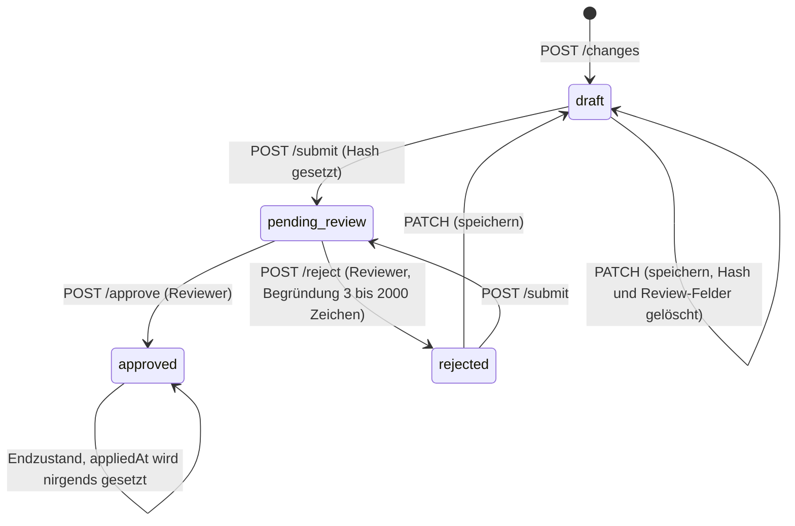

# Studio technisch

Das Studio ist eine statische Single-Page-Anwendung (`apps/editor`) für die Redaktion. Sie bearbeitet **Entwürfe** (`editor_changes`) über die Editor-Routen der Fach-API (`/api/v1/editor/*`); die fachliche Logik und alle Rechteprüfungen liegen im Server (`services/platform/src/api/platform/services/core/editor/editor-service.js`).

!!! note "Stand der Quellen"
    Diese Seite beschreibt den Code im Arbeitsbaum. Wo `knowledge/editor-studio.md` etwas anderes sagt, ist das unten ausdrücklich vermerkt. Befehle wurden nur gegen die Dateien im Repo plausibilisiert, nicht ausgeführt.

## Dateien im Überblick

| Datei | Zweck |
| --- | --- |
| `apps/editor/index.html` | Shell: Seitenleiste mit vier Bereichen (`data-page="dashboard|catalog|review|team"`), Drawer für den Inhaltseditor |
| `apps/editor/app.js` | Login (PKCE), Token-Verwaltung, API-Aufrufe, Rendering der vier Seiten, Drawer mit Formular und Aktionen |
| `apps/editor/json-editor.js` | Klasse `JsonEditor`: rekursiver Formular- und Raw-JSON-Editor für verschachtelte Felder |
| `apps/editor/style.css` | Layout und Farben |
| `apps/editor/nginx.conf` | Statische Auslieferung, Sicherheits-Header, Content-Security-Policy, `/healthz` |
| `apps/editor/Dockerfile` | `nginxinc/nginx-unprivileged:1.27.4-alpine` mit den vier statischen Dateien |
| `apps/editor/Dockerfile.release-overlay` | Aktualisiert nur die statischen Dateien auf einem bereits geprüften Basis-Image (`ARG BASE_IMAGE`) |

Es gibt keinen Build-Schritt und keine npm-Abhängigkeit: Der Browser lädt `app.js` direkt als ES-Modul (`<script type="module" src="/app.js">`), `app.js` importiert `./json-editor.js`.

```dockerfile title="apps/editor/Dockerfile"
FROM nginxinc/nginx-unprivileged:1.27.4-alpine
COPY nginx.conf /etc/nginx/conf.d/default.conf
COPY index.html app.js json-editor.js style.css /usr/share/nginx/html/
EXPOSE 8080
```

## Host-Erkennung und Konfiguration

Das Studio hat keine Konfigurationsdatei. `apps/editor/app.js` leitet alles aus dem Hostnamen ab:

```js title="apps/editor/app.js"
const host = location.hostname;
const production = host.startsWith('studio.');
const apiOrigin = production ? `https://${host.replace(/^studio\./, 'api.')}` : 'http://127.0.0.1:1338';
const authOrigin = production ? `https://${host.replace(/^studio\./, 'auth.')}` : 'http://127.0.0.1:8082';
const clientId = production ? 'plantini-editor-production' : 'plantini-editor-dev';
```

| Aufruf über | API | Keycloak | OIDC-Client |
| --- | --- | --- | --- |
| `studio.<domain>` | `https://api.<domain>` | `https://auth.<domain>` | `plantini-editor-production` |
| alles andere (z. B. `127.0.0.1:8084`) | `http://127.0.0.1:1338` | `http://127.0.0.1:8082` | `plantini-editor-dev` |

!!! warning "Stolperfalle: Content-Security-Policy hat feste Hosts"
    `app.js` leitet die API- und Auth-Origins aus `studio.<domain>` ab, aber `apps/editor/nginx.conf` trägt die erlaubten Ziele **fest** in `connect-src` ein (die produktiven API-/Auth-Hosts plus die lokalen Loopback-Adressen). Wird das Image unter einer anderen `<domain>` betrieben, blockiert der Browser die Aufrufe, obwohl der Code die richtigen Hosts berechnet. Die `nginx.conf` muss dann angepasst und das Image neu gebaut werden. Das Teacher-Image löst das anders (siehe [Portal technisch](portal-technik.md)): es erzeugt die CSP beim Containerstart aus Umgebungsvariablen.

```nginx title="apps/editor/nginx.conf (Auszug, Hostnamen durch Platzhalter ersetzt)"
add_header Content-Security-Policy "default-src 'self'; script-src 'self'; style-src 'self';
  connect-src 'self' https://api.<domain> https://auth.<domain> http://127.0.0.1:1338 http://127.0.0.1:8082;
  img-src 'self' data: https://api.<domain> http://127.0.0.1:1338;
  frame-ancestors 'none'; base-uri 'none'; form-action 'self' https://auth.<domain> http://127.0.0.1:8082" always;
location = /healthz { default_type text/plain; return 200 'ok'; }
location / { try_files $uri $uri/ /index.html; }
```

Weitere Header in derselben Datei: `X-Content-Type-Options: nosniff`, `Referrer-Policy: strict-origin-when-cross-origin`, `X-Frame-Options: DENY`, `Cache-Control: no-cache`. `script-src 'self'` verbietet Inline-Skripte; deshalb gibt es im HTML keine.

## Anmeldung: PKCE im Browser

Der Browser ist ein **öffentlicher Client** (kein Secret). Die Clients `plantini-editor-dev` und `plantini-editor-production` stehen in `services/identity/realm/plantini-realm.json` mit `standardFlowEnabled: true`, `directAccessGrantsEnabled: false`, `implicitFlowEnabled: false` und `pkce.code.challenge.method: S256`.



Wichtige Details aus `app.js`:

- **Token nur im Speicher.** `state.token`, `state.refresh` und `state.expires` leben im JavaScript-Objekt `state`. In `sessionStorage` liegen nur `verifier` und `nonce`, und nur bis zum Rücksprung.
- **Rollenprüfung im Browser ist nur Komfort.** `exchange()` dekodiert den Access-Token (`atob`, keine Signaturprüfung) und wirft „Dieses Konto hat keine Redaktionsrolle“, wenn keine der drei Rollen `inhaltsredaktion`, `botanisches_review`, `systemadministration` enthalten ist. Maßgeblich ist die Prüfung im Server (siehe unten).
- **Refresh.** `token()` tauscht den Refresh-Token ein, sobald `expires` (Laufzeit minus 30 s) überschritten ist. Schlägt das fehl, ruft es `login()` auf und navigiert zu Keycloak. Das gilt auch bei HTTP 401 aus der API. Die Realm-Einstellungen: `accessTokenLifespan: 300`, `ssoSessionIdleTimeout: 1800` (Sekunden).
- **Abmelden** entfernt den `sessionStorage`-Eintrag und ruft `/protocol/openid-connect/logout` mit `post_logout_redirect_uri` auf.

!!! warning "Stolperfalle: ungespeicherte Eingaben gehen bei Re-Login verloren"
    Es gibt keine lokale Zwischenspeicherung. Läuft die Sitzung ab (401 oder fehlgeschlagener Refresh), ersetzt `login()` die Seite per `location.replace` – offene Formularinhalte sind weg. Für Moderator:innen steht das im [Studio-Handbuch](../moderation/studio-handbuch.md) als Hinweis „oft speichern“.

### Rollen und Scope-Mapping

Die Rollen kommen aus dem Access-Token (`realm_access.roles`, optional `resource_access[<client>].roles`, wenn `PLATFORM_OIDC_ROLE_CLIENT_ID` gesetzt ist). `services/platform/src/api/platform/services/core/auth/actor-service.js` normalisiert sie (`extractRoles`, `normalizeRole`) und fällt ohne bekannte Rolle auf `lernende` zurück. Weil die Editor-Clients `fullScopeAllowed: false` haben, tauchen die Redaktionsrollen nur im Token auf, wenn sie dem Client per Scope-Mapping erlaubt sind – das ist im versionierten Realm unter `scopeMappings` für beide Editor-Clients eingetragen (alle drei Rollen). Zusätzlich brauchen die Clients die Default-Scopes `roles` und `plantini-api-audience`, sonst lehnt die API den Token wegen der Audience ab (`PLATFORM_OIDC_AUDIENCE`, in Produktion `plantini-api`).

Für `systemadministration` erzwingt der Realm einen zweiten Faktor: Im Flow `forms` steht `auth-conditional-otp-form` mit der Konfiguration `plantini-systemadmin-otp` (`forceOtpRole: systemadministration`, `defaultOtpOutcome: skip`); der Realm nutzt TOTP mit 6 Stellen und 30 Sekunden. Die Prüfung `validatePrivilegedMfa` in `services/identity/scripts/validate-realm-security.mjs` schlägt fehl, wenn das fehlt. `botanisches_review` und `inhaltsredaktion` haben im Realm keinen erzwungenen zweiten Faktor.

## Seiten der Oberfläche

| Seite (`data-page`) | Funktion in `app.js` | API-Aufruf | Sichtbar für |
| --- | --- | --- | --- |
| Übersicht (`dashboard`) | `renderDashboard()` | `GET /dashboard` | alle drei Rollen |
| Inhalte (`catalog`) | `renderCatalog()`, `drawTree()` | `GET /catalog` (beim Start in `load()`) | alle drei Rollen |
| Review (`review`) | `renderReview()` | `GET /changes` (beim Start in `load()`) | alle drei Rollen; Redaktion sieht nur eigene |
| Team (`team`) | `renderTeam()` | `POST /invitations` | alle drei Rollen; Rollenauswahl nach Rolle |

`load()` ruft beim Start `catalog` und `changes` parallel ab; das Badge an „Review“ zählt Änderungen mit `status === 'pending_review'`. Jede Mutation (`Entwurf speichern`, `Zum Review einreichen`, `Fachlich freigeben`, `Zurückweisen`) lädt danach per `load()` alles neu.

### Inhaltsbaum

`drawTree()` baut die Hierarchie **Ökosystem → Level → Pflanzen/Quizze** aus dem Katalog: Level hängen über `ecosystemId` am Ökosystem, Pflanzen über `plantIds` am Level, Quizze über `levelId`. Pflanzen ohne Level erscheinen unter „Nicht zugeordnete Pflanzen“. Ein Klick öffnet `openEditor(type, id)`: Es lädt `GET /items/{type}/{id}` und legt im Drawer einen **neuen** Entwurf an (`state.edit.changeId = null`). Bestehende Entwürfe öffnet man über die Review-Seite (`openChange`).

!!! warning "Stolperfalle: Entwürfe erscheinen nicht im Inhaltsbaum"
    `EditorService.catalog()` liest ausschließlich Strapi-Datensätze (`publicationState: 'preview'`). Entwürfe stehen in der Tabelle `editor_changes` und tauchen nur unter „Review“ auf. Wer aus dem Baum erneut auf denselben Eintrag klickt, erzeugt einen **zweiten, parallelen Entwurf** für dasselbe Ziel.

### Formularfelder und JSON-Editor

`field()` rendert pro Schlüssel ein Eingabeelement. Die Felder `sources`, `features`, `completionRule`, `data` und `learningCards` (Konstante `jsonFields`) laufen über `JsonEditor`:

- Modus **Formular**: rekursive Knoten je Typ (`Text`, `Zahl`, `Ja/Nein`, `Objekt`, `Liste`, `Leer`), Typwechsel per Auswahl, „+ Feld“/„+ Eintrag“, „Entfernen“.
- Modus **Raw JSON**: Textarea. Beim Wechsel zurück wird das JSON geparst; ungültiges JSON zeigt „Ungültiges JSON: …“ und der Modus bleibt.
- Die Schlüssel `__proto__`, `prototype`, `constructor` sind gesperrt (`UNSAFE_KEYS`, `assertSafeKeys`).
- Bei einem Entwurf im Status `pending_review` oder `approved` ist der **JsonEditor** schreibgeschützt (`readOnly: !editable`; editierbar sind nur `draft` und `rejected`). Die einfachen Felder aus `field()` (Eingabefelder, Textareas, Selects) erhalten dagegen kein `disabled`; es fehlt nur die Speichern-Schaltfläche, Eingaben darin verpuffen beim Schließen.

Auswahlfelder für `ecosystemId`, `levelId`, `plantId` und Checkboxen für `plantIds` füllt `field()` aus dem Katalog. Die UUID-Listen in `completionRule` (`requiredQuizIds`, `requiredPlantIds`, `requiredLevelIds`) müssen dagegen von Hand eingetragen werden; es gibt keinen Picker.

## Der Entwurfs-Zustandsautomat

Jede Bearbeitung ist ein Datensatz vom Typ `api::editor-change.editor-change` (Tabelle `editor_changes`, `draftAndPublish: false`). Schema: `services/platform/src/api/editor-change/content-types/editor-change/schema.json`.

| Feld | Bedeutung |
| --- | --- |
| `publicId` | UUID der Änderung (in der API `id`) |
| `entityType` | `ecosystem`, `level`, `plant` oder `quiz` |
| `targetPublicId` | UUID des Zielinhalts; bei neuen Inhalten eine frisch erzeugte UUID |
| `baseUpdatedAt` | `updatedAt` des Ziels zum Zeitpunkt des Entwurfs; `null` bei neuen Inhalten |
| `payload` | validierter Inhalt (JSON) |
| `payloadHash` | SHA-256 des kanonisierten Payloads, nur im Status `pending_review` und danach gesetzt |
| `status` | `draft`, `pending_review`, `rejected`, `approved` |
| `authorSubject`, `reviewerSubject` | Keycloak-`sub` (im Schema `private`, die API gibt sie als `author`/`reviewer` aus) |
| `reviewNote`, `reviewedAt` | Begründung/Kommentar und Zeitpunkt der Entscheidung |
| `reviewEvents` | Verlauf: Liste von `{action, actor, note?, at}` |
| `appliedAt` | Zeitpunkt der Anwendung auf veröffentlichte Inhalte |



!!! warning "Wichtig: `approved` ist heute eine Sackgasse"
    Im gesamten Repo liest nur `editor-service.js` das Feld `appliedAt`; **nichts schreibt es**. Eine freigegebene Änderung verändert keinen Strapi-Datensatz (siehe Kommentar in `approve()`: „Approval is an editorial decision only; applying it requires a separately validated, atomic content release.“). Die Kopplung an ein Release ist offen (Abschnitt [Grenzen](#grenzen-und-offene-punkte)).

### Speichern: `save()`

`POST /changes` legt an, `PATCH /changes/{changeId}` aktualisiert; beide laufen durch `EditorService.save()`.

1. `requireEditor(actor)`, Body muss ein Objekt sein, `type` muss in `TYPES` stehen.
2. `validatePayload(type, data)` (Details unten) – danach ist der Payload normalisiert (`trim`, fehlende optionale Texte werden `''`).
3. **Neu** (kein `changeId`): `targetPublicId` ist `input.targetId` (Änderung an einem bestehenden Inhalt, `findTarget` muss ihn finden, sonst `EDITOR_ITEM_NOT_FOUND`) oder eine neue UUID. `baseUpdatedAt` ist das `updatedAt` des Ziels bzw. `null`.
4. **Update** (`changeId`): Der Datensatz muss dem Aufrufer gehören **und** `draft` oder `rejected` sein, sonst `EDITOR_CHANGE_NOT_EDITABLE`. Der Typ darf nicht wechseln. Das UPDATE läuft als bedingte SQL-Anweisung (`WHERE id = ? AND status IN ('draft','rejected') AND payload = ?::jsonb`), setzt `status = 'draft'`, `payload_hash = NULL` und löscht Review-Notiz, Reviewer und `reviewed_at`. Hat jemand zwischenzeitlich geändert (0 betroffene Zeilen), antwortet der Server mit `EDITOR_CHANGE_STATE_CHANGED`.

Beim Speichern prüft der Server **nur** das Format (inklusive Slug-Regex). Eindeutigkeit des Slugs, Existenz referenzierter Inhalte und Konflikte kommen erst beim Einreichen und Freigeben.

### Einreichen: `submit()`

Nur der/die Autor:in, nur aus `draft` oder `rejected`. Vorher läuft `validateReferences(record)`. Dann `transition(...)` mit `status: 'pending_review'`, `payload_hash: hashPayload(payload)` und dem Verlaufseintrag `{action: 'submitted', actor}`. Der Hash ist SHA-256 über `JSON.stringify` einer **kanonisierten** Kopie (Objektschlüssel rekursiv sortiert).

### Freigeben und Zurückweisen

```js title="services/platform/src/api/platform/services/core/editor/editor-service.js (Auszug)"
async reject(actor, publicId, note) {
  requireReviewer(actor);
  const record = await this.findChange(publicId);
  if (!record || record.status !== 'pending_review') throw notFound('EDITOR_CHANGE_NOT_PENDING');
  this.assertSubmittedPayload(record);
  if (typeof note !== 'string' || note.trim().length < 3 || note.length > 2000) {
    throw invalidRequest({ note: 'Eine Begründung von 3 bis 2000 Zeichen ist erforderlich.' });
  }
  // ... transition(record, ['pending_review'], { status: 'rejected', ... })
}
```

- `approve()` verlangt keine Begründung (optional, höchstens 2000 Zeichen), ruft **erneut** `validateReferences()` auf und setzt `status: 'approved'`.
- `assertSubmittedPayload()` vergleicht `payloadHash` mit dem frisch berechneten Hash; bei Abweichung `EDITOR_PAYLOAD_CHANGED`. Über die API ist das normalerweise nicht erreichbar, weil `save()` nur `draft`/`rejected` ändert und dabei den Hash löscht – es ist eine zusätzliche Absicherung gegen Änderungen an der Datenbank vorbei.
- `transition()` führt das UPDATE mit `WHERE status IN (<erlaubt>) AND payload = ?::jsonb` aus (optimistische Nebenläufigkeit) und hängt den Verlaufseintrag an `review_events` an. Bei 0 Zeilen: `EDITOR_CHANGE_STATE_CHANGED` („Der Änderungsstatus hat sich inzwischen geändert. Bitte neu laden.“).

!!! note "Abweichung zur Wissensbasis"
    `knowledge/editor-studio.md` spricht von „Datenbank-Grenzbedingungen“. Im Code finden sich dafür keine CHECK-Constraints; der Schutz entsteht durch die bedingten UPDATEs (`WHERE status IN … AND payload = …::jsonb`). Die Abfragen verwenden PostgreSQL-Syntax (`?::jsonb`, `payload->>'slug'`); ein Betrieb auf SQLite ist **nicht geprüft**.

### Selbstfreigabe

`approve()` und `reject()` vergleichen `actor.subject` nicht mit `record.authorSubject`. Wer `botanisches_review` oder `systemadministration` hat, kann also **eigene** Entwürfe freigeben. `knowledge/editor-studio.md` nennt das eine bewusste Ausnahme vom Vier-Augen-Prinzip („wie vom Auftraggeber ausdrücklich vorgesehen“). Ein Konto mit nur `inhaltsredaktion` scheitert an `requireReviewer()` mit `REVIEW_FORBIDDEN`. Siehe auch [Review-Prozess](../moderation/review.md).

## Validierung: `validatePayload`

`validatePayload(type, data)` ist auch aus dem Modul exportiert. Es lehnt unbekannte Felder ab (`Unbekanntes Feld.`), baut den Payload nur aus den in `TYPES[type].fields` erlaubten Schlüsseln und prüft je Typ:

| Typ | Erlaubte Felder (`TYPES`) | Regeln |
| --- | --- | --- |
| `ecosystem` | `slug name description climateZone region season language` | `name` Pflicht, höchstens 160 Zeichen; `climateZone`/`region`/`season` höchstens 120; `language` höchstens 12; `description` höchstens 10000 |
| `level` | `slug title sequence difficulty learningGoal completionRule ecosystemId plantIds` | `title` Pflicht (200); `sequence` ganze Zahl 1 bis 10000; `ecosystemId` UUID; `plantIds` 1 bis 30 UUIDs; `completionRule` mit `minimumScore` (Zahl 0 bis 1), `requiredQuizIds`, `requiredPlantIds`, `requiredLevelIds` (UUID-Listen) und `collectionScope` (`level` oder `ecosystem`) |
| `plant` | `slug scientificName commonName family description warning sources features learningCards` | `scientificName`, `commonName` Pflicht (160); `description` Pflicht (20000); `warning` optional (10000); `sources` mindestens ein Eintrag, jeder beginnt mit `https://`; `features` muss eine Liste sein; `learningCards` über `validateLearningCards` |
| `quiz` | `slug title quizType data levelId plantId` | `title` Pflicht (200); `levelId`/`plantId` UUIDs; `quizType` einer von `multiple-choice`, `flashcard`, `identification`, `feature-match`; `data.prompt` nicht leer; `data.choices` genau 4 Einträge mit eindeutiger `id` und eindeutigem `label` (Groß-/Kleinschreibung egal); `data.correctChoiceId` muss eine dieser `id`s sein |

Für alle Typen gilt der Slug: `/^[a-z0-9]+(?:-[a-z0-9]+)*$/` (Fehler „Ein eindeutiger ASCII-Slug ist erforderlich.“), eine Längenbegrenzung gibt es nicht. `media` ist **kein** erlaubtes Feld.

!!! warning "Stolperfalle: `GET /items/plant/{id}` nicht unverändert zurückschicken"
    `EditorService.item()` liefert für Pflanzen zusätzlich `data.media` (Bilder). Schickt man diese `data` direkt per `POST /changes` zurück, antwortet `validatePayload` mit `VALIDATION_FAILED` und `fieldErrors: { media: "Unbekanntes Feld." }`. Die Oberfläche filtert `media` heraus (`Object.entries(data).filter(([key]) => key !== 'media')` und `values()` iteriert nur über die Schlüssel von `empty[type]`). Eigene Skripte müssen das ebenfalls tun.

### Lernkarten

`validateLearningCards(cards, label)` in `services/platform/src/api/platform/services/core/content/lesson-cards.js` verlangt **genau drei** Karten mit den nicht leeren Feldern `heading`, `text`, `question`, `correctAnswer`, `wrongAnswer1`, `wrongAnswer2`, `wrongAnswer3`. Die vier Antworten müssen sich nach Normalisierung (NFC, Kleinschreibung, Leerraum) unterscheiden, und `correctAnswer` muss **wörtlich** (normalisiert) im `text` vorkommen:

```json title="Beispiel: eine gültige Lernkarte (Auszug aus demo-content.de.json, Rotbuche)"
{
  "heading": "Rinde",
  "text": "Die Rinde der Rotbuche ist glatt und weißgrau. Vergleiche ihre Oberfläche mit den deutlich gefurchten oder schuppigen Rinden anderer Waldbäume.",
  "question": "Welches Rindenmerkmal passt besonders gut zur Rotbuche?",
  "correctAnswer": "Glatt und weißgrau",
  "wrongAnswer1": "Tief gefurcht und schwarz",
  "wrongAnswer2": "Papierartig weiß abrollend",
  "wrongAnswer3": "Schuppig orange abblätternd"
}
```

Die Datei dazu: `services/platform/src/api/platform/services/core/content/demo-content.de.json`. Aus denselben Karten leitet `quizzesFromCards()` die Quizfragen ab (`choice-1` ist die richtige Antwort, `rotateChoices()` rotiert die Position).

## Referenz- und Konfliktprüfung: `validateReferences`

Läuft bei `submit()` und `approve()`. Reihenfolge:

1. **Wartende Freigabe.** Existiert eine andere Änderung desselben Typs mit `status = 'approved'` und `applied_at IS NULL`, deren `target_public_id` übereinstimmt **oder** deren `payload->>'slug'` gleich dem Slug ist → `EDITOR_APPROVED_CONFLICT`.
2. **Ausgangsstand.** Bei `baseUpdatedAt != null` muss das Ziel noch existieren und dasselbe `updatedAt` haben, sonst `EDITOR_BASE_CHANGED`. Bei `baseUpdatedAt == null` darf das Ziel nicht existieren, sonst `EDITOR_TARGET_EXISTS`.
3. **Slug.** Trägt ein anderer Strapi-Datensatz desselben Typs den Slug → `EDITOR_SLUG_EXISTS`.
4. **Relationen.** Für `level`: `ecosystemId`, jede `plantIds`-Pflanze und alle IDs aus `completionRule`; für `quiz`: `levelId` und `plantId`. Jede Referenz muss per `findTarget()` als Strapi-Datensatz existieren, sonst `VALIDATION_FAILED` mit `fieldErrors.relations = "Referenz <typ>/<id> ist nicht vorhanden."`.

!!! warning "Folgen, solange `appliedAt` nie gesetzt wird"
    - **Sperre pro Ziel und Slug:** Nach einer Freigabe scheitert jedes weitere Einreichen/Freigeben für dasselbe Ziel (oder denselben Slug im selben Typ) mit `EDITOR_APPROVED_CONFLICT`, bis ein Release-Mechanismus `applied_at` setzt.
    - **Neue Inhalte können nicht auf neue Inhalte verweisen:** Relationen werden nur gegen Strapi geprüft, Entwürfe landen dort nie. Eine neu entworfene Ökosystem → Level → Pflanze-Kette lässt sich über das Studio derzeit also nicht durchreichen. Das ist aus dem Code abgeleitet, nicht im Browser durchgespielt.
    - Das Label `relations` fehlt in `fieldNames` (`app.js`); die Oberfläche zeigt `relations: Referenz …` mit dem rohen Schlüssel.

## API-Routen

Registriert in `services/platform/src/api/platform/routes/platform.js` (Strapi ergänzt das Präfix `/api`), Controller in `services/platform/src/api/platform/controllers/platform.js`. Jeder Handler läuft durch `withActor()`: Bearer-Token prüfen (`runtime.validator`), Akteur auflösen (`actorService.resolve`), gesperrte Konten (`ACCOUNT_SUSPENDED`) und entwertete Sitzungen (`AUTH_SESSION_REVOKED`) abweisen, Antwort mit `Cache-Control: no-store`.

| Methode und Pfad | Handler | Service-Methode | Rolle |
| --- | --- | --- | --- |
| `GET /v1/editor/dashboard` | `editorDashboard` | `dashboard()` | Redaktionsrolle |
| `GET /v1/editor/catalog` | `editorCatalog` | `catalog()` | Redaktionsrolle |
| `GET /v1/editor/changes` | `editorChanges` | `listChanges()` | Redaktionsrolle; Redaktion nur eigene |
| `GET /v1/editor/changes/:changeId` | `editorChange` | `change()` | wie oben, fremde: 404 |
| `GET /v1/editor/items/:type/:itemId` | `editorItem` | `item()` | Redaktionsrolle |
| `POST /v1/editor/changes` | `editorSave` | `save()` | Redaktionsrolle, Antwort 201 |
| `PATCH /v1/editor/changes/:changeId` | `editorUpdate` | `save()` mit `changeId` | nur Autor |
| `POST /v1/editor/changes/:changeId/submit` | `editorSubmit` | `submit()` | nur Autor |
| `POST /v1/editor/changes/:changeId/reject` | `editorReject` | `reject()` | `botanisches_review`, `systemadministration` |
| `POST /v1/editor/changes/:changeId/approve` | `editorApprove` | `approve()` | `botanisches_review`, `systemadministration` |
| `POST /v1/editor/invitations` | `editorInvite` | `KeycloakInvitations.invite()` | siehe unten, Antwort 201 |

Der Vertrag steht unter `contracts/api.yaml` (Tag `Editor`, Schemas `EditorChange`, `EditorSaveRequest`, `EditorReviewRequest`, `EditorInvitationRequest`).

!!! note "Lücken im Vertrag"
    `contracts/api.yaml` dokumentiert für `submit` nur 200 und 404 und für `reject`/`approve` nur 200 und 403. Der Code liefert zusätzlich 400 (`VALIDATION_FAILED`) und 409 (`EDITOR_*`-Konflikte). Der Hinweis „Veröffentlichung bleibt deaktiviert“ steht nur in den Beschreibungstexten. Wer den Vertrag erweitert, muss danach den Client neu erzeugen (`tools/scripts/generate-api-client.sh`).

### Beispiele

Die folgenden Aufrufe verwenden Platzhalter. Ein Token holst du dir aus einer Browser-Sitzung des Studios (Entwicklerwerkzeuge, Netzwerk-Tab, Header `Authorization`): Die Editor-Clients erlauben keinen Passwort-Grant (`directAccessGrantsEnabled: false`).

=== "Entwurf anlegen"

    ```http
    POST /api/v1/editor/changes HTTP/1.1
    Host: api.<domain>
    Authorization: Bearer <access_token>
    Content-Type: application/json

    {
      "type": "ecosystem",
      "data": {
        "slug": "streuobstwiese",
        "name": "Streuobstwiese",
        "description": "Extensiv genutzte Wiese mit hochstämmigen Obstbäumen.",
        "climateZone": "gemäßigt",
        "region": "Mitteleuropa",
        "season": "Frühling bis Herbst",
        "language": "de"
      }
    }
    ```

    Antwort `201` (Form aus `mapChange()`, Werte beispielhaft):

    ```json
    {
      "id": "<uuid der Änderung>",
      "type": "ecosystem",
      "targetId": "<neu erzeugte uuid>",
      "data": { "slug": "streuobstwiese", "name": "Streuobstwiese", "...": "..." },
      "status": "draft",
      "author": "<keycloak-sub>",
      "reviewer": null,
      "note": "",
      "updatedAt": "2026-10-05T09:12:44.000Z",
      "reviewedAt": null,
      "appliedAt": null,
      "reviewEvents": [],
      "payloadHash": null
    }
    ```

=== "Einreichen"

    ```http
    POST /api/v1/editor/changes/<changeId>/submit HTTP/1.1
    Authorization: Bearer <access_token>
    ```

    Antwort `200`: `status` ist `pending_review`, `payloadHash` ein 64-stelliger Hex-String, `reviewEvents` enthält `{"action":"submitted","actor":"<keycloak-sub>","at":"…"}`.

=== "Zurückweisen"

    ```http
    POST /api/v1/editor/changes/<changeId>/reject HTTP/1.1
    Authorization: Bearer <access_token>
    Content-Type: application/json

    { "note": "Quelle 2 belegt die Giftigkeitsangabe nicht. Bitte direkte Artenseite verlinken." }
    ```

    Antwort `200` mit `status: "rejected"`, `note` und einem Ereignis `{"action":"rejected","actor":"…","note":"…","at":"…"}`.

=== "Freigeben"

    ```http
    POST /api/v1/editor/changes/<changeId>/approve HTTP/1.1
    Authorization: Bearer <access_token>
    Content-Type: application/json

    { "note": "Fachlich geprüft, Quellen passen." }
    ```

    Antwort `200` mit `status: "approved"`. Es ändert sich **kein** veröffentlichter Inhalt.

### Fehlerformat und Codes

Fehler folgen RFC 9457 (`application/problem+json`), gebaut von `asProblem()` in `services/platform/src/api/platform/services/core/errors.js`:

```json title="Beispiel: Konflikt beim Freigeben (Form aus asProblem)"
{
  "type": "/problems/editor-base-changed",
  "title": "Konflikt",
  "status": 409,
  "code": "EDITOR_BASE_CHANGED",
  "traceId": "<X-Correlation-Id>",
  "detail": "Der veröffentlichte Inhalt hat sich seit dem Entwurf geändert. Bitte neu erstellen.",
  "instance": "/api/v1/editor/changes/<changeId>/approve"
}
```

Bei `VALIDATION_FAILED` kommt zusätzlich `fieldErrors` (Objekt Feld → Meldung), z. B. `{"slug": "Ein eindeutiger ASCII-Slug ist erforderlich."}`. Die Oberfläche zeigt `fieldErrors` als „Feldname: Meldung · …“ (Namen aus `fieldNames`), sonst `detail`.

| Code | HTTP | Auslöser | Meldung (`detail`) |
| --- | --- | --- | --- |
| `AUTH_TOKEN_MISSING` / `AUTH_TOKEN_INVALID` | 401 | Header fehlt oder Token ungültig | z. B. „Für diese Aktion ist eine Anmeldung erforderlich.“ |
| `AUTH_SESSION_REVOKED` | 401 | Token vor `tokensValidAfter` ausgestellt | „Die Sitzung wurde beendet. Bitte erneut anmelden.“ |
| `ACCOUNT_SUSPENDED` | 403 | Profil gesperrt | „Dieses Konto ist gesperrt.“ |
| `EDITOR_FORBIDDEN` | 403 | keine Redaktionsrolle | „Für die Redaktion ist eine Redaktionsrolle erforderlich.“ |
| `REVIEW_FORBIDDEN` | 403 | `approve`/`reject` ohne Review-Rolle | „Nur das botanische Review darf Inhalte freigeben.“ |
| `VALIDATION_FAILED` | 400 | Format, Pflichtfelder, Relationen | „Ein oder mehrere Felder sind ungültig.“ plus `fieldErrors` |
| `EDITOR_ITEM_NOT_FOUND` | 404 | `items/:type/:id` oder `targetId` unbekannt | generisch (s. u.) |
| `EDITOR_CHANGE_NOT_FOUND` | 404 | Änderung unbekannt oder fremd | generisch |
| `EDITOR_CHANGE_NOT_EDITABLE` | 404 | `PATCH`/`submit`: nicht Autor oder falscher Status | generisch |
| `EDITOR_CHANGE_NOT_PENDING` | 404 | `approve`/`reject` bei Status ungleich `pending_review` | generisch |
| `EDITOR_CHANGE_STATE_CHANGED` | 409 | gleichzeitige Änderung | „Der Entwurf wurde inzwischen geändert. Bitte neu laden.“ (Speichern) bzw. „Der Änderungsstatus hat sich inzwischen geändert. Bitte neu laden.“ (Statuswechsel) |
| `EDITOR_PAYLOAD_CHANGED` | 409 | Hash passt nicht | „Der eingereichte Inhalt hat sich geändert. Bitte erneut einreichen.“ |
| `EDITOR_APPROVED_CONFLICT` | 409 | andere Freigabe wartet auf Ziel oder Slug | „Für dieses Ziel oder diesen Slug wartet bereits eine freigegebene Änderung auf das Release.“ |
| `EDITOR_BASE_CHANGED` | 409 | Ziel seit Entwurf geändert | „Der veröffentlichte Inhalt hat sich seit dem Entwurf geändert. Bitte neu erstellen.“ |
| `EDITOR_TARGET_EXISTS` | 409 | neuer Inhalt, Ziel existiert bereits | „Das neue Inhaltsziel existiert bereits. Bitte neu laden.“ |
| `EDITOR_SLUG_EXISTS` | 409 | Slug schon vergeben | „Dieser Slug wird bereits verwendet.“ |

Alle `notFound()`-Fehler tragen dieselbe Meldung: „Die angefragte Ressource ist für dieses Konto nicht verfügbar.“ Das ist absichtlich unscharf (kein Hinweis, ob es die Änderung gibt). Für Moderator:innen bedeutet es bei `EDITOR_CHANGE_NOT_EDITABLE` zugleich „nicht dein Entwurf“ **und** „Status erlaubt keine Bearbeitung“.

## Dashboard-Kennzahlen

`dashboard()` zählt (nur veröffentlichte Datensätze: `publishedAt IS NOT NULL`): Profile (`users`), Ökosysteme, Level, Pflanzen, Quizze; `learningElements = levels + quizzes`; `cards = plants * 3` (abgeleitet aus der Pflicht von drei Lernkarten); `pendingReview` (Status `pending_review`); `approvedPendingRelease` (Status `approved` und `appliedAt IS NULL`). `storageBytes` summiert `bytes` der Tabelle `private_media` mit `status = 'uploaded'`; `plantNetToday` liest den Tageszähler `<prefix>:quota:<YYYY-MM-DD>` aus Redis (`runtime.providerGuard`) und ist `null`, wenn Redis fehlt – die Oberfläche zeigt dann „—“, nie eine falsche Null.

## Einladungen: `keycloak-invitations.js`

`KeycloakInvitations.invite(actor, { email, role })` (`services/platform/src/api/platform/services/core/editor/keycloak-invitations.js`) legt über die Keycloak-Admin-API ein Konto an. Der Browser sieht keine Admin-Zugangsdaten; der Server nutzt einen eigenen **Service-Account** (vertraulicher Client, Umgebungsvariablen unten).

| Rolle in der Einladung | Wer darf einladen |
| --- | --- |
| `inhaltsredaktion` (Standard) | jede Redaktionsrolle |
| `botanisches_review`, `lehrende` | nur `systemadministration` (`EDITOR_INVITE_FORBIDDEN`) |

Ablauf in `invite()`:

1. E-Mail normalisieren (`trim`, Kleinschreibung, Regex, höchstens 254 Zeichen), Rolle prüfen.
2. Origin und Client wählen: `lehrende` → `PLATFORM_TEACHER_ORIGIN`/`PLATFORM_TEACHER_OIDC_CLIENT_ID`, sonst `PLATFORM_EDITOR_ORIGIN`/`PLATFORM_EDITOR_OIDC_CLIENT_ID`. Fehlt Client-ID, Secret oder Origin → `EDITOR_INVITES_UNAVAILABLE` (503, „Der Keycloak-Einladungsdienst ist nicht konfiguriert.“).
3. `client_credentials`-Token holen, Rolle `GET /admin/realms/plantini/roles/{role}`.
4. Benutzer anlegen (`username = email`, `emailVerified: false`, `requiredActions: ['VERIFY_EMAIL','UPDATE_PASSWORD']`). Bei 409 → `EDITOR_INVITEE_EXISTS`.
5. Realm-Rolle zuweisen.
6. `PUT .../execute-actions-email` mit `client_id` und `redirect_uri` = `<origin>/`; Antwort `{ email, role, status: 'invited' }`.

!!! warning "Stolperfalle: keine Rückabwicklung bei Teilfehlern"
    Schlägt Schritt 5 oder 6 fehl, bleibt das in Schritt 4 angelegte Konto bestehen („Das Konto wurde angelegt, die Rolle konnte aber nicht zugewiesen werden.“ bzw. „Rolle zugewiesen, aber die Einladungs-E-Mail konnte nicht versendet werden.“). Ein zweiter Versuch mit derselben Adresse endet dann mit `EDITOR_INVITEE_EXISTS`; das Konto muss in Keycloak bereinigt oder die Mail dort neu ausgelöst werden. Im Gegensatz dazu räumt `KeycloakStudents.create()` im Portal ein neues Konto bei Fehlern wieder weg.

| Variable | Wirkung | Standard |
| --- | --- | --- |
| `PLATFORM_KEYCLOAK_ADMIN_BASE_URL` | interne Keycloak-URL | `http://keycloak:8080` |
| `PLATFORM_KEYCLOAK_ADMIN_CLIENT_ID` / `_CLIENT_SECRET` | Service-Account (leer = Einladungen aus) | leer |
| `PLATFORM_EDITOR_ORIGIN` | Rücksprung-Origin für Redaktionseinladungen | leer |
| `PLATFORM_EDITOR_OIDC_CLIENT_ID` | Client für den Rücksprung | `plantini-editor-production` |
| `PLATFORM_TEACHER_ORIGIN`, `PLATFORM_TEACHER_OIDC_CLIENT_ID` | dasselbe für Lehrende | leer bzw. `plantini-teacher-production` |

Die Produktionswerte setzt `infra/compose.production.yaml`; die Vorlage `infra/production.env.example` nennt den Service-Account „least-privileged“ und führt `view-users`, `manage-users`, `view-realm` auf. `tools/scripts/configure-managed-accounts.mjs` vergibt zusätzlich `query-users` – die Vorlage ist hier unvollständig. Ohne SMTP im Realm (`infra/production/configure-smtp.sh`) kommt keine Einladungs-E-Mail an.

## Grenzen und offene Punkte

- **Veröffentlichung ist nicht umgesetzt.** Freigaben ändern keine Strapi-Daten; `appliedAt` wird nie gesetzt. Fehlend laut `knowledge/editor-studio.md`: releaseübergreifende Validierung, versioniertes Release mit Paketen/SHA-256, atomares Aktivieren und Zurückrollen, Anbindung der freigegebenen Entwürfe. Der Stand der Offline-Pakete steht unter [Inhalte & Releases](../backend/inhalte-releases.md).
- **Keine Bildverwaltung.** Vorhandene Bilder werden nur als Liste angezeigt („Bildverwaltung folgt in einem eigenen Medien-Dialog.“); Hochladen und Zuordnen fehlen.
- **1000er-Limit.** `catalog()` lädt höchstens 1000 Datensätze je Typ, `listChanges()` höchstens 500 Änderungen. Eine Paginierung gibt es nicht.
- **Keine Tests.** Eine Suche nach `editor`, `studio`, `teaching`, `8084`, `8085` in `services/platform/test/` und `tools/e2e/` (ohne `node_modules`) findet keinen Treffer; für den Editor-Service gibt es also weder Unit- noch E2E-Tests.
- **Dashboard-Speicher** zählt nur hochgeladene private Medien (`storageScope: 'uploaded-private-media'`), nicht die Datenbank.
- **Keine Mehrmandantenfähigkeit.** Rollen sind realmweit; es gibt keine Zuordnung von Redakteuren zu Ökosystemen.

## Lokale Entwicklung

Voraussetzung ist der isolierte E2E-Stack mit der gitignorierten Datei `tools/e2e/.runtime/e2e.env` (Inhalt wird hier nicht dokumentiert). Dann:

```sh
node tools/scripts/configure-local-editor.mjs
docker compose --env-file tools/e2e/.runtime/e2e.env -p plantini-e2e \
  -f infra/compose.e2e.yaml -f infra/compose.authoring.local.yaml \
  -f infra/compose.editor.local.yaml up -d --build --wait editor platform
```

- `tools/scripts/configure-local-editor.mjs` ist ausdrücklich **nur für den lokalen E2E-Keycloak** gedacht („Never point this at a production realm“): Es legt/aktualisiert den Client `plantini-editor-dev` aus dem versionierten Realm, hängt die Default-Scopes `roles` und `plantini-api-audience` an, setzt das Scope-Mapping der drei Redaktionsrollen und erzeugt zwei lokale Testkonten (Redaktion und Review). Deren Zugangsdaten schreibt es in eine gitignorierte Datei unter `tools/e2e/.runtime/` (Modus 0600); sie werden hier nicht abgedruckt.
- `infra/compose.editor.local.yaml` startet den Container `editor` (Image `plantini/editor:local`, gebaut aus `apps/editor`) auf `127.0.0.1:8084` und setzt für `platform` unter anderem `PLATFORM_EDITOR_ORIGIN`, `PLATFORM_EDITOR_OIDC_CLIENT_ID=plantini-editor-dev` und `PLATFORM_SEED_DEMO_CONTENT=false`.
- `infra/compose.authoring.local.yaml` bindet `services/platform/src` read-only ein, damit Codeänderungen ohne Image-Neubau wirken (Neustart des Dienstes `platform` nötig).
- Studio: `http://127.0.0.1:8084/`. Einladungen sind lokal ohne Service-Account und SMTP nicht nutzbar (`EDITOR_INVITES_UNAVAILABLE`).
- Der Overlay `infra/compose.teacher.local.yaml` ergänzt dieselben `PLATFORM_EDITOR_*`-Variablen und `CORS_ORIGINS` für beide Weboberflächen.

!!! tip "Syntaxprüfung ohne Stack"
    `node --check apps/editor/app.js` und `node --check apps/editor/json-editor.js` (je Datei einzeln aufrufen; lokal mit Node 26 ausgeführt, ältere Versionen nicht geprüft) prüfen nur die Syntax. Der Statusautomat lässt sich ohne Datenbank nicht ausführen, weil `transition()` und `save()` rohe SQL-Anweisungen über `strapi.db.connection` verwenden.

### Produktion in Kurzform

`infra/compose.production.yaml` definiert den Dienst `editor` (Image aus `EDITOR_IMAGE`, `read_only: true`, `cap_drop: [ALL]`, `no-new-privileges`, Healthcheck auf `/healthz`, Port `127.0.0.1:${EDITOR_LOOPBACK_PORT:-8084}:8080`, Netz `edge`). Der Reverse-Proxy `infra/production/Caddyfile` leitet `studio.{$PLANTINI_DOMAIN}` an `127.0.0.1:{$EDITOR_PORT:8084}`; der Studio-Container hat keinen Zugriff auf Datenbank oder Strapi-Admin. `tools/scripts/build-production-realm.mjs` aktiviert den Client `plantini-editor-production` und setzt Redirect-URI und Web-Origin auf `https://studio.<domain>/`. Auf einem **bestehenden** Realm gilt: Ein Re-Import aktualisiert Clients nicht; der Client muss live angelegt oder per Skript nachgezogen werden (`knowledge/editor-studio.md`). Details zum Betrieb stehen im Abschnitt [Betrieb](../betrieb/index.md).

## Weiterführend

- Überblick der Spur: [Studio & Portal](index.md)
- Gegenstück für Lehrende: [Lehrendenportal technisch](portal-technik.md)
- Bedienung für Nicht-Entwickler: [Studio-Handbuch](../moderation/studio-handbuch.md) und [Review-Prozess](../moderation/review.md)
- Rollen, Token und Audience: [Identity & Keycloak](../betrieb/identity-keycloak.md)
- Inhalte und Releases im Backend: [Inhalte & Releases](../backend/inhalte-releases.md), [API-Vertrag](../backend/api-vertrag.md)
- Quellpfade: `apps/editor/`, `services/platform/src/api/platform/services/core/editor/`, `services/platform/src/api/platform/services/core/content/lesson-cards.js`, `services/platform/src/api/editor-change/content-types/editor-change/schema.json`, `contracts/api.yaml`, `knowledge/editor-studio.md`
