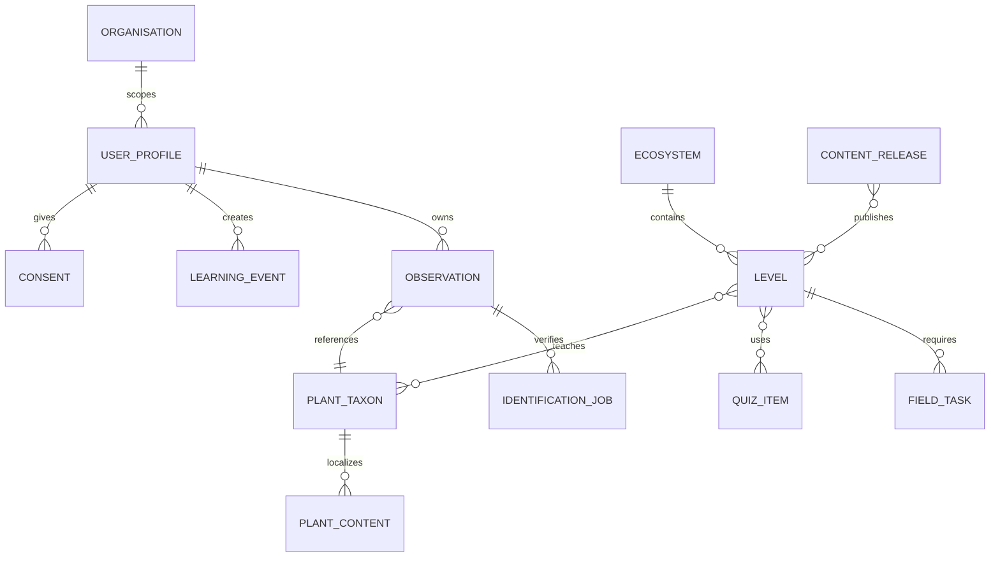

# Datenmodell

| Entität | Schlüssel/Attribute | Regeln |
|---|---|---|
| Organisation | ID, Name, Domains, IdP, Region, Status | delegierte Admin-/Reportgrenzen |
| UserProfile | interne ID, Keycloak `sub`, Locale, Organisation | keine Passwortdaten |
| Consent | Zweck, Textversion, Zeitpunkt, Status | getrennt, widerrufbar, nachweisbar |
| Ecosystem | Region, Saison, i18n, Medien, Status | n:m Taxa, 1:n Levelpfade |
| Level | Reihenfolge, Ziel, Regeln, Version | keine Zyklen, servervalidierter Abschluss |
| PlantTaxon | stabile interne ID, Synonyme, externe IDs | Namen nie Primärschlüssel |
| PlantContent | Locale, Merkmale, Ökologie, Warnungen, Quellen | review- und versionspflichtig |
| QuizItem | Typ, Lösung, Erklärung, Schwierigkeit, Kompetenz | reproduzierbare Bewertung |
| LearningEvent | Client-ID, Typ, Zeit, Level, Payload-Version | immutable und idempotent |
| Progress | materialisierter autoritativer Stand | aus Events reproduzierbar |
| Observation | Owner, Taxon, Datum, private Geodaten, Notiz | offline, exportierbar, löschbar |
| IdentificationJob | Status, Provider, Modell, Quote, Ergebnis | asynchron, idempotent, retrybar |
| ContentRelease | Version, Manifest, Hashes, Freigabe | atomare Aktivierung/Rückzug |
| AuditEvent | Akteur, Aktion, Objekt, Zeit, Ergebnis | keine sensiblen Payloadkopien |

Alle IDs sind nicht erratbare UUID/ULID-ähnliche Werte. Zeit wird intern als UTC gespeichert; Anzeige folgt Locale. Löschungen verwenden fachlich begründete Tombstones, bis alle Clients synchronisiert sind.
