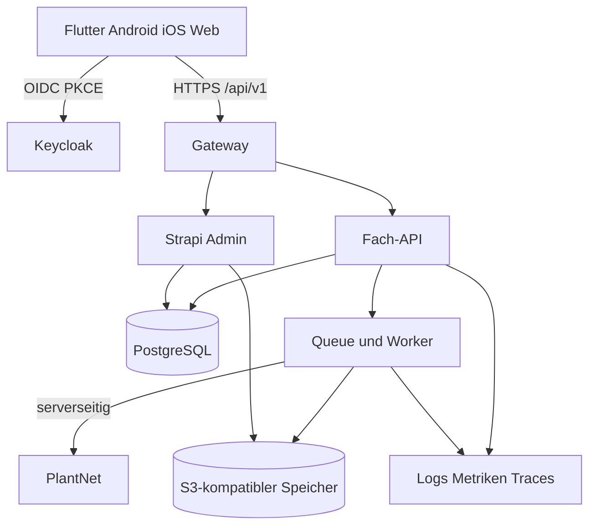

# Plattformarchitektur

## Prinzipien

- App-zentriert: Standard-CMS/Auth übernehmen Standardaufgaben; Individualcode konzentriert sich auf Lernen, Sync, Fortschritt, Herbarium und Identifikation.
- Backend-for-Frontend: Mobile Verträge und Domänenregeln liegen nicht in generischen CMS-CRUD-Endpunkten.
- Offline-first: Der Client reagiert lokal; Server und veröffentlichte Content-Version bleiben autoritativ.
- Asynchron: Identifikation, Medienvarianten, Exporte, Imports und Löschläufe sind Jobs.
- Offene Standards: REST/OpenAPI 3.1, PostgreSQL, S3, OIDC/OAuth 2.0 und SAML.
- Portabel: lokale Docker-Umgebung und produktive IaC müssen ohne proprietären Pflichtdienst rekonstruierbar sein.

## Datenzonen

| Zone | Enthält | Darf nicht enthalten |
|---|---|---|
| Keycloak | Identität, Provider, Realm-/Clientrollen, Sitzungen | Fortschritt, Fotos, Fundorte, Lerninhalte |
| Strapi/CMS | Taxonomie, Lerntexte, Quiz, Level, Medienrechte, Draft/Publish | Passwörter, private Beobachtungen, genaue Orte |
| Fach-DB | Profile, Einwilligung, Events, Fortschritt, Beobachtungen, Jobs, Audit | Passwort-Hashes externer IdPs, unkontrollierte CMS-Drafts |
| Public Content Bucket | veröffentlichte optimierte Medien | private Nutzerfotos |
| Private Observation Bucket | private Fotos/Exporte mit Zugriffskontrolle | öffentliche Direktlinks |
