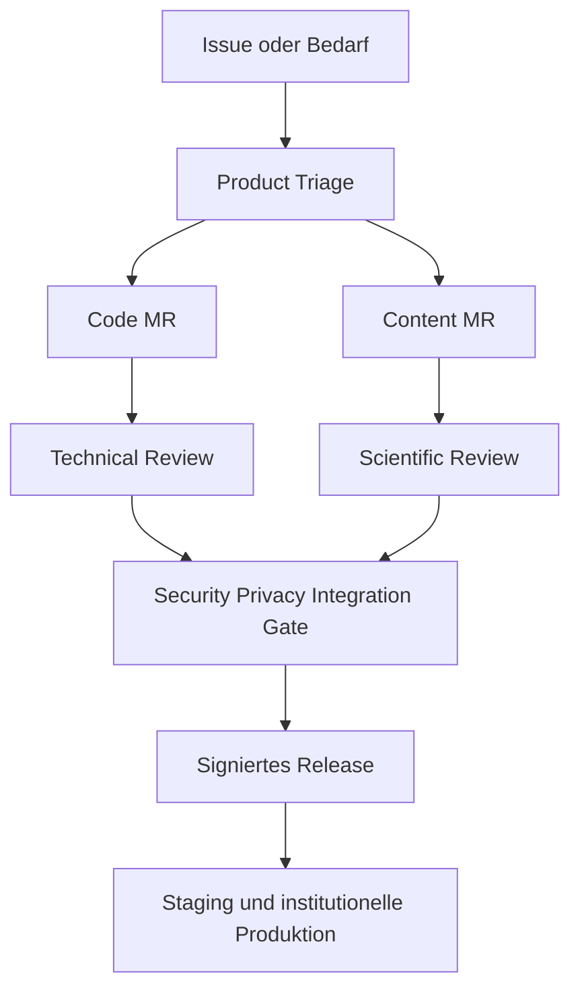

# Open-Source-Modell und Rollen

Plantini trennt drei Rollensysteme, die nicht miteinander verwechselt werden dürfen:

1. **Delivery-/Agentenrollen** unter `agents/`: bauen und prüfen das Produkt.
2. **Plattformrollen** unter `architecture/auth-and-roles.md`: regeln Rechte in App, CMS und API.
3. **Open-Source-Governance-Rollen**: entscheiden über Beiträge, Releases und langfristige Leitung.

Eine Person oder Institution kann mehrere Rollen besitzen, aber Interessenkonflikte, Vier-Augen-Prinzip und Produktionszugriff bleiben technisch getrennt.

## Governance-Rollen

| Rolle | Verantwortung | Entscheidungsrecht | Grenze |
|---|---|---|---|
| Steering Committee | Mission, Finanzierung, Partnerschaften, Marke, Eskalation | strategische Leitplanken und Ernennungen | kein Einzelmerge ohne Review |
| Product Steward | Roadmap, Scope, Nutzerwert und Requirement-Triage | Produktpriorität und Akzeptanz | keine technische Sicherheitsausnahme allein |
| Technical Maintainer | Architektur, Code, API, Migration, CI/CD | Merge nach Review, ADR-Vorschlag | keine fachliche Inhaltsfreigabe |
| Scientific/Content Board | Taxonomie, Botanik, Didaktik, Quellen, Medienrechte | fachliche Freigabe/Rückzug | keine System-/Identity-Administration |
| Security Team | vertrauliche Meldungen, Triage, Fix/Disclosure | zeitlich begrenztes Embargo/Notfallprozess | kleinster notwendiger Kreis |
| Release Manager | Version, Signierung, Changelog, Artefakte, Rollback | Veröffentlichung freigegebener Version | darf Gates nicht umgehen |
| Contributor | Code, Test, UX, Übersetzung, Dokumentation oder Content | Vorschlag über Issue/RFC/MR | kein automatischer Merge/Produktionszugriff |
| Institution Operator | eigene Instanz, IdP, lokale Rollen, Datenschutz und Support | lokale Konfiguration im Mandat | kein Zugriff auf andere Instanzen |

## Beitragsfluss

Code und Content besitzen getrennte Reviews, treffen aber vor Release an einer gemeinsamen Sicherheits-, Datenschutz- und Integrationsschranke zusammen. Ein öffentlicher Beitrag gewährt weder CMS-/IdP- noch Produktionszugriff.

## Vorteile

- mehrere Hochschulen können Wartung, Fachreview und Regionalisierung tragen
- Code, Lernlogik und Auswertungsdefinitionen bleiben wissenschaftlich referenzierbar
- neue Sprachen, Ökosysteme und Arten entstehen als geprüfte Contentpakete
- offene Standards und Exporte verringern Anbieterabhängigkeit
- Studierende können abgegrenzte reale Beiträge leisten
- öffentliche Prüfbarkeit wird mit vertraulicher Security Disclosure kombiniert

Diese Vorteile benötigen finanzierte Maintainerzeit, klare Marke/Lizenz, aktiven Code of Conduct, planbare Releases und Infrastruktur-/Securitybudget. Community-Arbeit ersetzt keinen verantwortlichen Betrieb.
