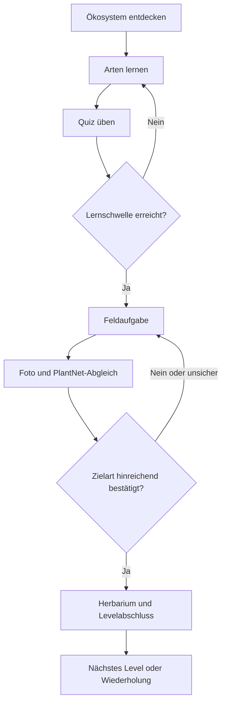
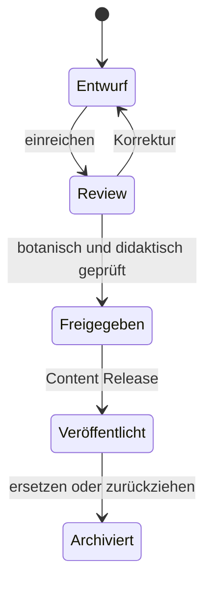

# Spiel- und Nutzungsabläufe

## Kernschleife

## Levelzustände

| Zustand | Eintritt | Übergang |
|---|---|---|
| gesperrt | Voraussetzungen fehlen | Freigabe nach konfigurierbarer Regel |
| aktiv | erste Einheit gestartet | Lernen, Quiz, Pause, Sync |
| feldbereit | Lern-/Quizschwelle erfüllt | Feldaufgabe oder weiteres Üben |
| Nachweis ausstehend | Foto lokal oder Job läuft | Ergebnis, Retry, Offline-Queue |
| abgeschlossen | Server bestätigt Abschluss | Erfolg, Herbarium, nächstes Level |
| Wiederholung fällig | Regel/Unsicherheitsprofil greift | fokussiertes Quiz ohne Abschlussverlust |

## Redaktion

Ein App-Client sieht ausschließlich Inhalte eines atomaren veröffentlichten Content-Releases. Drafts oder teilweise freigegebene Beziehungen dürfen nie im Manifest erscheinen.
