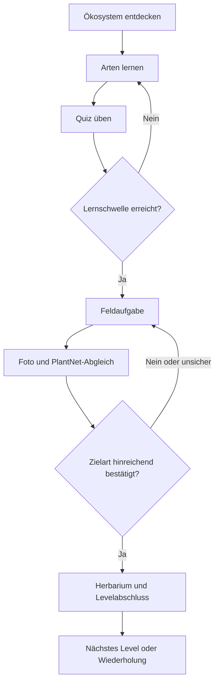
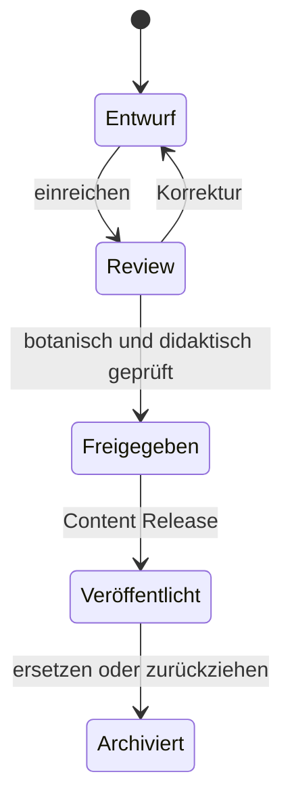

# Spiel- und Nutzungsabläufe

## Kernschleife

## Levelzustände

| Zustand | Eintritt | Übergang |
|---|---|---|
| gesperrt | Voraussetzungen fehlen | Freigabe nach konfigurierbarer Regel |
| aktiv | erste Einheit gestartet | Lernen, Quiz, Pause, Sync |
| feldbereit | Lern-/Quizschwelle erfüllt | Feldaufgabe oder weiteres Üben |
| Nachweis ausstehend | Foto lokal oder Job läuft | Ergebnis, Retry, Offline-Queue |
| abgeschlossen | Server bestätigt Abschluss | Erfolg, Herbarium, nächstes Level |
| Wiederholung fällig | Regel/Unsicherheitsprofil greift | fokussiertes Quiz ohne Abschlussverlust |

## Redaktion

Ein App-Client sieht ausschließlich Inhalte eines atomaren veröffentlichten Content-Releases. Drafts oder teilweise freigegebene Beziehungen dürfen nie im Manifest erscheinen.
# Glossar

| Begriff | Definition |
|---|---|
| Plantini | Produkt- und Projektname der offenen Artenlernplattform |
| Ökosystem | frei konfigurierbarer Lebensraum bzw. Lernkontext |
| Level | datengetriebener Lernpfad mit Arten, Quiz, Regeln und Feldaufgaben |
| Taxon | stabile fachliche Pflanzeneinheit; Name/Synonyme sind versionierte Attribute |
| Steckbrief | kuratierter, lokalisierter Lerninhalt zu einem Taxon |
| Feldaufgabe | reale Aufgabe mit einer oder mehreren erwarteten Zielarten |
| Beobachtung | privater Fund mit Foto, Datum, optionalem Ort und Notiz |
| Herbarium | persönliche Offline-Sammlung eigener Beobachtungen |
| Identifikationsjob | asynchroner Backend-Auftrag an PlantNet samt normalisiertem Ergebnis |
| Content Release | atomare, versionierte Menge veröffentlichter Inhalte und Medien |
| Learning Event | unveränderliches, idempotentes Ereignis für Lern-/Quizfortschritt |
| Fach-API / BFF | stabile API zwischen Flutter-App und Backendkomponenten |
| CMS | Strapi-basierte Redaktion für Inhalte, Medien und Veröffentlichung |
| IdP | Keycloak als zentrale Vertrauensstelle für Login und SSO |
| Organisation | Hochschule/Bildungseinrichtung mit delegierten Admin-/Reportrechten |
| Muss/Soll/Kann | Go-live-verbindlich / möglichst MVP / spätere Roadmap |
# MVP-Grenzen und offene Entscheidungen

Offene Punkte sind echte Gates. Ein Agent darf daraus keine verdeckte Architekturentscheidung machen.

| ID | Frage | Vorläufige Arbeitsannahme | Entscheider | Gate |
|---|---|---|---|---|
| OQ-01 | Bedeutet 25/50/75 Arten global kumulativ oder je Ökosystem? | Architektur unterstützt beides; Seed, Budget und Contentplanung rechnen bis Freigabe mit 75 eindeutigen Arten. | Product Manager + Scientific Board | vor vollständigem Content-Import |
| OQ-02 | Ist Isar auf Web produktionsreif genug? | Mobile: Isar. Web: Persistenzport; Spike gegen aktuelle Zielbrowser, sonst IndexedDB/Drift-WASM. | Orchestrator + Flutter Lead | Gate A |
| OQ-03 | Liegt die Fach-API als Strapi-Erweiterung oder separater TypeScript-Service vor? | Mit dünnen Strapi-Custom-Routes starten; nach Sync-/Worker-Spike entscheiden. | Orchestrator + Backend Lead | Gate A |
| OQ-04 | Welche Altersgruppen und Einwilligungsregeln gelten? | Keine öffentliche Profile/Fundorte; Forschungseinwilligung getrennt; genaue Regeln blockieren Pilot. | Product + Datenschutz/Recht | vor externem Pilot |
| OQ-05 | Welches PlantNet-Kontingent und welche Flora gelten? | Mock in Entwicklung; echter Dienst erst nach Vertrag, Quote und Attribution. | Product + Backend + Betrieb | vor Feldpilot |
| OQ-06 | Wie weit reicht Organisationsisolierung im MVP? | Rollen- und Berichtsscope, kein vollständiger SaaS-Mandant. | Product + Auth + Backend | vor Admin-Implementierung |
| OQ-07 | Welche Open-Source-/Contentlizenzen werden final verwendet? | Apache-2.0 für projektspezifischen Code; CC BY 4.0 für freigegebene Texte; Assetlizenz je Medium. | Steering Committee + Recht | vor öffentlichem Repository |
| OQ-08 | Welche Google-/Apple-/Hochschul-Provider gehen produktiv? | Lokaler Test-IdP zuerst; echte Clients/Redirects erst nach Domain- und Storefreigabe. | Auth Manager + Release Manager | vor Beta |

## Änderungsregel

Eine Entscheidung aktualisiert mindestens: ADR, betroffene CSV-Zeilen, Vertrag/Schema, Tests, Betrieb und Handoff. Bei Scopeänderung rebaselined der Product Manager Termin und Aufwand.
# Screenkatalog

Jeder Screen umfasst auch Loading-, Empty-, Offline-, Fehler-, Berechtigungs- und Accessibility-Zustände.

| ID | Screen | Kernaussage |
|---|---|---|
| S01 | Start / Onboarding | Idee, Sprache, Datenschutz, Alters-/Einwilligungsweg, Anmeldung |
| S02 | Anmeldung | E-Mail/Passwort, Google, Apple, institutioneller Login, Reset/Fehler |
| S03 | Home | nächster Schritt, Fortschritt, Lernserie, Offline-/Syncstatus, Erfolge |
| S04 | Ökosysteme | konfigurierbare Lebensräume, Saison, Download und Curriculum |
| S05 | Levelübersicht | 25/50/75, Lernziel, Voraussetzung, Fortschritt, Lernzeit |
| S06 | Lerneinheit | Bild, Name, Schlüsselmerkmale, Merkhilfe, Lebensraum und Quelle |
| S07 | Quiz | Bild-, Namens-, Merkmals-/Lebensraumfrage, Hinweis und Sofortfeedback |
| S08 | Quizabschluss | Ergebnis, unsichere Arten, Wiederholung und nächster Schritt |
| S09 | Pflanzenübersicht | Offline-Suche, Filter, Lernstatus und Ökosystembezug |
| S10 | Pflanzensteckbrief | Organbilder, Taxonomie, Merkmale, Verwechslung, Warnung und Quellen |
| S11 | Feldaufgabe | Zielart, Sicherheit, Nachweis, Standortoption und Kamera |
| S12 | Kamera / Aufnahmehilfe | Organwahl, Licht-/Qualitätstipps und bis zu fünf Bilder |
| S13 | Identifikation läuft | Queue-/Jobstatus, Offline-Warten, Verlassen und spätere Rückkehr |
| S14 | Identifikationsergebnis | Kandidaten, verständliche Unsicherheit, Zielabgleich und Retry |
| S15 | Herbarium | private Sammlung, Raster/Liste, Suche/Filter und Offline-Status |
| S16 | Herbariumdetail | Foto, Steckbrief, Datum, optionaler Ort, Notiz, Historie, Export/Löschen |
| S17 | Fortschritt / Erfolge | Level-, Arten- und Kompetenzfortschritt, Wiederholung, Zertifikat |
| S18 | Downloads / Sync | Pakete, Größe, WLAN-Regel, Queue, letzter Sync und Konflikte |
| S19 | Profil / Datenschutz | Locale, Logins, Einwilligung, Export, Löschung und globale Abmeldung |
| S20 | Hilfe / Feedback | Grenzen, Sicherheit, Inhaltsfehler und optionale Diagnose |

## Visuelle Quelle

- Gesamtboard: `references/design/Plantini_Screens_v2_Full.png`
- Lernen: `references/design/Plantini_Screens_v2_Lernen.png`
- Expedition: `references/design/Plantini_Screens_v2_Expedition.png`
- offene HTML-Quelle: `references/design/Plantini_Screens_v2.html`
- Canva-Links und Designhinweise: `references/design/Plantini_Canva_Sources.md`

Die Mockups konkretisieren Informationshierarchie und Designsystem. Verbindlich bleiben Anforderungen, Zustandsmodell und Accessibility-Abnahme.
# Vision und Scope

Plantini verbindet Artenbildung, reale Naturerfahrung und wissenschaftlich nachvollziehbare Lerninhalte. Die App richtet sich zunächst an junge Menschen und Bildungseinrichtungen im deutschsprachigen Raum, soll aber Regionen, Sprachen, Taxonomien und Rechtsinformationen vollständig datengetrieben erweitern können.

## Kernreise

Lernende wählen ein Ökosystem und Level, lernen kuratierte Pflanzen, üben mit Quizmodi, erfüllen eine Feldaufgabe, fotografieren eine Pflanze, erhalten einen probabilistischen PlantNet-Abgleich und speichern einen bestätigten Fund privat im Herbarium.

## MVP

- Flutter-App für Android, iOS und Web
- drei Ökosysteme und drei aufeinander aufbauende Level
- 25/50/75 Arten gemäß noch freizugebender Zähllogik
- Steckbriefe, Bilder, Merkmale und mehrere Quizmodi
- Fortschritt, Wiederholung, Erfolge und Levelabschluss
- Foto, optionaler Standort, PlantNet-Abgleich und persönliches Herbarium
- Offline-Inhalte, Offline-Fortschritt, Queue und Konfliktbehandlung
- klassischer Login, Google, Apple und erweiterbares Hochschul-/Schul-SSO
- vollständige dynamische Administration, Rollen, Review/Publish und Dashboard
- Open-Source-Code, Dokumentation, Tests, GitLab CI/CD und reproduzierbarer Betrieb

## Nicht-Ziele im MVP

- soziales Netzwerk, öffentlicher Fundort-Feed oder kompetitive Ranglisten
- rechtlich oder sicherheitskritisch garantierte Artenbestimmung
- automatische Veröffentlichung generierter, ungeprüfter Inhalte
- vollständige Citizen-Science-Publikation an GBIF
- universeller Multi-Tenant-SaaS-Marktplatz
- mehrere Identifikationsprovider im MVP; die Adaptergrenze wird dennoch vorbereitet

## Produktprinzipien

1. Lernen vor Technikshow: Jede Funktion muss einen Lern- oder Feldnutzen haben.
2. Unsicherheit ehrlich erklären: Ein Score ist keine botanische Gewissheit.
3. Offline zuerst: Naturorte sind nicht zuverlässig vernetzt.
4. Privat standardmäßig: Fotos und genaue Fundorte gehören den Nutzenden.
5. Inhalt ohne App-Release: Ökosysteme, Level und Arten bleiben CMS-gesteuert.
6. Offen entwickeln, geschützt betreiben: Quellcode offen; Produktionsdaten und Zugänge strikt getrennt.
